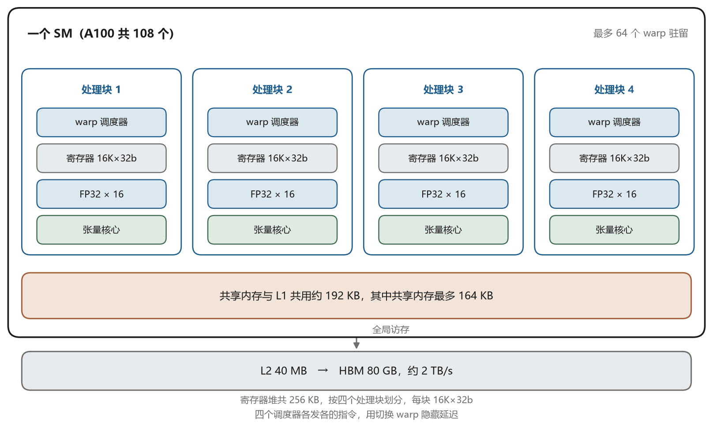

# 一块 GPU 的构造

RTX 4090 的加速频率标到 2.5 GHz 以上，A100 的 boost 频率只有 1.41 GHz。两个数字摆在一起，很容易得出前者更快的结论。可把同一个 fp16 矩阵乘分别放到两张卡上，A100 的吞吐反而是 4090 的两倍左右。频率高了一倍，算得却更慢，这件事用“核心多不多”也解释不通，4090 的流处理器数量比 A100 还多。

差在别的地方。频率只说明流水线每秒跳多少次，不说明每一次跳动能塞进多少数据、数据从显存到计算单元要等多久、一张卡上同时有多少活能干。同一块芯片里，标量单元、张量单元、缓存和显存带宽是四套独立的资源，它们的比例决定了什么样的计算能跑满，什么样的计算只能跑到十分之一。理解 GPU 的构造，本质上是把这四套资源分开看，而不是盯着一个总数字。

## 一个 SM 里有什么

NVIDIA 把 GPU 切成若干流式多处理器（streaming multiprocessor，SM）。A100 有 108 个 SM，RTX 4090 有 128 个，H100 的 SXM 版本有 132 个。每个 SM 是一个可以独立干活的小处理器，有自己的调度器、寄存器堆、共享内存和计算单元。写 kernel 的人关心的不是整块芯片，而是一个 SM 里能同时装下多少线程、这些线程怎么被发射出去。

往上还有一层组织。SM 被编成图形处理簇（graphics processing cluster，GPC），每个 GPC 里有若干个 SM，共享一部分前端资源。GPC 的数量决定了芯片能被切成几个独立工作的区域，这也是多实例 GPU 那种“一张卡切成七份”功能的物理基础。对于写算子的人，GPC 平时是透明的，只有在跨 GPC 通信、L2 分片访问不均的时候才会露出来。

一个 SM 通常分成四个处理块，每个处理块有自己的 warp 调度器和一小片寄存器。调度器每个周期从驻留的 warp 里挑一个能执行的，发射一条指令。计算单元按块摆开，每个处理块里有若干 FP32 单元、整数单元、特殊函数单元，以及一个张量核心（Tensor Core）。

A100 的一个 SM 有 64 个 FP32 单元、4 个张量核心、256 KB 寄存器堆，共享内存和一级缓存共用 192 KB 左右的片上空间，共享内存最多能划到 164 KB。RTX 4090 的一个 SM 有 128 个 FP32 单元，寄存器堆同样是 256 KB，共享内存的额度小一些，约 100 KB。单看 FP32 单元，4090 的 SM 是 A100 的两倍，整卡 16384 个对 6912 个，标量浮点算力也确实是四倍多的差距。

张量核心走的是另一条路。A100 每 SM 每周期能做 1024 次 fp16 乘加，4090 是 256 次。4090 靠更多的 SM 和更高的频率把差距拉回来一些，稠密 fp16 张量算力大约是 A100 的一半，实际跑起来因为带宽只有一半，通常还是落后。稀疏算力是另一回事，4090 标称的 330 TFLOPS 是开启 2:4 稀疏后的数字，不能和 A100 的稠密 312 TFLOPS 直接比。

还有一个容易忽略的细节，处理块里的几类单元不是等比例的。以 A100 为例，一个处理块有 16 个 FP32 单元，做一次单精度加法要占满 16 个 lane，一个 warp 需要两个周期；整数单元少一半，整数运算的吞吐相应减半；算 `exp`、`rsqrt` 这类特殊函数要经过专门的单元，吞吐只有普通浮点的四分之一到八分之一。一段看起来全是浮点的代码，如果里面混着地址计算和超越函数，实际吞吐可能只有峰值的三分之一。这也是为什么 kernel 优化到最后要去数指令，而不是只看浮点运算总数。

## warp 是执行的最小单位

SM 调度器发射的单位不是线程，是 warp。一个 warp 固定 32 个线程，它们共用一条指令，各自用自己的数据。这就是单指令多线程（single instruction multiple threads，SIMT）的含义。32 个线程各自算各自的 `a[i] + b[i]`，硬件只发一条加法指令，32 个 lane 同时做完。

固定 32 个线程带来一个麻烦。代码里一旦出现分支，一个 warp 里的线程走向不同路径，硬件只能把两条路径各跑一遍，把不参与的 lane 屏蔽掉。这叫线程束分歧（warp divergence）。分歧本身不致命，代价是有效吞吐按路径数打折。一段 if/else 两边各占一半的代码，warp 要执行两遍，吞吐掉一半。写 kernel 时把分支改成谓词选择或者让同一条 warp 内的线程走同一条路，省下来的就是这部分。

更大的问题是延迟。一次全局内存访问要几百个周期，一次共享内存访问几十个周期，算术指令几个周期。CPU 用乱序执行和巨大的缓存掩盖这个差距，GPU 不这么做。GPU 的调度器是顺序发射的，一个 warp 的指令要等前一条的结果，它等的时候，调度器直接换另一个 warp 上来跑。所以 SM 上要驻留足够多的 warp，让调度器手上总有活。

一个 SM 最多驻留 64 个 warp，也就是 2048 个线程。实际能驻留多少由三样东西卡住，线程数上限、每线程的寄存器用量、每线程块的共享内存用量。一个线程用 64 个寄存器，2048 个线程就要 128K 个寄存器，SM 只有 64K 个 32 位寄存器，于是只能装 1024 个线程，占用率一半。这是一个很实际的约束，很多 kernel 调到最后发现瓶颈是寄存器，不是算法。

算一下要多少 warp 才够。假设一个 warp 每做 8 条算术指令就要等一次 500 周期的全局访存，而算术指令每个周期发一条。要盖住 500 个周期的空档，需要大约 60 个 warp 轮转。SM 的上限是 64 个，所以这种访存密集的代码几乎要把占用率堆满才能跑出带宽。反过来，一个全是寄存器计算的 kernel，8 个 warp 就能把流水线喂饱，剩下的寄存器全用来做更大的 tile 更划算。占用率不是越高越好，它是和指令组合一起看的量。

线程块（thread block）是线程和 SM 之间的中间单位。一个块里的线程可以被同步，可以共享同一片共享内存，硬件保证它们同时驻留在一个 SM 上。块一旦被分配到某个 SM，就会一直待到执行完，中途不会搬家。所以块的大小决定了调度粒度，块太多而每个块太小，SM 上装满之后剩下的块只能排队，最后一批块填不满所有 SM，收尾的那段时间有一半单元在空转。这个现象叫尾效应（tail effect），在形状不规整的算子里很常见，2048 个块分给 108 个 SM，最后 104 个 SM 只能看着 4 个 SM 干活。

## 从芯片到显存的一条路

一个线程发出的地址要经过好几层才落到底下的存储。离计算单元最近的是寄存器，每个线程私有，访问没有额外延迟，容量按线程算只有几十到两百多个。往外是共享内存，一个线程块内的线程共享，容量几十到一百多 KB，延迟二十到三十个周期。共享内存和一级缓存在物理上是同一块 SRAM，划分方式可配，这也是为什么共享内存开得越大，能当缓存用的空间越小。

再往外是 L2，整块芯片共享，A100 有 40 MB，RTX 4090 有 72 MB，延迟两百个周期左右，带宽比显存高一个量级。最外层是高带宽显存（high bandwidth memory，HBM）或者 GDDR，A100 80 GB 的版本带宽约 2 TB/s，RTX 4090 24 GB 的 GDDR6X 约 1 TB/s。再往外就是 PCIe 和网络，PCIe 4.0 的 x16 单向约 32 GB/s，只有显存带宽的六十分之一。这个比例决定了任何跨主机的数据搬运都必须被摊薄，否则再快的卡也只能空转。

一条全局访存指令发出后，数据从显存读上来，经过 L2、L1，最后进寄存器，这个过程中 warp 是挂起的。要让它挂得值，一次读上来的数据得被用够多次。这就是后面反复出现的复用概念。一个 32 线程的 warp 读 32 个连续的 float，一共 128 字节，正好是一条缓存行的宽度，硬件合并成一次事务，效率百分之百。如果这 32 个线程读的是跨步为 32 个 float 的地址，就变成 32 条独立的事务，同样的数据量要花 32 倍的带宽。同一份代码，改一个索引写法，带宽差三十倍。

L2 的命中率决定了这条路的实际代价。A100 的 40 MB L2 是分片的，每个分片靠近一组显存控制器，地址按哈希散到各个分片。一个算子如果反复访问同一块数据，比如矩阵乘里同一行 A 被多个块重复读取，这些重复请求大部分会落在 L2 里，显存带宽的压力就小得多。反过来，一个大模型的权重在推理时只被读一次，L2 再大也留不住，这时候的瓶颈就是纯粹的显存带宽，算力再高也填不满。判断一个算子有没有 L2 红利，看它的数据块能不能塞进 L2，以及访问顺序会不会把已经读进来的块挤出去。

## 一张卡不是一个数

把 A100 和 RTX 4090 放在一张表里，能看清“卡”这个词有多含糊。

表 1-1　两张卡的几个维度（标称值，来自厂商公开规格）

| 维度 | A100 80GB SXM | RTX 4090 |
|---|---|---|
| SM 数 | 108 | 128 |
| FP32 单元 | 6912 | 16384 |
| fp16 张量算力（稠密） | 312 TFLOPS | 约 165 TFLOPS |
| 显存容量 | 80 GB HBM2e | 24 GB GDDR6X |
| 显存带宽 | 约 2 TB/s | 约 1 TB/s |
| 卡间互联 | NVLink，约 600 GB/s | 无，走 PCIe |

标量算力 4090 领先，张量算力两者接近，带宽和容量 A100 领先一倍到三倍，互联能力差一个数量级。这就是为什么同一个模型在两张卡上的表现可以完全不按“跑分”排序。一个 7B 参数的模型用 fp16 存下来是 14 GB，4090 装得下，但留给中间结果和 KV 缓存的只剩不到 10 GB，批大小上不去；A100 装得下同样模型，还能开更大的批。一个 batch 很大的卷积网络，4090 的标量算力能发挥出来；一个受带宽限制的逐元素算子，A100 的带宽直接变成两倍速度。

这张表里的数字都是标称值，标称值和实际值之间还隔着一层功耗。boost 频率是单核轻载时能短时间冲到的频率，一张卡持续跑满张量核心，功耗会顶到上限，频率自动降下来。A100 的整卡功耗上限 400 W，4090 是 450 W，两者都会在持续负载下降频，降多少取决于散热。机房里把几张卡挤在一起，进风温度高十度，能维持的频率就低一截。所以同一个 kernel 在两台机器上跑出不同的数字，先看散热和功耗墙，再怀疑代码。

这四套资源还带来一个推论，GPU 的性能问题不能笼统地问“够不够快”，只能问“哪一项不够”。算力不够，就换更低的精度或者更高效的指令；带宽不够，就减少访存或者提高复用；容量不够，就换卡、切分模型或者压权重；调度不够，就想办法把 kernel 合起来或者用多个流填满空隙。

判断瓶颈需要一个能比较不同资源的尺子。寄存器、共享内存、L2 和显存之间的距离不是线性的，它们各自有容量、带宽和延迟三个坐标，只有把这三个坐标对齐，才知道一个算子该往哪一级存储上放。下一章就把这些层级摆成一张阶梯。
