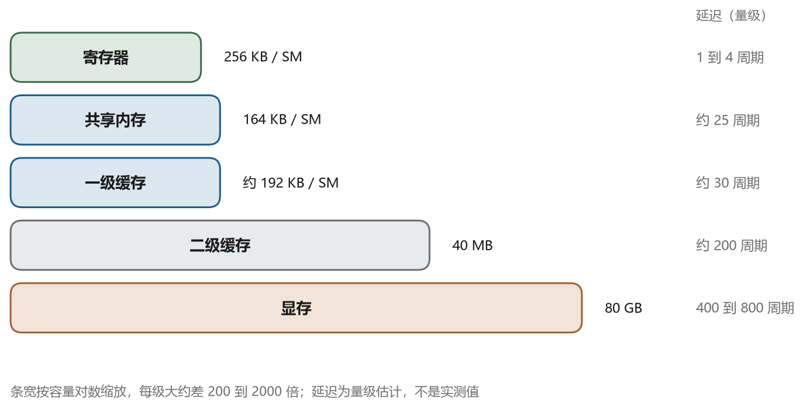
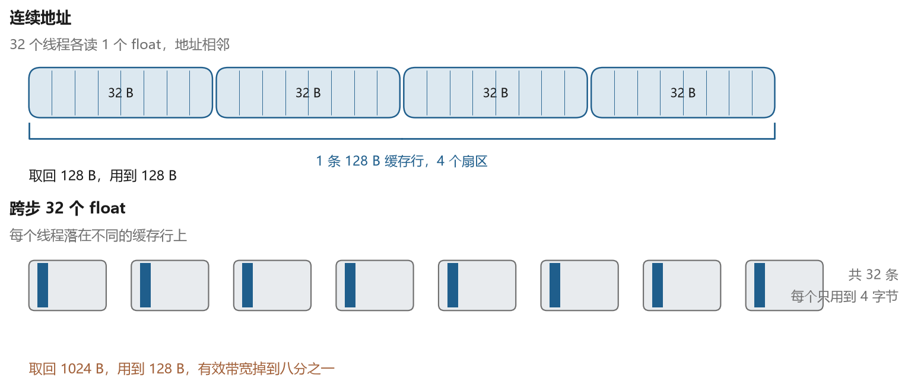

# 存储的阶梯

假设有人写过一版矩阵转置，下面的数字只为说明量级。4096×4096 的 fp32，读一遍写一遍，理论上是 128 MB 的搬运量，在一块带宽 2 TB/s 的卡上应该跑 60 多微秒。他的第一版跑了 1.8 毫秒，差了三十倍。代码没有写错，每个元素都转置对了，问题出在第二个循环的索引上。第一版按行读、按列写，写入的时候 32 个线程落到了 32 条不同的缓存行上，每次只写 4 个字节，却要占一整条 128 字节的通道。把读和写都改成按行，中间用一片共享内存做转置，时间掉到 0.11 毫秒。

这个例子说明一件事。GPU 的算力是按“每周期能做多少次乘加”算的，但一个 kernel 能不能拿到这份算力，取决于数据能不能按时送到。从寄存器到显存，每一级的容量、带宽、延迟都差一个量级，写代码的人要做的，是让热数据待在近处，让远处的数据一次搬够。

## 五级存储，三个坐标

一个线程能看到五级存储。每一级都有自己的容量、延迟和带宽，三者不同步变化，这就是“阶梯”的含义。

可以用一个办公室打比方。寄存器是手边的便签，写上去就能看，但只贴得下几张；共享内存是同一张桌子上的资料夹，组里的人共用，伸手就能翻；一级缓存是隔壁的共享柜，走几步；L2 是楼层的公共库，要走一段路，但一层楼的人都用得上；显存是整个公司的仓库，去一趟要十几分钟，不过里面能堆几千箱。容量越大、离得越远、拿一次越贵，这个顺序在每一代 GPU 上都没变过。

表 2-1　各级存储的量级（以 A100 为例，数值为公开规格的近似值）

| 层级 | 谁可见 | 容量 | 延迟（周期） | 带宽量级 |
|---|---|---|---|---|
| 寄存器 | 线程私有 | 256 KB / SM | 几个 | 最高，按指令取 |
| 共享内存 | 线程块 | 最多 164 KB / SM | 约 25 | 约 128 B / 周期 / SM |
| 一级缓存 | SM | 与共享内存共用 | 约 30 | 约 128 B / 周期 / SM |
| 二级缓存 | 整卡 | 40 MB | 约 200 | 数 TB / s |
| 显存 | 整卡 | 80 GB | 400 到 800 | 约 2 TB / s |

容量上也是同样的台阶。寄存器加上共享内存不到 0.5 MB，L2 是 40 MB，显存 80 GB，相邻两级差了两百到两千倍。这个比例决定了缓存只能装下工作集的一小片，一个算子要么把自己的数据切成能塞进上一级的块，要么就得反复回显存取。这里说的“工作集”（working set）指一段连续计算里真正会被反复碰到的那部分数据，不是整个张量的大小。一个 4096×4096 的 fp32 矩阵是 64 MB，但算一个 128×128 的输出块时，工作集只有 A 的 128 行加 B 的 128 列，加起来几 MB，能塞进 L2。判断一个算子有没有缓存红利，看的是工作集，不是权重总量。

128 字节的缓存行和 32 字节的扇区不是随便定的，它对应着显存颗粒一次突发的数据量，硬件按这个粒度搬运最省事。DRAM 内部按行和列寻址，一次打开一行再连发若干个字，比每次重新开行便宜得多，所以控制器宁愿一次多拿一点。代码里的访问模式如果和这个粒度对不上，浪费就从这里开始。

把共享内存的带宽乘上 SM 数量和频率，108 个 SM 每周期各搬 128 字节，1.41 GHz 下合计约 19 TB/s，接近显存带宽的十倍。寄存器更夸张，一个 SM 每周期能读几千字节。也就是说，同一份数据放在不同的层级，喂给计算单元的速度能差十倍以上。这就是为什么分块（tiling）几乎是所有高性能算子的共同结构，把一块数据搬进共享内存，然后在里面反复用。

一级缓存和共享内存共用一块 SRAM，划分比例可以在启动 kernel 时指定。给共享内存多划一点，缓存就少一点，反过来也一样。很多算子其实没怎么用共享内存，却把默认划分调成了偏缓存，效果立竿见影。判断标准很简单，看 kernel 里 `__shared__` 声明了多大，剩下的都可以留给缓存。

延迟和带宽是两件事，初学者容易混。带宽说的是单位时间能搬多少，延迟说的是发出请求到拿到数据要等多久。打个比方，带宽是高速公路每小时能过多少辆车，延迟是一辆车从入口开到出口要多久。加宽车道能提高带宽，不影响任何一辆车的行程时间；提高限速能缩短延迟，但如果车流已经堵死，每小时过的车数还是上不去。GPU 处理延迟的办法不是加快它，而是用大量并发的请求把它盖住。一个 SM 上几十个 warp 同时挂着访存，显存控制器排队处理，总的吞吐由带宽决定，单个请求等多久反而不重要。这也解释了一个现象，一个带宽利用率 90% 的 kernel，单个 warp 的访存延迟可能长达上千周期，因为排队的人太多。

反过来，如果一个 kernel 的并发不够，比如只有几个 warp 在跑，或者每个 warp 的访存地址互相依赖，那么它等的就是延迟而不是带宽，表现出来是“显存带宽只用了 20%，但就是快不起来”。这两种情况要改的地方完全不同，前者要减少搬运，后者要增加并行或者提前取数。

把周期换成时间更直观。A100 的 boost 频率是 1.41 GHz，一个周期约 0.71 纳秒。共享内存 25 个周期是 18 纳秒，L2 的 200 个周期是 142 纳秒，显存按 500 个周期算是 355 纳秒。一个 warp 发出一次全局读，到数据可用要等三百多纳秒，这段时间够算几百次乘加了。如果它干等着，等于白白扔掉几百个发射机会，所以硬件宁愿让几十个 warp 同时挂着，把这三百多纳秒用别人的活填满。

## 合并访问：一个 warp 读几条通道

显存不是按字节随机访问的，它的最小搬运单位是 32 字节的扇区（sector），四条扇区拼成一条 128 字节的缓存行（cache line）。一个 warp 的 32 个线程各读一个 float，一共 128 字节，如果地址连续，硬件把这 32 个请求合并成 4 个扇区、1 条缓存行，一次搬完。这叫合并访问（coalesced access）。

如果地址不连续，比如每个线程读的地址相隔 128 字节，32 个线程就落在 32 条不同的缓存行上，硬件要发 32 次请求，搬回 1024 字节，而线程真正用到的只有 128 字节。带宽放大了八倍，有效带宽掉到八分之一。跨步为 32 个 float 的读法在按列遍历二维数组时最常出现，因为行优先存储下，同一列相邻两行的元素正好隔着一行的长度。

跨步不一定是 32。跨步为 8 个 float 时，4 个线程共用一个 32 字节扇区，32 个线程需要 8 个扇区，放大两倍。跨步为 2 时放大到四倍。判断方法很简单，把一个 warp 内 32 个地址画出来，看它们落在几个 32 字节的格子里，格子的数量就是请求数。

把这两个数字换算成带宽，能看清差在哪里。4096×4096 的 fp32 矩阵是 64 MB，读一遍写一遍 128 MB。1.8 毫秒对应 71 GB/s，只有显存带宽的百分之三；0.11 毫秒对应 1.16 TB/s，到了带宽的一半以上。同一块卡，同一份数据量，一个写法用掉了带宽的三十分之一，另一个用掉一半，差别全在请求怎么落到扇区上。

除了合并，还有对齐和宽度。一个 float4 向量化加载，一个线程一次读 16 字节，32 个线程就是 512 字节，四条缓存行，指令数只有标量加载的四分之一。省下来的不只是指令，还有地址计算和寄存器里的搬运。所以高性能 kernel 里常见 `float4`、`int4` 这样的类型，前提是数据在显存里按 16 字节对齐。分配显存时用 `cudaMalloc` 拿到的一般是 256 字节对齐，偏移一个 float 之后就不再对齐，这也是很多“把一个切片送进 kernel”的代码突然变慢的原因。

对齐对合并访问也有影响。一个 warp 读 32 个连续的 float 本来是 128 字节，正好四个扇区；如果起始地址没落在 32 字节边界上，同样 128 字节的数据就会跨到第五个扇区，硬件得搬 160 字节，多出四分之一。数据量越小，这种溢出占比越高，一个 4 字节的偏移就能让带宽掉一成。

## 共享内存的 32 个 bank

共享内存被切成 32 个 bank，每个 bank 4 字节宽，地址按 4 字节为单位轮流分配，第 k 个字落在第 k 模 32 个 bank 上。一次访问中，如果 32 个线程各落在不同的 bank，硬件一个周期搬完；如果有两个线程落在同一个 bank 的不同地址上，就是冲突（bank conflict），要排队，最坏情况 32 个线程全部落在同一个 bank，一次访问拆成 32 次。

把它想成银行大厅的 32 个窗口。每个人办一件事，如果 32 个人各排一个窗口，一轮就办完；如果全挤在同一个窗口，其他窗口全空着，也只能一个一个来。冲突的代价不是多搬了数据，而是把本来能并行的一次访问拆成了串行的多次。

转置是最典型的例子。把 32×32 的块读进共享内存，按行写进去，每个线程写自己那一列，这一步没问题。读出来的时候按列读，第 i 个线程读 `tile[i][j]`，同一时刻 32 个线程的 j 相同、i 从 0 到 31，地址间隔正好 32 个字，全部落在同一个 bank 上，32 路冲突。

办法是加一列。把共享内存声明成 `[32][33]`，每行的跨度从 32 变成 33，第 i 行第 j 列落在 `i*33+j`，同一个 j 下 i 每加一，地址加 33，模 32 之后每次偏移 1，32 个线程正好铺满 32 个 bank。多出来的那一列不存数据，只为了让跨度变成奇数。这个技巧在几乎所有共享内存分块里都会用到，代价是每行浪费 4 字节。

共享内存的分配有粒度，每个块申请的量会向上取整到 128 字节或者 8 KB，具体看架构。这一点在小块上会放大浪费，一个块申请 33 KB，按 8 KB 取整变成 40 KB，SM 上能装的块数就少了一个。所以共享内存用量要按“能装几个块”倒着算，而不是看单个块够不够用。多申请 1 KB 导致占用率掉一档，这种事在调 kernel 时经常遇到。

另一条路是打乱索引（swizzle），用异或把行号和列号混起来，让访问自然分散。CUTLASS 这类库用的是更复杂的 swizzle 函数，目的相同，在不浪费空间的前提下避开冲突。原理不复杂，本质是让“同一时刻被访问的 32 个地址”在模 32 之后各不相同。

共享内存还有一个隐性成本，同步。写进去之后要 `__syncthreads()` 才能读，一次同步要求块内所有线程到达同一个点。块越大，同步的代价越高，而且同步前后的指令没法重叠。很多 kernel 的共享内存版本比寄存器版本慢，原因不是搬得多，而是同步太多，每次分块都要停下来对齐。

## 占用率是一笔预算

占用率（occupancy）指一个 SM 上实际驻留的 warp 数占上限的比例。上限是 64 个 warp，也就是 2048 个线程。实际驻留多少，由三样资源里最紧的那一样决定。

假设一个 kernel 每个线程用 40 个寄存器，块大小 256 个线程。一个块要 10240 个寄存器，SM 有 65536 个，能装 6 个块，1536 个线程，48 个 warp，占用率 75%。如果每个线程用 64 个寄存器，一个块要 16384 个，只能装 4 个块，1024 个线程，占用率 50%。再看共享内存，如果每个块要 48 KB，164 KB 只够 3 个块，768 个线程，占用率 37%，这时候寄存器还富余，卡住的是共享内存。两个约束取小的那个。

调占用率的常见手段是限制寄存器用量。给 kernel 加 `__launch_bounds__(256, 6)`，编译器会按“至少 6 个块”倒推可用的寄存器上限，超出的部分就溢出（spill）到本地内存。本地内存名字里带“本地”，实际上落在显存里，一次溢出读写要走 L2 甚至 HBM，代价比多用一个寄存器大得多。用 `-Xptxas -v` 能看到每个 kernel 的寄存器用量和溢出字节数，溢出不为零通常意味着改错了方向，应该缩小 tile 或者改写逻辑，而不是硬压。

块大小的选择还有一条不太直观的约束。一个 SM 同时能驻留的线程块数量有上限，多数架构是 32 个。块太大，线程数先到了 2048 的上限，块数根本用不满；块太小，比如每块 32 个线程，即便块数堆到 32 个也只有 1024 个线程，占用率被块数卡住。128 和 256 这两个值之所以常见，是因为它们能把线程数、寄存器、共享内存三项额度同时用满，又不会因为块数太少而在收尾时浪费。块大小调错的表现很典型，profile 里 SM 的驻留线程数上不去，但寄存器并没有超，这时候要去数块数。

把账倒过来算会更清楚。想让 64 个 warp 全部驻留，2048 个线程平分 65536 个寄存器，每个线程最多 32 个。这对矩阵乘这类要在寄存器里放一大片累加器的 kernel 是不够的，一个 128×128 的块、256 个线程，每个线程要负责 64 个输出元素，光累加器就要 64 个寄存器，加上地址和临时变量轻松过百。于是矩阵乘的占用率通常只有 25% 到 50%，这不是写错了，而是用占用率换了寄存器级的数据复用。它靠每个线程手上有很多独立的乘加来填流水线，不靠 warp 数量。

占用率高不等于快。一个算术密集、访存很少的 kernel，8 个 warp 就能把发射口喂饱，此时多出来的寄存器用来放更大的 tile，反而能让每个线程少读几次共享内存。一个访存密集的 kernel，warp 少了盖不住延迟，占用率就是硬指标。判断该往哪边走，要回到上一章的算术强度和访存比例，也就是下一章要搭的那把尺子。
