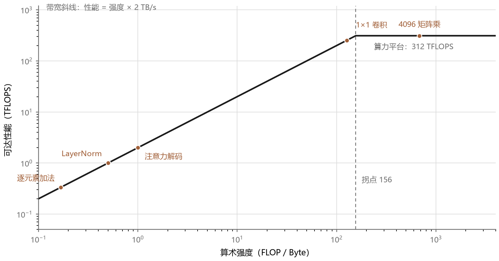
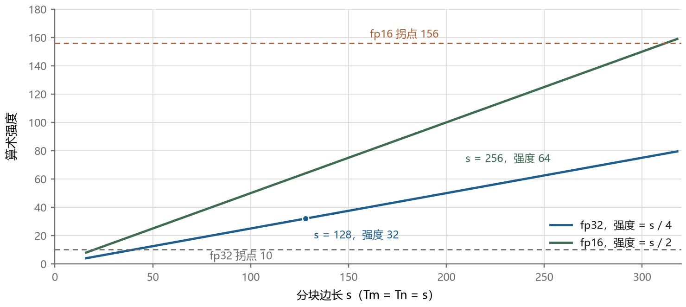

# 用 roofline 判断瓶颈

同一个模型，两个 kernel，在 Nsight 里看到的 SM 利用率都是 70% 左右，一个跑到了峰值算力的 80%，另一个只有峰值的 3%。如果只看利用率，两个 kernel 都“很忙”，可忙的事情不一样。前者在算，后者在等数据，等待的时间被算进了“活跃”里。要区分这两种忙，需要一个能把算力和带宽放在同一张图上的坐标。

roofline 模型就是这张图。它横轴放算术强度，纵轴放可达性能，用两条线把整个空间切成两半，一半的 kernel 受带宽限制，另一半受算力限制。它不能预测一个 kernel 具体跑多少毫秒，但能在一分钟内回答一个更有用的问题，这个算子还有多少空间，以及空间要从带宽里挤还是从指令里挤。

## 算术强度

算术强度（arithmetic intensity）是一个比值，浮点运算次数除以访存字节数。

$$
I = \frac{\mathrm{FLOP}}{\mathrm{Bytes}}
$$

分子按乘加算两次运算。一个向量加法 `c[i] = a[i] + b[i]`，每个元素 1 次加法，读 8 字节写 4 字节，强度是 `1/12`。一个 fp32 的矩阵乘，`2MNK` 次运算，读三个矩阵共 `4(MK + KN + MN)` 字节，强度随规模增长。

强度低意味着每搬一个字节只做很少的计算。这类算子天生受带宽限制，卡有多少带宽就能跑多快，算力再高也用不上。强度高意味着数据搬进来之后被反复使用，瓶颈转移到计算单元，这时候才轮到讨论峰值算力和指令效率。

强度的口径要先说清楚，否则算出来的数对不上。分子只算真正的乘加，不算地址计算和类型转换；分母只算必须从显存搬的字节，不算重复读。这两个约定都是理想化的，真实的 kernel 两头都会多花，但用来比较不同算子已经够了。

字节数由精度决定，这件事在后面几册会反复出现。同一个矩阵乘，权重从 fp32 换成 fp16，字节数减半，强度翻倍，拐点没有变，可算子在图上往右挪了一大格。换成 int8 再翻一倍。量化能提速，一部分原因是算力变强，更大的一部分原因是在同样的带宽下搬运的字节少了，原来卡在斜线上的算子挪到了平台线上。

同一个算子，强度可以因为写法不同差很多。一个 4096×4096×4096 的 fp32 矩阵乘，从公式算强度是 683，看起来非常高，可一个朴素的三重循环实现只跑到峰值的百分之一。原因不是字节数算错了，而是朴素实现里每个输出元素都要从显存重新读一遍 A 的一行和 B 的一列，真正发生的访存远多于公式里的下界。公式算的是“至少搬多少”，实际搬多少取决于分块。

## 带宽斜线与算力平台

把峰值带宽记作 B，峰值算力记作 P，可达性能就是两者里更小的那一个。

$$
P_{\mathrm{reach}} = \mathrm{min}(P, I \times B)
$$

在双对数坐标上，`I × B` 是一条斜率 1 的直线，`P` 是一条水平线。两条线交于一点，交点处的强度叫拐点（ridge point）。

$$
I_{\mathrm{ridge}} = \frac{P}{B}
$$

A100 的 fp16 张量算力是 312 TFLOPS，显存带宽约 2 TB/s，拐点就是 156 FLOP/Byte。强度低于 156 的算子落在斜线上，性能跟带宽成正比，跟算力无关；高于 156 的落在平台线上，性能受算力限制。同一张卡换成 fp32 标量算力 19.5 TFLOPS，拐点掉到 10，几乎所有算子都跑到平台线上，因为 fp32 的算力太低了。

融合会改变强度。两个逐元素算子串起来，`y = f(g(x))`，不融合时读 x 写 tmp，再读 tmp 写 y，一共 4 次搬运，每次 4 字节。融合之后只读 x 写 y，搬运量减半，运算量没变，强度翻倍。如果这两个算子的强度分别是 0.5，融合后变成 1，在斜线上的位置右移一格，速度上限也跟着翻倍。这就是第九章要讲的融合为什么几乎总是有效，它改的不是算力，是分母。

图里几个点的坐标都来自公式。逐元素加法（fp16）强度约 0.17，落在斜线最左端，可达性能不到 0.4 TFLOPS，只有峰值的千分之一。LayerNorm 要读两遍写一遍，强度约 0.5，可达 1 TFLOPS。单请求单 token 的注意力解码，强度接近 1，可达 2 TFLOPS，这就是为什么大模型推理在小 batch 下算力利用率极低，它根本不在算力那一侧。反过来，4096 规模的矩阵乘强度接近 700，稳稳落在平台上。

拐点是一个非常有用的数，因为它把“该优化什么”分成了两半。在斜线左边，优化算法没有意义，减少字节数才有意义，比如把两个 kernel 合起来少写一次中间结果，或者把 fp32 换成 fp16 让字节数减半。在平台线上，减少字节数帮助不大，得让指令更密，比如用张量核心、减少寄存器搬运、把循环展开。

## GEMM 的强度从哪来

分块的推导值得亲手算一遍，因为它是理解所有高性能算子的基础。

把 C 切成 `Tm × Tn` 的块，K 方向不分块，一个块要读 A 的 `Tm × K` 和 B 的 `K × Tn`，算出 `Tm × Tn` 个输出。fp32 下字节数是 `4(Tm + Tn)K`，运算量是 `2 Tm Tn K`，强度是

$$
I = \frac{2\,T_m T_n K}{4\,(T_m + T_n)\,K} = \frac{T_m T_n}{2\,(T_m + T_n)}
$$

K 被约掉了。这个结果说明强度只和块的形状有关，和 K 有多长无关。取 `Tm = Tn = s`，强度变成 `s/4`。块取 32 时强度 8，取 128 时强度 32，取 256 时强度 64。

这和 fp16 的拐点 156 差得远。也就是说，只靠共享内存这一层分块，强度还不足以把 fp16 张量核心喂饱。真实的 GEMM 要在寄存器里再复用一次，一个线程算 `4 × 4` 或者 `8 × 8` 个输出，把从共享内存读来的 A 片段和 B 片段各用 4 次或 8 次，强度再乘上这个倍数。CUTLASS 里的 warp tile 和 thread tile 就是这个意思，两层分块叠起来，强度才够到平台线上。

这也解释了一个常见现象。同一个矩阵乘，M、N、K 都很大时能跑到峰值的七成，形状变成 `M=1` 的矩阵向量乘，性能掉到峰值的百分之几。后者的强度只有 `N` 那么大，而每个输出元素都要读一整行权重，字节数远大于运算量。批大小为 1 的推理就落在这个区间。

## 手算一次

拿一个真实的卷积层算一遍，比记公式有用。输入 `1×256×56×56`，卷积核 `3×3`，输出通道 512，fp32。

运算量是 `2 × 1 × 512 × 56 × 56 × 256 × 3 × 3`，约 7.4 GFLOP。字节数是输入 3.2 MB、权重 4.7 MB、输出 6.4 MB，合计约 14.3 MB。强度约 517，在 fp16 拐点 156 的右边，也在 fp32 拐点 10 的右边。

分开算两个下界。带宽下界是 14.3 MB 除以 2 TB/s，约 7 微秒。算力下界按 fp32 的 19.5 TFLOPS 是 380 微秒，按 fp16 张量核心的 312 TFLOPS 是 24 微秒。三个数放在一起，结论很直接，这一层是算力瓶颈，用 fp32 标量单元跑它，光是算就要 380 微秒，是带宽下界的五十倍。这就是卷积网络在 fp32 下必须用张量核心的原因。

再算一个逐元素算子。同样是 `1×512×56×56` 的张量，做一次 GELU，读 6.4 MB 写 6.4 MB，12.8 MB 的搬运量，带宽下界 6.4 微秒。运算量按每个元素十来次运算算，不到 20 MFLOP，fp32 下算力下界 1 微秒。带宽下界是算力下界的六倍，说明这个算子怎么写都不会超过 6.4 微秒，唯一的优化方向是少搬字节。

表 3-1　三个算子的账本（按 A100 的标称值估算，不考虑实现开销）

| 算子 | 运算量 | 字节数 | 强度 | 带宽下界 | fp16 算力下界 |
|---|---|---|---|---|---|
| 3×3 卷积 256→512 | 7.4 GFLOP | 14.3 MB | 517 | 7 µs | 24 µs |
| GELU，512×56×56 | 0.02 GFLOP | 12.8 MB | 1.6 | 6.4 µs | 可忽略 |
| 注意力解码，单 token | 1.0 MFLOP | 1.0 MB | 1.0 | 0.5 µs | 可忽略 |

这张表把三个算子的性质摊开了。卷积可以靠换指令变快，GELU 和注意力解码只能靠少读少写变快。把这三个算子放进同一个网络，端到端时间的大部分往往花在后两类上，因为层数多、每层都要把整个张量读一遍写一遍。第十四章会把这份账本算到整网。

## 拐点之外的事

roofline 是一阶模型，它只算了两件事，算力和带宽，其他都忽略了。真实 kernel 的性能会在它下面，低多少取决于模型没算的那些东西。

指令效率是第一项。张量核心的一条指令做 16×8×16 的矩阵乘加，但数据要从共享内存搬到寄存器、按特定布局摆好、算完再搬出去，这些搬运指令也占发射口。一个 GEMM kernel 里，真正做乘加的指令可能只占三成，剩下七成是 `ldmatrix`、`stmatrix`、地址计算和循环控制。roofline 假设算力平台是平的，实际平台要按指令比例打折。

占用率和尾效应是第二项。roofline 假设有足够多的并行把流水线填满，块数不够或者最后一批块填不满 SM 时，性能掉下来。一个 128 个块的 kernel 分到 108 个 SM 上，第二轮只有 20 个 SM 有活干，平均利用率掉到六成。

分层带宽是第三项，也是最容易误判的一项。roofline 里的 B 通常是显存带宽，可一个分块良好的 GEMM，大部分请求落在 L2 或者共享内存里，实际受限于 L2 带宽而不是显存带宽。反过来，一个合并访问很差的 kernel，请求数被放大八倍，有效带宽只有标称的八分之一，它在 roofline 上的位置看起来在平台线上，实际却是被请求数拖住的。所以图上的点要按“有效字节”和“有效带宽”来放，不是按标称值。

还有一层容易忽略的差别，roofline 里的带宽是标称峰值，实际能拿到的往往只有八成到九成，读和写混在一起时更低。DDR 和 HBM 在读写切换时有效率损失，纯读能跑到峰值的九成多，读写各半时掉到七八成。所以按斜线算出来的时间要留一点余量，尤其是那些读一次写一次的逐元素算子。

这些偏差不妨碍 roofline 做判断。它的价值在于给出一个上界和一个方向，让你知道一个算子最多能有多快，以及差的那部分该往哪边找。真正的定位要靠 Nsight，那是第十一章的事。

roofline 也用来回答选型问题。同一份模型放到两张卡上，拐点不同，算子在图上的位置不变，但落在斜线左边还是平台线上可能变。一张带宽翻倍、算力减半的卡，斜线整体上移、平台线下移，原来在平台线上的算子会掉到斜线上，性能只跟带宽走，这时候再优化指令就没用了。换卡之前把要跑的算子画一遍，比看跑分表准确。

下一章先把平台线这一侧拆开，看张量核心到底在做什么，为什么它能在一个周期里塞进上千次乘加，以及什么样的形状才能让它满负荷。
