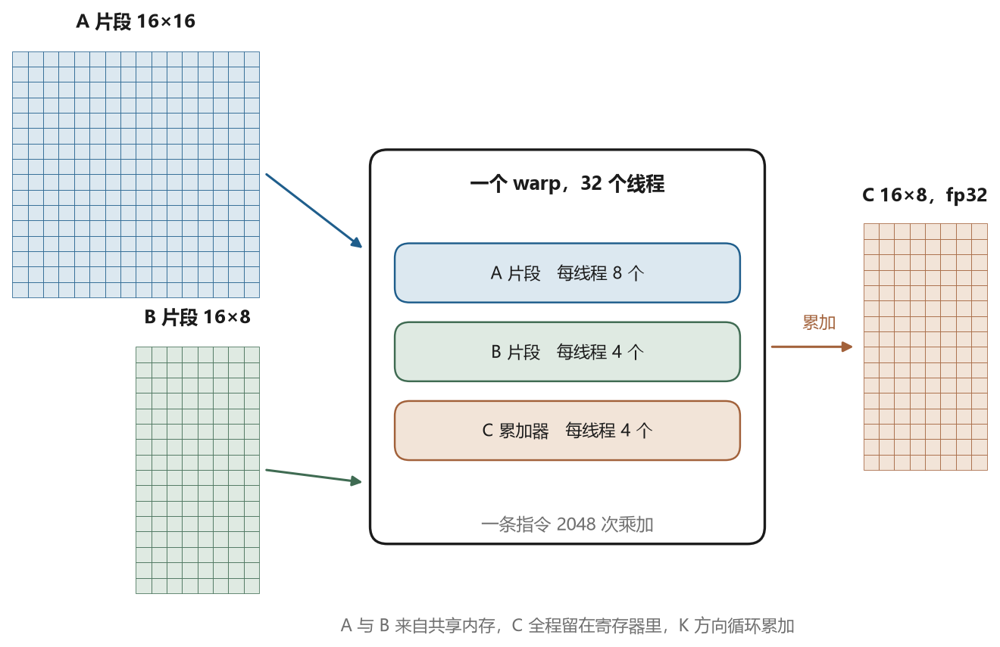
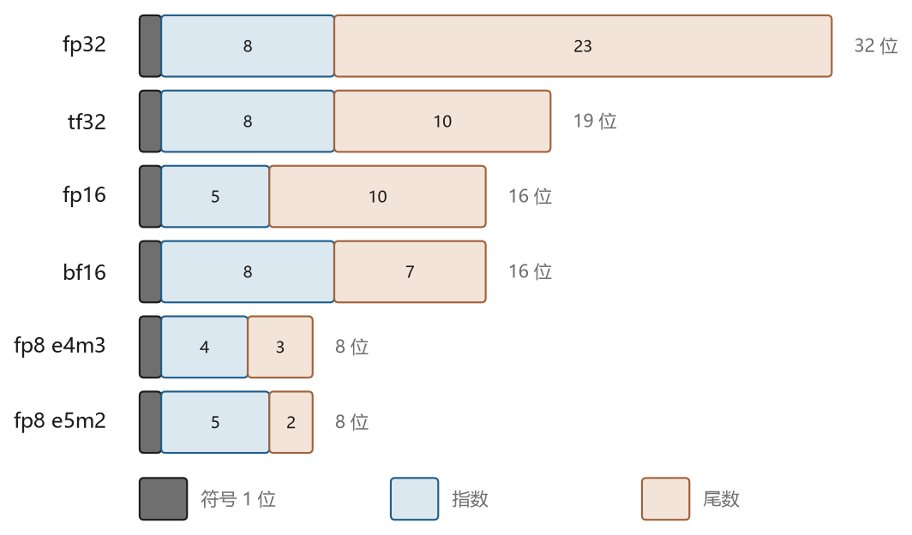

# Tensor Core 与矩阵指令

在 A100 的白皮书里，fp16 张量算力是 312 TFLOPS，fp32 标量算力是 19.5 TFLOPS，差十六倍。这个差距不是靠把频率拉高或者多加几个核实现的，而是换了计算的单位。标量单元一次做一次乘加，张量核心一次做一个 16×8×16 的矩阵乘加，一条指令算完 2048 次乘加。十六倍的差距就来自这里。

代价是张量核心不认任意形状。它只接受几种固定的尺寸，要求数据按特定布局摆在寄存器里，还要求精度在它支持的名单上。写 kernel 的人如果不知道这些约束，经常会写出一个“用了张量核心但只达到标量性能”的实现，看起来调用了正确的指令，实际大部分时间在搬数据。

## 从 FMA 到 MMA

标量单元的乘加指令叫 FMA，`d = a * b + c`，一条指令一个结果。32 个线程同时执行，一个周期做 32 次乘加。这是 CUDA core 的工作方式，也是 4090 那 16384 个单元的工作方式。

张量核心的指令叫 MMA（matrix multiply accumulate，矩阵乘加）。以 `m16n8k16` 为例，它算的是一个 16×16 的 A 片段乘一个 16×8 的 B 片段，加到 16×8 的 C 片段上。名字里的三个数字分别是输出的行数 16、输出的列数 8、累加的深度 16，也就是 A 和 B 各自沿 K 方向的长度要够 16 才能用这条指令。这条指令由一整个 warp 执行，32 个线程各自持有片段的一部分，硬件在内部把它们拼起来做矩阵乘。

片段的划分方式由指令规定。A 的 256 个元素分给 32 个线程，每人 8 个；B 的 128 个元素每人 4 个；C 的 128 个元素每人 4 个。这个分配不是任意的，相邻线程拿到的元素在矩阵里也相邻，这样 `ldmatrix` 这类加载指令才能用一次共享内存访问喂满整个 warp。写 kernel 的人看不到这层细节，但一旦要手写布局变换，就必须按这个规则把数据摆对，摆错的结果是数值对不上，而且不会报错。

一条 `m16n8k16` 做 2048 次乘加，也就是 4096 次浮点运算。A100 的一个 SM 每个周期能做 1024 次 fp16 乘加，四个张量核心平分，一条指令两个周期完成。频率 1.41 GHz 乘上 108 个 SM 再乘 1024 次乘加，正好是 312 TFLOPS 的一半，乘 2 得到 312。数字对得上，说明这个吞吐是可以从指令层面推出来的，不是市场部门编的。

反过来也能算出指令数。一个 4096×4096×4096 的 fp16 矩阵乘，按 M 方向 4096 除 16 得 256 段，N 方向 4096 除 8 得 512 段，K 方向 4096 除 16 得 256 段，乘起来是 3355 万条 MMA。每条 2048 次乘加，合起来 687 亿次乘加，乘 2 就是 137 GFLOP，与前面第五章的估算对得上。这个数很有意思，它说明一个看似巨大的矩阵乘，在指令层面只是一串三千万条的指令流，优化的重点就是把这条流不间断地喂下去。

累加器留在寄存器里是这套设计的关键。一个 `m16n8k16` 算完，C 片段还在原处，下一个 K 片段接着往上加，中间不需要写回共享内存。循环展开几次之后，一个 warp 可以同时持有好几个 C 片段，让张量核心一直有活干。这也是为什么矩阵乘的寄存器用量那么大，`128×128` 的块、256 个线程，每个线程的累加器就要 64 个寄存器。

## 精度的取舍

张量核心支持的精度是一份菜单，不同代际的卡菜单不一样。

fp16 是最早也最通用的一项，1 位符号、5 位指数、10 位尾数，能表示的最大值 65504。bf16 保持 fp32 的 8 位指数，尾数只剩 7 位，范围够大但精度低。tf32 是 A100 引入的，8 位指数加 10 位尾数，输入按 tf32 舍入、乘加在内部按更高精度做、结果累加到 fp32，对用户来说几乎不用改代码，把矩阵乘的输入转成 fp32 直接送进张量核心就行。fp8 在 Hopper 之后才有，分 e4m3 和 e5m2 两种，前者指数 4 位尾数 3 位，精度高一点；后者指数 5 位尾数 2 位，范围大一点。

三个位数各管一件事。符号位定正负，指数位定能表示多大和多少的范围，尾数位定相对精度。fp16 的 10 位尾数对应大约三位十进制有效数字，表示 1.234 这样的值时误差在千分之一量级；bf16 的 7 位尾数只剩两位多有效数字，误差升到百分之一量级。这也是为什么 bf16 适合算梯度，梯度本来就在很大范围内抖动，少几位尾数无所谓。

fp8 的 e4m3 和 e5m2 的分工也是这个道理。激活和权重的数值分布集中，多要精度少要范围，用 e4m3；梯度里有少量极大的值，需要范围，用 e5m2。选错了会看到模型发散或者精度骤降，原因不是算法，是格式的指数位不够。

菜单上的每一项都对应一个吞吐档位。A100 的 fp16 是 312 TFLOPS，tf32 是 156，fp64 只有 19.5。H100 增加了 fp8，吞吐再翻一倍。这个比例说明张量核心的设计目标是吞吐，不是单次运算的精度，它把大部分芯片面积花在了并行乘加阵列上，精度靠格式设计和累加策略来保证。

累加放在 fp32 里是常见做法。输入用 fp16 表示会有舍入误差，但每次乘加的结果累加到 fp32，误差不会随 K 增长而指数放大。Micikevicius 等（2017）分析过这套混合精度训练的数值行为，结论是 fp16 输入加 fp32 累加在大多数网络上够用，需要额外处理的只是梯度下溢，用损失缩放解决。推理没有梯度，下溢问题更少，所以 fp16 推理的数值风险比训练低。

整型和 fp8 的张量核心走的是另一套路子，输入和输出之间差一个缩放因子，乘加在整数域完成，溢出靠缩放和饱和处理。它把每个元素的字节数压到了 1，吞吐是 fp16 的两倍。代价是缩放因子要提前标定，标定不准就溢出或者精度不够，这件事在本册里只关心它带来的吞吐和带宽变化。Micikevicius 等（2022）讨论过 fp8 两种格式的分工，e4m3 用来放权重和激活，e5m2 用来放梯度，原因还是在范围与精度之间取平衡。

fp16 的坑在于范围。K 很大时部分和可能超过 65504，直接变成 inf。bf16 没有这个问题，范围与 fp32 相同，代价是尾数只有 7 位，量化噪声更大。选哪一个取决于模型的数值分布，不能只看吞吐表。一个常见做法是权重用 fp16、累加用 fp32，同时对激活做范围统计，确认不会溢出。

## 形状与布局的约束

MMA 的形状是固定的，`m16n8k16` 里的三个数字不能改。想让张量核心工作，矩阵要被切成这样的块，切不整齐的部分要么补零，要么退回标量路径。

固定形状不是偷懒，是电路决定的。张量核心内部是一片固定排列的乘法器阵列，一次把 16×16 的 A 和 16×8 的 B 全部扇进去，路径宽度、累加器位置都是硬连的。要支持任意形状，就得加选择器和多路复用器，面积和延迟都会失控。所以硬件干脆只提供几种尺寸，剩下的交给软件去凑。这一点在别的加速器上也一样，矩阵尺寸写在指令里，不是运行时参数。

补零的代价很容易算。M 方向切到 16 的倍数，一个 M=17 的矩阵要补到 32，一半的乘加是在零上做的，有效算力直接减半。N 方向切到 8，K 方向切到 16。批大小为 1 的推理里，M 就是 1，补到 16 意味着十六分之十五的张量核心算力被浪费，这也是小 batch 推理用张量核心收益有限的原因之一。

大模型解码时 M 就是批大小，通常 1 到 32。批大小为 1 时补到 16，看上去浪费了十六分之十五的算力，可这一层的实际瓶颈在带宽上，张量核心空转并不影响总时间，因为权重读取才是主要成本。批大小升到 8 或者 16，补零的浪费被摊掉，同一份权重喂给更多请求，算力利用率跟着上来。批处理为什么能提高吞吐，一个原因就在这里。

布局的约束更隐蔽。MMA 要求 A 和 B 以特定的行列主序摆在寄存器里，而共享内存里的数据是按另一种顺序排的。两者之间的转换靠 `ldmatrix` 指令，它一次从共享内存读 8 个 8×8 的片段，按 MMA 需要的顺序分给 32 个线程。这条指令对地址有对齐要求，每个片段的首地址要 16 字节对齐，跨度也要对齐，否则要拆成多次加载。

共享内存的 bank 冲突在这里又出现一次。按行存 A、按列读 B 是最自然的写法，可 B 的列读正好是 32 路冲突。解决办法和第二章一样，要么给共享内存加 padding，要么在写入时就把数据摆成 swizzle 之后的顺序，让 `ldmatrix` 读的时候自然分散到 32 个 bank。CUTLASS 里的 `TensorOpMultiplicand` 这类类型就是干这个的，名字很长，作用就是把布局变换藏进类型里。

最后是形状的粒度。张量核心的一条指令覆盖 16×8 的输出，一个 warp 至少要算这么多才有意义。如果某一层的输出只有 4 个通道，比如某些轻量模型的瓶颈层，那么用张量核心还不如用标量单元快，因为补零和布局转换的开销超过了收益。判断标准是有效利用率，输出元素的个数除以补零之后的个数，低于一半就该考虑别的路径。

## 在 warp 之间分工

一个线程块里通常有 4 个或者 8 个 warp，它们要共同算一个大的输出块。分工方式有两种，沿 M 切或者沿 N 切。

沿 M 切的时候，每个 warp 负责 16 行或者 32 行，共用同一份 B 片段。B 从头到尾只被读一次，A 各读各的。沿 N 切反过来，每个 warp 负责一段列，共用 A 片段。哪一种更省，取决于块的长宽比。共用那一侧之所以更省，是因为共享内存的读也要花带宽，同一份片段被四个 warp 各读一遍，就是四倍的片上流量，而共享内存带宽恰好是 GEMM 最先撞上的墙之一。一个 `128×128` 的块配 8 个 warp，每个 warp 算 `64×32` 或者 `32×64`，前者沿 N 切四份、沿 M 切两份，后者反过来。CUTLASS 的选择是把 warp 排成 `2×4` 或者 `4×2` 的网格，让每个 warp 的 `m16n8` 片段拼接起来正好覆盖整块。

分工完了还有一个“谁读哪块共享内存”的问题。每个 warp 从共享内存读 A 的一行片段和 B 的一列片段，如果所有 warp 同时读同一块，bank 冲突会集中在一个区域。把 warp 的起点错开，或者让每个 warp 负责不同的 K 偏移，可以把访问压力摊到 32 个 bank 上。这也是 swizzle 函数存在的第二个理由，第一个理由是避免单个 warp 内部的冲突。

把 8 个 warp 的切法具体走一遍。128×128 的块排成 4 行 2 列，每个 warp 负责 32 行、64 列。它要先从共享内存读 A 的 32×32 片段和 B 的 32×64 片段，共 3072 个 fp16，再切成 2×8 个 `m16n8` 的 MMA 片段。注意 32 和 64 都能被 16 和 8 整除，切割时不会有零头，这也是为什么 warp tile 的边长总取 16 的倍数。如果某一边取了 48，最后一个 MMA 片段就有一半是空的。

这种切法还有一个副作用，每个 warp 需要自己的一份 A、B 寄存器。32×32 的 A 片段加 32×64 的 B 片段是 3072 个 fp16，摊到 32 个线程就是 96 个 32 位寄存器，再加上 64 个累加器，已经接近一个线程的寄存器上限。所以 warp tile 不能无限大，它受三个东西同时限制：寄存器、共享内存、MMA 的形状。调参的时候先算寄存器，再看共享内存，最后才是块的尺寸。

一个 128×128 的块正好配 8 个 warp，不是巧合。4×4 个 warp 每个算 32×32，复用最低；2×8 每个算 64×16，累加器太少，反过来浪费；4×2 或 2×4 让每个 warp 拿到 32×64 左右的矩形，累加器数量和复用倍数平衡得最好。

## Hopper 的 wgmma

到了 Hopper，指令的粒度又变了一次。`wgmma` 由一个 warpgroup 执行，128 个线程，形状是 `m64nNk16`，N 可以是 8 到 256 之间的若干档。一条指令覆盖的输出从 16×8 涨到 64×N，指令数少了一个数量级。所谓 warpgroup，就是四个 warp 绑成一组，共享一部张量核心的喂数据通道，可以理解为一个更大的教官，同时对四个班喊口令。

更重要的是数据来源。`wgmma` 的 A 和 B 可以直接从共享内存读，不需要先搬进寄存器。省下的不只是寄存器空间，还有 `ldmatrix` 那一步的指令和延迟。累加器仍然在寄存器里，一条指令算完直接累加，和 `mma.sync` 的语义一样。

另一处变化是异步。`wgmma` 发出之后不阻塞，后面的指令可以继续执行，等结果的时候用一条等待指令同步。这让“取下一块数据”和“算当前块”真正重叠起来，而不用靠双缓冲加手工调度。代价是编程模型复杂了，发出指令、等待、屏障的顺序错了，结果会静默地错，不报错也不崩溃。

异步带来的第一个好处是寄存器压力。`mma.sync` 要求 A、B 片段先放进寄存器，一个 `64×256` 的 wgmma 如果照搬这套做法，光 B 片段就要几千个寄存器，物理上放不下。直接从共享内存读，寄存器只留给累加器，一个线程能同时持有更多的输出块，块可以开得更大，数据复用跟着提高。第二个好处是指令数，一条 wgmma 替代几十条 mma，发射口的压力小了，前端不再是瓶颈。

代价是正确性变得更难保证。异步指令发出后，共享内存里的那块数据在它读完之前不能改，需要屏障和 fence 配合。编译器对这些约束的检查有限，写错了通常不会报错，只是结果偶尔不对，而且只在特定形状下出现。这也是为什么大多数人用 CUTLASS 或者 Triton 而不是手写 wgmma。

这两代指令的差别可以概括成一句话，`mma.sync` 是同步的、寄存器到寄存器的，`wgmma` 是异步的、共享内存到寄存器的。写 kernel 的人如果只是调用库，感受不到这个差别；如果要自己写一个融合算子，指令的选择会直接决定能不能把流水线铺满。

这一章讲的都是“一个 warp 或一个 warpgroup 怎么算一小块”。把这些小块拼成一个完整的矩阵乘，还要解决分块、流水、线程块划分这一串问题，下一章接着讲。
