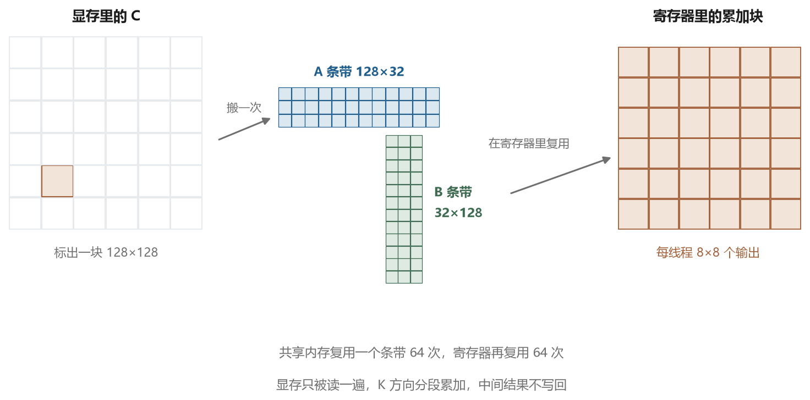

# GEMM：分块与流水

4096×4096×4096 的 fp16 矩阵乘，137 GFLOP，在 A100 上 cuBLAS 跑 0.45 毫秒左右，接近理论下界。自己照教科书写的三重循环版本，同样的形状要 20 毫秒以上，差了四十多倍。代码没有算错一个元素，差距全在数据怎么搬。朴素版本每做一次乘加都要从显存读两个数，分块版本把一块数据搬进共享内存之后反复用几百次。cuBLAS 是 NVIDIA 提供的矩阵运算库，CUTLASS 是同一家公司开源的头文件模板库，两者的关系在第十三章细说，这里只需要知道它们是这个领域的上限参照。

先把下界算出来，后面的讨论才有参照。137 GFLOP 除以 312 TFLOPS 是 0.44 毫秒，这是算力下界。访存这边，4096 的三次方，三个矩阵各 32 MB，一共不到 100 MB，除以 2 TB/s 是 0.05 毫秒。算力下界是访存下界的九倍，说明这个形状稳稳在 roofline 的平台线上，时间应该由算力决定。cuBLAS 跑 0.45 毫秒，等于把算力用满了九成以上，几乎没有浪费。任何人想在这个形状上超过它，只能指望更快的指令或者更少的运算，不可能靠更好的搬运。

矩阵乘是所有算子优化里最成熟的一个，cuBLAS 和 CUTLASS 已经把这件事做到了接近硬件极限。讲它不是为了让人手写一个更快的，而是因为分块、双缓冲、布局变换这三件事在卷积、注意力、归一化里都会再出现一遍。看懂 GEMM 的分块，后面几个算子只是换了外衣。

## 朴素实现的问题

把矩阵乘写成三重循环，`for i, for j, for k`，最内层做 `C[i][j] += A[i][k] * B[k][j]`，每个输出元素要读 K 个 A 的元素和 K 个 B 的元素。总共 `2MNK` 次读，每次 4 字节，加起来是 `8MNK` 字节。

按 roofline 的口径，这个实现的算术强度是 `2MNK / 8MNK = 0.25`，落在斜线最左边。512 的三次方，访存量是 1 GB，理论下界只要 3 MB，差三百倍。A100 的 40 MB L2 能兜住一部分，因为 A 的一行和 B 的一列在连续迭代里会被重复读，但 L1 只有一百多 KB，兜不住整个工作集，大部分请求还是要回到 L2 甚至显存。

换一个规模看得更清楚。512 的三次方是 0.27 GFLOP，算力下界 0.86 微秒，访存下界 1 GB 除以 2 TB/s 是 0.5 毫秒，两者差了近六百倍。朴素实现在这个规模上要跑一毫秒以上，正好卡在访存下界附近，说明它确实被带宽按住了，而且因为跨步访问，有效带宽还打了折扣。

这个差距在 CPU 上看不到，原因是 CPU 的快取分层与线程数不同。一个 CPU 核心跑三重循环，整个 512×512 的 B 也就 1 MB，正好落在二级缓存里，重复读几乎不花时间。GPU 一个 SM 只有一百多 KB 片上空间，而同一个矩阵乘是几千个线程在同时读，各自的工作集叠在一起，谁也不住。同一个算法在两种硬件上的效率相差一个数量级，背后的原因就是缓存容量的比例。

这里有一个容易绕进去的地方。同一个实现，规模从 512 变到 4096，强度从 0.25 变成 2，涨了八倍，可它始终贴着斜线。原因是 `8MNK` 这个分母跟着 `MNK` 一起长，强度只与形状有关，与总规模无关。想让强度上去，只能改访问方式，不能指望矩阵变大。

更糟的是请求数。每个线程读一个 float，相邻线程读的是相邻的列还是隔着一整行，决定了合并访问好不好。按 `i, j, k` 的顺序写，内层 k 变化时 A 的地址连续、B 的地址跨行，一半的访问是跨步的。带宽再打一次折。

还有一个隐性成本，朴素实现的每个线程都要算一遍地址。一个乘加配一个乘法算索引、一个加法推进，指令数翻了倍，而整数单元只有 FP32 单元的一半，地址计算反倒成了主开销。分块实现把这些地址计算摊到一整块上，同样的指令数换来几百倍的活，这才是它真正的优势。

## 分块

分块的思路很直接，把 C 切成 `Tm × Tn` 的块，一个线程块负责一块。算这一块要读 A 的 `Tm × K` 条带和 B 的 `K × Tn` 条带，各读一遍，然后在这两个条带上做 `Tm × Tn × K` 次乘加。读的量是 `(Tm + Tn) K` 个元素，算的量是 `Tm Tn K` 次，每读一个元素能做 `Tm Tn / (Tm + Tn)` 次乘加。

取 `Tm = Tn = 128`，每读一个元素能做 64 次乘加。取 64，能做 32 次。块越大，复用越高，但共享内存装不下。128×128 的块，K 方向一次处理 16 个，A 条带是 128×16，B 条带是 16×128，fp16 下各 4 KB，加上双缓冲要两份，一共 16 KB。A100 的 SM 有 164 KB 共享内存，理论上能装十份，但寄存器会先撑不住。

从显存流量的角度看，分块做的事就是把“每算一个输出读一整行和一整列”换成“整块只读两条边”。一个 128×128 的块，要算 16384 个输出，按朴素写法要读 16384 乘 2K 个元素；分块之后只读 `(128 + 128) K` 个，差 64 倍。这 64 倍就是前面那个复用倍数，它是分块唯一的收益来源，也是为什么块越大越快的原因。

把预算算细一点。128×128 的块，K 方向一次走 32，fp16 下一个 stage 的 A 条带是 128×32×2 字节，8 KB，B 条带同样 8 KB，一个 stage 16 KB。开三个 stage 是 48 KB，一个 SM 装三个块就顶到 144 KB，离 164 KB 的上限不远。寄存器这边，128×128 个输出分给 256 个线程，每个线程 64 个累加器，加上 A、B 片段和地址计算，实际用量在 100 到 120 之间，一个块要 25600 到 30720 个寄存器，SM 的 65536 个只够两个块。于是占用率被寄存器定在 25%，共享内存还有富余。

真实 kernel 的块大小是几项约束折中的结果。128×128×32 是 fp16 下常见的配置，共享内存用 32 KB 左右，寄存器用量让占用率落在 25% 到 50% 之间，每个 SM 装一到两个块。256×128 的块复用更高，但共享内存和寄存器都翻倍，占用率掉到 12.5%，尾效应变明显，块数少的时候反而慢。

表 5-1　三种块大小的预算（fp16，K step 32，不考虑边界）

| 块大小 | 一个 stage 的共享内存 | 每线程累加器 | 可装块数 | 复用倍数 |
|---|---|---|---|---|
| 64×64 | 8 KB | 16 | 4 到 6 | 32 |
| 128×128 | 16 KB | 64 | 2 | 64 |
| 256×128 | 24 KB | 128 | 1 | 85 |

块越大复用越高，可装的块数越少。装一个块意味着 SM 上只有 8 个 warp 在跑，一旦这个块的流水断了，整个 SM 都空着。装两个块能互相掩护，一个块等数据时另一个块在算。这就是为什么 256×128 的配置在形状规整、批很大时能赢，在形状零碎时反而不如 128×128。

这里的换算关系值得记一下。一块 128×128、线程数 256，就是 8 个 warp；同时装两块就是 16 个 warp，占用率 25%。看起来很低，可 GEMM 并不靠 warp 数量掩盖延迟，而是靠每个线程手上那 64 个独立的累加器。它们之间没有依赖，张量核心和共享内存的访问可以交替进行，一个线程自己就能把流水线填满。所以看到 GEMM 的占用率只有 25% 不必惊讶，那是用占用率换寄存器复用的结果。

分块之后，每一级存储的访问次数差出一个量级。显存只被读一遍，理想情况下每个元素读一次；共享内存被读 `Tm` 或 `Tn` 次；寄存器被读 `Tm Tn` 次。三级存储的带宽正好也是这个比例，片上快、片外慢，复用次数和带宽差距配上了，算力才不会被搬运拖住。

## 双缓冲与流水

分块解决了复用，没解决等待。一个块算完第 k 段，要等第 k+1 段从显存搬进来才能继续，这段等待里张量核心是停的。K 方向有几百段，每段都要等一次，累积起来很可观。

双缓冲（double buffering）把等待藏起来。共享内存开两份，一份给当前计算用，一份给下一段加载用。计算第 k 段的同时，另一条路径把第 k+1 段搬进来。搬运和计算是两种不同的硬件，可以真正并行，只要搬的时间不超过算的时间，等待就消失了。

$$
T_{\mathrm{step}} = \max\left(T_{\mathrm{load}},\; T_{\mathrm{compute}}\right)
$$

一段的加载时间和计算时间之比，决定了要几级缓冲。加载比计算慢，两级缓冲只能把等待减半，要三级或者四级才能完全盖住。CUTLASS 的 stage 数就是这个意思，常见的取值是 3 到 5。stage 越多，共享内存占用越大，块能开的尺寸越小，又是一次折中。

把账算得更具体一点。一段 K 步的计算量是 `128 × 128 × 32` 次乘加，约 52 万次，按每周期 1024 次算约 500 个周期。加载量是两条 128×32 的 fp16 条带，共 16 KB。这 16 KB 大部分能从 L2 拿到，L2 带宽比显存高一个量级，分摊到每个 SM 大约是每周期几百字节，一千多个周期能搬完；在三级以上流水里，每段的加载已经在上一段执行时完成了，所以真正卡住的仍然只有 L2 未命中的那一部分。两级的余量够不够，取决于命中率，这也是为什么 stage 数要配合块大小一起调。

反过来说，如果块很小、K 步很小，计算一段只要几十个周期，而加载要一两百个周期，那就需要更多 stage。这也是为什么小矩阵乘的分块参数和大矩阵不同，库里的启发式会根据形状换一套。

早期实现这个重叠要靠手工安排，先用 `cp.async` 把数据从显存搬到共享内存，再用 `cp.async.wait_group` 等它完成，中间插入计算指令。这一步的关键是“搬数据的指令不占用寄存器”，线程发完就可以去算别的，搬运由内存子系统自己完成。Hopper 之后有了 TMA（Tensor Memory Accelerator，张量内存加速器），搬运由专门的硬件单元发起，一个线程发一条指令就能搬一整个 tile，还能自动处理边界。省下的不只是指令，还有寄存器，因为地址计算不用每个线程各算一遍。

stage 数不是越多越好。共享内存的总量是固定的，stage 从 3 加到 5，一个块占的量从 48 KB 涨到 80 KB，能装的块数从 3 个掉到 2 个。块数少了，块之间的掩护就弱了，某个块的流水断掉时没有别的块顶上。经验和实测都指向同一个结论，先让块数不少于 2，再在剩下的空间里加 stage。

还有一条容易被忽略的约束，每个 stage 之间要有屏障。写共享内存的线程和读共享内存的线程不是同一批，中间的 `__syncthreads()` 少了，读到的是上一轮的残留数据，结果偶尔错。屏障多了，warp 被强行对齐，流水又被切开。CUTLASS 用的是带到达计数和等待计数的屏障，让写者和读者各自记账，不需要全员对齐，代价是逻辑复杂。

流水做得好不好，看一个指标就够了，张量核心的空转比例。Nsight Compute 里的 tensor pipe 利用率如果在 60% 以下，说明有一段时间没有 MMA 在跑，问题多半在加载侧。这时候要么加大 stage 数，要么把块调小让加载更快，要么检查共享内存的 bank 冲突是不是让加载变慢了。

## 线程块内部的分工

一个线程块里有几百个线程，它们要共同算 `Tm × Tn` 的输出。分工分两层，warp 之间分一次，warp 内部的线程再分一次。

warp 之间沿 M 和 N 切成网格，比如 8 个 warp 排成 2×4，每个 warp 负责 64×32 的输出。每个 warp 再用 MMA 指令切成 16×8 的小块，一个 64×32 的 warp tile 是 4×4 个 MMA 片段。线程在 warp 内部的分工由指令规定，不需要自己安排。

线程和累加器的对应关系决定了寄存器用量。一个 warp 有 32 个线程，一个 16×8 的 C 片段有 128 个元素，每人 4 个。如果 warp tile 是 64×32，就是 16 个片段，每人 64 个累加器寄存器。加上 A、B 片段和地址，一个线程用 100 到 150 个寄存器很常见。这个数字直接决定了占用率的上限，也决定了块不能再大下去，反过来又限制了复用倍数。几个参数的相互牵引决定了 GEMM 没有一套通用最优参数。

K 特别长的时候还有另一种切法。C 的一个块可以由多个线程块共同计算，每个块负责一段 K，最后把部分和加起来，这叫 split-K。它把一条很长的流水切成几条短的，块数变多，SM 的占用率跟着上来，代价是多一次写回和一次归约。批很小、K 很长的形状，比如某些全连接层，split-K 能把性能从峰值的两成拉到五成。归约可以用原子加，也可以用单独的 kernel，前者省一次启动，后者数值确定性更好，因为浮点加不满足结合律，原子加的顺序每次不同，结果会有微小差异。

什么时候该想到 split-K，有一个简单的判据。如果 M 和 N 都不大，比如都是 256，那么 128×128 的块只能切出 4 个块，而 A100 有 108 个 SM，绝大多数 SM 闲着。这时候把 K 切成 27 段，就有 108 个块可以并行，虽然每段要多一次部分和写回，但换来的并行度远远值回这个代价。反过来，M 和 N 都很大的时候切 K 只会增加归约成本，没有好处。

共享内存的读也要错开。所有 warp 同时读 A 的同一个条带，容易撞在同一个 bank 上。CUTLASS 的做法是把共享内存按 8×8 的小块重新排列，读的时候按 XOR 过的顺序取，让同一时刻的 32 个地址落在不同的 bank。这套 swizzle 规则不复杂，但手写容易错，一旦错了性能掉一半还不报错。

## 什么时候还值得自己写

大多数情况下不值得。cuBLAS 覆盖了常见的形状和精度，在主流 GPU 上都能跑到峰值的六七成以上，CUTLASS 提供了可以定制的模板，能改 epilogue、改布局、改精度组合。需要自己写的场景大概有三类。

第一类是融合。矩阵乘后面接一个逐元素操作，比如 `Gemm + Mul + Add`，单独起一个 kernel 要多读一遍写一遍，融合进去就不用。CUTLASS 的 epilogue 支持这种定制，改的是模板参数，不用重写主循环。

第二类是形状特殊。M 很小、N 很大，或者 K 特别长，库里的启发式选择可能不是最优的。这种情况下先试 `cublasLt` 的算法选择，还不行再考虑自己写一个针对这个形状的 kernel。

第三类是硬件特殊或者精度特殊。新架构刚出来时库还没跟上，或者要用一种库不支持的混合精度组合，只能自己写。这种情况通常有明确的性能目标，也有足够的时间做调优。

判断的标准可以很简单。先用库跑一遍，量出延迟和带宽，算出它在 roofline 上的位置。如果已经在算力平台线附近，别写了；如果离得远，先确认是形状的问题还是融合的问题，前者试算法选择，后者试模板定制。只有在两条路都走不通时，自己写才是有意义的。

拿具体数字练一次。一个 `M=1, N=4096, K=4096` 的矩阵向量乘，权重是 32 MB，每个权重只参与一次乘加，运算量 33.6 MFLOP，强度恰好是 1。算两个下界，带宽下界 32 MB 除以 2 TB/s 是 16 微秒，算力下界 33.6 MFLOP 除以 312 TFLOPS 不到 1 微秒，所以它稳稳落在斜线上。假设实测跑了 130 微秒，有效带宽只有 246 GB/s，是标称值的八分之一。这个差距不能靠改分块边长补，因为它不是分块的问题，而是这个形状的访问模式不适合张量核心的套路。这时候该做的是换一个针对 M=1 优化的实现，比如把权重按列优先重排、用向量化读取代二维拼接。

这类形状还有一个判断捷径，看它像不像一次“读权重”。矩阵向量乘、小批全连接、decode 的注意力，都是把一大块参数读一遍、每个参数只用一两次，它们的时间几乎都等于参数字节数除以带宽。看到这种账单，就知道优化空间在字节数上，不在指令上。

卷积是另一回事，它的形状比矩阵乘复杂得多，库的覆盖也更参差。下一章看卷积的几种算法，以及它们各自在什么条件下更快。
