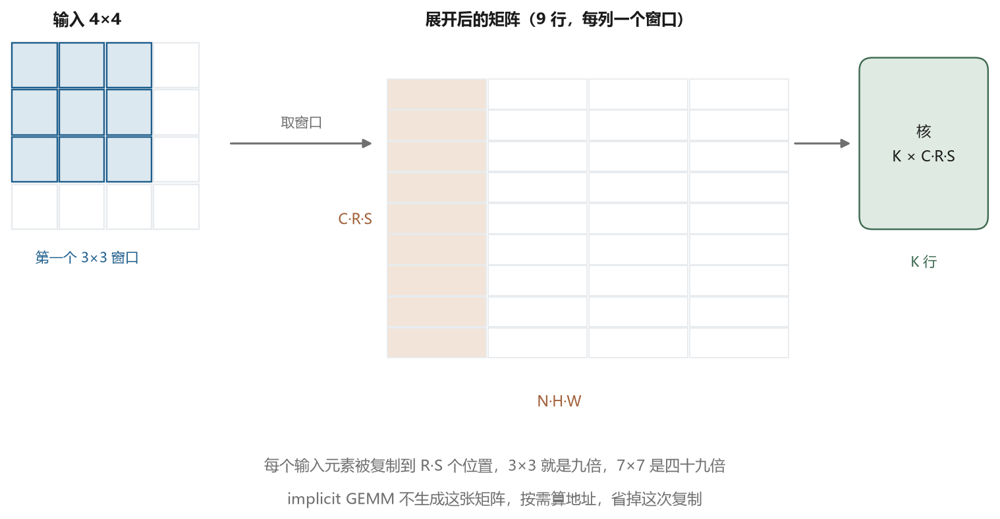
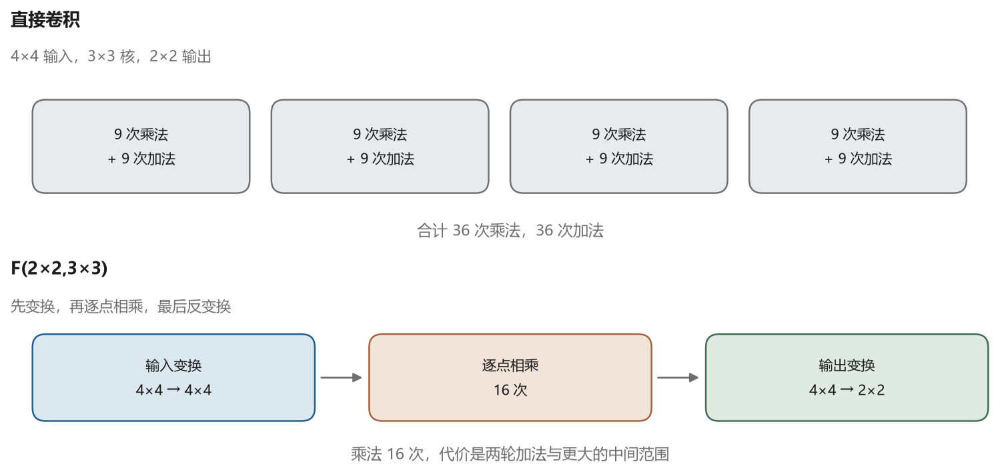

# 卷积的几种算法

一个 `1×256×56×56` 的张量过一层 3×3 卷积，输出 512 通道。同一个形状，cuDNN 在这个尺寸上跑几十微秒，一个照定义写的直接卷积要慢三到五倍。如果把它展开成矩阵乘，运算量一模一样，显存却要多占九倍。三种做法算的是同一件事，谁快取决于形状、核大小和卡的带宽。

卷积之所以有这么多算法，是因为它不像矩阵乘那样只有一种最优写法。3×3 的小核、7×7 的大核、1×1 的瓶颈层、深度可分离的移动端层，各自落在不同的区间。选错了算法，性能差十倍很正常，而且不会报错。

## 直接卷积的复用结构

直接卷积的写法最符合定义，输出每个点，取输入的 `R×S` 邻域，和卷积核做乘加。一个输出元素要 `C R S` 次乘加，整个层是 `2 N K H W C R S` 次。

这个算法的复用来自滑窗。相邻的输出点共用大部分输入，一个 3×3 的窗口在水平方向移一格，只换掉一列，另外两列还在。同理，同一块输入会被 K 个输出通道各用一次。所以一个好的直接卷积实现，会把输入的一块和全部的核放进共享内存，让每个输入元素被读 `K R S` 次。

复用次数可以估出来。256 个输入通道、512 个输出通道、3×3 的核，一个输入元素会被 512 个输出通道各用 9 次，一共 4608 次。要按照这个倍数把数据搬到寄存器，共享内存里至少要放一整块输入和全部核。核本身是 `512 × 256 × 9` 个 fp16，2.3 MB，装不进 164 KB 的共享内存，所以实际实现一次只处理一部分输出通道，把核也分块。

麻烦在边界和不对齐。窗口跨到张量外面要补零，补零的分支会让 warp 分歧，一个块里靠近边界的 warp 走一条路，内部的走另一条。核的尺寸是奇数时，输入和输出的坐标对不上，向量化加载容易错位。3×3 的核在 NCHW 布局下，C 方向连续而 W 方向跨 C 步，滑窗读出来的地址不连续，合并访问很难做好。

## im2col 与 implicit GEMM

把卷积变成矩阵乘是另一条路。对输出的每个位置，取一个 `C R S` 的列向量，把所有位置排成矩阵的一列，得到形状 `(C R S) × (N H W)` 的矩阵，卷积核排成 `K × (C R S)`，两者相乘就是输出。这个展开叫 im2col。

展开之后卷积就变成了 GEMM，可以套用前一章的所有优化，分块、双缓冲、tensor core 都能用。代价是内存。`C R S` 比 `C` 大 `R S` 倍，3×3 就是九倍，7×7 是四十九倍。一个 `256×56×56` 的输入展开后是 `2304 × 3136`，fp32 下 28 MB，刚好超过 A100 的 L2 一小截，原本能全放进缓存的数据现在要频繁回显存。写回展开矩阵本身还要一次额外的带宽，读写各一遍。

implicit GEMM 去掉了这次展开。它不真的生成那个大矩阵，而是在分块循环里按需取数，从原图上算出对应的地址，直接送进共享内存。GEMM 的骨架不变，只是加载那一步换成了一个地址映射函数，取 A 的第 `(c, r, s)` 行时跳到输入的第 `(c, h+r, w+s)` 个位置。内存占用回到原图大小，复用结构保持不变。

两种做法的带宽账可以粗略比较。im2col 至少要写一遍展开矩阵，`2304 × 3136` 的 fp16 矩阵是 14 MB，写一遍读一遍 28 MB，在 2 TB/s 的卡上是 14 微秒。这一层本身的算力下界是 7.4 GFLOP 除以 312 TFLOPS 约 24 微秒，看起来展开的代价还能藏住，可它占掉了相当于一半的显存带宽，和别的层抢资源时就露出来了。分块大的实现能把展开后的矩阵切碎，让每一块留在 L2 里，代价是地址计算更复杂。

cuDNN 的主力算法就是 implicit GEMM（Chetlur 等，2014）。它在显存里只放原图，在片上做展开，等于把 im2col 的好处拿走、代价留下。实现上的难点在地址计算和边界处理，每个块要判断自己覆盖的输出区域有没有越界，越界的部分用零填充。这段逻辑的指令开销不小，卷积的形状越零碎，开销占比越高。

## Winograd：用加法换乘法

前两种算法算的乘加次数一样，只是搬运方式不同。Winograd 换的是算法本身，它用更多的加法换更少的乘法。

以一维的 F(2,3) 为例，用 3 个权重的卷积核算 2 个输出，直接算是 6 次乘加。Winograd 先把 4 个输入做一次变换，和同样变换过的权重逐点相乘，再做一次反变换得到 2 个输出，中间只有 4 次乘法。乘法从 6 降到 4，代价是变换的加法，输入变换 4 次加，输出变换 3 次加。

二维的 F(2×2,3×3) 是把它用两次，一次沿宽、一次沿高。4×4 的输入块，3×3 的核，出 2×2 的输出。直接算要 `4 × 9 = 36` 次乘法，Winograd 只要 `16` 次，少了一半多。核越大收益越大，F(4×4,3×3) 能到四倍以上。

F(4×4,3×3) 是另一档。6×6 的输入块出 4×4 的输出，直接算 144 次乘法，Winograd 36 次，四倍。块越大省得越多，可变换矩阵的系数也越大，最大到 4 以上，中间结果的动态范围被放大十几倍，fp16 直接溢出。所以 F(4×4,3×3) 一般要用 fp32 或者带缩放的定点，而 fp32 在张量核心上只有一半吞吐，四倍的乘法节省被抵消掉一部分。

代价有三项。第一是加法多了，乘法省下来的时间可能被加法吃掉，尤其在张量核心上，乘法便宜到几乎免费，加法反而成了瓶颈。第二是数值误差，变换矩阵里的系数有正有负，中间结果的范围比输入大，fp16 下容易溢出或者丢精度，实践中要仔细做缩放。第三是适用条件，步长必须为 1，核必须是 3×3 或者 5×5 这类固定形状，dilation 和分组都要特殊处理。

Lavin 和 Gray（2015）把 Winograd 用在 GPU 上的卷积网络里，报告了 3×3 卷积层两到四倍的加速。那是 2015 年的 GPU，没有张量核心，乘法还比较贵。到了有张量核心的架构，Winograd 的收益缩水，因为它把乘法换成了加法，而张量核心只加速乘法。cuDNN 里仍然保留 Winograd，但只在特定形状下启用，选不选由启发式决定。

## 分组与形状的边角

分组卷积把通道切成几组，每组独立卷积。它的乘加次数按组数等比例减少，代价是每组的通道数变少，算术强度跟着降低。组数等于通道数时就是深度可分离的空间部分，此时每组的核只有 `R S` 个参数，几乎没有任何复用，性能完全由带宽决定。

分组还带来一个布局问题。NCHW 下按通道分组，每组是一段连续的通道，读起来还好；NHWC 下按通道分组，每个空间位置上的通道被切开，读一个组要在内存里跳着走。同一个模型换一种布局，分组卷积的性能可能差一倍，原因不在算法，在访存。

形状的边角值得单独说。通道数是 8 的倍数，张量核心和向量化加载都能对齐；不是 8 的倍数，最后一个块要补零，有效算力按比例下降。比如 3 通道的输入层，补到 8 之后七成的乘法是在零上做的，这一层永远跑不快。分辨率不能被块大小整除时，最后一行一列的块大部分线程在空转。这些损失不会体现在算力表上，只会体现在端到端时间里。

## 大核、深度可分离与 1×1

核大的时候 FFT 卷积有优势。把卷积看成两个序列的线性卷积，长度是 `H + R`，直接在时域算要做 `H R` 次乘法，在频域只需正反变换各一次加上 `H + R` 次复数乘法，量级是 `(H + R) log(H + R)`。核从 3 涨到 31，时域的乘法涨十倍，频域的只涨一点几倍，交叉点经验上在 7 到 11 之间，取决于实现和缓存。把输入和核都变换到频域，逐点相乘，再变换回来，复杂度从 `O(R S)` 降到 `O(log(R S))`。7×7 以上的核，FFT 的乘法次数明显少于直接卷积。问题是精度和内存，频域计算是复数，fp32 下的误差比时域大，还要额外的频谱缓冲区。现代网络里 7×7 的核基本只出现在第一层，那一层的通道数少、分辨率高，FFT 的收益被数据准备的开销抵消。所以 FFT 卷积在今天的推理里用得不多。它更适合音频、频谱这类本来就是复数信号的场景。

深度可分离卷积是另一个极端，每个通道单独做空间卷积，再做一个 1×1 的通道混合。它的乘加次数只有普通卷积的几分之一，可算术强度也跟着掉下来，因为每个通道的卷积核只有 9 个参数，数据搬进来用不了几次就扔了。这类层在移动端模型里很常见，在 GPU 上通常受带宽限制，优化方向是把 depthwise 和 pointwise 合成一个 kernel，少写一次中间结果。

1×1 卷积最简单，它就是矩阵乘，`M = N H W`，`K = C`，`N = K_out`，不需要 im2col 也不需要滑窗。它的算术强度是 `2 C / 8`，通道数 256 时是 64，在 fp16 下仍然低于拐点 156，但已经接近。瓶颈层用 1×1 降维升维的设计不是偶然，它在同样的 FLOP 下把数据压进更少的字节，让后面的 3×3 卷积更好算。

表 6-1　四种算法的性质对比

| 算法 | 乘加次数 | 额外内存 | 适用条件 | 主要问题 |
|---|---|---|---|---|
| 直接卷积 | `2 N K H W C R S` | 无 | 任意形状 | 合并访问难做 |
| im2col | 同上 | 膨胀 `R S` 倍 | 任意形状 | 展开与写回带宽 |
| implicit GEMM | 同上 | 无 | 通道数是 8 的倍数较好 | 地址计算开销 |
| Winograd | 约 `1/2.25` | 变换缓冲区 | 3×3、步长 1 | 数值误差、加法多 |

算法的选择在库内部由启发式完成，用户通常感知不到。可感知的是形状的边角，通道数不是 8 的倍数、分辨率不能整除、步长和 padding 组合特殊，这些情况下库会退回一个通用实现，性能掉一半。遇到这种层，先看 Nsight 里 kernel 的名字，如果名字里带着 `generic` 或者 `fallback`，说明它没走快路径。

一句话概括这几种算法的分工。通道多、分辨率大的层，implicit GEMM 是默认选择；3×3 且步长为 1、精度要求不严的层，Winograd 可能更快；通道少、分辨率高、核大的层，直接卷积反而更合适，因为展开和变换的开销都比计算本身大。移动端那类深度可分离的层，唯一的出路是融合，把 depthwise、pointwise 和激活串成一个 kernel。

这些算法解决的是一层卷积怎么算得快。一层算完，后面还有归一化和激活，它们不改变数据量却要读写整个张量。下一章看这些“便宜”的算子为什么常常占掉一半时间。
