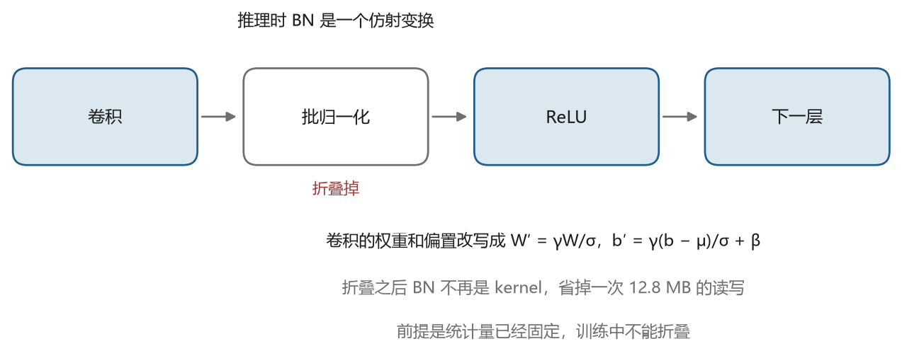
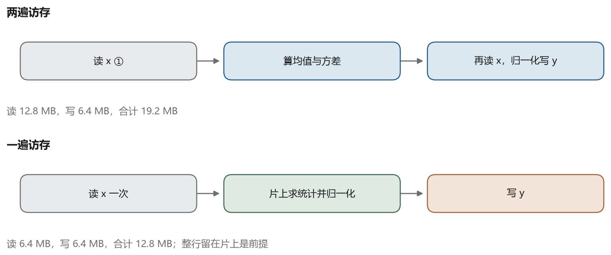

# 归一化、激活与逐元素运算

在 ResNet-50 的 profile 里，批归一化和 ReLU 加起来经常占到三成以上的时间，而它们的浮点运算量不到全网的百分之一。卷积层辛辛苦苦做了几十亿次乘加，结果时间被一个“每个元素减一下、除一下、再取个 max”的层吃掉一半。第一次看到这个分布的人通常会怀疑 profile 出错了。

没有错。这些算子的算术强度不到 1，只有卷积的千分之一，它们的时间全部花在搬运上。一个 512×56×56 的张量是 6.4 MB，读一遍写一遍就是 12.8 MB，在 2 TB/s 的卡上要 6.4 微秒，一秒里能做十五万次。卷积层有几百 GFLOP 可以摊，这些层没有，它们的时间就是字节数除以带宽，一点余地都没有。

这类算子有个统称，叫逐元素算子（elementwise operator），也叫按元素运算符，意思是它把每个元素单独处理，不跟邻居发生关系。它和卷积、矩阵乘的根本区别就在这里，后两者的每个输出都要看很多输入，所以有复用的机会；逐元素算子看完一个就扔，没有任何复用。没有复用，就没有算术强度，就不可能跑得比带宽快。

## 带宽是唯一的账

逐元素算子的算术强度可以直接写出来。读一个元素、写一个元素，fp32 下 8 字节，运算按 1 到 10 次算，强度在 0.125 到 1.25 之间。换成 fp16，读写各 2 字节，分母从 8 降到 4，强度直接翻倍，这也是为什么同样的逐元素层换成半精度就能快一截。

$$
I = \frac{\mathrm{FLOP}}{8}
$$

A100 的拐点是 156，这个数低了两百倍，所以它稳稳落在斜线最左端。可达性能是强度乘带宽，0.125 乘 2 TB/s 等于 0.25 TFLOPS，只有峰值算力的千分之一。这个数字说明，一个逐元素 kernel 无论怎么写，都不可能超过 0.25 TFLOPS，它的上限由字节数决定，不是指令。

顺带说一句为什么这些算子在 profile 里的占比常常高得反常。一个网络里卷积层的数量有几十个，逐元素层有几百个，前者的单层时间长但数量少，后者的单层时间短但数量多。再加上每个逐元素层都是一次全张量的读写，字节数累加起来就超过了卷积。看 profile 的时候不要只盯着最慢的那个 kernel，要看同一个 kernel 出现了多少次，以及这一类 kernel 的总时间占多少。

由此得到两个推论。第一，减少字节数是唯一有效的优化，融合两个逐元素算子，把中间结果留在寄存器里，字节数从 16 降到 8，速度直接翻倍。第二，降低精度会让逐元素算子变快，因为这里唯一的成本是字节数，fp32 换 fp16 就是分母减半。注意这和卷积的情形不同，卷积换精度的收益一部分来自字节数，更大一部分来自张量核心，两者的机制不一样。

把几个算子的账放在一张表里，差距一目了然。同样是 `512×56×56` 的 fp32 张量，每个算子读写的字节数不同，带宽下界差两倍。

表 7-1　几个逐元素算子的访存账（张量 512×56×56，fp32，带宽按 2 TB/s 估）

| 算子 | 读 | 写 | 合计 | 带宽下界 |
|---|---|---|---|---|
| ReLU | 6.4 MB | 6.4 MB | 12.8 MB | 6.4 µs |
| GELU | 6.4 MB | 6.4 MB | 12.8 MB | 6.4 µs |
| 残差相加 | 12.8 MB | 6.4 MB | 19.2 MB | 9.6 µs |
| LayerNorm，两遍 | 12.8 MB | 6.4 MB | 19.2 MB | 9.6 µs |
| LayerNorm，融合 | 6.4 MB | 6.4 MB | 12.8 MB | 6.4 µs |

一个残差块里有两次 BN、两次 ReLU、一次残差相加，加起来五次全张量读写，接近 50 微秒。同样这一块里的 3×3 卷积，算力下界是 24 微秒。这就是为什么归一化和激活能占到三成时间，它们做的事少，可搬的东西多。

除了带宽，还有一个成本是 kernel 数量。每个逐元素算子是一个独立的 kernel，启动一次要几微秒的 CPU 时间和一次全局同步，GPU 上的流水线要排空再填满。一个模型有几百个这样的 kernel，光启动就占掉一两毫秒。这一点第十章讲 CUDA Graph 的时候还会回来。

怎么确认一个算子确实卡在带宽上，看两个数就够了。一是实测的有效带宽，用字节数除以时间，如果到了标称带宽的七成以上，说明搬运已经接近极限；二是 SM 的忙碌程度，如果利用率很高但张量核心和浮点单元的发射很少，说明线程都在等访存。两个数一起看，基本不会误判。确认之后，优化的方向就只有减少字节和融合，调 tile、调占用率都是在做无用功。

实际带宽利用率通常在七成到九成之间。读一次写一次的模式对 DRAM 不算友好，读写切换有开销，向量化加载能让它接近峰值。用 `float4` 一次读 16 字节，一个 warp 就是 512 字节，四个缓存行，指令数只有标量的四分之一。这一条在这些算子上比在任何别的地方都值钱，因为它们本来就是指令少、访存多，省指令等于省不了什么，可省下来的地址计算能减少流水线停顿。

## BN 折叠进卷积

批归一化在推理时是一个仿射变换，因为它用的均值和方差是训练时统计好的常数。它的英文是 batch normalization，缩写 BN，做法是把一个通道上的数值拉到均值 0、方差 1，再用两个可学习的参数缩回去。为什么要拉，因为一个深层网络里，上一层的输出分布会随训练不断漂移，下一层就得不停追着这个分布学，把分布固定下来，训练就稳了。

$$
y = \frac{\gamma\,(x - \mu)}{\sigma} + \beta
$$

展开之后是 `y = (γ/σ)·x + (β - γμ/σ)`，一个缩放加一个偏移。如果 x 来自上一层卷积 `x = W * a + b`，把这两步合起来，新的权重和偏置是

$$
W' = \frac{\gamma}{\sigma} W, \qquad b' = \frac{\gamma\,(b - \mu)}{\sigma} + \beta
$$

卷积的权重乘一个标量，偏置换一个值，BN 就消失了。这个过程叫折叠（folding），它在推理时没有误差，因为所有的量都是常数，折叠只是把两次浮点运算合成一次，精度损失可以忽略。

折叠的前提是训练已经结束，统计量不再更新，而且卷积和 BN 之间不能夹着激活函数。一旦中间有 ReLU，折叠后的仿射变换就不等价了，因为 `max(0, x)` 不满足线性，不能把它后面的缩放提前。这就是为什么实践中的融合链总是 conv 接 BN 再接 ReLU，顺序不能换。训练时 μ 和 σ 是当前 batch 的统计量，每个 batch 都变，权重没法提前改，所以折叠只能在推理图上做。这也是为什么用 `model.eval()` 之后再导出，得到的图比训练图小一圈。忘了切换模式就把模型冻住，BN 用的还是 batch 统计，输出会随批大小变化，这是推理部署里最常见的一类 bug。

折叠的另一个好处是省掉一次全张量的读写。BN 作为一个独立算子，要读一遍写一遍，`512×56×56` 上是 12.8 MB，6.4 微秒。折叠之后它不存在了，这 6.4 微秒直接归零，而且不需要写代码，是在图优化的阶段自动完成的。

折叠还有一个副作用，它让权重的数值范围变了。γ 除以 σ 可能放大也可能缩小，某些通道的权重被放大几十倍，fp16 下容易溢出。量化的时候这个放大尤其讨厌，因为不同通道的缩放系数不同，统一的量化参数照顾不到所有通道。所以折叠要在量化之前做，或者量化时按通道分别定缩放。

## LayerNorm 为什么慢

LayerNorm 和 BN 的公式几乎一样，区别在统计量的范围。BN 沿通道方向统计，每个通道一组参数，推理时用常数；LayerNorm 沿特征方向统计，每个 token 自己算均值和方差，运行时才知道。

$$
\bar{x} = \frac{1}{D}\sum_i x_i, \qquad \sigma^2 = \frac{1}{D}\sum_i (x_i - \bar{x})^2
$$

这两步都要把整个向量读一遍，归一化那一步还要再读一遍。一个朴素实现是三遍访存，读 x 算均值，读 x 算方差，读 x 写 y。聪明的实现把均值和方差放在一次遍历里算完，变成两遍，读 x 算统计，读 x 写 y。一遍和两遍的差别就是这一节的全部，剩下的都是怎么做到一遍。

融合版只读一遍，是因为一整行能装进片上存储。一个 4096 维的 fp32 向量是 16 KB，一个线程块 256 个线程各负责 16 个元素，用 warp shuffle 或者共享内存做归约，算完统计量之后每个线程手上的 16 个元素还在寄存器里，直接归一化写回。整个过程中 x 只从显存读了一次。

“装得下”这个条件决定了一切。大模型的隐藏维度通常是 4096 或者 8192，fp16 下一行是 8 KB 或 16 KB，一个线程块拿 48 KB 共享内存就能放下几行，融合实现可行。换成视觉模型里 512×56×56 的张量，如果把空间维也算进归一化的范围，一行就是 160 万个数，根本装不下，只能退回多遍访存。这就是为什么同样叫归一化，语言模型里几乎是免费的，视觉模型里却可能占掉可观的时间。

省下来的是 6.4 MB 的一次读和一次写，在 `512×56×56` 的张量上是 3.2 微秒。一个模型里有几十个 LayerNorm，加起来就是几百微秒。这也是为什么几乎所有推理引擎都把 LayerNorm 实现成融合 kernel，PyTorch 的 `layer_norm` 和 Triton 的教程里都是这个写法。

行太长装不下时，融合要退一步。一个 8192 维的 fp16 向量是 16 KB，还能装进共享内存；65536 维就装不下了，得回到两遍访存，或者把统计量的计算做成流式，用 Welford 算法一边读一边更新，读完一遍就能得到均值和方差。Welford 的写法比两遍求和稳定，代价是每次更新要做一次除法和几次乘加，比朴素的平方和慢一点，但不需要重读数据。

## RMSNorm 与 softmax

后来的大模型多用 RMSNorm，公式里去掉了减均值，只除以均方根。名字里的 RMS 是均方根（root mean square）的缩写，做法是把向量里每个元素的平方加起来平均，开根号，再用它去除。

$$
y_i = \frac{x_i}{\sqrt{\frac{1}{D}\sum_j x_j^2 + \epsilon}}\,\gamma_i
$$

少了一次减均值，看起来只是省了一点算术，实际省下的是访存。计算均值要先遍历一遍求平均，再遍历一遍减掉，融合实现里可以用一次遍历同时算和与平方和，但减均值仍然要求每个元素在手边。RMSNorm 只需要平方和，一遍遍历就够，实现更简单，片上缓冲的压力也小一点。它和 LayerNorm 的差别在数值上是否等价，目前只有经验证据，没有理论证明，实践中的表现是差不多的。

softmax 是另一类，它要读两遍。第一遍找最大值或者求和，第二遍做指数和归一化。一个 `N × N` 的注意力分数矩阵，`N` 是 2048，fp16 下是 8 MB，读两遍写一遍 24 MB，12 微秒。这在 attention 里不算什么，因为 `QK^T` 本身的矩阵乘更贵。可到了 decode 阶段，每生成一个 token 都要对整行做一次 softmax，行很短但行数很多，这时 softmax 反而成了可见的开销。

行短到什么程度值得说。批 1 时一次 decode 的分数是一个 `1 × 2048` 的向量，只有 4 KB，却要发起三轮访存；整个 kernel 的活不到一百万次加法，却要占几百个线程和一次启动。这种“小得没法摊销”的 kernel 是 decode 阶段的主要开销来源，也是为什么推理引擎会把 softmax 的循环整个融进注意力的 kernel 里。

为什么要先找最大值，而不是直接算指数。因为 `exp` 增长很快，x 等于 100 时结果已经是 10 的 43 次方，fp16 存不下，直接变成 inf，最后除出一个 NaN。先把每个元素减去最大值，指数就落在 0 到 1 之间，不会溢出，而减一个常数不改变 softmax 的结果，因为分子分母同时乘了同一个因子。这个技巧叫“数值稳定化”，代价是多一遍求最大值的遍历。能不能省掉这一遍，要看数值范围，已知输入有界时可以省，但大部分框架不敢省。

softmax 的融合点在于把它和后面的矩阵乘合起来。标准写法是 `P = softmax(QK^T)`，`O = PV`，中间那个 `P` 要写回显存再读出来。如果把 softmax 的归约和 `PV` 的累加放进同一个循环，`P` 就永远不用落到显存，这正是 FlashAttention 的做法，下一章细讲。

## 激活函数的代价

ReLU 最简单，一个 `max(x, 0)`，一个周期一条指令。SiLU 是 `x · sigmoid(x)`，要算一次指数；GELU 是 `x · Φ(x)`，Φ 是标准正态的累积分布，精确版要用 `erf`，近似版用 `tanh`。

$$
\mathrm{GELU}(x) = \frac{x}{2}\left(1 + \mathrm{erf}\left(\frac{x}{\sqrt{2}}\right)\right)
$$

`exp` 和 `erf` 都走特殊函数单元，A100 上一个 SM 每周期只能做 16 次，是普通浮点的四分之一。一个 SM 有 64 个 FP32 单元，算加法能并行 64 个，算开方或指数只有 16 个单元能用，其余的都在等。一个 GELU 要一次 `erf` 加几次乘加，在 512 维的张量上，特殊函数的吞吐会成为次级瓶颈。tanh 近似把 `erf` 换成一次 `tanh`，还是走特殊函数单元，但少了几次乘法，误差在 `1e-3` 量级，多数任务能接受。

更快的做法是查表或者多项式近似。查表把输入范围切成几千个格子，每个格子存一个系数，用一次访存换十几次指令。这在带宽紧张的卡上不划算，因为查表本身要访存。多项式近似用三五次乘加拟合一段，误差可控，全在寄存器里做，是移动端和一些推理框架的常见选择。

把三种激活放在一起看，它们的成本差别很大。ReLU 只要一个比较，在访存瓶颈的层里完全免费；SiLU 和 GELU 要一次指数或一个近似，特殊函数单元的吞吐是普通浮点的四分之一到八分之一，宽层上就能看出差距。这也是为什么很多模型宁愿用计算量稍大的 GELU 近似式，也不愿让一个精确版占着特殊函数单元。

fp16 下还有范围问题。`exp` 的自变量超过 11 就溢出到 inf，GELU 的 `erf` 在 x 小于负五时饱和到零。这些数字不是随手编的，fp16 的最大值 65504 取自然对数约 11.09，超过它结果就存不下；而 `erf` 在 -5 之后已经很接近零，再算也改变不了尾数。这些边界在 fp32 下不出现，换成 fp16 就要显式截断。截断本身是两条指令，可它把向量化的循环切开，吞吐掉一截。有些框架用查表加插值绕开，代价是精度和一次额外的访存，值不值得要看层的宽度。

这些激活函数单独看都便宜，放在一起看就贵了。一个 Transformer 层里，LayerNorm、SiLU、残差相加轮流出现，每个都读写一遍整个张量，加起来的时间可能超过注意力本身。第九章讲融合，就是把它们串成一个 kernel，让张量只被读写一次。

到这里，单看一个算子怎么快已经讲完了。真正难的是把它们连起来，让中间结果不出片上存储。下一章开始看这个方向的极端案例，注意力。
