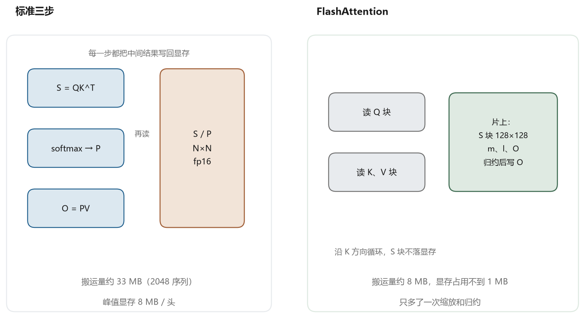
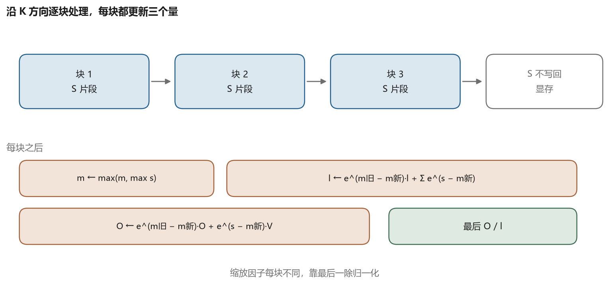

# Attention 与 FlashAttention

2048 个 token 的序列，单头注意力，头维度 64。中间那个 `QK^T` 的结果是 2048×2048 的矩阵，fp16 下 8 MB。32 个头加起来 256 MB，比很多模型的全部权重还大。可它只是中间结果，算完 softmax、乘完 V 就没用了。

把这块内存省掉的做法叫 FlashAttention。它做的事情听上去违反直觉，为了少读写，它把一部分计算重做了一遍。重算意味着更多的浮点运算，理论上更慢，实际却快了两到四倍（Dao 等，2022）。原因很简单，GPU 的算力远多于带宽，用一点多余的算力换掉大量的搬运，账是划算的。

## 注意力的三步

这个矩阵在训练时是显存的大头，在推理时是带宽的大头。训练一个 2048 上下文、32 头、32 层的模型，如果每个头的分数矩阵都要存下来供反向使用，光这一项就是 256 MB 乘 32 层，八吉字节。推理不存分数矩阵，可它要写下来再读回去，占的是时间不是容量。两种浪费的根源相同，中间结果的形状是 `N²`，而它只被用两次。

标准的注意力写成三步（Vaswani 等，2017）。先算分数矩阵 `S = Q K^T`，形状 `N × N`；再对每一行做 softmax 得到 `P`；最后算 `O = P V`，形状 `N × d`。

$$
S = \frac{QK^{\top}}{\sqrt{d}}, \qquad P = \mathrm{softmax}(S), \qquad O = PV
$$

三步各自是一个矩阵乘或者一个逐行归约，单独看都不慢。问题在于 `S` 和 `P` 要落到显存。`QK^T` 写完 8 MB，softmax 读一遍写一遍 16 MB，`PV` 再读一遍 8 MB。一共 32 MB 的搬运，而这三步的运算量是 `4 N² d`，2048 规模下约 1 GFLOP。算术强度算下来是 32，低于 fp16 的拐点 156，所以整段是带宽瓶颈。

把两笔账并排放，差距更清楚。2048 的序列、64 的头维度、fp16，Q、K、V 各 256 KB。

表 8-1　单头注意力在 2048 序列上的搬运量（按公式估算）

| 做法 | 显存读写 | 峰值显存占用 | 算术强度 |
|---|---|---|---|
| 标准三步 | 约 33 MB | 8 MB 的 S 与 P | 约 32 |
| FlashAttention | 约 8 MB | 不到 1 MB 的片上块 | 约 130 |

标准做法的 33 MB 里，绝大部分是 `S` 和 `P` 的四次读写，Q、K、V 只占 1 MB。FlashAttention 把这四次读写去掉，剩下的是 K、V 被每个 Q 块重复读一遍的开销。块越大，重复越少。

如果 `S` 和 `P` 能留在片上，搬运就只剩 Q、K、V、O 四个矩阵，一共 `4 N d` 个元素，`N²` 那一项消失了。问题是片上装不下整个 `N × N`，A100 一个 SM 的共享内存只有 164 KB，2048×2048 的 fp16 是 8 MB，差五十倍。装不下就得分块，分块就要处理 softmax 的归约跨越块边界的问题。

## decode 时它变成带宽问题

推理分两个阶段。prefill 一次处理整个 prompt，`N` 是几千，矩阵大、并行足，属于算力瓶颈。decode 一次生成一个 token，`N` 是 1，要算的是这一个 token 对全部历史 token 的注意力。

decode 的形状是 `1 × d` 的 Q，乘上 `N × d` 的 K，得到 `1 × N` 的分数。这一行 softmax，再乘 `N × d` 的 V 得到 `1 × d` 的输出。整段没有一次矩阵乘的规模超过 `1 × N × d`，张量核心在这上面使不上劲，因为 M 只有 1，补零到 16 之后十五分之十六的算力空转。每一步的运算量是 `4 N d`，搬运量是 `4 N d` 字节，算术强度正好是 1。

强度 1 意味着可达性能是 2 TFLOPS，只有峰值的千分之六。这就是大模型推理在小批处理下算力利用率极低的原因，它在图上的位置贴着斜线最左端，跟逐元素算子挨在一起。想让它变快，唯一的方向是提高强度，也就是让同一份 K/V 服务更多的请求。批处理把 Q 从 1 行变成 B 行，运算量涨 B 倍，搬运量不变，强度涨到 B。批大小 16 时强度 16，仍然不高，但已经能看出改善。

decode 的算术强度也可以用批大小来表达。批 1 时强度 1，批 B 时强度 B，因为 K、V 只读一遍，Q 有 B 行。要跑到 fp16 拐点 156，批大小得 156，显存根本装不下这么多 KV。实际的推理服务把批大小定在几十，接受强度只有几十的事实，转而用别的手段压缩 KV，比如量化到 int8、共享前缀、按需驱逐。这些手段改的是分母，不是分子。

KV 缓存的容量是另一个约束。一个 7B 模型，32 层，32 个头，头维度 128，fp16 下每个 token 的 KV 是 `2 × 32 × 32 × 128 × 2` 字节，512 KB。2048 个 token 就是 1 GB，批大小 8 就是 8 GB。显存就这么多，批大小上不去，强度也就上不去。这条链路把 decode 锁在了带宽瓶颈上。

## online softmax

FlashAttention 的核心是把 softmax 的归约做成流式的。softmax 的公式里有一个全局最大值和一个全局和，看起来必须先看完整行才能算，于是必须先写出 `S`。online softmax 指出，这个归约可以分块累加。

$$
m^{(j)} = \max\left(m^{(j-1)},\; \max_i s_{ij}\right)
$$

$$
l^{(j)} = e^{m^{(j-1)} - m^{(j)}}\, l^{(j-1)} + \sum_i e^{s_{ij} - m^{(j)}}
$$

每来一块分数，更新当前的最大值和当前的和，同时把输出累加器按新的最大值重新缩放。

$$
O^{(j)} = e^{m^{(j-1)} - m^{(j)}}\, O^{(j-1)} + e^{s_{ij} - m^{(j)}}\, V_j
$$

一块算完，`O` 里是未归一化的部分和，`l` 是配平因子，最后除一次就得到正确结果。整个过程只需要常数大小的片上空间，`S` 的那一整行永远不需要完整存在。

手算一遍块循环的搬运量。块大小取 128，序列 2048，Q 块有 16 个。每个 Q 块读一次 K 和 V，各 256 KB，一共 512 KB，16 个块就是 8 MB。加上 Q 本身 256 KB 和输出 256 KB，总共 8.5 MB。标准做法是 33 MB。四倍的差距直接对应到时间上，这就是论文里报告的加速比来源。块大小翻倍到 256，Q 块变成 8 个，搬运量减半到 4 MB，可 256 行 Q 加上 K 块要占的共享内存也翻倍，可能装不下，装不下就要减小 K 方向的块，重复读的次数又上去。块大小和片上容量是一对互相拉扯的量。

缩放的代价是每块一次乘法。块数越多，缩放的次数越多，但这些乘法是逐元素的，量级只有 `O(N d)`，远小于矩阵乘的 `O(N² d)`。真正多出来的运算是重算，反向传播时 `S` 和 `P` 不存，要重新算一遍。推理没有反向，所以 FlashAttention 在推理上只有收益，没有重算成本，只多了一点缩放和归约。这也是为什么它在推理里几乎是默认选项。

## 分块与并行划分

分块的尺寸怎么定，取决于三个量。片上能放多少，决定了 Q、K、V 三个块加起来的元素数上限；头的维度，决定了每个块的字节数；需要的并行度，决定了块不能太大，否则块数不够填满 SM。头维度 64、共享内存 100 KB，能放的 fp16 元素约 5 万个，头维度 64 时一个块最多 780 行，取 128 或者 256 是留出余量的结果。头维度 128 时同样的空间只能放 390 行，块要减半。

一个块里的循环是这样排的。外层的 Q 块固定，把这一块 Q 读进片上；内层沿 K 方向扫，每次读一块 K 和一块 V，算出一块分数，更新 `m`、`l`、`O`。K 方向扫完，`O` 除以 `l` 写回显存。整个过程中 `K` 和 `V` 被读的顺序由外层决定，每个 Q 块都要把 `K`、`V` 全读一遍。

IO 的复杂度可以写出来。Q 块有 `N/B_r` 个，每个要读 `N d` 个元素的 K 和 V，所以搬运量是 `N² d / B_r`。`B_r` 受片上容量限制，约等于 `M/d`，`M` 是共享内存大小。代进去得到 `N² d² / M`。标准实现的搬运量是 `N² + N d`，两者相比，倍数就是 `d² / M`。头维度 64、共享内存 100 KB 时，`d²/M` 约 0.16，搬运量降到六分之一；头维度 128 时约 0.64，收益小一些。

FlashAttention-2 改了三处（Dao，2023）。第一处是把非矩阵乘的运算再砍掉一部分，原来的实现里有些缩放和掩码的计算是逐元素的，占比不小，改成在矩阵乘的 epilogue 里做。第二处是把并行维度从 batch 和 head 扩展到序列维，prefill 时一个长序列只有几个 head，并行度不够，沿序列切块能让所有 SM 都忙起来。第三处是 warp 之间的分工，原来把 K 和 V 切给不同 warp，结果每个 warp 算出的部分和要跨 warp 归约，改成沿 Q 切，归约就不用跨 warp。

重算的成本可以算出来。丢掉 `S` 之后，反向传播要用它算梯度，只能拿 `Q` 和 `K` 重新乘一遍，代价是 `2 N² d` 次乘加。省下的显存读写是 `4 N²` 个元素。两者的比值取决于 `d`，`d` 越大，重算越贵。头维度 128 时，重算的运算量相当于把这一层再算一遍前向的 `QK^T`，而省下的搬运量是 8 倍于它的字节数。在算力富余、带宽紧张的卡上，这笔交换划算；在算力紧张的卡上，可能就不划算。

推理没有这个顾虑。前向只要算一次，`S` 和 `P` 用完就扔，本来也不需要保存，所以 FlashAttention 在推理上只多了一点缩放和归约的运算，省下的是纯粹的带宽。这就是为什么它在推理引擎里几乎是默认选项，而在训练里要权衡。

因果掩码是 decoder 的常态。第 i 个 token 只能看到前 i 个，`S` 的上三角被屏蔽。分块之后，完全落在上三角的块可以直接跳过，不读不写不算。一个 2048 的序列，块大小 128，能跳过大约一半的块。这个优化对 prefill 有效，对 decode 无效，因为 decode 的 Q 只有一行，所有块都落在需要计算的下三角里。

多查询注意力和分组查询注意力是另一条路，让多个头共用一份 K、V。8 个查询头共用一个 KV 头，KV 缓存直接降到八分之一，decode 的搬运量跟着降到八分之一。强度没有变，但分母小了，时间就短了。代价是表达能力，实际模型里用 4 到 8 个查询头共用一份 KV，精度损失在多数任务上测不出来。这一类改动发生在模型结构层，和算子层的 FlashAttention 不冲突，两者叠起来效果最好。

块内的归约也有讲究。一个 128 行的 Q 块，每行的 softmax 要横跨整个 K 方向，如果每行分给一个 warp，warp 内部的 32 个线程要对 128 个分数做归约，走的是 shuffle 而不是共享内存。行数不是 32 的倍数时，最后几个 warp 要处理边界，分支会让一部分 lane 空转。块大小取 64 的倍数，能让这些边界大多落整齐。

PagedAttention 解决的是另一个问题，KV 缓存按块管理，减少内部碎片和重复分配（Kwon 等，2023）。它和 FlashAttention 是叠加关系，不是替代关系，两者都假设 KV 是按块访问的。这部分属于调度和内存管理，留给《引擎》。

注意力的故事到这里可以收一下。它本来是一个 `O(N²)` 计算、`O(N²)` 访存的算子，算术强度中等，被中间矩阵拖成了带宽瓶颈。分块加 online softmax 把访存从 `O(N²)` 压到 `O(N² d²/M)`，强度提上去，瓶颈回到矩阵乘。decode 阶段受 KV 读取限制，强度接近 1，这个改不了，只能靠批处理、共享 KV 和缓存管理。

FlashAttention 之后，注意力的瓶颈回到了矩阵乘上。prefill 阶段的算力利用率能到五成以上，decode 阶段仍然是带宽瓶颈，因为它受限于 KV 的读取量，这一点算法改不了，只能靠批处理和 KV 缓存压缩。下一章回到更一般的问题，几个相邻的算子怎么合成一个，什么时候合不了。
