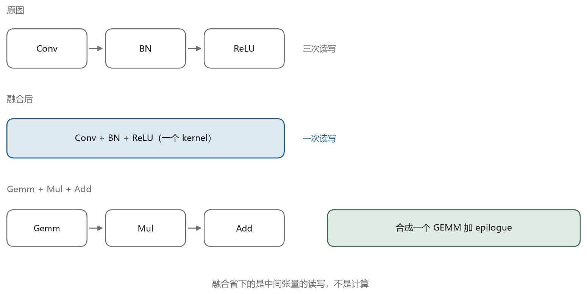
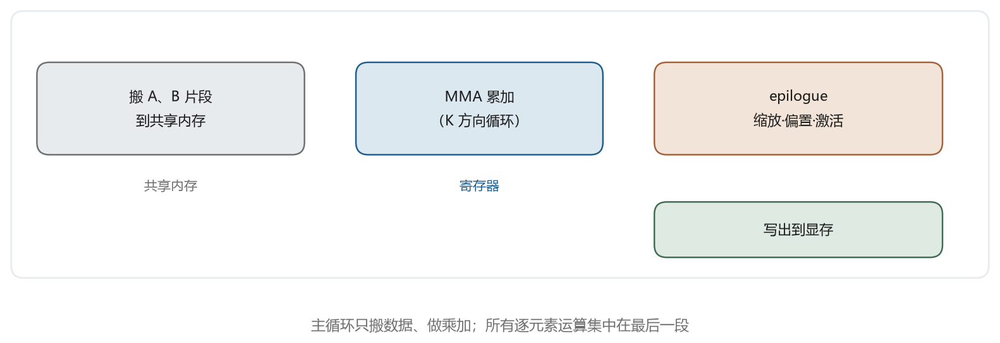

# 融合算子的写法与边界

一个 Conv+BN+ReLU 的残差块，拆成三个 kernel 跑，中间结果要写回显存两次再读回来两次。`512×56×56` 的 fp32 张量是 6.4 MB，四次搬运 25.6 MB，13 微秒。融合成一个 kernel，这 25.6 MB 全部消失，卷积算完的累加器还在寄存器里，乘个缩放、加个偏置、取个 max，直接写最终结果。

省下来的时间不体现在任何一行代码的加速比上，它是“没做的事”。这也是融合最难被感知的地方，profile 里只会看到 kernel 少了、时间短了，看不出是哪一步省下来的。融合（fusion）这个词在推理语境里就指这件事，把几个相邻的算子合成一个 kernel，中间结果只存在寄存器或者共享内存里，不落到显存。

## 两种收益

融合带来两样东西，减少显存流量和减少 kernel 数量。

显存流量的账很好算。两个相邻的逐元素算子，不融合时读 a 写 b，再读 b 写 c，一共 16 字节每元素；融合后只读 a 写 c，8 字节。带宽减半，时间也减半。这个倍数与张量多大无关，因为分子分母都是同一个元素数。可如果中间结果特别大，比如注意力的分数矩阵是 `N × N`，那么省下的字节数就是 `N²` 量级，序列长度翻倍，省下的时间变成四倍。融合的收益在大小上是有差别的，尽管比例一样。

kernel 数量的账在第十章细讲，这里先给个量级。一个 kernel 启动在 CPU 侧要几微秒，在 GPU 侧要一次全局同步，流水线要排空再填满。一个模型有几百个小 kernel，每个 kernel 只算几微秒，启动开销可能和计算本身一样大。融合把三个 kernel 合成一个，省下的是两次启动和两次同步。

拿一个残差块算一遍。输入 `512×56×56`，两次 3×3 卷积，两次 BN，两次 ReLU，一次残差相加，fp32 下每个张量 6.4 MB。不融合时，conv1、BN、ReLU、conv2、BN、ReLU 各读写一遍，每次 12.8 MB，残差相加读两个张量写一个，19.2 MB，合计约 96 MB。融合之后，conv1 读输入 6.4 MB，conv2 读 skip 6.4 MB 并写输出 6.4 MB，中间结果留在寄存器里，合计约 19 MB。差了五倍，而计算量一点没变。

这 96 MB 换算成时间是 48 微秒，19 MB 是 9.6 微秒，两者之差就是融合的收益。对比一下这一块的算力下界，两次 3×3 卷积加起来约 12 微秒，已经不比你节省的部分小。也就是说，在这个残差块上，搬运和计算是同一个量级，不融合的话一半时间花在搬家上。

为什么把中间结果留在寄存器里就这么便宜。一个寄存器写和读各只要一个周期，不需要地址计算，也不占带宽；而写回显存再读回来，光是延迟就是三百多纳秒，还要占两次带宽。更关键的是，一旦写回显存，这部分数据就可能被别的层挤到 L2 外面去，下次读的时候又是一次完整搬运。融合把一个“往返”变成了一次“就地加工”，这是它唯一也是全部的秘密。

两样收益的比例取决于算子。逐元素算子融合，省的主要是带宽；小 kernel 融合，省的主要是启动。判断方法很简单，看融合前后时间是按字节数比例降的，还是按 kernel 数量比例降的。

## Conv+BN+ReLU

这条路是三段折叠。BN 折进卷积的权重和偏置，第七章已经推过；ReLU 折进 epilogue，卷积算完的累加器直接过一遍 `max(x, 0)` 再写回。



写法上，主循环不变，改的是收尾那几步。CUTLASS 把这个位置叫 epilogue，字面意思是尾声，指主循环算完、结果写回之前的那一段。主循环把 `C = A × B` 累加到寄存器，epilogue 拿累加器的片段，做缩放、加偏置、激活，再写出去。标准库里提供的 epilogue 有线性组合、ReLU、GELU 几种，也可以自己写一个。把它想成一条生产线的最后一道工序，前面的切割、打磨都不能少，但贴标签、装盒子这道工序可以自由搭配。

```cpp
// 伪代码：一个融合了缩放、偏置、ReLU 的 epilogue
for each accumulator c in registers:
    c = c * alpha + beta          // BN 折叠后的缩放与偏置
    c = max(c, 0)                 // ReLU
    store(out + offset, c)
```

epilogue 里做这些事为什么不额外花钱，原因是位置。累加器在寄存器里，一个线程手上是 64 个 fp32，做一次乘加一次 max 只要几十个周期，而把这些数写回显存要等几百个周期。融合把“写出去再读回来”换成了“在寄存器里多算几步”，在带宽瓶颈的层上，多出来的算术指令被访存延迟掩盖，几乎测不出来。反过来，在算力瓶颈的层上，epilogue 的指令会真的加上去，一层已经很吃力的卷积再加个 GELU，时间会涨几个百分点。

### 一个融合 kernel 的骨架

手写一个融合 kernel，结构大致是四段。先算这个块负责哪一块输出，把坐标映射到输入；再把 A、B 的片段搬进共享内存，双缓冲，和主循环套在一起；然后做矩阵乘，累加器留在寄存器；最后走 epilogue，缩放、偏置、激活、读 skip、写回。

```cpp
__global__ void fused_conv_bn_relu(const half* in, const half* w,
                                   const half* bias, half* out) {
    // 1. 定位输出块，算出输入的起始地址
    // 2. 主循环：K 方向分块，cp.async 预取，ldmatrix 喂 MMA
    // 3. 累加器留在寄存器：C 片段
    // 4. epilogue：乘 alpha，加 beta，ReLU，写回
}
```

难点不在结构，在细节。输入的起始地址会因为 padding 变成负数，要单独处理越界的块。权重的排布要提前做一次重排，把 `KCRS` 的顺序改成 MMA 需要的片段顺序，这次重排是一次性的，在加载模型时做，不进入推理时间。输出的写回要考虑对齐，`56×56` 的最后一行凑不满 128 字节，要拆成标量写。

调试这类 kernel 有个笨办法但很有效，先关掉融合，把每一步的中间结果都写出来，和参考实现比对；确认每一步都对，再逐步合并，每合并一步比对一次。一次合并两步，出错的时候分不清是哪一步错了。

边界在训练。训练时 BN 的统计量每个 batch 都在变，权重没法提前折进卷积，融合只能在推理图上做。另一个边界是数值，折叠把 γ 除以 σ，某些通道的权重被放大，fp16 下可能溢出。工程上的做法是折叠后重新统计权重的范围，超出的通道单独处理，或者整体留一份 fp32 的副本。

## Gemm+Mul、Gemm+Add 与 Scale+Linear

矩阵乘后面接一个逐元素仿射变换，是最常见的融合模式。语言模型里的 `y = Wx + b` 后面经常跟着一个缩放或者门控，`y = (Wx + b) * g + d`，四个参数都能并进 epilogue。

$$
y = \gamma\,(Wx + b) + \beta
$$

展开就是 `W' = γW`，`b' = γb + β`。γ 是标量时，权重整体乘一个数，可以提前做；γ 是向量时，每个输出通道一个缩放，也一样能提前乘进权重，因为矩阵乘的每一行正好对应一个输出通道。只有当 γ 依赖输入时才不能提前，比如门控线性单元里的 `silu(gate) * up`，两个矩阵乘的输出逐元素相乘，这时的乘法只能在 epilogue 里做，但依然不需要单独起一个 kernel。区别在于前一种能提前到加载模型时，后一种必须每次推理都算。

Scale+Linear 是量化的常见尾巴，反量化就是把整数乘上 scale 再加零点，形式和平移变换一样，直接在 epilogue 里做。这样量化模型的最后一层不必先写整数再读出来反量化，省掉一次全张量的往返。



这些融合的共同点是“一个输入一个输出”，中间不产生新的张量。只要满足这个条件，epilogue 里的运算几乎不花钱，因为它用的是已经在寄存器里的数据，唯一增加的是几条算术指令，而这几条指令在带宽瓶颈的层上完全被掩盖。

把反量化当成一个具体例子。一层 int8 矩阵乘算出的是 int32 累加值，要用 `y = (acc - zp) * scale` 变回浮点，其中 zp 是零点、scale 是缩放因子，这一步叫反量化。不融合时它要读一遍 int32、写一遍 fp16，`1×4096` 的输出是 16 KB 加 8 KB；融合进 epilogue 之后完全省掉，代价只是每个元素多两次乘法。累加器本来就在寄存器里，这两次乘法连延迟都盖得住。

再补一个反向的例子，说明什么情况下 epilogue 不能免费。如果后接的运算是 softmax 或归一化，它需要看到一整行或一整列才能算，而 epilogue 手上只有一个线程负责的那几个元素，信息不够。这时候只能退回独立 kernel，或者像下一童讲的那样把整个归约做成流式的，在片上累加着算。会不会花这个钱，只取决于后面的算子是不是逐元素的。

## ConvAdd 与残差

残差相加是另一种形状，两个输入一个输出。`y = conv(x) + skip`，skip 来自几层之前，可能要读一次显存。融合的做法是在卷积的 epilogue 里读 skip，加完再写 y。

这里有个生命周期问题。如果 y 和 skip 是同一块内存，也就是原地相加，那么 skip 在被读之前不能被覆盖。一个块算完写回时，另一个块可能还没读它需要的 skip 区域，写早了就读到新值。解决办法是让每个块只写自己负责的那一块，并且保证块的划分和 skip 的划分一致。这在 NCHW 下容易做到，因为通道连续；在 NHWC 下要按空间位置切，边界容易出错。

拿具体形状看一遍。`512 × 56 × 56` 的激活按 NHWC 分成 128 个块，每块负责 4 行像素。如果写回时跨了行，比如一个块写了一部分，相邻块还在读同一行，就会出现干扰。这类问题在单线程测试里不一定暴露，因为调度顺序碰巧对了；在并发高的时候才出错，而且是偶发。调试时可以把块数人为调小、加重同步，把竞态放大。

另一个问题是 skip 可能被多处引用。残差结构里 skip 一般只被加一次，但有些结构会把它送到两个分支，这时候原地写会破坏另一个分支的输入。编译器做融合时会做生命周期分析，发现引用计数大于一时就不做原地写，改为分配新缓冲区，代价是多一次写和一份显存。

这个代价有时很大。一个 `512×56×56` 的 fp32 缓冲区是 6.4 MB，几百层里只要有几十层需要额外缓冲，就多占几百 MB，相当于多开了一个批次的余量。所以融合不是只看时间，还要看显存；在显存紧张的场景里，宁可多一次拷贝，也不能多一块常驻缓冲。这也是为什么推理引擎在融合时会先算峰值显存，再决定哪几条链合。

把两种写法的差别记成一句话：原地相加省一块显存，但需要保证读写不交叠；开一块新缓冲一定正确，代价是显存和一次写。前者在通道连续、块划分整齐的 NCHW 上比较好用，后者在 NHWC 和多分支结构里更稳。这也是为什么推理引擎在融合时会先算峰值显存，再决定哪几条链合。

## 融合为什么失败

融合不是总能做。有五种情况会让它失败或者变慢，每一种都能在 profile 里看出来。

布局不一致。卷积的输出是 NHWC，下一个算子期望 NCHW，融合就得在中间转一次布局，转布局本身要读写一遍全张量，还不如不融合。这类问题在多框架拼接的模型里很常见，每换一次框架就换一次布局，每次转换都是一次全张量的往返。判断方法很简单，看融合前后的带宽，如果没降反而升了，就是这个原因。

精度不一致。卷积用 fp16 累加，后面的加法要求 fp32，epilogue 里要做类型转换，转换本身不贵，可它打断了向量化，写出的数据宽度从 128 位掉到 64 位，带宽利用率下降。

动态形状。融合要在编译时确定块的大小和循环次数，形状每次推理都变，就只能退回通用实现。这也是为什么动态 shape 的模型在推理引擎里性能通常差一截。举个具体情形，一个检测模型要处理 640×640 到 1920×1080 之间任意分辨率的输入，每换一种分辨率，特征图的尺寸就变，块数也跟着变，融合 kernel 里的循环边界就对不上，只能重新编译或者退回通用路径。固定分辨率的服务没有这个问题，所以同样的模型在固定输入下往往能快百分之二十。

中间结果还有别的用途。有些层需要保存中间激活做辅助损失，或者需要输出中间特征做可视化，这时候中间结果必须落地，不能只在寄存器里过一遍。

寄存器压力是第六种，也是最隐蔽的一种。融合之后两段逻辑挤在同一个 kernel 里，它们的中间变量共享同一批寄存器，用量可能超过一个线程能拿到的上限，编译器只好溢出到本地内存，而本地内存就是显存。表面上 kernel 数量少了，实际上多出了溢出流量，可能比不融合还慢。判断方法是看编译日志里的 spill 字节数，不为零就要警惕。

融合和量化的交互也要考虑。量化模型里，卷积后面接反量化，再接激活，算子是三个，逻辑上是一件。融合可以把反量化并进 epilogue，把激活并进同一个 kernel，一次写完。但如果量化方案要求每一层输出都存成 int8 再读出来做缩放，融合就被打断，因为中间结果必须以整数形式落地。选量化方案时要问清楚这一点，逐层量化和逐通道量化对融合的要求不一样，前者更依赖中间结果落地。

需要精确的中间统计。量化校准要统计每一层的激活范围，融合之后中间结果不落地，统计就没法做。很多框架的做法是校准阶段用不融合的图，校准完再切回融合图。

还有一类失败不那么明显，融合之后反而变慢。两个算子的最优块大小不同，卷积喜欢 128×128，后面的逐元素喜欢 128×1，硬凑成一个 kernel，块大小只能取折中，两边都跑不到最优。或者两个算子的并行度不同，前一个的输出块数刚好填满 SM，后一个只有几块，融合之后尾效应被放大。这类情况靠 profile 才能发现，看融合前后的时间，涨了就退回去。

融合的收益还会被编译时间吃掉一部分。一个融合的 kernel 从写到能用，通常要几天，调试花的时间比写代码多。判断一个融合值不值得，可以按字节数算。融合省下的字节数乘以带宽的倒数，就是理论收益；融合增加的成本是代码复杂度、调试难度和边界处理的指令开销。收益大于几微秒的融合值得做，小于一微秒的融合往往被边界处理的成本吃掉。

融合的上限由数据流决定。一条链上每个张量只被读写一次，就是融合的极限，再往下压只能改算法本身。实际的图里，能融合的链通常只占一部分，剩下的张量因为分支、跳连、多消费者而必须落地。所以端到端的收益总比逐条链算出来的小，能到一半就算不错。

到这里，单个算子和几个算子的组合都讲完了。剩下的问题是它们怎么被组织起来执行，谁来保证顺序，怎么减少调度开销。下一章讲流和 CUDA Graph。
