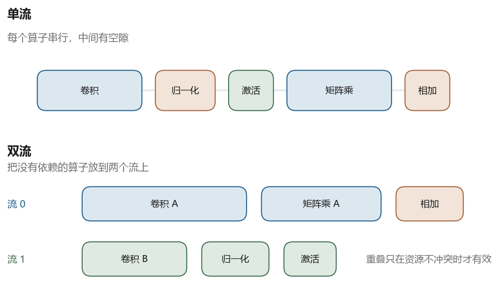
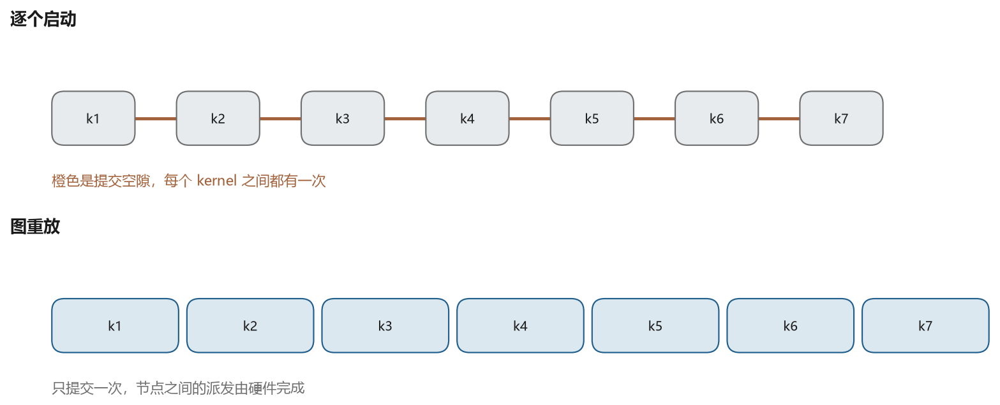

# 并行、流与 CUDA Graph

假设一个检测模型有 180 个 kernel，平均每个算 5 微秒。按说 0.9 毫秒能跑完，实际端到端 2.8 毫秒。看 Nsight 的时间线，GPU 上是一串短块，块与块之间有空隙，空隙加起来比块还长。SM 利用率只有三成，可算力并没有闲着，它在等 CPU 把下一条命令送过来。

这种“算得快、发得慢”的情况在小模型和高帧率场景里很常见。单看每个 kernel 都快到极限，端到端就是慢，因为调度开销没办法分摊。解决它有两层手段，一是在流上做并行，让多个 kernel 同时跑；二是把启动序列录下来重放，把 CPU 的工作压到一次。

## 启动一次要多久

先把这个空隙量化。一个逐元素 kernel 在 A100 上算 6 微秒，同一条时间线上，它前面的空隙可能也有 4 微秒。180 个这样的 kernel，空隙加起来 0.7 毫秒，占端到端的四分之一。

一次 kernel 启动，在 CPU 侧要做几件事。检查参数、分配一个命令包、写进门铃（doorbell）、更新内部的队列状态。门铃是一块内存映射的寄存器，CPU 往上写一个值，GPU 就知道有新命令了，这个名字很形象，跟按门铃让里面的人开门是一个意思。在老一代的驱动和硬件上这要五到十微秒，现在降到两微秒左右，可如果你的 kernel 只算三微秒，这两微秒就是百分之四十。

在 GPU 侧，kernel 之间也不是零成本切换。前一个 kernel 的最后一个块跑完，要等所有块都结束，硬件才能开始下一个。这段时间叫尾部延迟，块数越多、每块时间越不均匀，尾部越长。一个 kernel 有 1000 个块，最后一批只有 20 个块在跑，其余 SM 空着，这段空转也要算进端到端。

启动开销可以自己测。写一个空 kernel，循环启动一万次，用 event 计时，总时间除以一万就是单次开销，通常在两到五微秒之间。再写一个只做一次乘加的 kernel，对比两者的差，就是硬件派发本身的时间。这个数在不同驱动版本上会变，升级驱动之后重新测一次不吃亏。

测的时候要注意一件事，得先让 GPU 忙碌起来。如果每次启动之后都同步一次，测到的就是“启动加一次往返”的时间，比真实的吞吐开销大得多。正确的写法是一次性排入一万个 kernel，最后同步一次，这样 GPU 侧的执行会连起来，测出来的才是纯启动开销。这个细节看起来小，很多网上流传的“启动开销八微秒”就是没排好队测出来的。

两个开销叠加，结果是 kernel 越小越吃亏。一层 3×3 卷积在 `56×56` 上还有几十微秒的活干，一个 LayerNorm 只有六微秒，一个残差加只有三微秒。后两类在时间线上就是一串密集的小点，空隙比点还宽。

把这件事换算成一个比值就清楚了。一个 kernel 能接受的开销占比，取决于它自身多长：十微秒的 kernel，两微秒开销占两成，勉强可接受；两微秒的 kernel，开销比它本身还长，吞吐直接减半。所以“减少 kernel 数量”在小模型上的优先级高得吓人，它不靠优化，而是靠减少需要优化的次数。

## stream 与 event

CUDA 的 stream 是一条命令队列，同一个流里的操作按顺序执行，不同流之间可以并发。把它想成超市的收银台，一个队伍一个台，队内先来后到，两个队可以同时结账。默认情况下一个 CUDA 程序只有一个流，所有 kernel 排一条队，前一个不完，后一个不上。把一个模型的独立分支放到不同流里，理论上可以让卷积和归一化同时跑。

实际能重叠多少，取决于三件事。第一是依赖，两个算子如果有数据依赖，就不能放进不同的流，除非中间插一个 event 做同步。第二是资源，两个 kernel 都要吃满 SM 的时候，放两个流只会让它们互相抢，总时间不比串行短。第三是带宽，两个都是带宽瓶颈的 kernel，叠在一起之后总带宽不变，时间还是那么多。这三条里任何一条不满足，重叠都不会发生，只会多出同步开销。

默认流有个历史包袱。在老版本的语义里，默认流会和其他所有流隐式同步，一个 kernel 放进默认流，别的流上的操作就得等它。这个行为可以用编译选项改成“每线程默认流”，改完之后默认流只和自己线程的流同步，并行才真正生效。很多代码在多流上跑不出效果，原因就是这个隐式同步没关掉。

还有一个数量关系值得记住。两个流的加速比上限是二，但要拿到二，两个 kernel 必须完全不争资源。现实中能拿到百分之二十到三十就算不错。所以多流不是免费的午餐，它的收益来自填补空隙，空隙填满之后再分流只会增加竞争。判断有没有空隙，看时间线就够了，如果 GPU 上已经几乎没有白块，多流不会带来任何好处。

真正值得放多流的是互补的 kernel。一个用张量核心、一个用特殊函数单元，或者一个读、一个写，重叠才有意义。典型场景是数据加载和计算重叠，把 H2D 拷贝放在一个流，计算放在另一个流，拷贝不占 SM，能完全藏住。另一个场景是多路请求，每一路的 kernel 都很小，合成一个流跑不满 GPU，分成四路就能填满。

服务端的做法和离线批处理不一样。离线跑测试集，一个大批次塞满 GPU 最快；在线服务，请求一个接一个来，每路都很小。这时候有两种策略，一是攒批，等几毫秒凑够一批一起算，用单流；二是每路一个流，让它们自然重叠。前者的延迟下限是攒批的等待时间，后者的显存占用随并发线性增长，两者都要在延迟和吞吐之间选一个点。选错了的现象是 GPU 利用率上不去，或者 p99 延迟突然翻倍。

event 是用来做跨流同步的。`cudaEventRecord` 在一个流里打一个标记，`cudaStreamWaitEvent` 让另一个流等到这个标记。用 event 的时候要注意，事件本身不阻塞 CPU，它只是插一个依赖。写了 event 却忘了 wait，是这类代码最常见的错误，结果时对时错，取决于执行顺序。

## CUDA Graph

CUDA Graph 换了一个思路。既然启动开销来自一次次提交，那就把整串提交录下来，编译成一个图，之后每次只发一次。图（graph）在这里不是计算图的意思，而是提交记录，每个节点是一次 kernel 启动或一次拷贝，边是它们之间的依赖，很像把一封封快递单换成一整张发货清单。

用法分三步。先用 stream capture 把一段正常的提交序列录下来，CUDA 自动推断出节点和依赖；然后 instantiate 成一个可执行的图，这一步会做一次优化，把可以并行的节点排到一起；之后每次推理只调一次 `cudaGraphLaunch`。CPU 的工作从几百次提交变成一次，GPU 侧的调度也从逐个派发改成按图执行。capture 这个名字很形象，就是“录下来”，录的时候 kernel 不会真的算，只是把调用记下来；instantiate 则把记录变成一份可以直接交给硬件的执行计划。

图的构建有两种方式。capture 最省事，把现有代码包一层就能录。手工建图更可控，用 `cudaGraphAddKernelNode` 一个个加节点，依赖关系自己指定，适合需要精细排布的场景，比如把两个本来串行的分支显式并行化。手工建图的代码量大，但不用改原来的 kernel，只是换一种提交方式。

图也不是万能的。它省的是 CPU 侧的提交，GPU 侧的内核切换还在，两个节点之间仍然有一次派发，只是这次派发由硬件完成，比驱动快。所以 kernel 数量特别多的模型，图能把开销从两微秒降到零点几微秒，但降不到零。真正的解法还是减少 kernel 数量，也就是融合。

收益在小 kernel 多的模型上最明显。一个 180 个 kernel 的模型，逐个启动 2.8 毫秒，图重放可能降到 1.2 毫秒，省下来的全在空隙里。kernel 本身没变快，只是不再排队。

图对推理服务还有一个副作用，它让时间变得可预测。逐个启动的模型，延迟抖动大，因为 CPU 侧的排队受系统负载影响。图重放的时间稳定，这对有 SLA 的服务很重要，用户看到的 p99 延迟比起平均值更能决定体验。

限制也很硬。图里的形状、地址、参数在 instantiate 的时候就固定了，输入的形状变了，图就用不了，要重新 capture。为什么要固定，因为图在实例化时就把每个节点的资源需求算好了，包括要多少共享内存、启动多少个块，这些数直接写进了执行计划，运行时不再重新计算，也就无法应变。地址变了可以更新，用 `cudaGraphExecKernelNodeSetParams` 改节点参数，比重新 capture 便宜。批大小变化是图最常见的敌人，一个服务要支持动态批处理，就得为每个批大小准备一张图，或者把批大小固定下来，用 padding 补齐。

还有几个坑。capture 期间不能做同步操作，`cudaDeviceSynchronize` 和会隐式同步的 API 都会让 capture 失败。图里的内存分配要用图内存池，普通的 `cudaMalloc` 在 capture 期间是不允许的。多流 capture 要指定从哪个流开始，其他流通过 event 汇入，写错了 capture 会录不全。

## 三种切分方式

多卡并行的三种切法，在概念上要分清，因为它们对通信的要求完全不同。

数据并行把批切开，每张卡跑完整的模型，梯度或者输出汇总。它的英文是 data parallel，核心思想是“同样的代码，不同的数据”。它的问题是每张卡都要存一份完整权重，模型大了放不下。通信量是每层输出的大小，在推理时只在最后汇总一次，所以对带宽要求低。

张量并行把一层的矩阵按列或者按行切开，每张卡算一部分，算完用 all-reduce 合并。它的英文是 tensor parallel，切开的是张量本身。all-reduce 是一种集合通信操作，每张卡拿着自己那份部分和，最后所有人拿到总和，可以想成几个人各算了一段报表，最后大家把结果加起来并抄一份。它能把单层拆到多卡，权重也一起拆了，代价是每层都要通信一次，对互联带宽要求很高。一层里的 all-reduce 是延迟敏感的，卡间带宽不够时，通信时间会超过计算时间。

流水并行把层按段切开，每张卡负责一段，微批依次流过。它的英文是 pipeline parallel，跟工厂流水线是一回事，每道工序只做一小部分，工件依次传递。它的问题是流水线填充和排空，段数越多，气泡越大。一个四段的流水线，气泡占了四分之一的时间，除非微批足够多。

数据并行和张量并行的差别在通信频率上。数据并行每个微批只通信一次，通信量等于输出的大小；张量并行每一层都要通信，通信量等于激活的大小乘上层数。层数越深，张量并行的通信越频繁，对互联的带宽和延迟要求越高。一张卡内部走 NVLink，带宽是 PCIe 的十几倍，跨机走 InfiniBand 又低一个量级，所以张量并行通常限制在单机之内。

流水线的气泡可以算。段数 p，微批数 m，理想情况下每个微批在每个段上花一份时间，总时间 `(m + p - 1)` 份，有效利用率是 `m / (m + p - 1)`。四段、四个微批，利用率只有一半；四段、三十二个微批，利用率到 0.89。这就是为什么流水并行要求微批足够多，也是为什么段数不能太深。通信在段之间发生，段越多，每一次微批流过都要多等一次。

这三种切法常常混用。一个百亿参数的模型，可能用 8 路张量并行加 16 路流水并行，再加数据并行。每加一种切法，通信的模式和开销就变一次，端到端的账越来越难算。这部分细节属于分布式推理，不在这本书的范围里，这里只需要记住一句话，并行的收益永远小于线性，因为通信和同步不会自己消失。

框架层的开销也不能忽略。一次推理从 Python 调用进来，要经过参数检查、算子分发、内存申请、流同步，PyTorch 的 eager 模式每个算子都有这几步，加起来几十微秒。这部分开销在 GPU 时间线上看不到，它发生在 CPU 侧，可它会让 GPU 空着等。把它想成餐厅的前台，厨房再快，点单的人一条一条报菜名，厨房也只能等着。用 `torch.cuda.set_sync_debug_mode` 或者 trace 工具能看到同步点，用静态图或者编译模式能把这部分压下去。这也是把单个 kernel 放回整张图之后才会显现的一类开销。

回到单卡。流和图解决的是“发得慢”，还没解决“算得不对地方”。下一章讲怎么用 Nsight 找到时间到底花在哪里。
