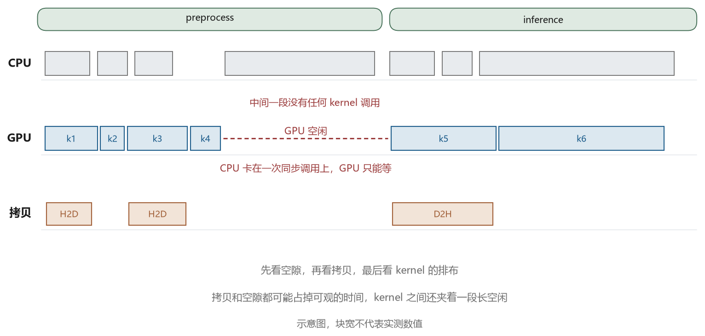

# 用 Nsight 找瓶颈

举个例子。一个分割模型的端到端延迟是 42 毫秒，目标是 30。看 `nvidia-smi` 之类的工具，GPU 利用率常年在 90% 以上，看起来卡已经跑满了。用 Nsight Systems 打开时间线，情况完全不同，GPU 那一行有一半是空的，实际在算的只有 18 毫秒，另外 24 毫秒花在三次显存拷贝和两次等待上，其中一次等待来自一个同步调用。

利用率这个数字骗人，因为它只统计“有 kernel 在跑”的时间，不区分 kernel 是在算还是在等。更细的指标要求 GPU 在同一时刻既满了算力又满了带宽，而这几乎不可能，因为两者本来就是此消彼长的关系。要看清时间花在哪，得用能看时间线的工具。

## Nsight Systems 看时间线

工具本身是两件，一件看全局，一件看局部，用错了顺序会浪费很多时间。常见的情况是拿着 Nsight Compute 一个个 kernel 分析，看到每个都很健康，回到端到端还是慢，因为问题根本不在 kernel 里。先把时间线的坑填上，再进 kernel，这是唯一稳妥的顺序。

Nsight Systems 是系统级的工具，它记录 CPU 线程、CUDA API、kernel、内存拷贝、以及你用 NVTX 打的标记，画成一条时间线。它的价值在于把“应用做了什么”和“GPU 做了什么”对齐。

看时间线有几个固定的顺序。

先看 GPU 行有没有空隙。空隙意味着 GPU 在等，等的原因可能是 CPU 还没提交、可能是同步点、可能是拷贝没完成。空隙超过总时间的两成，端到端就已经不是 kernel 的问题了，再优化 kernel 也没用。

再看拷贝。H2D 和 D2H 在时间线上是单独的一行，一次 200 MB 的拷贝在 PCIe 4.0 上要 6 毫秒，如果它发生在推理路径上而不是提前做好，这 6 毫秒就白白加在延迟里。很多模型第一次推理慢，原因就是权重还在页锁定内存里没搬过去。

然后看 kernel 的排布。同一层的几个 kernel 如果被拆成串行的五六段，中间还夹着空隙，说明融合没生效或者流没排好。如果看到一条很长的 kernel 后面跟着一串几微秒的小 kernel，说明大头已经优化过了，剩下的是调度开销。

时间线还可以对比两个版本。把改动前后的两次 profile 各存一份，用工具自带的对比视图叠在一起，红色的部分是变慢的，绿色的是变快的。对比比单看一份更有说服力，尤其是改动很小的时候，肉眼在单份时间线上看不出差别。

最后看 CPU 行。CPU 那一行如果一直在密集地调 CUDA API，说明提交是瓶颈；如果 CPU 有空闲而 GPU 也有空隙，说明两边都在等某个外部事件，比如数据加载或者网络请求。

NVTX 是配合时间线用的标记接口。在代码里插 `nvtxRangePush("preprocess")` 和 `nvtxRangePop()`，时间线上就会出现一个彩色的区间，标注这一段属于哪个阶段。框架一般已经内置了，PyTorch 的 profiler 会把算子名和形状写进标记，TensorRT 有 `--nvtx` 选项。没有标记的时间线是一堆没有名字的块，有了标记才知道哪一段是解码、哪一段是注意力。

Nsight Systems 不告诉你 kernel 内部发生了什么，它只回答“时间花在哪个阶段”。要往下钻，换一个工具。

## Nsight Compute 看单个 kernel

Nsight Compute 是 kernel 级的工具，它把选中的 kernel 单独跑一遍，收集几十组硬件计数器，算出各项资源的利用率。它的核心视图叫 Speed of Light，两个百分比，一个算力利用率，一个内存利用率。

这两个数的含义要说清楚。算力利用率是“实际发出的计算指令占峰值吞吐的比例”，内存利用率是“实际达到的带宽占峰值带宽的比例”。两个都低，说明既没算满也没搬满，问题在延迟或者并行度；一个高一个低，说明瓶颈在那个高的上面；两个都接近八成，说明这个 kernel 已经到极限了。

Speed of Light 下面还有一个 memory chart，把各级存储之间的流量画成一张图。它能直接指出哪一级的流量异常，比如共享内存的读写量是 DRAM 的十倍，说明复用做得不错；如果两者接近，说明共享内存几乎没起作用，数据搬进来用一两次就扔了。这张图对判断分块有没有生效特别有用，比看代码快得多。

往下看三个视图。

Memory Workload Analysis 给出各级存储的命中率和请求效率。L1 命中率低说明局部性差或者共享内存没用好；L2 命中率低说明工作集超过了 40 MB；DRAM 的“每个请求的扇区数”如果大于 4，说明访问不合并，一个请求拉回了用不上的数据。这一项直接对应第二章讲的合并访问。

Scheduler Statistics 给出每个周期的发射情况。发射槽利用率低于六成，说明 warp 不够或者指令之间有依赖。活跃 warp 数和合格 warp 数（eligible）是分开统计的，活跃但不够格，说明 warp 都在等某个资源。

Warp State 给出 warp 停在什么原因上。最常见的几项是 long scoreboard（等全局内存）、MIO throttle（共享内存或特殊函数队列满）、barrier（等同步）、not selected（有别的 warp 被选中，这一项不是问题）。如果 long scoreboard 占了一半以上，说明访存延迟没被盖住，要么提高占用率，要么改进局部性。如果 MIO throttle 高，说明共享内存访问太频繁或者有 bank 冲突。

## 三个常见误判

第一个误判是把“利用率高”当成“算力用满了”。SM 的利用率统计的是有 warp 驻留的时间，一个 warp 在等内存的时候也算活跃。要看真正算得怎么样，得看算力利用率和 stalled 的比例，而不是看 SM 的占用。

第二个误判是只看单个 kernel 的时间。一个 3 微秒的 kernel 在 Nsight Compute 里看起来很完美，带宽七成、算力两成，没什么可优化的。可模型里有 200 个这样的 kernel，每个前面有 2 微秒的启动空隙，加起来 0.4 毫秒。这时候该做的是把它们合成一个，而不是优化其中任何一个。

第三个误判是漏掉拷贝和同步。端到端延迟里，kernel 时间只占一部分。输入预处理在 CPU 上做的，要算进延迟；输出后处理要算；显存分配第一次的开销要算；那些隐式的同步点，比如 `.item()`、`print(tensor)`、`torch.cuda.synchronize()`，每一次都会把流水线排空。这些在 kernel 视图里都看不到，只能在时间线上找。

还有一个视图叫 Source，它把指标按源码行聚合。一个 kernel 里哪一行的访存最多、哪一行的 stall 最多，都能看到。这个视图对定位分支和边界处理特别有效，代码里一处不起眼的 `if (idx < n)` 可能就是瓶颈，因为它让最后一批 warp 全部走另一条路径。

还有一个技术性的坑。Nsight Compute 为了收集计数器，会把 kernel 重放多次，还会把并发的 kernel 串行化。它测出的时间是失真的，不能拿来当基准。正确用法是用它看比例和瓶颈，用 Nsight Systems 或者普通的端到端计时看绝对时间。

## 从端到端拆到 kernel

定位的流程是一条自顶向下的链，每一步都在缩小范围。

第一步，量端到端。同一个输入，同样的预热次数，跑一百次取中位数。同时记录 p50 和 p99，两者的差距说明抖动有多大。

第二步，切分阶段。用 NVTX 在前处理、推理、后处理各打一个标记，看每个阶段占多少。如果前处理占了四成，先去看前处理，别碰模型。

第三步，按 kernel 排序。用 Nsight Systems 的汇总视图，看按总时间排序的 kernel 列表。注意是总时间而不是单次时间，一个每次 2 微秒但出现 500 次的 kernel，总时间比一个出现 5 次的 100 微秒 kernel 更长。

排序的时候要区分“设备时间”和“挂钟时间”。设备时间是 kernel 在 GPU 上占用的时间，挂钟时间是从第一个 kernel 开始到最后一个结束。两者之差就是空隙和拷贝。一个内核总时间 20 毫秒、设备时间 12 毫秒的模型，第一优先级是把 8 毫秒的空隙找出来，不是把 12 毫秒压到 10。

第四步，选一个 kernel 做深入分析。选总时间占比最高的那个，用 Nsight Compute 看它的 SOL、访存效率、stall 原因。

第五步，形成一个假设并只改一个变量。假设是“这个 kernel 的瓶颈在 DRAM 带宽，因为每次请求只用到 4 字节”，改动就是向量化加载，让每次请求用到 16 字节。改完复测，看带宽是不是上去了。

第六步，回到第一步。一个改动可能把瓶颈推到了别处，原来的第二瓶颈变成第一，流程再走一遍。

每一步都要留下记录。改了什么、为什么改、复测的结果是多少，写在同一个地方，一周后回来看还能接上。性能工作最容易丢的不是方法，是上下文，尤其是几个人接力的时候，一个人做的实验另一个人不知道，同样的事情会重做三遍。

这条链里最容易犯的错是跳过前两步。直接打开 Nsight Compute 分析一个 kernel，优化了半天，端到端只快了百分之二，因为那个 kernel 只占百分之三。先知道钱花在哪，再决定省哪一笔。

假设你面对一个 42 毫秒的检测模型。时间线上 GPU 行有 24 毫秒是空的，其中 18 毫秒是三次 `cudaMemcpy`，6 毫秒是 CPU 侧的空档。三次拷贝里两次是输入的图像预处理结果，一次是输出搬回主机。把预处理改成在 GPU 上做，两次拷贝消失，预处理本身也从 8 毫秒降到 0.6 毫秒。剩下的一次拷贝改成异步加双缓冲，藏在计算后面。42 毫秒变成 24 毫秒，一次 kernel 都没优化。

再往下看 kernel 列表，占比最高的不是卷积，是一个 `concat` 后面跟着的 `slice`，两个加起来 3.2 毫秒。它们在拼特征金字塔的多尺度输出，形状不规则，每次推理都要重新分配显存。改成预先分配一块固定大小的缓冲区，两个 kernel 合并成一个拷贝，3.2 毫秒降到 0.4 毫秒。最后才轮到卷积，把两个 3×3 层换成 implicit GEMM 的库调用，省下 1.5 毫秒。

这个顺序是典型的。先拿掉搬运和同步，再处理调度和融合，最后才是 kernel 内部。反过来做，前面的浪费会把后面的收益吃掉。

流程本身不难，难的是坚持一次只改一个变量。同时改三处，复测快了百分之二十，你不知道是哪一处起了作用，也不知道另外两处是不是在拖后腿。慢一点，但每一步都可归因。

下一章处理一个更基础的问题，数据在显存里怎么排。布局错了，前面所有的优化都会打折。
