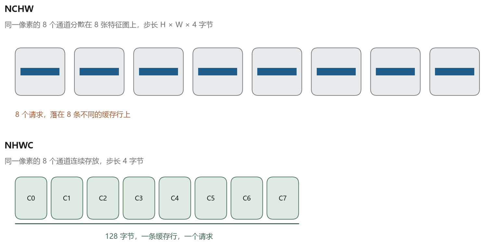

# 带宽、布局与权重分块

同一个 ResNet-50，同一个批大小，同一个 GPU。一份用 PyTorch 的默认布局跑，一份先把权重和数据都转成通道在最后的布局，后者的卷积部分快了一点五到两倍。模型没有变，精度没有变，唯一变的是内存里元素的排列顺序。

布局这件事在前面的章节里提过几次，每次都只说“合并访问很重要”。到了具体的层上，它决定了张量核心能不能用、向量化加载能不能对齐、共享内存的 bank 会不会撞。一个模型的布局选错了，前面所有的分块和流水都要打折。

## NCHW 与 NHWC

张量有四根轴，批、通道、高、宽。NCHW 把通道放在第二根，NHWC 把它放到最后。这四个字母就是四根轴的缩写，N 是 batch size，C 是 channel，H 是 height，W 是 width，字母顺序就是内存里从外到内的排列顺序。两种排法在数学上等价，在内存里的样子完全不同。

NCHW 下，同一个通道的相邻像素挨在一起，通道之间隔着一整张特征图。取一个像素的全部通道，要走 `H × W` 步。NHWC 反过来，一个像素的 C 个通道连续放着，取通道是连续的，取相邻像素要跨 `C` 步。

具体看地址。`1×512×56×56` 的 fp32 张量，NCHW 下通道的步长是 `56×56×4`，12544 字节。一个 warp 的 32 个线程各取一个通道的同一个像素，地址相隔 12544 字节，落在 32 条不同的缓存行上，一次访问要 32 个请求。NHWC 下同样的访问，32 个通道连续放着，128 字节，一条缓存行，一个请求。同样的数据量，请求数差 32 倍，有效带宽差几十倍。这个差距在按通道归约的 kernel 上直接可见，实测带宽往往只有峰值的十分之一，先转一次布局再归约，能回到七成以上。

卷积的两种算法对布局的偏好不同。直接卷积在 NCHW 下更好写，因为一个通道的特征图是连续的二维数组，滑窗读起来舒服。implicit GEMM 和张量核心要 NHWC，因为 GEMM 的 K 方向是 `C R S`，其中 C 是最大的分量，只有 C 连续，`ldmatrix` 才能一次读满一个片段。

这个偏好不是玄学，是地址算术。按 NHWC 排，一个像素的 C 个通道存成一段连续内存，`C R S` 里的 C 就落在最低位，正是 GEMM 想要的“乘数维度连续”；而 NCHW 把 C 放在外面，`C R S` 的三根轴被 `H × W` 隔开，取一个片段要做三次乘法算地址，向量化加载也对不齐。同一层卷积换一种布局，性能差一倍很常见。

如果只看卷积，NHWC 在 GPU 上通常更快，因为主流实现都用张量核心。可一个网络不是一个卷积，前面有输入预处理，后面有归一化、池化、全连接。每一层都可能有自己偏好的布局，全转一遍的代价是一次全张量的读写。`512×56×56` 的张量是 12.8 MB，转一次 12.8 MB 的流量，6 微秒，转十次就是 60 微秒。

布局转换本身就是一次访存密集的操作，强度约 0.25，速度由带宽决定。所以布局转换只在两种情况下值得，一是转换之后下游有多层受益，二是转换能和别的操作合起来，比如在输入预处理里顺便做掉。逐层转换是最坏的做法，每层都要多读写一遍全张量，性能掉一半还查不出原因。

所以布局的选择是一个全局决策。推理引擎在构建阶段做一次布局分配，给每个张量选一个布局，尽量减少转换次数，把连续的、有依赖的层放在同一种布局下。这个分配问题在有分支的图上会变复杂，因为一个张量可能被两种布局的消费者共用，只能选一个然后给另一个插入转换。

为什么 PyTorch 默认发 NCHW，而推理引擎往往改成 NHWC。历史原因是早期 cuDNN 只支持 NCHW，整个生态就长成了这个样子；后来张量核心普及，NHWC 对 `ldmatrix` 更友好，NVIDIA 又把推荐布局改了过来，TensorRT 之类的引擎在构建时会默认选 NHWC。框架的基础设施改不动，引擎可以重新排一遍，这就是为什么同一个模型导出前导出后的布局常常不一样。

## 合并、向量化与对齐

合并访问的规则第二章讲过，这里补两个工程细节。

先说向量化这个词。它指的是让一条指令一次搬多个数据，而不是一个 float 一个 float 地搬。硬件支持 128 位的加载指令，一次拿 16 字节，编译器把连续的 4 个 float 拼成一条指令，就叫向量化了。好处有两个，指令数少四分之三，地址计算也少四分之三，而地址计算在访存密集的 kernel 里占的指令比例很高。

向量化的宽度由指令和对齐共同决定。`float4` 是 16 字节，`half8` 也是 16 字节，一个 warp 一次读 512 字节，正好四条缓存行。要满足对齐，张量的首地址要 16 字节对齐，每个线程读的偏移也要是 16 的倍数。NHWC 下 C 是 8 的倍数时，一个像素的通道刚好是一个 `half8`，读起来天然对齐；C 是 3 或者 5 的时候，只能退回标量读，带宽利用率掉到四分之一。

对齐还会被切片破坏。把一个 `N × C × H × W` 的张量沿 H 切开，送进 kernel，第二片的起始地址偏移了 `C × W × 4` 字节，不一定是 16 的倍数。很多框架在这种情况下会把切片复制一份到连续内存，复制本身要读写一遍。看起来是一个无害的 `x[:, :, 28:, :]`，实际上多了一次全张量的搬运。

这类问题在写网络时很容易发生。把一个特征图在通道维上拆成两半，两半的起始地址都是对齐的；拆在空间维上，后半段的起始地址就要看 `C × W × 4` 除以 16 的余数，只要 W 不是 4 的倍数就会错位。想避开，要么把维度拆在通道上，要么保证 W 是 4 的倍数。

对齐的另一种损失来自结构体。一个自定义的像素结构，字段顺序排得不好，编译器会在中间插填充字节。`float3` 就是典型，它按 16 字节对齐却只用了 12 字节，向量化加载时浪费四分之一。拆成一个 `float2` 加一个 `float`，反而更快。

合并访问还有一个容易忽略的层面，读写的比例。同一个 kernel 里读和写交替发出，DRAM 要在读模式和写模式之间切换，切换有开销。把读集中在一段时间，写集中在另一段时间，或者在共享内存里攒够一批再写，效率会高一些。这也是为什么双缓冲在纯访存的 kernel 上也有用，它让读写的时间片更整齐。

判断一个 kernel 有没有吃到向量化，看 Nsight Compute 里的“每个请求的字节数”。一个完美的 128 位加载，每个线程一次请求 16 字节，一个 warp 512 字节，对应 16 个扇区。如果这个数只有 4 或者 8，说明退化成了 32 位或者 64 位访问。

## 权重分块

权重的形状比激活大得多。一个 `512 × 256 × 3 × 3` 的卷积核是 1.2 M 个 fp16，2.3 MB，比 L1 大，比 L2 小。一个模型的所有权重加起来几百 MB，L2 只有 40 MB，装不下。这就是权重分块要解决的问题，把权重切成能装进 L2 的段，让同一段在被挤出去之前尽可能多地被用。

分块的做法是把权重按输出通道切成几段，每次只加载一段，让这一段在计算期间留在 L2 里。一次推理只有一遍前向，权重每个元素只被读一次，所以分块带来的复用得靠“同一段权重被多个批或者多个空间位置共用”来实现。批大小是 1 的时候，权重没有复用，分块也就没有收益；批大小是 32 的时候，同一段权重被 32 个样本共用，分块能把 L2 的命中率提上去。

权重分块还能和流共享。多个流同时跑同一个模型的推理，权重是共享的，只有激活不同。如果调度得当，两个流在时间上错开，同一段权重会被先后复用，L2 的命中率比单流还高。如果两个流完全同步，同时要同一段权重，反而会互相冲掉缓存。这解释了为什么多流并发在小模型上收益大，在大模型上收益小，大模型的权重根本装不进 L2，谁先谁后都没用。

这里要区分两种分块。一种是性能上的权重分块，目的是让数据待在缓存里，块的大小由 L2 容量和批大小决定。另一种是量化里的分块，每个块有自己的缩放因子，块的大小由数值范围决定，通常 32 到 128 个元素。两者都叫 `block`，含义完全不同，看论文和代码的时候要分清。

分段的粒度可以估。L2 是 40 MB，一个 `512×256×3×3` 的 fp16 核是 2.3 MB，理论上能同时放下十七段。可 L2 还要装激活和别的层的权重，实际能留给权重的预算只有几 MB。按输出通道切成四段，每段 128 个核，0.6 MB，占 L2 的百分之一点五，剩下的留给激活，命中率就上去了。批大小越大，同一段权重被复用的次数越多，分段越值。

权重的排布也能优化。卷积核在内存里默认是 `KCRS`，为了喂给张量核心，很多实现会在加载时重排成 `KRSC` 或者更适合 `ldmatrix` 的片段顺序。这次重排是一次性的，发生在加载模型的时候，不进入推理时间。代价是模型文件里存的布局和运行时的不一样，需要一个预处理步骤，好处是推理时省下每次都要做的地址计算。

## 显存池与峰值

显存不够是部署里最常见的硬约束。算清楚峰值显存，比事后 OOM 再砍批大小有效得多。显存（device memory）就是显卡上那块独立的 GDDR 或 HBM，不跟主机的内存共享，模型、激活、缓存全在里面，装不下就直接报错，没有交换空间可以退。

峰值由四部分组成。权重，固定不变，量化之后能压到原来的四分之一到八分之一；激活，随批大小和分辨率线性增长，是峰值的主要变量；KV 缓存，只有自回归模型有，随序列长度和批大小增长；工作区，算子的临时缓冲，比如 im2col 的展开矩阵、注意力分块的中间结果。

$$
M_{\mathrm{peak}} = M_{w} + \max_t \left(M_{a}(t) + M_{kv}(t) + M_{ws}(t)\right)
$$

激活那一项的 `max` 是对时间取的，因为不同时刻活着的张量不一样。一个残差块里，输入要被保留到相加那一步，中间的两层输出用完就扔，所以峰值出现在第二层卷积的输入和第一层输入的输出同时活着的时候。把这条曲线画出来就是一张山形图，横轴是执行进度，纵轴是当时还没释放的字节总量，山尖就是峰值。逐层画出“活张量总量”的曲线，最高点就是峰值。

拿一个 7B 的模型算一遍。fp16 权重 14 GB，这是固定项。KV 缓存按 2048 上下文、批 8 算，前面估过每 token 512 KB，2048 乘 8 是 8 GB。激活在 decode 阶段很小，一个 token 的中间结果不到 100 MB。工作区几 GB，取决于算子实现。加起来 22 GB 以上，一张 24 GB 的卡刚好够，批大小再加就 OOM。这就是为什么长上下文和大批大小不能同时要，两者都在抢 KV 缓存。

分配器的行为会影响实际占用。PyTorch 的缓存分配器按块管理，释放的内存不还给驱动，而是留在池子里给下一个同样大小的请求。这带来两个后果，一是碎片，不同大小的块交替申请释放之后，池子里有空间但拼不出连续的大块；二是报告的占用高于实际需要，`torch.cuda.memory_allocated` 和 `memory_reserved` 的差就是池子里的空闲。调峰值显存的时候要看 reserved，因为 OOM 是按 reserved 算的。

显存池还可以跨流共享，也可以跨进程共享。推理服务里多个模型跑在一张卡上，共用一个池能减少碎片，代价是一个模型崩了会连累别的。这些属于服务层的设计，但根子在分配器的行为上，理解了池子怎么工作，才知道为什么“把批大小从 8 降到 7”有时能省下 2 GB。

一个常见的现象能说明这一点。同一个服务重启之后只能开到批 6，而重启之前明明能开到 8。原因往往是启动顺序变了，一块大缓冲区先被切走，剩下的小块拼不出合适的形状，即使总空闲量够。这种问题不会在日志里报错，只能从 reserved 的变化上看出端倪。那也是为什么很多生产环境在启动时一次性预分配好所有缓冲区，之后不再向驱动要内存。

显存的另一个常见误解是“碎片只是浪费”。碎片真正的问题是它把可预测的峰值变成不可预测的峰值，同一个模型在同一个卡上跑，今天能开批 8，明天只能开批 7，因为池子里的历史分配不同。解决办法是启动时预分配一个大池子，所有张量从池子里切，切的时候按大小排序，大的先切。推理服务的框架一般都有自己的池，原因就在这里。

布局和显存都排好之后，下一个问题是这些 kernel 从哪来。自己写、用库、还是用编译器生成，下一章讲选择的依据。
