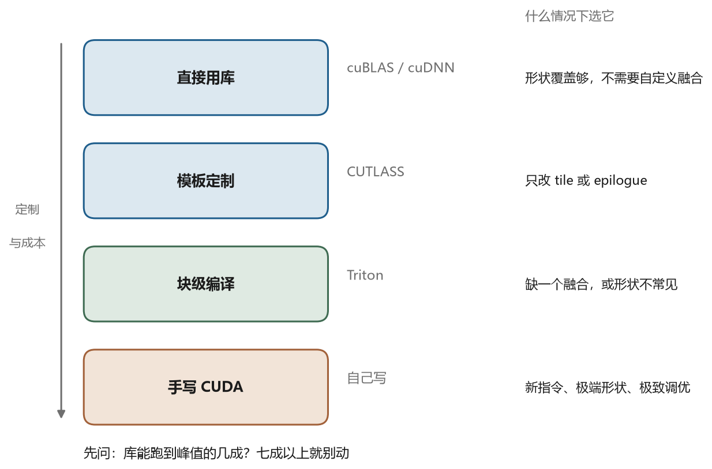

# 算子库与自动调优

设想这样一个场景。一个形状为 `M=512, N=4096, K=4096` 的矩阵乘，在 A100 上 cuBLAS 是最快的，换到 H100 上，一个用 Triton 写的版本反而领先一截。同一份 Triton 代码换回 A100，又落后了。这不是谁更好的问题，是两边的启发式在两张卡上选了不同的分块，各自碰巧对了一次。

这种“此消彼长”在算子选型里是常态。库的启发式是黑盒，编译器的映射规则也是黑盒，两者都没法保证在你的形状上最优。能保证的只有一件事，把候选都测一遍。

算子实现的性能不是一个固定值，它随形状、精度、卡型、库版本变化。所以“用哪个”这个问题没有一个通用答案，只有一套判断流程。这一章讲这套流程，以及每一条路的代价。

## 四条路

从省事到费力，一共四个层级。

最上层是 cuBLAS 和 cuDNN。它们覆盖了矩阵乘和卷积的主流形状，内部有几十种实现，按形状和卡型选一个。调用的成本最低，性能在常见形状上是可信的，七成峰值是常态。缺点是封闭，你没法改它的分块，没法加自定义的 epilogue，遇到非常规形状只能吃它选的那个。

第二层是 CUTLASS。它是头文件库，用模板把 GEMM 和卷积的各个部件拆开，tile 大小、stage 数、warp 排布、epilogue 都是模板参数。你可以只改 epilogue，把 ReLU 换成自己的激活，主循环一行不动。代价是模板很重，编译一次几分钟，出错信息几千行，学习曲线陡。

第三层是 Triton。它用 Python 写 kernel，按块描述计算，共享内存分配、线程映射、bank 冲突避让都交给编译器。一段 30 行的 Triton 代码能写出接近 CUTLASS 的性能，尤其适合自定义融合算子，比如带掩码的注意力和变体的归一化。

最下面是自己写 CUDA。完全控制，也完全负责。只有在库和编译器都做不到的时候才值得，比如要用一种新指令，或者形状特殊到启发式完全失效。

再往外一层是框架自己的封装。PyTorch 的 `torch.matmul`、`torch.nn.functional.conv2d` 最终都调到这两个库，但中间有算子分发、形状检查、内存申请。这一层的好处是省事，坏处是你看不见它选了哪个实现。想看的话，开 `TORCH_LOGS=graph_breaks` 或者用 profiler 看 kernel 名字，名字里通常带着库的算法编号。

## Triton 的位置

Triton 的编程模型是“块”。你写的是对一个 `BLOCK_M × BLOCK_K` 的块做什么，不是某个线程做什么。编译器把这些块映射到 warp 和线程，自动分配共享内存，自动插入同步。

这个抽象层级正好落在 CUDA 和框架之间。比 CUDA 高，因为不用管线程索引和共享内存；比框架低，因为能控制分块和数据流。写一个融合的 LayerNorm，CUDA 要一百多行，Triton 三十行，性能在多数形状上差别不到一成。

一段 Triton kernel 的样子是这样的。`tl.program_id` 拿到当前块的下标，`tl.arange` 造出块内的索引，`tl.load` 带掩码读，`tl.dot` 做矩阵乘，`tl.store` 写回。没有线程、没有 warp、没有共享内存，这些由编译器在下面决定。写的人只需要关心块的形状和数据的排布，性能调优的主要手段就是改块的大小和 stage 数。

它的短板在极端形状上。块大小是编译期常量，形状不规整时要靠掩码处理，掩码的指令开销在窄矩阵上占比很高。张量核心的指令选择也由编译器决定，遇到需要精细控制的场景，比如 Hopper 的异步拷贝，Triton 的抽象会挡住一些优化。

判断要不要用 Triton，看两件事。一是这个算子能不能用块级描述，能就说明 Triton 合适；二是它的性能瓶颈是不是带宽，是的话 Triton 生成的代码通常已经够好，因为带宽瓶颈的 kernel 对指令排布不敏感。反过来，一个要榨干张量核心的 GEMM，Triton 可能比 CUTLASS 差几个百分点，这时候差的就是那几个百分点的调优空间。

## 编译器那条路

还有一类工具不写 kernel，而是从计算图生成 kernel。TVM 把算子描述成调度（schedule），用一套原语描述分块、向量化、并行，再由编译器生成 CUDA 代码（Chen 等，2018）。MLIR 提供了多层的中间表示，让编译器在不同抽象层做优化，然后降到硬件方言。XLA 走的是另一条路，从张量计算图出发，做融合、布局分配、生成代码。

这条路的优势是全自动。一个没见过的融合模式，编译器能生成一个可用的 kernel，人不用写。劣势是生成质量不稳定，简单的元素级融合能到峰值，复杂的注意力就常常不如手写。所以工业界的做法是混合，通用模式交给编译器，关键路径用手写的库。

编译器路线还有一个隐性门槛，调优知识要人工沉淀成启发式或者代价模型。TVM 的算子调度模板是人写的，不同算子要不同的模板，模板没覆盖的算子性能就差。这套东西的维护成本很高，也是为什么大多数推理引擎最后还是回到库加少量手写 kernel。

## 自动调优

分块大小、stage 数、warp 数，三个参数组合起来有几百种可能。手工试太慢，于是有了自动调优。

先说清楚自动调优在优化什么。给定一个算子的逻辑描述，可调的只有分块和调度参数，算法本身是固定的。所以调优的上限由算法决定，一个算术强度不足的算法，调得再好也突破不了带宽。这也是为什么先看 roofline 再调优，方向错了，搜索空间再大也没用。

搜索空间通常这样定。`BLOCK_M` 和 `BLOCK_N` 从 32 到 256，`BLOCK_K` 从 16 到 128，`num_stages` 从 2 到 5，`num_warps` 从 4 到 8。全组合上千种，实际会先按约束剪掉一批，比如共享内存装不下的、寄存器超标的，剩下的几百种实测。

实测的代价是编译加运行。每种配置编译一次，几十毫秒到几秒，跑一次几毫秒。一千种配置，十分钟。这十分钟在开发时可以做，在部署时不能做，所以调优的结果要缓存，按形状和卡型做键，下次直接读。

除了实测，还有代价模型。TVM 用的是基于机器学习的代价模型，先在小规模上采样一批，拟合一个模型，用它预测剩下的配置，只实测预测最好的几个。这样能把搜索成本降一个量级，代价是模型不准时选错（Chen 等，2018）。两种方法在工业界都有用，实测更准更慢，模型更快更粗。

缓存的键要选对。形状、精度、卡型是必须的，块大小不是，因为块大小是结果不是输入。缓存失效的条件也要想清楚，驱动升级、库版本变化、数据布局变化都可能让原来的最优配置变差。保守的做法是把缓存和版本绑在一起，升级就重跑。

调优还有一个隐性成本，编译时间影响迭代速度。改一行代码，编译五分钟，一天只能试几十次。CUTLASS 的模板实例化是重灾区，一个完整的 GEMM 实例化要几分钟。缓解的办法是减少实例化数量，把常用的形状预先编译好，不常用的走 JIT。Triton 在这上面好一些，JIT 编译一两秒，迭代快。

## 版本与形状覆盖

库的性能和版本强相关。新架构发布之后，库要过几个版本才能把新指令用上。H100 刚出的时候，很多库里的 kernel 还是按 A100 的分块写的，跑出来只有峰值的三成，几个版本之后才补上。升级库有时候能让性能翻倍，也可能因为启发式改了而变慢，所以升级前后都要复测。

版本问题的另一面是编译产物。CUTLASS 生成的 kernel 和架构绑定，`sm_80` 的产物不能跑在 `sm_90` 上，要为每个架构单独编译。一个支持多卡的库，二进制体积会膨胀好几倍，加载时间也跟着涨。这也是为什么很多库把不常用的架构做成 JIT，第一次用到时编译。

形状覆盖是另一个坑。一个库宣称支持任意形状，实际在非常规形状上会退回一个通用实现。判断方法在第六章提过，看 kernel 的名字，带 `generic`、`fallback`、`ref` 的通常不是快路径。另一个方法是对比不同形状的性能曲线，如果某个形状突然掉一半，那里就是断崖。

cuBLAS 有一个 `cublasLtMatmulAlgoGetHeuristic` 接口，可以问它推荐哪个算法，也可以让它把所有候选都返回，自己实测选一个。后者叫穷举，适合形状固定的推理服务，一次调优长期受益。cuDNN 也有类似的接口，叫 `cudnnFindConvolutionForwardAlgorithm`，原理一样。

表怎么建也有讲究。测的时候要用真实的数据分布，因为有些 kernel 的性能依赖数据，比如稀疏或者带掩码的注意力运算符，全零输入和随机输入的耗时不同。预热次数要够，第一次跑有编译和分配开销。每个形状测三次取中位数，抖动超过百分之十就多测几次，说明这台机器当时不稳。

建表的流程是这样的。部署前把所有层的形状跑一遍，记下每个形状的最佳实现和耗时，写进配置文件。推理时按形状查表，查不到再走默认路径。这张表是模型和硬件的绑定，换卡要重跑，但它能把“库的启发式猜错”这一类问题挡在部署之前。

还有一个经常被忽略的选项，什么都不做。很多层在整网时间里占比不到百分之一，把它们从 cuDNN 换成手工调优的实现，最多省几十微秒，投入却是几天。判断标准还是第十四章要讲的账本，先按时间排序，只优化前几名。库的默认实现在大部分层上已经够好，剩下的是长尾。

库的选择最后落到一句话上，先量，再选，别猜。同一个模型在两张卡上的最优实现可能不一样，同一张卡上不同形状的最优实现也可能不一样，唯一可靠的办法是把候选都跑一遍。

还有一点值得记住。库和编译器的边界在移动，今天的编译器能生成的，明年可能就能生成得很好；今天要手写的，明年可能变成模板参数。所以选型不是一次性决定，是每隔一段时间要重新问一次的问题。把选型的过程记下来，比记住结论更有用。

到这里，单个 kernel、算子组合、执行调度、工具和选型都讲完了。最后一章把这些拼起来，算一笔端到端的账。
