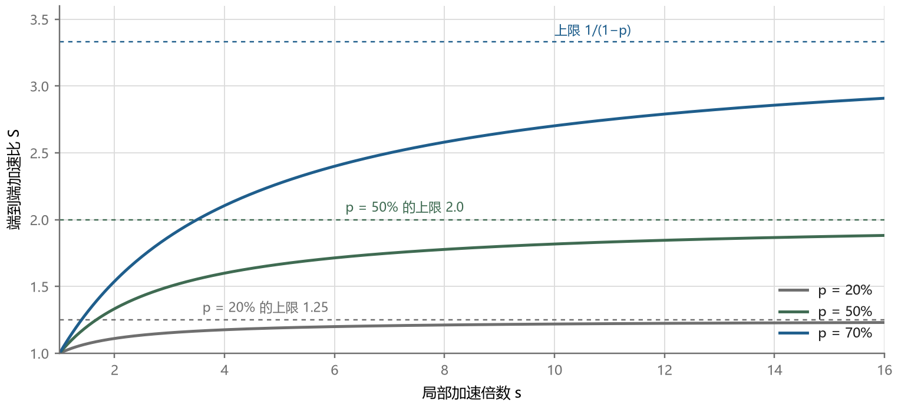
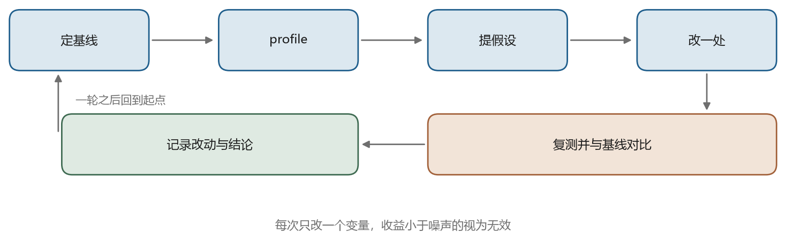

# 从 kernel 到端到端延迟

一个检测模型的卷积部分优化了三成，单看那几个 kernel，时间确确实实少了三成。端到端延迟从 24.0 毫秒降到 22.6 毫秒，快了不到百分之六。前后处理、拷贝、同步、框架开销一点没动，它们占的那部分时间在分母里没变，分子的改善被稀释了。

这件事每次做优化都会遇到。算清楚稀释的比例，就能在动手之前知道值不值得做。这也是最后一章要讲的，把单个 kernel 的数字放回端到端，看哪些改动真的有意义。

## 一份账本

端到端的账要从头记。一个模型跑一次，时间花在几个地方，每一处都要有一个数。

表 14-1　一个假设的检测模型的端到端账本（数字为示例，实际要靠 profile 测）

| 阶段 | 占端到端 | 性质 | 能不能压 |
|---|---|---|---|
| 前处理 | 8% | CPU 缩放与归一化 | 挪到 GPU，能压到 2% |
| 主干卷积 | 55% | 算力瓶颈 | 换实现或降精度，有空间 |
| 归一化与激活 | 14% | 带宽瓶颈 | 融合，理论降一半 |
| 检测头与后处理 | 15% | 小 kernel 多 | 融合，减少启动 |
| 拷贝与同步 | 8% | 传输 | 异步加双缓冲，能藏住 |

这张表是假设的，真实的值要用 Nsight 量。它的用途是给出一个判断框架，看到某一项的占比，就知道这一类优化的上限在哪。前处理占 8%，把它全部干掉也只有百分之八；主干占 55%，压三成就是 16.5 个百分点。

量每一项有两个办法。一是用 NVTX 在代码里打标记，时间线上按区间统计，适合前后处理和框架层。二是按 kernel 名字分组，把同一类 kernel 的时间加起来，适合主干和归一化。两个办法对不上是常事，差额就是框架开销和空隙，正好是账本最后一行要填的数。

账本还要写清楚“测的是什么”。单张图片的延迟、批量 32 的吞吐、并发 8 路时的 p99，三个数完全不同，优化目标也不同。同一份代码在三个目标下的最优配置可能互相冲突，比如批大小越大吞吐越高，但延迟和 p99 会变差。先定目标再优化，否则改到最后不知道自己在优化什么。

账本里最容易漏的是最后一项。拷贝和同步不在 kernel 列表里，在时间线的最上面或者最下面，容易在排序的时候被漏掉。一个模型端到端 24 毫秒，所有 kernel 加起来 19 毫秒，剩下 5 毫秒去哪了，答案通常就在这里。

## Amdahl 定律

把账本换算成收益，用的是 Amdahl 定律。设某一部分占总时间的比例为 p，这部分本身加速了 s 倍，端到端的加速比是

$$
S = \frac{1}{(1 - p) + \frac{p}{s}}
$$

代入一个例子。p 是 0.55，s 是 1.3，分母是 0.45 加 0.423，等于 0.873，加速比 1.15。也就是卷积快三成，端到端快一成半。如果 s 是 2，分母是 0.45 加 0.275，加速比 1.38。如果 s 趋于无穷，加速比的上限是 `1/(1-p)`，这里就是 2.2。

Amdahl 定律有一个更强的版本，把通信和同步也考虑进去。分布式训练和推理里，加速的部分越大，通信量往往也越大，收益会被进一步稀释。单卡上这个问题不明显，多卡上它是主要矛盾，这一点在第十章提过。这里只用基础版本，把单卡上的账算清楚。

这个上限是最有用的部分。它告诉你，无论把卷积优化到多快，端到端也快不过 2.2 倍，因为剩下的 45% 一动不动。想让端到端再快，只能去动那 45%。

表 14-2　不同占比和加速倍数下的端到端收益（按公式算）

| 局部占比 | 局部快 2 倍 | 局部快 4 倍 | 局部快 10 倍 |
|---|---|---|---|
| 20% | 11% | 18% | 22% |
| 50% | 33% | 60% | 82% |
| 70% | 54% | 108% | 154% |

看第一行和第三行的差距。同样是四倍加速，占比 20% 只带来 18%，占比 70% 带来一倍。选错了优化对象，投入的力气大部分被分母吃掉。这张表也解释了为什么“整体重构”往往比“逐点优化”有效，重构改的是分母，逐点优化改的是分子。

推论有三条。

第一条，优先优化占比大的部分。占比 20% 的部分，即使优化到零，端到端也只快 25%。占比 60% 的部分，优化一半就有 43% 的收益。这条看起来显然，实际工作中经常被违反，因为占比大的部分往往难啃，占比小的部分容易出成绩。

第二条，优化要成组做。卷积压了一半，归一化再压一半，两项叠加的收益大于各自的一半之和，因为它们都把分母里的同一块吃掉了。反过来，如果两次优化作用于同一部分，第二次的边际收益会很小。

第三条，别忘了分母。分母里的项如果不参与优化，它的占比会随着分子的缩小而变大。一开始 8% 的拷贝，在别的部分都优化之后可能变成 20%，那时候它就是主要矛盾。

## 为什么 kernel 快了端到端没快

除了 Amdahl 的稀释，还有四种具体的原因。

布局转换。一个 kernel 快了，但它输出到下游需要另一种布局，转换的开销把收益吃掉。这在换实现的时候特别常见，新的卷积 kernel 用 NHWC，前后都是 NCHW，两头各插一次转换，快了 30% 又被转换吃掉 20%。

同步点。kernel 变快了，可它后面有一个同步，整个流水线要等它。同步点通常藏在看不见的地方，`.item()`、打印、条件判断里的张量比较，每一个都会把 GPU 排空。优化完 kernel 之后，这些同步点变成新的瓶颈，而且更难发现，因为它们不在 kernel 列表里。

框架开销。Python 层每个算子都要分发，一次几微秒。kernel 从 20 微秒降到 10 微秒，分发开销没变，占比从 5% 涨到 10%。这就是为什么很多优化在 microbenchmark 里有效，接到真实模型里就看不见。

数据依赖导致的串行。一个大 kernel 被拆成几个小 kernel 并行，理论上时间应该变短，可如果它们之间有依赖，实际还是串行。这种情况在跨层融合里常见，融合之后代码看起来是一个 kernel，内部的阶段之间有屏障，屏障把流水切开，收益没有想象的大。

批处理策略。小批量的延迟由固定开销主导，大批量的吞吐由算力主导。把 kernel 优化了 30%，如果服务是延迟敏感的，固定开销没变，用户感知的改善会小于 30%；如果服务是吞吐敏感的，改善会更接近 30%。同一个优化，在不同的服务目标下价值不同。

## 把优化组织成循环

性能工作不是一串优化技巧，是一个循环。

循环里最反直觉的一步是第一和第五，因为它们看起来与优化无关。可性能工作里最常见的失败不是想法不好，是基线不稳、复测不准，最后无从判断哪个想法真的有用。把测量做扎实，比多看十篇优化技巧有用。

第一步，定基线。同一个输入，同样的预热，跑一百次，记下中位数和 p99，同时记录当时的代码版本、库版本、驱动版本、卡型、时钟设置。基线不可复现，后面的所有结论都不可信。

第二步，profile。用第十一章的流程，从端到端拆到 kernel，找到占比最高的那一个。不要凭经验猜，猜错的概率很高。

profile 的粒度也要选。第一次看端到端，第二次看阶段，第三次才看单个 kernel。一开始就钻进 kernel，很容易在 3% 的层上花三天。假设要能被证伪，比如“这个 kernel 受 DRAM 带宽限制，因为每个请求只用到 4 字节”。能被证伪的假设才能指导改动。

第四步，改一个变量。只改一个，其他都不动。同时改三个，结果好了你不知道是哪个起作用，结果坏了你也不知道是哪个坏了。

第五步，复测。同样的输入，同样的预热，和基线比。收益小于测量噪声的，视为无效。噪声有多大，看基线的 p50 波动，一般百分之二以内算稳定。

第六步，记录。改了什么、为什么、结果如何、下一步是什么。写在同一份文档里，下次接着来。

复测的时候要控制环境。同一台机器、同一个电源模式、同样的散热条件，别的进程不要抢 GPU。云上的机器尤其要注意，同一张卡被别的租户分时复用，测出来的数字会飘。测之前先跑一个固定的微基准，看它的时间和昨天是否一致，不一致就先查环境。

这个循环跑一轮通常要半天到一天。一个模型想快一倍，可能要跑十几轮，分布在几周里。急躁的做法是把所有想到的优化一次做完，然后花两周找是哪一处引入了精度问题或者崩溃。

## 收束

还有一个经常被忽略的收益来源，减少要做的事。前面十三章讲的大多是“同样的事做得更快”，还有一类是“这件事不必做”，比如常量折叠、死代码消除、把训练专用的层从推理图里去掉、把 BN 折进卷积。这些改动的收益直接体现在分母上，不需要 Amdahl 换算。看到一个模型，先问哪些算子可以不跑，再看怎么跑得快。

这一册从一块 GPU 的构造讲到端到端，中间经过存储层次、roofline、张量核心、GEMM、卷积、归一化、注意力、融合、流、profiling、布局和选型。每一章都在回答同一个问题的不同侧面，时间花在哪里。

回到最开始的那个判断。一个算子慢，先看它的算术强度落在 roofline 的哪一侧，斜线左侧改访存，平台线上改指令。改完看它占端到端多少，占比小的别花时间。占比大的，按循环一步步做，每步都留基线。

单个 kernel 再快，也要靠图和数据流把它们串起来。谁来决定哪两个算子融合，谁来决定张量用什么布局，谁来决定请求怎么排进 GPU，这些是《引擎》那一册的内容。那一册讲计算图、编译器和推理服务，是把这一册的零件装成一台机器。

从这一册往下走，还有一个方向是精度。同样的计算，用更少的位表示，字节数减半，算力翻倍，代价是数值误差。这条路的边界在哪里，怎么量化，怎么校准，是《精度》那一册的事。
