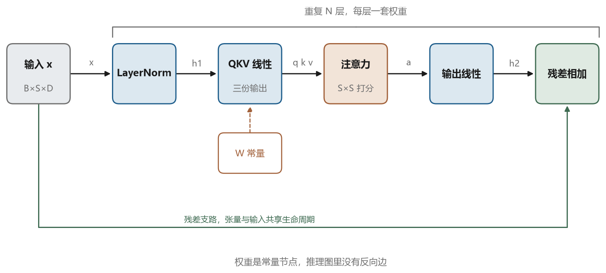
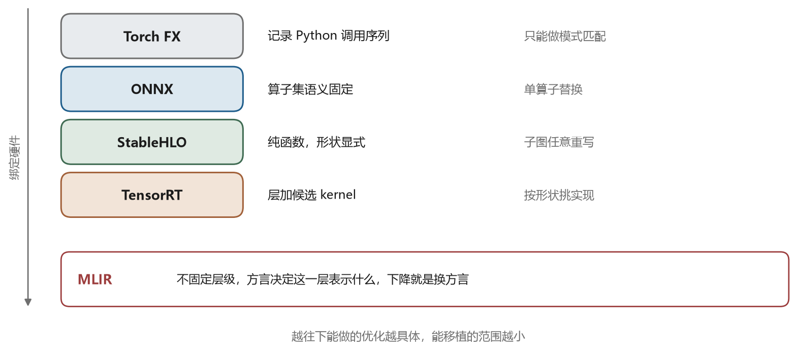

# 计算图与中间表示

把 Transformer 的推理脚本导出成 ONNX，用可视化工具打开，第一反应往往是数不清节点。脚本里明明白白只有十几个算子调用，导出的图里却有四百多个节点，其中大半是 reshape、transpose、cast 和 slice。它们不算任何有意义的东西，只负责把张量的布局从一个算子期望的样子改成下一个算子期望的样子。

先解释一下这里说的图。计算图（computational graph）是一种把计算写成“有向无环图”的表示，节点是算子，边是张量，箭头方向就是数据的流动方向。可以把它想成一张物流单：仓库之间怎么转运写得清清楚楚，每个中转站收到什么、发出什么、交给谁，都能顺着箭头查。写成图之后，程序不再是一行行按顺序执行的语句，而是一份“谁依赖谁”的清单。

这件事给出的第一个提示是，图上的节点数不能用来判断计算量。一个 7B 的模型导出后有几千个节点，真正吃算力的却集中在几十个矩阵乘上。反过来，一堆逐元素小算子能把节点数撑到上万，它们在总时间里占的比重可能不到百分之五。读图的第一步是分清哪些节点在算，哪些节点在搬。搬的节点不产生新信息，只改变数据躺在显存里的排列方式，它们的成本是纯粹的内存流量。

## 从 eager 调用到图

PyTorch 默认的执行方式是即时执行（eager execution，也叫 eager 模式），Python 每调用一个算子，就有一条 kernel 被排进队列，回来之后才执行下一行 Python。这里的 kernel 指的是 GPU 上真正被调度执行的一段程序，一次启动处理一个算子的数据，写完就退出。eager 模式好调试，打印一下就能看到张量的值，改一行代码立刻生效。

代价是每个算子都必须独立处理自己的输入输出，框架没有机会看到相邻几次调用其实可以合并。打个比方，eager 像去菜市场一样一样买，买葱跑一趟，买姜再跑一趟，每趟都要排队、称重、付钱；图模式像先写好一张采购单，一次交给摊主配齐。单看每次排队只有几微秒，可一个模型里有几百上千次调用，加起来就是毫秒级。

计算图把这个视角反过来。张量是图上的边，算子调用是节点，节点之间的连接表示数据流向，节点的属性记录卷积核大小、步长、padding 这类只影响这一个节点的参数。权重也在图里，通常以常量节点的形式出现。这个区分很关键：同样是“卷积的权重”，做成常量节点，引擎就敢把它折进别处；做成一个运行时才填的输入，图上就什么都不能假设。

有了这张图，一些原本做不到的事情才成为可能。两个相邻算子可以换成一个，省掉中间张量的一次写和一次读。输入全是常量的算子可以提前算完，线上直接查表。没有下游消费者的节点可以删掉，比如推理时不起作用的 dropout。内存可以按节点的生命周期复用，先算完的张量把显存让给后算的。这些操作不需要理解模型在算什么，只需要理解图的结构。这也是推理引擎能在完全不认识你的模型的情况下把速度提上去的原因。

图还有第二个用处，跨框架交换。训练用 PyTorch，部署可能跑在 TensorRT、ONNX Runtime、OpenVINO 上，中间需要一个大家都认的表示。ONNX 承担的就是这个角色，它定义了算子语义和文件格式，谁都可以读写。代价是它一旦发布就很难改，新增一个算子要走标准流程，所以新模型的新结构在 ONNX 里往往滞后一段时间。一个模型带了个全新的注意力变体，导出时经常只能拆成一堆基础算子，或者干脆报不支持。

第三次视角的转换发生在服务端。当一个进程里同时跑几个模型，或者一张卡上要排队处理几十路请求时，执行单位就不再是“一次前向”，而是“一批任务”。这时候图提供的是拓扑信息，哪些节点必须要等上游算完，哪些可以并行，内存什么时候可以还回去。运行时靠这张图安排顺序，而不是靠 Python 的调用顺序。

以图为中心也有代价。图是死的，Python 是活的。一旦代码里出现训练和推理共用的分支、依赖运行时配置的层数、或者按输入内容挑选的路径，图就必须在某个时刻被确定下来，而确定下来的那一刻未必覆盖所有情况。这就是后面反复出现的那个矛盾的源头，图越静态，优化越多，能接受的输入越窄。

## 五种中间表示，五种抽象层级

“中间表示”这个词容易让人以为只有一种东西。中间表示（intermediate representation，通常缩写为 IR）是编译器内部用来描述程序的格式，可以理解成几种工具之间传话用的稿纸：上游写完，下游照着念，念出来的意思不能变。一条真实的部署链上会经过好几种 IR，它们的抽象层级不同，能做的优化也不同。

ONNX 站在算子这一层。Conv、Gemm、LayerNormalization 这些名字对应确定的数学定义，附带一组属性。好处是语义稳定，谁读都一样；坏处是优化空间被封住了。图里的 Conv 后面跟着 BatchNormalization，能不能合并要看运行时愿不愿意做，图本身没有留下任何提示，因为它只保证“这两个算子各自算什么”，不保证“它们可以怎样被合成一个”。

Torch FX 站在 Python 这一层。它记录的是代码里对 `torch` 模块的调用序列，节点上存着函数引用和参数，不看算子内部语义。这让它非常适合做抓取（capture），也就是把一段 Python 代码原样翻译成图。也让它在需要理解算子含义时无能为力，因为它只知道“调用了 `torch.nn.functional.relu`”，不知道 relu 是逐元素的上界截断。`torch.compile` 的前一段就是靠 FX 完成的。

StableHLO 站在函数式这一层。计算被写成一组没有副作用的函数，形状和类型显式挂在值上，动态维度用一个符号维度表示。函数式的好处是可组合，任何一段子图都能当成纯函数重写，不用担心别处有人改了同一块内存。这一点在并行和分布式编译里尤其重要，纯函数可以随便复制和重排。

TensorRT Network 站在 GPU 这一层。它定义的是“这一层上我可以选哪些实现”，所以每一层除了数学定义，背后还挂着一个候选 kernel 集合，也就是 tactic。这让它能做出比通用图优化更细的决定，也让它的图没法脱离特定硬件存在。

MLIR 不在这条纵列里，它横跨整列。它提供的是一套描述任意层级 IR 的框架，方言（dialect）决定这一层表示什么。高层可以接近 ONNX 的算子，往下一层换成循环和向量，再往下换成目标硬件的指令。每一步下降都是一次方言之间的重写，重写规则由这一层的语义决定。

表 1-1　几种中间表示的位置与代价

| 表示 | 抽象层级 | 擅长 | 主要代价 |
|---|---|---|---|
| ONNX | 算子 | 跨框架交换 | 语义固定，优化空间被封 |
| Torch FX | Python 调用 | 快速抓取、保留动态性 | 不理解算子语义 |
| StableHLO | 函数式 | 组合与并行重写 | 需要前端先转成函数式 |
| TensorRT Network | GPU 实现 | 选 tactic、贴近硬件 | 绑定硬件与版本 |
| MLIR | 跨层框架 | 多层下降与复用 | 建设成本高，易抽象泄漏 |

这几种表示之间不是替代关系。一份模型可能先被 FX 抓成 Python 层的图，再导出成 ONNX 交给别人，进了 TensorRT 之后又被翻译成它自己的网络定义，每一层都重新丢一次信息，也重新拿一次信息。链越长，能对上的东西越少，所以真正在意性能的项目，往往在链条末端留一份数值基准，每过一道都拿它校一次。层级越低，能做的优化越具体，能移植的范围越小。挑引擎的时候，实际上是在挑停在哪一层。

## 图的性质，决定了它能被怎么改

同一份模型导出成两张图，可优化程度可能差很远。差别来自四个性质，它们决定了优化器“敢不敢”动手。

静态还是动态。静态图在导出时就把每个张量的形状固定下来，动态图的形状里有符号维度，要等运行时才确定。静态图能提前分配显存，能按具体形状挑 kernel，动态图不行。这不是玄学，是信息量的问题。编译器在构建时不知道 batch 是 1 还是 32，就没法为某个形状挑出最优实现，只能选一个折中的。

有环还是无环。绝大多数推理图是无环的，反向传播那条路已经没了。带循环的图一般来自自回归解码，这类循环在导出时会被展开或者表示成子图，展开的次数直接决定图的大小。展开 32 步和展开 1 步，是两张完全不同的图，前者可能大到编译器的内存装不下，后者每次只算一个 token，需要外面套一层调度。

有没有控制流。`if` 在图上要么展开成两条分支各自成图，要么表示成一个带条件输入的节点。前一种要求条件是编译期常量，后一种要求运行时支持。一个条件依赖输入数据的 `if`，在导出时经常直接失败，这也是为什么很多模型在训练之后就再没改过前向代码。改一行 if 的代价从“重训”变成了“重写导出逻辑加重新验证”。

有没有副作用。就地写的算子、随机数、打印、对全局状态的修改，都会让重写变得不安全。编译器看到两个节点之间没有数据依赖，通常想交换它们的顺序，只要有一个节点偷偷改了第三块内存，交换就错了。函数式 IR 受欢迎，很大程度是为了消掉这种不确定性：输入只读，输出只写新张量，交换顺序永远安全。

还有一类不那么显眼的东西，属性和输入的区别。卷积的步长是属性，权重的形状也是属性，但权重完全可以被当成一个输入传进来。同一个算子，权重走属性就是常量，能做常量折叠和权重预处理；走输入就是运行时可变的，图上什么都不能假设。很多导出器把两者混着处理，结果是一份看上去正常的图，里面能折叠的机会一个都没剩下。检查的办法很简单，看图里那些本该是常量的权重，是不是一个个都挂着“输入”的标记。

## 导出时丢掉的东西

导出报错是部署里最常撞的墙。原因大多落在四类里，它们的共同点是问题都发生在“Python 程序翻译成数据流图”的过程中，而不是算子算错了。

自定义算子。训练代码里写了一个 CUDA 扩展，ONNX 里没有对应的算子，导出器要么报错，要么把它变成自定义节点等你注册实现。前者要改模型，后者要写 plugin，两条路都不轻松。

追踪只走一条路。基于追踪的导出器（tracing）拿一组真实输入跑一遍，记录跑过的算子。代码里有 `if x.sum() > 0:` 时，它只记录这一次走的那一支，另一支在图上根本不存在。这类模型看起来导出成功了，换一组输入就给出错误结果，而且错得很难发现，因为报错的地方离原因很远。要避免它，要么把分支改写成张量运算，要么走支持控制流的导出路径，用脚本化的方式把 if 真的记进图里。

Python 语义被固化进图。字典查找、列表推导、`len(tensor)` 取到的具体数字，在 eager 下都正常工作，导出时它们的值被写成常量。序列长度一旦变化，这些常量就成了错的。这类错误最隐蔽，因为图是合法的、算子都在、数值也对，只是对固定长度之外的情况完全失效。比较稳妥的做法是把长度也当成输入传进来，让图里的切片依赖那个输入，而不是依赖 Python 算出来的常量。

别名与视图。`view`、`transpose`、切片在 eager 下是零拷贝的视图，两个张量共享一块内存。导出格式如果不表达别名关系，后面做内存复用时就会算出错误的生命周期，症状是某些形状下输出莫名其妙地错。这就好比两个人共用一把钥匙，登记表上却记成了两把，谁先还回去都行，于是东西在别人还在用的时候被清走了。

所以导出之后的第一件事不是跑性能，是对数值。同样的输入喂给原模型和导出的图，比输出，也比中间层。中间层对得上而输出不对，问题在后处理；中间层就对不上，问题在导出。数值对不上的图，后面所有优化都是在错误的地基上盖楼。

## 把图当数据结构读

后面几章做的事情，本质上都是在图上做重写。常量折叠删掉能提前算的节点，死代码消除删掉没人用的节点，融合把两个节点换成一个，布局转换在必要的地方插入搬运节点。这些操作能不能做，取决于图的形状、节点的属性、节点之间有没有副作用，也就是这一章讲的几个性质。

所以打开一个推理引擎之前，值得先打开一次图。具体的读法有几条。先按算子类型统计数量，看看排在前面的几位是矩阵乘还是 cast、transpose，前者说明模型本身重，后者说明搬运重。再看每个张量有几个消费者，消费者多于一个的张量是融合的天然边界，它们必须落显存。然后看哪些形状是具体的数字、哪些是符号，符号维越多，后面能做的静态优化越少。最后找常量节点，看它们有没有被折叠掉。

这张图上写着后面所有优化的上限，也写着很多“为什么融合没生效”的答案。一个节点数砍掉一半的优化，如果砍掉的全是搬运节点，端到端可能一点没变；反过来，节点数只少了百分之五，但省掉的是三个大张量的往返，收益可能很可观。看节点数不如看流量，看流量不如看时间线，但读图是最便宜的第一步。

读图这件事有工具帮忙，别硬看。可视化工具能把图按子图折叠，也能按张量大小给边标上粗细，一眼就能看出哪条边是大流量。有些工具还能直接标出哪些节点被融合了，哪些没合，没合的原因写在属性里。自己写脚本统计也值得做，按算子类型、按精度、按消费者数量各出一张表，这三张表放在一起，一个模型的脾气大概就见完了。熟练之后，拿到一份陌生的图，十分钟能判断出它值不值得继续优化，这个判断比任何单项技术都省时间。读图还有一个副作用，它会让“为什么慢”这个问题变得具体，你不再需要凭感觉猜是算子写得不好还是数据搬得太多。
