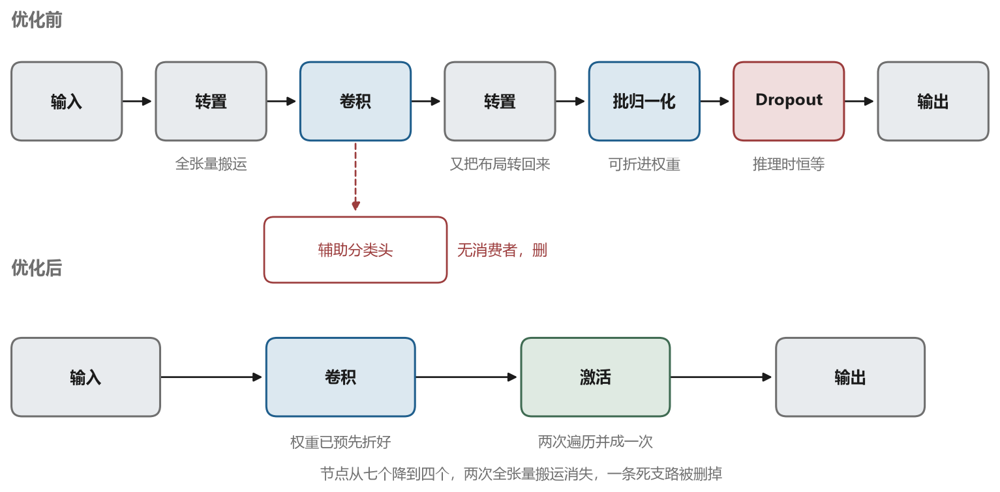

# 图优化：折叠、消除与重写

一份从 PyTorch 导出的图，用脚本数一遍算子类型，经常能看到几十个 Cast。它们的源头大多不在模型里，而在某个 `torch.autocast` 上下文，或者某个权重被单独存成了 fp32 又在计算前转成 fp16。数值上这些 Cast 什么都没做，代价却是把整个张量从显存读出来再写回去。

图优化这一层处理的就是这类东西。它不改模型的结构，不改权重，只改表达方式，所以理论上输出可以和原来一模一样。实际项目里它也确实是收益最便宜的一层，因为不需要训练，不需要校准，改完重跑一次数值对齐就完事。

## 能提前算的，别放到线上算

最直接的优化叫常量折叠（constant folding）。如果一个节点的所有输入都是常量，它在导出时就能算出一个结果，节点本身可以换成一个常量。卷积里把 BN 的均值方差折进权重、把转置后的权重预先转好、把位置编码表提前生成，本质都是同一件事。

这件事有个前提，图得知道哪些东西是常量。前面说过，属性和输入的区别会直接影响判断。一个把权重当输入传的导出器，折叠器看到的是一个运行时才确定的值，只能放弃。所以有些图看起来“该折的没折”，问题不在折叠器，在导出时的签名。

折叠还有个体积上的边界。一个形状是 4096×4096 的矩阵乘，输入全是常量，理论上可以折成一个 16M 元素的常量表，但这个常量会被写进 engine 文件，加载时要拷到显存，换来的只是省掉一次矩阵乘。多数引擎会给折叠后的张量设一个大小上限，超过就保留计算。省下的时间和多花的显存之间要有个平衡点，这个点通常按“折叠后不超过原图权重的百分之几”来定。

折叠发生在哪个时刻，决定了它的效果。导出时折叠，图会变小，但导出器看不到硬件，不知道哪种折法在目标机器上更划算。构建时折叠，引擎知道形状和精度，能折得更彻底，但构建本身变慢。运行时第一次加载时折叠，灵活度最高，代价是启动时间不稳定，某些服务冷启动时的毛刺就来自这里。同一个优化，三个时机，三个不同的代价。

形状推导是折叠的副产物，也是后面很多优化的前提。一个节点输出的形状能不能算出来，取决于输入形状和它的属性，`reshape` 的 `-1`、`slice` 的边界、`concat` 的维度对齐，都要能推成具体数字。推不出来的时候，引擎只能把这一段当成黑盒。这就是为什么很多融合在静态形状下成功、在动态形状下失效。

## 没人用的节点

死代码消除（dead code elimination）删的是没有下游消费者的节点。推理图里这种节点比想象中多。

最常见的是训练专用的部分。Dropout 在推理时等价于恒等，`drop_path` 在残差分支里也是恒等，辅助分类头在推理时通常不被使用，EMA 的影子权重拷贝、损失计算、指标统计，全都不影响输出。一份没有清理过的图里，这些东西可能占掉两三成的节点。

第二类是没被用到的输出。模型返回一个字典，`logits`、`hidden_states`、`attentions` 全在里面，服务端只取 `logits`。导出时如果把整个字典都当输出，那些没人读的分支就得算完再扔。

第三类是折叠留下的残骸。常量折叠之后，原来的常量节点、中间结果节点都变成了孤儿，得靠 DCE 收尾。

手工版的 DCE 就是导出时指定输出名。导出器默认把模型返回的所有张量都当输出，如果声明“只要 `logits`”，那些没人读的分支在导出阶段就不会被写进图。这一步比事后删节点干净得多，因为你有模型的完整信息，而引擎只有一张图。代价是输出名写错会直接报错，或者悄悄少一个输出。

DCE 的安全边界在副作用。一个节点就算没人用，只要它写了内存、打印了东西、或者碰了全局状态，就不能随便删。训练代码里顺手加的 `print(x.shape)` 在导出后可能变成一个真实节点，把一段本来能删的支路钉死在那里。判断一个节点有没有副作用，靠的是算子注册表里的一项标注，标注写错了，DCE 就会删错。这类 bug 极难定位，因为删掉的东西在正常输入下确实没用。

## 重复的表达式

同一段计算在图里出现两次，是最容易被忽略的浪费。公共子表达式消除（common subexpression elimination，CSE）找出输入相同、属性相同、没有副作用的两个节点，把它们合成一个。

在 Transformer 的图里，这种重复很常见。三个 `slice` 从一个 `qkv` 张量里切出 q、k、v，切完又各自做一次 `reshape` 和 `transpose`，如果三个头的处理方式一致，这几步的形状变换经常是同构的。位置编码表如果在每个 block 里都重新算一遍，也是一份可以共享的常量。多头注意力的多个头之间如果展开成并行的子图，同一份 mask 会被加很多次。

还有一类重复不在形状上，而在权重上。两个层共享同一份 embedding，或者 qkv 的三个线性层本来是三个独立节点，如果权重能拼成一个大矩阵、输入完全一致，CSE 可以把它们合成一次大矩阵乘。规模变大之后 GPU 利用率跟着变高，这一步的收益有时比删几十个逐元素算子更大。

比 CSE 更彻底的是代数化简。`x * 1`、`x + 0`、连续两次 `transpose` 同一个维度对、`reshape` 成同一个形状、`concat` 之后又 `split` 回原来的几段、`pow(x, 2)` 换成 `x * x`，这些在数学上都成立，改完之后图更短。麻烦在于它们不一定逐位等价。`x / 8` 和 `x * 0.125` 在二进制浮点下结果相同，`x / 3` 和 `x * (1/3)` 就不同。开启“允许近似”的开关之后，化简的胆子会变大，数值漂移也跟着变大，这类改动必须配一次比数值的回归测试，不能只看输出对不对。

重写还有一个顺序问题。一个 pass 跑完可能给下一个 pass 造出新机会，比如折叠产生常量、常量又让 CSE 多出一对相同节点。所以引擎通常把一串 pass 反复跑，直到图不再变化，或者达到迭代上限。上限是必要的，少数规则会互相打架，A 把 `mul` 变成 `div`，B 又把它变回来，没有上限就会死循环。

## 布局转换是最难躲的搬运

前面三种优化都在减少节点，布局转换却在增加节点。它之所以值得单独讲，是因为它经常是图上最贵的一类节点。

卷积有两种主流内存布局，NCHW 和 NHWC。前者把通道放在最内层，后者把通道放在最后。不同硬件、不同 kernel 库偏好不同，x86 上的某些库喜欢 NCHW，GPU 上的 tensor core 更习惯 NHWC。一个模型如果一半算子在一种布局下最快，另一半在另一种下最快，图中间就会出现来回转换，每次转换都要把整个张量读一遍写一遍。

优化的思路是让转换尽量少，而不是让转换尽量快。相邻的两个转换可以抵掉，一个转置后面跟着逐元素算子时，转置可以推到逐元素算子之后，因为它对逐元素运算满足交换律。真正的死结在权重上，一个卷积的权重布局是固定的，输入布局变了，要么转输入，要么转权重。转权重只发生一次，加载时做掉；转输入每帧都要做。有经验的实现会选前者。

量化之后布局又添了一层约束。int8 的矩阵乘通常要求通道维对齐到 8 或 16 的倍数，才能用上向量指令，而通道维是不是最内层，取决于布局。一个本来只是“多一次搬运”的转换，在量化后可能变成“掉出快路径”，延迟差好几倍。所以量化前先确定布局，比量化后发现不对再改要省事。

还有一个现象值得知道。有些引擎报出来的层数比原图少很多，看起来融合得很成功，实际性能几乎没动，原因是它在内部又插回了转换节点，只是这些节点不在报告的层里。判断融合有没有真的生效，看层数没用，要看 kernel 数量和总的内存读写量。

## 重写的边界

图优化能做的事情有一个共同前提，改写之后语义不变。这条线画在哪里，各家引擎并不一致。有的把 `x/3` 换成乘法，有的不换；有的允许把 `LayerNorm` 里的除法和 `eps` 一起折进下一个算子，有的只在 fp32 下这么做。所以同一份 ONNX 在两个引擎里跑出来的数值可能差一点点，差多少要看它们开了什么开关。

这带来一个实践上的建议。每次改图优化配置，都留一份固定的输入和输出做基准，逐层比一遍。丢掉的节点、被改写的形式、被合并的算子，任何一个环节出错，症状都是“结果差一点”，而不是“报错”。这种错误如果混进了线上，排查成本比性能收益大得多。

还有一件容易被忽略的事。大多数引擎能把优化过程打到日志里，具体哪个 pass 动了几次，哪一层没合。这份日志比任何性能剖析都便宜，因为它不占 GPU、不抓核，只是把图的变化列出来。调优化级别之前先看一眼日志，往往能省下一整天的猜测。

下一章讲融合，它是图优化的极端形式，把两个算子换成一个。规则比这里严格得多，失败的方式也更隐蔽。
