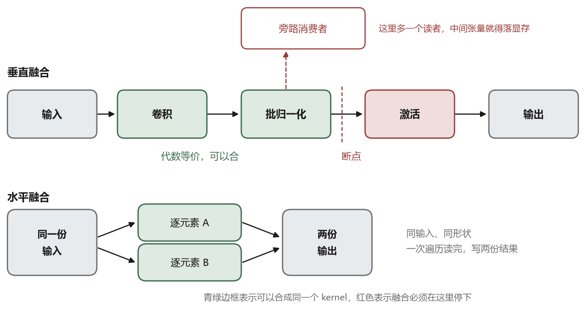

# 算子融合的规则

一个 Conv-BN-ReLU 的结构，在 PyTorch 里是三行代码。换到推理引擎里，它可能是三个 kernel，也可能是三个合起来的一个。前者每个中间张量都要写进显存再读出来，一个 1×64×112×112 的 fp16 张量是 1.5 MB，写一遍读一遍就是 3 MB 的流量。三行代码算下来，卷积本身可能只占一半时间，另一半花在搬运上。

融合（operator fusion）指的是把相邻的几个算子合成一个 kernel，中间结果不出显存。可以想成流水线：不融合是三道工序分在三个车间，每做完一道都要装箱、运走、再拆箱；融合是把三道工序摆进同一个工位，半成品在手里直接接着做。听上去是个纯粹的收益，实际做起来失败率很高。同一份模型在两个引擎上，一个报“融合 47 处”，另一个报“融合 12 处”，性能差三成（这组数字是示例，只为说明差距可以有这么大）。搞清楚为什么合不上，比记住哪些算子能合更有用。

## 三种关系

垂直融合连接生产者和消费者，是最常见的一种。卷积的输出直接作为批归一化的输入，中间那个张量不需要落显存，可以在寄存器或者共享内存里从上一段计算直接接到下一段。这类融合的收益上限等于中间张量的大小乘上它被读写的次数。注意这里说的是上限，不是实际收益，因为融合后的 kernel 仍要读第一段的输入、写最后一段的输出，只省掉了中间那几趟。

水平融合处理的是同一个输入的多个消费者。两个逐元素算子读同一份输入，输出形状也一样，可以把它们放进一次遍历，读一遍输入，写两份输出。这类融合省的是输入带宽，对带宽瓶颈的模型有效，对算力瓶颈的模型基本无用。判断依据还是算术强度：每读一个字节能做好几次浮点运算的模型，带宽不是瓶颈，省带宽等于没省。水平融合还有个限制，两个消费者的输出形状必须能对齐，一个输出是全尺寸、另一个经过切片，硬塞进同一个遍历反而要处理两套索引。

垂直融合之所以能省，是因为片上存储和显存的速度差了两个数量级。寄存器读写几乎没有延迟，共享内存一次几纳秒，而显存一次要几百纳秒。中间结果留在片上，下一段接着用，省下的不只是两次搬运的时间，还有等待搬运的停顿。代价是片上存储很小，一个 SM 的寄存器加起来也就几百 KB，融合的段越长，能同时驻留的线程越少。

还有一种不叫融合但常被归到融合里的东西，模式级的重写。注意力里的 `softmax(QK^T)V` 是三个算子，把它们合成一个 kernel 不是简单拼接，中间那个 S×S 的分数矩阵在长序列下会大到放不下。序列长度 8192 时，这个矩阵按 fp16 算是 128 MB，一个头就这么多。FlashAttention 的做法是分块计算并在线更新 softmax 的归一化因子，数学上等价，实现上是另一套算法（Dao 等，2022）。这类“融合”改变的其实不止是数据流，还包括计算的顺序和中间结果的精度，收益远大于普通融合，风险也远大于它。长序列下把注意力显存从平方级压到线性级，靠的就是这一步。

由此可以归纳出一条粗糙的判据。形状一一对应、每个输出元素只依赖对应位置的输入，这种逐元素链最容易合。带归约的段也能合，但要注意归约维必须在块内完整，否则得跨块累加，实现复杂度上一个台阶。会改变数据布局的段（转置、跨步切片）不适合合进别人，因为它的访存模式和邻居完全不同。需要全局信息的段（整段 softmax、整段 LayerNorm 的均值方差）在融合时要先算一遍统计量再算输出，等于读两遍输入，收益打折。

## 哪些是等价，哪些是近似

Conv 后面接 BatchNorm，是代数上完全等价的合并。推理时 BN 用的是训练时统计好的均值和方差，它就是个逐通道的仿射变换。把缩放和平移折进卷积权重：

$$ W' = \frac{\gamma}{\sqrt{\sigma^2 + \epsilon}} W $$

$$ b' = \frac{\gamma}{\sqrt{\sigma^2 + \epsilon}} (b - \mu) + \beta $$

这里 γ 是 BN 的缩放、β 是偏移、μ 和 σ 是统计出来的均值与标准差，ε 是防止除零的小常数。折完之后 BN 节点消失，卷积多了一次权重预处理。为什么要折，而不是让 BN 单独跑一遍？因为 BN 单独跑要读一次卷积的输出、写一次结果，而这段数据在融合后根本不用落盘。省下的是两个全张量的往返，不是几次乘加。

注意这个等价是在实数上成立的，在浮点上只是近似。折叠改变了运算顺序，舍入误差跟着变，fp32 下差异通常在 1e-7 量级，fp16 下可能到 1e-3。一个模型里几百个这样的折叠叠起来，端到端的差异能否接受，要靠比数值回答，不能靠“数学上等价”四个字。实践中的做法是拿一批真实输入跑原模型和折叠后的模型，看最大绝对误差和输出的分布，前者看极端情况，后者看有没有系统性偏移。

Gemm 后面接一个常量缩放，也可以折进权重，把 `y = (xW + b) * s` 改成 `y = x(W s) + b s`。前提是 `s` 是标量或者逐通道的常量。逐通道的时候要注意它在权重矩阵的哪一维上，折错维度的症状是输出整体偏，loss 曲线看着正常但精度掉几个点。这类错误不容易在单测里暴露，因为形状对、类型对、甚至数值范围也对，只是每个通道被乘了别人的系数。

批归一化后面接激活，严格说不需要“融合”这个词，它们只是被放进同一次遍历。数学上没有变化，收益来自省掉一次读和一次写。这类融合最安全，也最容易被忽略，因为引擎报告里它常常不算一个“融合的层”。

近似的那一类要小心。GELU 有精确版和 tanh 近似版，两个版本的输出差在 1e-3 量级，模型可能一点都不在意，也可能在一个对数值敏感的任务上掉点。LayerNorm 里的 `rsqrt` 在不同实现下的精度也不一样。引擎为了用上更快的指令，经常默认选近似版，这个选择通常写在配置里，值得翻一眼。判断自己的模型敏不敏感，有个笨办法但有效：把近似开关拨到精确版跑一遍评测集，看指标有没有变化，没有就放心用快的。

## 融合失败的五种原因

第一种是中间结果还有别的消费者。卷积的输出除了喂给 BN，还被另一个分支拿去用了，那这个张量就必须落显存，融合的收益直接归零，引擎一般直接放弃。这也是残差连接周围融合特别少的原因，`x` 被主路和残差两处读，谁都动不了。有些引擎会做张量的引用计数，只被读一次的才允许融合，计数算错就会产生错误的图。引用计数看起来简单，实际上要处理视图、别名和原地写，一处漏算就是数据竞争。

第二种是布局不一致。前一个算子输出 NHWC，后一个只接受 NCHW，中间必须转换。转换节点插进去，融合就断了。这类失败在看日志时经常被误认为“引擎不支持这个组合”，实际是布局在作梗。排查时先看融合前后的图里有没有成对的 transpose，有就说明问题在这。

还有些融合靠人写。引擎推不出来的组合，可以用 plugin 手工实现一个 kernel，把三段计算写在一起。代价是这个 kernel 只对你验证过的形状和精度生效，换了卡、开了别的 dtype、序列长度超出范围，都得重写一份。项目周期一长，plugin 的数量会比预期多，维护成本跟着涨。

第三种是精度不一致。卷积是 fp16，BN 的参数是 fp32，引擎要么先转再合，要么放弃。转不转取决于它对这个算子注册的规则，有些引擎保守到底，一律不合。反过来，如果两个算子都支持 fp16 但内部累加精度不同，融合后只能取一种，可能让其中一段的精度下降。

第四种是形状推不出来。动态维度出现在融合的边界上，引擎无法判断融合后 kernel 的循环边界，只能退回多个 kernel。这条限制在序列长度可变的时候特别常见，也是为什么固定形状的 engine 往往能多报出一批融合。

第五种是合完之后没有 kernel 可用。这是最反直觉的一种。你把三个算子合成一个“Conv-BN-ReLU”，逻辑上更优，但目标硬件上没有对应的融合 kernel，引擎只好用通用实现，或者生成一段更慢的代码。所以融合规则库通常是按硬件分版本的，同一份规则在 A 卡上有效，在 B 卡上未必。这也解释了为什么“同一条流水线，换张卡性能就掉”，不是模型的问题，是规则和实现的对不上。

融合的受益者里，矩阵乘最特殊。一个 qkv 投影本质上是一次大矩阵乘，如果导出时被切成三个 Gemm，每个都有自己的启动和收尾，合成一个之后 GPU 的占用更满。这类融合不改数值，也不增显存压力，是性价比最高的一种，前提是三个矩阵的输入完全一致且能拼到一起。

还有一种更隐蔽的代价，寄存器压力。融合之后一个 kernel 要同时持有的中间数据变多，占用率（occupancy）跟着下降。占用率指的是一个 SM 上能同时驻留多少线程，它决定了延迟能不能被其他线程的指令掩盖。当算子本身是访存密集型，融合收益明显；当算子已经把计算单元占满，再加一段进来只会让它更挤。见过融合之后反而慢 5% 的例子，原因就是占用率从 50% 掉到 25%，延迟暴露出来了。这个例子说明融合不是单调的，它有一个最优点，过了这个点，省下来的带宽不够补上损失掉的并行度。

## 看起来融合了，其实没有

引擎报告里“融合了多少层”这个数字不能直接信。有几种情况会让它虚高。

第一种是插入的重排节点。融合把三个算子变成了一个，但为了让输入符合新 kernel 的要求，前后各插了一个布局转换，净效果是一个算子变成了三个，只是报告里那个转换不算“层”。

第二种是部分融合。三个算子合成两个，报告里算作一次成功融合，实际只省了一次搬运。想知道到底合到什么程度，得看 kernel 数量和总的内存流量，而不是层数。

第三种是 fallback。某个自定义算子没有融合实现，整段退回逐算子执行，但日志里只在开头写一行警告，后面照样报融合成功。那行警告常混在几千行构建日志的中间，不看就会漏。

验证的办法有几个，成本从低到高。最低的是看引擎导出的优化后图，数一下真正的节点数和中间张量的大小。中等的是用 profiler 抓一次前向的时间线，看 kernel 之间有没有空隙、有没有意料之外的 memcpy。最高的是拿融合前后的数值逐层比，确认没有为了融合牺牲精度。三种办法里，时间线最值得先做，因为它能直接回答“省下来的时间到底去哪了”。

把这一节的意思再说白一点，融合报告里的数字是引擎的自我评价，不是实测。自我评价的口气总是乐观的，因为它数的是“做了多少次尝试”，不是“省了多少时间”。真正确认收益的办法只有一个，把融合开关关掉跑一次，再打开跑一次，比端到端。如果两次的差异只有百分之二，那这个融合值不值得为它冒风险，就是另一个问题了。

还有一种“假融合”更隐蔽，两个算子被贴到一起了，但它们之间仍然隔着一次显存读写，只是因为它们被安排在相邻的两个 kernel 里，看起来像一段。判断的办法是看两者之间的数据有没有出现过 memcpy 或者 store，有就是没合。这种假融合在动态形状的图里很常见，因为循环边界不确定，引擎只能保守地分开跑，但报告里仍然计了一次融合。

## 融合能带来多少

融合的收益有一条粗略的上界。假设被融掉的是 k 个中间张量，每个的大小是 S 字节，那么省下的流量大约是 2kS，省下的时间约等于这个流量除以有效带宽。一个 7B 的模型做 fp16 推理，一个 token 的 hidden state 是 8192 字节，融掉十个这样的中间张量，省下的是 160 KB 的读写，按 1 TB/s 的有效带宽算，大约 0.16 微秒。听起来很少，但每层都这么做，几十层叠起来、几百个 token 摊开，就是可观的数字。

反过来也说明一件事，融合在计算密集的地方收益小，在搬运密集的地方收益大。判断一个模型值不值得花力气调融合，先看它的算术强度。如果它本来就卡在矩阵乘上，融合只能省掉边角料。如果它在逐元素算子上耗掉了一半时间，融合就是最值钱的一层优化。

所以有一条务实的线。为了多合两个算子去改写模型结构、写 plugin、括进去三个版本的兼容代码，通常不划算；为了把几十个逐元素算子合进同一段遍历而调优一下配置，通常划算。两者的区别在于改动是可逆的，还是变成了项目里的一份长期负债。判断可逆有个简单的标准，明天换一张卡、换一个引擎版本，这份改动还能不能原样用。不能，就是负债。

融合的规则依赖于形状，形状不稳，规则就用不上。同一个算子在不同形状下能接受的融合也不一样，小 batch 时适合把更多的逐元素算子合进来，因为那时带宽是瓶颈；大 batch 时算子已经接近计算饱和，多合反而会挤掉占用率。下一章讲形状这件事，以及为什么固定形状能让一整套优化变得可行。

这里还有一个容易误判的地方。融合在训练时也能做，但训练图和后向的依赖让很多融合变得不安全，所以你在训练代码里看到的 kernel 数，不能用来推测推理时会有多少。反过来也一样。拿训练时的性能表象去推断部署后的表现，是两个不同的问题。
