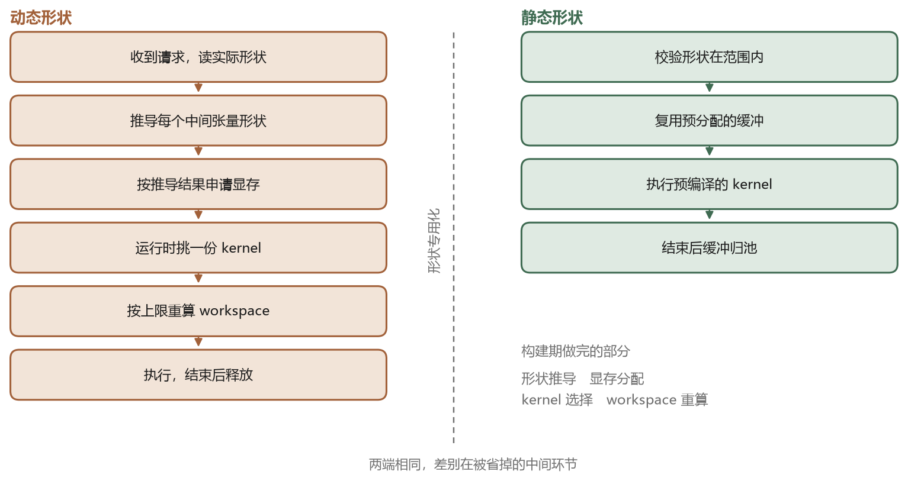

# 形状、动态性与静态化

一个对话服务上线时的配置是这样写的，最大批大小 8，最大序列长度 2048。压测跑的是 batch=8、长度 512，吞吐很好看。上线后真实流量的平均批大小是 2.3，序列长度集中在 60 到 120 之间，吞吐只有压测时的三分之一，单请求延迟还更高。

配置没有写错，模型也没有变。问题在于 engine 是按一组形状构建的，而那组形状和线上实际的形状不重合。形状（shape）指的是每个张量的维度大小，比如 `[8, 512, 4096]` 表示批 8、序列 512、隐藏维 4096。这几个数字看起来只是元数据，实际上决定了显存怎么分、kernel 怎么选、循环怎么展开。为什么当初会按最大值配，理由也不难理解，担心上线后“不够大”出错，而按最大值配至少不会崩。这件事在动态形状的模型上尤其容易发生，因为每个人都在按“最大可能”配参数，而最大可能很少是实际发生。

## 形状不确定，代价落在四个地方

第一个是显存。推理时的中间缓冲按形状分配，形状不定就没法算出准确的大小，运行时只能保守地按上限预留，或者边走边申请。前者浪费，后者带来分配开销和碎片。一个 batch=8 的模型按 8 预留，实际跑 batch=1 时那部分显存白占着。这块白占的显存本来可以拿去多放几条请求的 KV cache，所以浪费不是线性的，它会挤掉并发，再挤掉吞吐。

第二个是 kernel 选择。同一个矩阵乘，M 等于 1 时是访存受限，适合用切分 K 维、多 block 归约的实现；M 等于 512 时是计算受限，适合用大 tile 的分块实现。这里说的 tile 是把大矩阵切成小块，一块装进一次片上计算，块的大小决定了片上存储用了多少、数据重用了多少次。选哪个要看形状。形状是符号的时候，引擎只能选一个折中的、在所有形状下都不算太差的实现，于是小 batch 和大 batch 都不在最优。很多引擎在动态维度上会多做一个动作，把维度值当成参数传进 kernel，循环边界从常量变成寄存器里的值，代价是循环展开和地址计算都退化成通用版本，每次迭代都多几条指令。

第三个是 CUDA Graph。捕获一次执行序列要求所有地址和形状在执行时固定，形状变了图就失效。想用 CUDA Graph，就得为每一组形状各捕一张图，形状一多，图的数量和管理成本都上去了。一张图本身只占几百 KB 到几 MB，但每张图都要自己的一批固定地址，显存会按图的数量成倍涨。

第四个是编译期的循环展开与向量化。编译器知道长度是 512 时，可以把循环按 8 或 16 展开，可以做更激进的寄存器分配。长度是符号的时候，它只能生成一个通用的循环，边界检查一次都不能省。这一条在小算子上尤其明显，一个 512 元素的向量加法能展开成几十条无分支指令，符号长度只能写成循环，光循环控制就占掉一半时间。

这四条加起来，解释了为什么同一张卡上，静态形状的 engine 常常比动态形状的快 20% 到 50%。差距不是某个魔法开关，而是一连串“因为不知道，所以不敢”的保守决定。这个区间是量级示意，具体到你的模型可能只有 15%，也可能到 60%，要看模型里小算子占多少。

还有一个不太显眼的地方，变长序列的处理。模型要求一个整齐的张量，而请求的序列长短不一，中间就得 padding 到本批最长。padding 的位置算出来的结果没用，却一样要算、要占显存、要占带宽。batch 内长度差异越大，浪费越多。这也是后面讲连续批处理时要绕开的东西，它会把“按批对齐”换成“按 token 计费”。

## optimization profile

TensorRT 用 optimization profile 来妥协。profile 是构建时给引擎的一张“形状许可表”，每个 profile 给三组形状，最小、最优、最大。构建时引擎在最小和最大之间采样若干组形状，为每组挑 tactic，把能覆盖这些形状的实现固化下来。最优形状是它重点优化的那一个，实际运行的形状越接近它，性能越好。

可以把它想成地图的缩放级别。你告诉导航“我常走城区，偶尔跑高速，最远到两百公里”，它按这个范围准备数据；超出范围的路它没下过，就得现场联网。最优形状就是它重点缓存的那一块，走得越多越顺。

这个机制引出两条实践规则。一条是最优形状要按线上真实的分布来设，不是按最大值。上面的例子里，opt 应该设成 batch=2 或 4，序列长度 128，而不是 8 和 2048。另一条是范围不要开太宽，min 到 max 跨度越大，引擎需要采样的形状越多，构建时间按比例涨，而中间那些形状的性能都被牺牲掉了。跨度过大的时候还有个副作用，采样点之间隔得远，你实际用的形状可能落在两个采样点中间，两边的 tactic 都不理想。

超出范围会发生什么，各家不一样。有的直接报错，有的自动回退到最大形状并把多余的槽位空着跑，有的干脆在运行时重新构建一个。第三种最危险，因为它把一次几十毫秒的请求变成了几分钟的等待，而且通常发生在流量高峰，正好是你最不希望它重建的时候。上线前把“超范围会怎样”实测一遍，比读文档可靠。

多个 profile 是另一个选项。一个 profile 服务短请求，一个服务长请求，运行时按实际形状选。代价是显存按 profile 数量叠加，构建时间也叠加。三个 profile 的 engine 比一个 profile 的贵三倍，这在显存紧的卡上是真实的约束。所以 profile 的数量不是越多越好，两个通常够用，超过三个就要问自己是不是该分服务了。

还有一个经常被忽略的成本，形状校验。每次推理都要拿实际形状去匹配一个 profile，匹配不上就要走回退路径。这一步的开销很小，但它意味着“形状决策”这件事从构建期摊到了每次调用，在每秒几千次的小模型服务里也会累成真实开销。

## 静态化换来的东西

固定 batch、固定序列长度，等于把所有“不知道”都变成了“知道”。显存一次分配好，kernel 按这一组形状调到最优，整个执行序列可以捕成一张 CUDA Graph，连 CPU 的启动开销都省掉了。这件事在延迟敏感的服务里尤其明显，一次前向只花 3 毫秒时，启动开销可能就是其中 0.5 毫秒。

代价是浪费。一批请求里最长的那个决定 padding，短请求的位置被填满，算力花在无用的 token 上。序列长度 60 的请求和长度 500 的请求混在一批里，按 500 对齐，有效利用率只有一成多。这时候静态化的收益和 padding 的浪费互相抵消，甚至倒挂。可以用一个简单的比值估一下，平均有效长度除以对齐长度，低于三成就别指望静态化能赢。

所以静态化的适用场景有个清晰的轮廓。请求形状高度一致时（固定的图像尺寸、固定的音频窗口、固定长度的分类输入），静态化几乎总是赢。请求形状差异很大时（对话、文档问答），静态化的收益被 padding 吃掉，连续批处理和分页 KV cache 这类方案更合适。

静态化还有个前提容易被漏掉。固定形状意味着输入必须先被整理成那个形状，整理本身要花时间。文本服务里这通常是一次拷贝加一次 padding，把几百个长短不一的序列摆成整齐的张量，图像服务里是一次 resize。这些操作可能在 CPU 上做，也可能在 GPU 上做，做完了才能进 engine。如果模型本身只有两三个毫秒，整理输入的时间可能比计算还长，静态化的收益就被前置开销淹没了。

一个折中的做法是分桶。把形状按几档归档，60 以下一档，60 到 128 一档，128 到 512 一档，每档一个静态 engine。同一档内的 padding 浪费有限，档与档之间用最接近的那个。桶的数量是人为选的，桶越多浪费越少，engine 越多构建和显存成本越高。这个权衡没有标准答案，只能按流量分布算。算的时候别只看平均长度，要看分布的尖峰在哪，把一个尖峰单独切一档，往往比均匀切五档更有效。

## 缓存位置编码是什么意思

“把位置编码缓存起来”这句话经常出现在推理优化的清单里，含义比字面复杂一些。

位置编码（positional encoding）是给每个 token 标上“它在第几位”的信息，因为注意力本身不带顺序。以旋转位置编码（Rotary Position Embedding，通常简称 RoPE）为例，每个注意力层都要对 q 和 k 做一次旋转，公式是把 q 按 head 维度拆成前后两半，用预先算好的余弦和正弦表做乘加：

$$ q' = q \cdot \cos(m\theta) + \mathrm{rot}(q) \cdot \sin(m\theta) $$

其中 m 是位置，θ 是一组与 head 维度相关的频率。关键在于这张 cos/sin 表只跟位置和维度有关，与输入内容无关，与 batch 无关。它是一份彻头彻尾的常量。

既然如此，就没有理由在每个 token、每一层、每一次前向里重算它。正确的做法是在加载模型时算一次，形状是“最大序列长度 × head 维度”，放在显存里当常量用。这一步省下来的不是一次乘法，而是每层每步都要做的一次三角函数计算加一次 expand 加一次 gather。对长序列解码来说，它是实打实的固定开销。举例来说，40 层、32 个 head、head 维度 128，每生成一个 token 要把这张表读 40 次，每次几百 KB，加起来就是每 token 十几 MB 的额外流量，只为算几个三角函数。

放到图的层面看，这件事和权重预处理是同一类优化，把一个不随请求变化的值提前算好，变成图上的常量。引擎看到常量张量，还能进一步把它折进 kernel 的参数或者放到常量内存里，连读显存的延迟都省了。

代价在于它绑定了最大序列长度。表开到 2048，序列长度 3000 的请求就没法处理，只能截断或者重建。还有一个坑在位置插值。为了拉长上下文窗口而改旋转频率的做法，会直接改变表里的值。表是构建期固定的，频率一变就必须重建，而重建意味着重新导出、重新构建 engine。如果在项目走到后期才想起要改上下文长度，这道工序得提前算进去。在连续批处理的服务里，新来的请求位置是动态的，表的长度必须按最大的那个预留，做不到按需增长。这和分页 KV cache 的思路正好相反，后者能按需分配，前者只能预分配，两者的取舍来自“这张表能不能共享”。位置编码表是所有请求共用的，一份就够，所以预分配不心疼；KV cache 每个请求一份，预分配就浪费。

同类的还有 attention mask、Alibi 的斜率表、卷积的 padding 索引表。它们的共同特征是只依赖形状和位置，不依赖输入内容。认出这一类张量，就能在构建期把它们固定下来。这也是为什么静态形状能让一整套优化连锁生效，形状定了，常量才能定，常量定了，折叠和融合才有对象。

## 形状是整条链的前提

回到开头那个服务。修法不是把 batch 调大，而是承认线上形状和压测形状不是一回事，按真实分布重新设 profile，或者干脆分桶。改完之后，同一张卡的吞吐回到了压测时的八成以上。

这一章想说明的是，形状这件事在图、编译器、运行时三层都会出现，而且每次都是以“信息不足”的形式出现。图上不知道形状，融合不敢做；编译器不知道形状，循环不敢展开；运行时不知道形状，内存不敢预分配。后面几章讲的很多机制，本质上都是在用不同方式补上这条信息。这四层对信息的胃口还不一样，图要的是“能推出具体数字”，编译器要的是“编译期常量”，运行时只要一个“范围”，工程上往往只能满足其中两层，剩下的靠回退路径撑住。

了解这一点有个直接的好处。性能不达标的时候，先问一句“引擎在建的时候知道形状吗”，比直接去调参数有效。知道形状却没设对，改 profile；压根不知道形状，先想办法把形状收敛成几档。这两种情况要改的东西完全不同，混在一起试只会浪费时间。

形状还有一个容易被忽略的作用，它是团队沟通的共同语言。模型团队说“这个模型很快”，服务团队问的第一句应该是“在什么形状下”，因为同一份权重在 batch=1、长度 60 和 batch=32、长度 2048 下是两个东西。把形状写进性能报告、写进发布单、写进容量评估，争论会少很多。很多“上线后变慢”的争议，最后发现只是两边说的形状不是一个。

最后把这一章和后面的关系说清楚。静态化不是在“快”和“慢”之间选，是在“确定性”和“灵活性”之间选。确定性能换成现成的好处，也能换成稳定的延迟；灵活性换来的是对未知输入的容错。一个服务上线之后，流量分布是会变的，三个月前的 profile 可能已经不对了，所以形状这件事不是一次性配置，是要跟着流量一起维护的东西。
