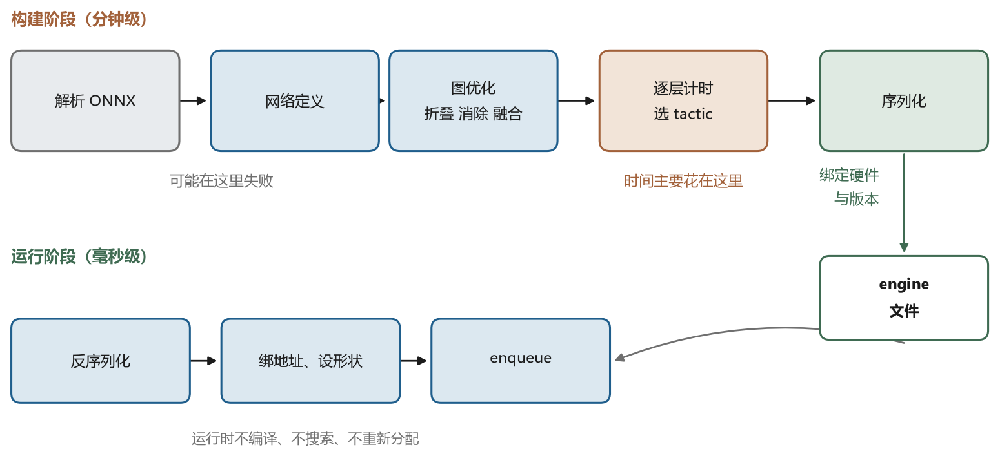

# TensorRT：从网络到 engine

第一次用 TensorRT 的人，通常会在两件事上卡住。一件是构建时间，一个几十层的模型在开发机上跑了四十分钟，进度条卡在“Building engine”不动，看着像死机。另一件是构建好的 engine 拿到另一台机器上，加载时直接报错，报的还不是“文件损坏”，而是序列化版本不匹配或者设备不兼容。

这两件事指向同一个事实。engine 不是模型，它是针对某一块具体的 GPU、某个驱动、某个库版本编译出来的一份二进制。它里面存的不只是权重和网络结构，还包括为这一块卡挑好的 kernel、排好的显存布局、测量过的性能数据。换一块卡，这些东西全部作废。

## 两个阶段，两种时间尺度

TensorRT 的工作分成构建和运行两段，两段的时间尺度差了三四个数量级。

构建从解析开始。ONNX 解析器把文件读成一张网络定义，节点是层，边是张量，张量带形状和精度。这一步能失败的地方不少，算子不支持、属性不认识、动态维度没声明、权重格式对不上。报错通常还算清楚，会告诉你是哪一个节点。

解析之后是优化。这一段的动作就是前几章讲的那些，常量折叠、死代码消除、层融合、布局选择，再加上一些 TensorRT 自己的重写，比如把多个小卷积合成一个大卷积、把 `concat` 之后的卷积拆成并行的卷积。这些优化不改变数学结果，改变的是图的形状和每个张量落在哪种布局里。

优化完是 tactic 选择，构建时间的大头在这里。同一层在 TensorRT 里不是一种实现，而是一族实现。一个矩阵乘可以用不同的分块、不同的寄存器数量、不同的累加顺序，每种实现的性能在不同形状下不一样。构建器会把候选实现逐个在真实的 GPU 上跑一遍，计时，留下最快的那个。

序列化是最后一步，把网络结构、权重、选好的 tactic 一起写成一个文件。这个文件里没有源码，也没有中间表示，只有运行时需要的那些字节。它能被多快加载，取决于它有多大，一个 7B 模型的 fp16 engine 大概十几 GB，从磁盘读到显存的这段时间在服务冷启动时是可见的。

运行阶段就简单了。反序列化，绑定输入输出的显存地址，设置动态形状，往 stream 上排一次执行。这一段是毫秒级的，正常情况下没有编译，没有搜索，也没有分配。

## 为什么构建这么慢

构建慢有三个乘数叠在一起。

第一个是层数。一个 Transformer 有几百层，每层都要选 tactic。

第二个是每层的候选数。常见的层有五六种实现，复杂的层有几十种。候选数还跟精度有关，开了 INT8 之后候选集合变了，要重新测一遍。

第三个是采样形状。动态形状下构建器不能只测一组形状，要在 min 和 max 之间采样若干组，每组都测。三个乘数相乘，几万次计时很正常，每次计时都要启动 kernel、同步、读时间，加起来就是几十分钟。

计时本身还有约束。测量必须在真实 GPU 上做，而且不能被别的任务干扰，所以构建时那张卡基本不能干别的。多卡并行构建是个常见的加速手段，但每张卡要各自测一遍，tactic 的结果不共享。

构建时还有一个参数容易被忽略，workspace 的上限。很多候选实现需要一块临时显存做中转，开的 workspace 越大，可选的实现越多，挑到的可能越快。把 workspace 设得很小，构建能过，但等于提前排除了相当一部分候选，性能就这样被自己的配置卡住了。运行时的显存预算要把这块算进去，它不属于权重，也不属于激活，但确实占着卡。

TensorRT 提供了 timing cache 来缓解这件事。它把某一层的测量结果按形状和精度存下来，下次构建同样结构的模型时直接查表，不用重测。这对“同一模型反复构建”的场景很有效，对“每次都是新模型”的场景帮助有限。cache 还会失效，换驱动、换库版本、甚至换一张同型号但不同批次的卡，里面的一些条目就不能用了。

## 精度是构建期决定的

TensorRT 的精度设置不是运行时开关，它在构建时就固化了。开 FP16 时，构建器会把能安全降到 FP16 的层降下去，同时插上必要的转换。哪些层“能安全降”由一张表决定，表里写着每个层支持哪些精度组合。一个层如果只支持 FP32，它会留在 FP32，前后的转换会被插进来，这段就慢了。

INT8 要多一步校准。默认路径是给一批有代表性的输入，让网络跑一遍，统计每一层激活的分布，据此定出缩放因子。校准集选得不好，精度掉得比预期多，而且掉在哪一层很难看出来。另一条路径是显式量化，也就是图里已经带好了 QDQ 节点，缩放因子由你在导出时给定，TensorRT 直接照着用，不需要校准。后者可控性更好，前提是你的训练或量化流程能产出这样的图。

FP8 在更新的架构上可用，它的动态范围比 INT8 宽，校准的难度低一些，但支持它的层更少，实际跑起来经常是一部分 FP8、一部分 FP16、一部分 FP32 混在一起。

混精度是常态，这件事本身不是问题，问题是转换点在哪。每插一个转换，就是一次全张量的读写。看一份 engine 的性能，值得先看它有多少个转换层。

## plugin 与它的代价

TensorRT 不支持的自定义算子，要靠 plugin 补。plugin 是一个 C++ 类，声明自己的形状推导规则、输出数量、序列化格式，然后实现执行逻辑。构建时把它注册进去，解析到对应节点时调用你的实现。

这条路能走通，但坑不少。

版本匹配是第一道。plugin 的序列化格式里带着一个版本号，engine 在反序列化时会比对，不一致就拒绝加载。你的 plugin 改了一个字段，所有旧 engine 都作废。

ABI 是第二道。plugin 编译时用的编译器版本、标准库、CUDA 版本，都要和运行时的环境一致，否则会出现一些非常难查的崩溃，症状是加载时或者第一次执行时段错误。

形状推导是第三道。plugin 必须自己声明输出形状怎么从输入推出来，声明错了，后面的层拿到的形状就是错的，报错会出现在离 plugin 很远的地方。

性能是第四道。plugin 是自己写的 kernel，能不能比原生实现快，完全取决于写法。见过把插件写成了十几次 kernel 启动的版本，比不融合还慢。

所以 plugin 的定位应该是“最后手段”。能用标准算子表达的，尽量在导出时表达出来。必须写 plugin 的，把它当成项目里的一等公民来维护，版本、测试、文档一样都不能少。更实际的一条经验是，先看这个算子能不能用几个标准算子拼出来，拼出来的版本慢一点但能跨版本跑，往往比一个不能用第二年的 plugin 更值。

## engine 绑定什么

engine 文件的兼容性边界值得写清楚，因为它是“为什么本地跑得好，上线就崩”的常见原因。

绑定 GPU 架构。为某一代架构编译的 kernel 指令，换一代可能不被支持。厂商提供了硬件兼容选项，可以把 engine 做成跨代的，代价是放弃一部分针对性的优化，性能通常会降一些。

绑定库版本。默认情况下 engine 只能在构建它的那个大版本上加载，跨版本需要显式开启版本兼容。这个选项在老版本上不存在，所以跨版本升级时经常要重建。

绑定驱动。驱动对 kernel 和显存管理有影响，某些情况下不同驱动版本会带来行为差异。

绑定构建时的形状范围。超出 profile 的输入不是“慢一点”，而是报错或者需要重建。

绑定 plugin 的二进制。上面说过。

这五条里有四条是环境，一条是配置。环境类的绑定没法绕过，只能靠制品管理把每一份 engine 和它对应的环境绑在一起；配置类的绑定则要求把 profile 写进发布清单，因为运维不知道这个文件里有一个形状范围。

这些绑定加起来意味着，engine 不能当成模型文件来管理。模型文件可以进 git，可以随便拷；engine 更适合当成构建产物，进制品库，带上构建时的环境标签，按目标机器的组合分别构建、分别发布。制品库里一个模型出现十几份 engine 是正常的，每一份对应的是一条环境线。

认识清这些边界，该不该用也就有答案了。硬件固定、模型结构稳定、性能要求高、愿意为构建时间付代价的场景，TensorRT 的优势是真实的，尤其是小 batch、低延迟的推理，它能把 kernel 挑得很细。模型天天变、硬件种类多、自定义算子多的场景，构建成本和维护成本会把收益吃干净。

还有一类场景需要掂量，就是形状高度动态的生成式模型。TensorRT 能做，但它擅长的是静态形状下的极致，动态形状下优势被削弱，而专门为这类模型设计的引擎和推理框架往往更顺手。这个判断在后面的章节还会反复出现。
