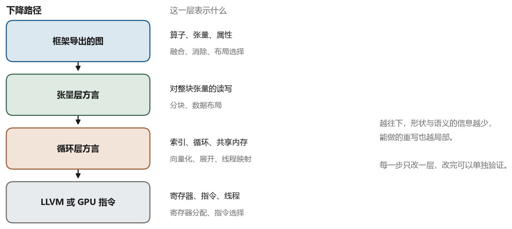

# TVM、MLIR 与 XLA

一个矩阵乘在给定显卡上能跑多快，理论上可以算出来。算出来之后再看实际实现，往往只到理论值的六成。手写 kernel 的人会花三天把分块、寄存器、向量宽度一个个试过去，最后调到七成半，然后发现换一个形状，前面调的全部作废。

编译器这一路走的是另一种办法。它不去猜最优实现，而是把一个参数化的实现空间定义出来，让机器去试。这里的编译器不是指把 C 代码变成机器码的那个，而是指把计算图变成目标硬件上可执行代码的那一层，工作对象是算子而不是语句。TVM 最早把这件事说清楚，写什么（计算的定义）和怎么算（调度）分开，调度由搜索决定。这套思路后来被 XLA、Triton、Inductor 各取一部分，成了今天推理编译的主流做法。

## 把“写什么”和“怎么算”分开

TVM 的核心是一张计算图和一组调度原语（Chen 等，2018）。计算图描述每个输出张量怎么由输入算出来，只用索引表达式，不涉及循环怎么写。矩阵乘写成对 k 求和，卷积写成对通道和核窗口求和，都是几行声明。

可以拿做菜打比方。计算声明是菜谱，写清楚要放什么、放多少；调度是火候、下锅顺序、切菜的粗细。同一份菜谱，换一套火候，出来是两个菜。把这两件事拆开的好处是，菜谱不用改就能适配不同厨房，调度可以按每个厨房的条件单独调。

写成代码大概是这样，只声明“C 的每个元素是 A 的一行点乘 B 的一列”，不提循环：

```python
@T.prim_func
def matmul(A: T.Buffer((M, K), "float16"),
           B: T.Buffer((K, N), "float16"),
           C: T.Buffer((M, N), "float16")):
    for i, j in T.grid(M, N):
        with T.block("C"):
            k = T.reduce_axis(K)
            C[i, j] = T.sum(A[i, k] * B[k, j], axis=k)
```

这段代码直接跑会很慢，它是“数学定义”，不是“高效实现”。调度描述循环怎么组织。分块大小、循环顺序、是否向量化、是否并行、是否展开，这些构成一个组合空间。同一段计算配上不同的调度，生成的代码性能可以差十倍。TVM 提供的原语让人能手动写出一个合理调度，也能让搜索算法在这个空间里自动找。

搜索这一块经历了三代。第一代是模板加参数搜索，人写好一个带参数的模板，机器只调那几个参数。第二代是自动生成候选，从零开始构造调度，搜得更广但更慢。第三代的重点在代价模型，用机器学习预测某个调度要跑多久，减少真正上机测量的次数。

代价模型是这条路的软肋。预测不准的时候，搜出来的调度还不如手写的。硬件越新，预测越不准，因为训练数据里没有这一代卡的行为。所以很多实际项目最终会退回到“手写主调度，只让自动调优扫几个参数”的折中。这个折中听起来不够优雅，但它把不确定的部分缩到了最小，剩下的交给人工经验。

手动写一个调度，形状大致是这样的。把 M 和 N 各切 64，每个小块的乘加放到一个线程块里做，切出来的 A 和 B 小块先搬到共享内存，外层循环再叠一个双缓冲，让下一块的数据搬进和当前块的计算重叠起来。这几十行调度代码决定了生成的 kernel 能不能跑满，而它跟“矩阵乘是什么”一点关系都没有。这套思路最大的价值也在这里，一段调度可以复用到所有同类算子，换形状只需要重搜参数。

另一条代价是形状。一次搜索对应一组形状，形状变了要重搜。NLP 服务里序列长度从 60 跳到 2000，中间有几百种形状，不可能每种都搜一遍。常见的做法是把形状离散成几档，或者干脆只对最主要的几个形状做专用化，其余走通用版本。这和上一章的 profile 是同一个矛盾的两副面孔，一个在引擎里解决，一个在编译器里解决。

调度空间的规模值得一提。光是分块大小三组，每组十个取值，就是一千种组合；再加上循环顺序、向量宽度、是否双缓冲，轻易就到十万数量级。搜索不可能全覆盖，所以实际做法是先用人写的启发式圈一小块，再在里面搜。这也解释了为什么自动调优的收益常常集中在少数几个关键算子，比如卷积和矩阵乘，其余算子搜也搜不出什么。

## MLIR 解决的是另一件事

TVM 处理的是“一个算子怎么变成高效的循环”，MLIR 处理的是“一堆不同层级的表示怎么串起来”（Lattner 等，2020）。

在没有 MLIR 的年代，每个框架、每个硬件、每种优化都要写一套自己的 IR 和转换，N 个前端乘 M 个后端就是 N×M 份工作。MLIR 的观察是，这些 IR 里有大量重复的部分，循环、内存访问、类型、函数这些东西在每一层都要出现。把公共部分抽出来做成基础设施，剩下的部分用方言（dialect）表示。

方言这个词用得贴切。它指的是“在同一个语法框架下，各自领域的表达习惯”。高层方言说张量、说归约，中间方言说循环、说共享内存，底层方言说线程、说寄存器。每种方言有自己的规则，但共享同一套类型系统和 pass 基础设施。结果是，翻译工作从 N×M 变成 N 加 M，每个前端只需要会一种方言，每个后端也只需要认一种。

一个方言定义一组操作和它们的语义。高层的方言接近数学，比如张量上的逐元素运算和归约。中间的方言描述循环和内存层级。底层的方言接近机器指令。转换规则写成“匹配这个模式，替换成那个模式”，在方言内部或者方言之间进行。

一个真实的下降链大致是这样。框架的图先变成张量层的方言，张量层的算子再拆成对循环和内存的描述，循环层再做分块、向量化、线程映射，最后交给 LLVM 或者直接生成 GPU 代码。下降（lowering）指的就是这个“从高层往低层走”的过程。每一层都有自己的优化，张量层做融合，循环层做分块，底层做指令选择。一个人可以在任意一层插进去修改，不用关心别的层怎么实现。

这套结构让下降变成一串可以逐步验证的小步。每一步只改一层，改完还能跑一遍测试，出问题容易定位。这比“从高层图一步跳到 LLVM IR”要好维护得多，后者一旦出错，报错信息基本没有参考价值。

MLIR 的代价是抽象泄漏。方言之间的边界不是天然的，你得自己定义清楚每一步保留什么、丢弃什么。下降过程中如果某一层丢掉了形状信息，后面就再也补不回来，这和图优化里丢掉信息是同一类问题。写 MLIR 的 pass 经常会遇到“上面还有信息，下面已经没有了”的尴尬。

一个具体的例子能看清这个尴尬。矩阵乘在张量方言里写成“对 k 求和”，形状是 `[M, K]` 乘 `[K, N]`；下降到循环方言时，形状变成了三个循环的边界；再降到线程方言时，边界又变成了“这个块算哪一段”。每一步都少一点“整体”的信息，多一点“局部”的细节。如果这一步把 M 写成了常量而 M 本来是符号，后面所有依赖 M 的优化都失效，而且不会报错，只是生成的代码比预期差。

## XLA 的选择

XLA 走的是另一条路，它假设输入已经是函数式的（StableHLO 就是它这一层的表示），然后专注于三件事，融合、布局、代码生成。

融合的策略比图优化那一层激进。XLA 会把一整条元素级算子链合成一个 kernel，中间结果连寄存器都不出。对 Transformer 里的 LayerNorm、激活、残差相加这一类，这个策略效果很好。它的判断也简单，只要一个消费者、逐元素、形状可推，就合。一段残差加归一化加缩放加激活的链，在图上五六个节点，融合后是一个 kernel，进一次、出一次，中间五个张量全在寄存器里转。

布局是 XLA 里存在感最强的一环。它要在整个计算图上选一套布局，让转换次数最少、访存最友好。选布局是个全局问题，局部最优经常导致全局很差，所以这一步通常要跑一个带代价模型的搜索。这也是 XLA 和普通图优化的分界线，后者只能就地把两个算子拼起来，前者可以为了一个全局更优的布局，把整条链的形状都改掉。

XLA 的编译是即时的（JIT），也可以提前编好（AOT）。JIT 的好处是随形状变化自由，坏处是第一次调用的编译时间。一个动态形状的模型在 XLA 上跑，经常会因为形状变了而反复重编译，表现出来就是前几次请求特别慢，之后稳定。AOT 把这个代价挪到构建期，但要求你事先知道形状集合，等于把自由度换成了确定性。

XLA 最不适应的场景是自回归解码。解码时每一步只算一个 token，大部分算子变成访存受限的小 kernel，融合的收益抵不过固定的调度开销。这也是为什么大模型推理很少直接用 XLA 的默认路径。它擅长的是“大块计算、一次算完”，不擅长“每步只算一点、一直循环”。

还有一个工程上的绕法，把不同长度的输入归到有限的几档。每个档对应一个编译产物，请求进来先归档，再走对应的那条。这和图 4 章的分桶是同一个思路，只不过这里的代价是编译时间和编译缓存，而不是显存。档选得粗，浪费算力；选得细，编译产物和内存开销上去。



## 三个方案的共同点

它们都在做同一件事，用规则加代价模型在实现空间里选，而不是让人手写每一个 kernel。差别在于选的范围和选的时机。可以再打一个比方，TVM 像“把一个格子内最好的做法全算一遍”，MLIR 像“把一套施工标准和工具链定下来”，XLA 像“给定一套性子急的规矩，快速给出一个不错的方案”。

TVM 把搜索放在编译期，针对具体形状，搜得细，慢。MLIR 不直接做选择，它提供做选择的框架，具体的搜索由各个 pass 决定。XLA 的选择在编译期完成，但它的搜索空间比 TVM 窄，代价是灵活度。

它们的边界也相似。三者在计算密集、形状固定、算子规整的场景下表现最好。卷积、矩阵乘、逐元素链，这些都是它们的舒适区。在访存不规则、控制流复杂、算子形状极小的场景下，它们的收益迅速下降，因为搜索空间里的候选实现本身就不怎么样，再会搜也没用。

还有一条共同的限制，编译器优化的是单个 kernel 或者单段图的执行效率，它不管请求怎么排队、显存怎么复用、多个模型怎么共存。这些属于运行时和服务层的事，编译器看不到，也就优化不了。很多“上了编译器还是慢”的案例，瓶颈就在这些看不到的地方。

它们对错误的容忍度也不同。TVM 搜不到好调度时，至少能退回一个能跑的通用实现；MLIR 的下降如果中途出错，往往直接编译失败，因为高层信息已经丢了，回不去；XLA 在形状变化时可能反复重编，累积起来把延迟拉成尖刺。这三种失败方式在评估时都得试一遍，别只看最优情况。

代价模型还有一个现实问题，测量噪声。一个 kernel 只跑几十微秒的时候，计时误差可能就有几个百分点，搜出来的“最优”和“次优”其实分不开。专业做法是每组候选多跑几遍取中位数，再给不值得搜的小算子直接约定一个固定实现。这条经验在全自动调优里经常被忽略，结果是搜了很久，性能在噪声里沉浮。

## 什么时候值得引入编译器

判断标准比想象中简单。如果你的模型是标准的卷积网络或者 Transformer，形状能固定下来，并且你已经把图优化和量化都做了，再往下抠 kernel 效率，编译器是合理的工具。它能把人工调优的周期从周缩短到小时，也能在换硬件的时候省掉重写的功夫。如果模型很小、调用很频繁，编译器的启动开销会成为主要成本，这时候更适合用现成的库，或者干脆用解释执行的路径。如果模型结构特殊、算子基本是自定义的，编译器的调度空间里没有合适的候选，收益有限。

中间还有一种判断依据常被忽略，团队能不能维护这套东西。引入一个自动调优的编译器，你同时接手的是一套构建流程、一份调优缓存、一堆版本相关的问题。调优缓存丢了，性能就回到起点；换驱动，缓存里的条目可能失效；报错信息都在 IR 层，护的人得能读懂。这些成本在选型时往往不算进去，上线后才发现它们比写一个 kernel 贵。

还有一个常被忽略的时机问题。引入编译器最适合的阶段是“模型结构已经稳定，但还没到极致优化”，而不是“模型还在天天改”或者“已经手写得很好了”。前者会把编译流程变成迭代的负担，后者收益有限。判断标准可以很具体，数一下过去三个月模型的前向代码改了几次。三次以上，先别引入；一次没改，而且性能已成为主要矛盾，那就是好时机。

还有一个务实的替代方案值得提一句。如果团队养不起一套编译器，但又确实需要比通用库更快的 kernel，可以把最难的那个算子交给专家手写，其余全用库。这样既能拿到大部分收益，又把维护面积控制在很小的范围。编译器适合“整体都需要提一点”的模型，手写适合“一个算子在拖后腿”的模型，判断哪种情况，看时间线上前三个算子占了多少。

下一章讲的 torch.compile 试图把这条路做成默认选项，代价是它必须在用户不知情的情况下决定什么时候编译、什么时候放弃。
