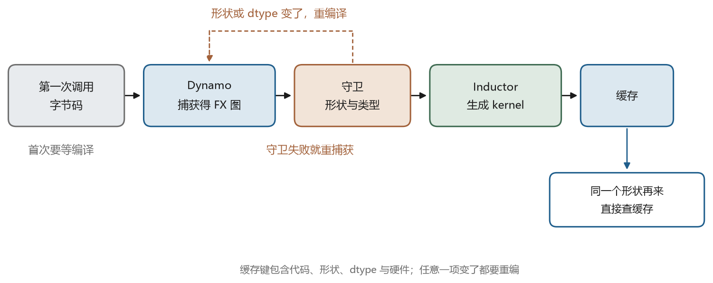

# torch.compile：捕获与生成

给一个模型加上一行 `@torch.compile`，第一次跑的时候会明显停顿，然后开始出结果。多数情况下第二次就快了，元素级算子多的模型能快三成到一倍。但如果输入形状变了，停顿会再来一次。如果代码里有某个地方触发了图的断开，速度可能一点没变，只是启动变慢了。

它不像 TensorRT 那样要单独构建，也不像 TVM 那样要写调度，看起来像是“加一行就好”。这一行背后其实是一整条编译链，理解它什么时候不生效，比理解它什么时候生效更有用。而且它的生效条件不在你的模型结构里，而在你的代码写得够不够“乖”。

## Dynamo 抓的是字节码

torch.compile 的第一段是 Dynamo（PyTorch 官方文档，2023）。它不追踪算子调用，而是拦在 Python 字节码这一层，把函数体拆成一段一段，能翻译成张量运算的部分翻成计算图，翻不了的部分退回 Python 解释执行。这个做法和 ONNX 导出的追踪不一样。追踪需要真实的输入跑一遍，走过的分支才存在；字节码捕获不需要真实数据，它把条件本身当成图上的一个值，形状也可以用符号表示，所以能在图上保留一部分动态性。

翻出来的图是 FX 图，节点是对 torch 操作的调用，边上带着形状和类型信息。图交给下一段之前，Dynamo 会为这张图生成一组守卫（guard），守卫的内容是“这次运行的环境特征”，比如张量形状、dtype、参数的 `requires_grad`、函数里用到的全局变量的值。下次调用时守卫全部成立，就直接复用编译结果；有一个不成立，就重新捕获、重新编译。

这就是为什么换一个 batch size 会再停顿一次。形状在守卫里，形状变了守卫就失败。这条机制保证了正确性，也埋下了重编译的隐患。

第一次调用之所以慢，是因为捕获本身也不便宜。它要逐条解释字节码，把每个 torch 调用记成一个 FX 节点，推导每个节点的形状，再生成守卫。一个小模型也要几百毫秒到几秒，大模型的代价更明显。所以它不适合“启动就要快”的场景，更适合“启动一次、跑几万次”的场景。

## graph break 是什么

Dynamo 遇到它看不懂的代码，会在那里把图切断，前一段编好，后一段重新开始。这个断点叫 graph break。

常见的原因有几类。一是取值操作，把张量转成 Python 数字，`x.item()`、`int(tensor)`、`len(tensor)`，一旦取值，图里就没有这个数了，后面的逻辑回到 Python。二是数据依赖的控制流，`if x.sum() > 0` 这种条件，Dynamo 无法在图里表达，只能切断。三是副作用，打印、写文件、修改全局状态。四是太动态的 Python，比如根据字符串拼出方法名、动态修改类属性、用第三方库的对象做容器。

断点本身不报错，默认只是静默地把图切小。切得多了，编译收益消失，反而多了编译开销。有一个开关可以让它严格模式，遇到断点直接报错，调试的时候很有用，因为它把“为什么没加速”变成一个具体的位置。

对这一点要有个心理准备，任何试图完全消除 Python 的编译器，都会在 Python 的动态性面前退一步。退一步不是失败，但退的步数决定了这套方案值不值得用。

一个断点的代价不止是“少融合了几个算子”。图切开之后，前一段的结果必须先写回显存才能交给后一段，如果后一段在 CPU 上算，还得等 GPU 同步完。一次同步在几十微秒的量级，对一个大 kernel 无所谓，对一串小 kernel 就是灾难。所以看到断点时，先看它切在哪里，再看它切开了多少工作量。把一个热点循环里的小断点修掉，收益往往比调一堆编译参数大。

## Inductor 生成 Triton kernel

捕获到的 FX 图交给 Inductor。它做的是前几章讲过的那些事，融合、布局、内存规划，然后把每一段生成成 Triton kernel。

生成的粒度值得说清楚。Inductor 会把能融合的算子放进同一个 kernel，判定标准和一般的图融合类似，但更激进，因为它有完整的形状和 dtype 信息，也愿意为了一次遍历生成一个稍长的 kernel。它生成的 kernel 里，每个线程处理几个元素、循环怎么排、要不要做规约，都是模板加搜索决定的，搜的规模比 TVM 小得多，所以编译快，最优性差一些。

布局方面，Inductor 尽量不改数据的物理排列，只在必要处插入转换。这和 XLA 的全局布局搜索不同，是局部决策。好处是简单可控，坏处是错过一些全局更优的方案。

内存规划是它的另一个贡献。一段融合之后，中间张量不需要分配，直接在寄存器里传下去；不能融合的那几段，它会算出每块缓冲的存活区间，把不重叠的区间叠在同一块显存上。这一步不改变 kernel 数量，却能明显降低峰值，对显存卡得紧的服务比速度提升更值钱。

动态形状在这里的处理方式是符号化。形状不确定时用符号维度表示，生成的 kernel 接受形状作为参数。这能避免为每个形状编译一份，代价是丢失了“形状是常量”带来的优化机会，循环边界变成运行时值，向量化和展开都受限。`dynamic=True` 打开的就是这条路，它把重编译换成了通用 kernel。

## 缓存与重编译

编译结果会写进缓存目录，同一台机器上第二次启动可以直接读。缓存键包括代码、形状、dtype、硬件信息、编译选项，任何一项变了就重新编译。这在开发时很方便，在容器里经常出问题，因为容器一重建，缓存目录没了，服务冷启动要重新编译一遍。

重编译有次数上限。同一个函数反复触发重编译，超过上限之后 Dynamo 会放弃编译，退回 eager。这个设计是为了防止“每个请求形状都不一样”的场景把机器拖死，但它的副作用是性能静默退化，日志里只有一行提示。曾经有用例把一个新模型接进来，所有请求的延迟都正常，只是比预期慢了 40%，最后才发现在预热阶段重编译次数就已超限。

一个常见的坑在服务的预热。压测时用固定形状，缓存全部命中；上线后流量形状分散，每个新形状第一次都慢。解决的思路是预热时把线上可能出现的形状都跑一遍，或者干脆固定几个形状分桶，让形状集合收敛。这和前面讲 optimization profile 的思路是一致的，只是这里没有显式的构建阶段，代价落在第一批请求上。

## 什么时候有用，什么时候没用

有效的场景有几个共同点。模型里元素级算子多，融合空间大。形状稳定，守卫很少失败。单个 kernel 的时间占比不高，调度开销占比高。训练和批量推理里这些条件经常同时满足，所以 torch.compile 在这两个场景的口碑最好。具体到数字，元素级算子密集的模型能快到一倍上下，而一个几乎全是矩阵乘的模型提升很有限，因为它本来就没多少可融合的东西。

无效的场景也有共同点。解码阶段每一步只有几十个微秒的 kernel，编译带来的融合收益抵不过额外的调度和内存开销。模型里有大量自定义算子，Inductor 只能退回调用原来的实现，融合不起来。代码里 graph break 密集，图被切得很碎。还有一类是模型本身太简单，编译的时间比跑得快。这几条里，最后一种最容易被忽略，因为它看起来不该发生。

还有一类情况需要特别提醒，`mode` 里的低开销模式会启用 CUDA Graph。它能把整个前向的启动开销压到很低，前提是地址稳定、形状稳定。一旦你的代码里有动态分配，或者输出形状随输入变化，这个模式要么报错，要么退化成普通路径。用之前先确认你的输入契约是否真的固定。

把它和 TensorRT 放在一起看，差别在定位。TensorRT 是“离线构建、极致优化、强绑定”，torch.compile 是“在线编译、够用就好、随代码走”。前者适合产品形态稳定、硬件固定的服务，后者适合迭代快、硬件多样的训练和实验环境。两者不冲突，同一个项目里常常是训练用 torch.compile，上线用 TensorRT 或者专用引擎。

还有一层差别在交付形态。TensorRT 交出去的是一个文件，可以版本化、可以分发、可以离线验；torch.compile 交出去的是一段代码加一个缓存目录，缓存不在，性能就不在。所以它在训练和实验里顺手，做成可交付的推理包时反而麻烦。

还有一层差别在可解释性。TensorRT 构建完能导出优化后的网络，一层层看；torch.compile 生成的 Triton 代码也能 dump 出来看，但那是代码不是图，读起来更费劲。调性能的时候，能看到的东西越多越好，这一点上两边的使用体验差得很远。

下一章换个角度，讲量化落到图上是什么样子。它和这一章的关系很直接，量化的图表示决定了编译器能不能把量化也一起融合掉。
