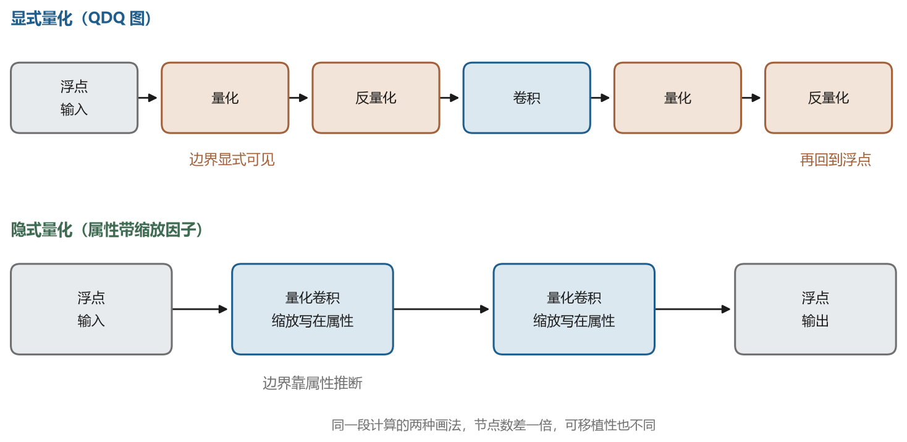

# 量化在图上的落地

同样一个模型转成 int8，两份产物在同一个引擎里跑，一份精度掉了三个点，一份只掉了零点三个点。权重一样，校准集一样，差别在图的样子上。第一份的图里每个算子的输入输出都包着一对量化反量化节点，第二份的图里算子本身带着缩放因子，中间没有多余节点。

这两种图在数值上可以等价，但在工程上的命运差别很大。哪一种表示能被哪个引擎吃下去，决定了融合能不能做、校准怎么算、出错时怎么定位。所以它不是格式选择，而是整条量化流程的前置约束。量化算法本身有专门的一册讲，这一章只看它在图上长什么样。

## 两种图表示

显式量化的做法是在图里插入量化节点。浮点张量经过 QuantizeLinear 变成整数张量，整数张量经过 DequantizeLinear 变回浮点，算子本身还是浮点的，只是它两边的张量在物理上是整数。这一对节点简称 QDQ（Jacob 等，2017）。

$$ \hat{x} = s \cdot (q - z) $$

其中 s 是缩放因子，z 是零点，q 是存下来的整数。量化是它的逆运算，先除以 s 加 z，再四舍五入并截断到整数范围。

隐式量化的做法是把缩放因子写成算子的属性。卷积节点的属性里有输入缩放、权重缩放、输出缩放，算子内部按这些参数做整数运算。图上看不到量化节点，量化信息藏在属性里。

两种表示的差别在于信息存放在哪。QDQ 把量化位置显式标出来，任何一个读过图的人都能看到哪一段是整数、哪一段是浮点、边界在哪。隐式把这件事压缩进算子，图更干净，但“这一段到底是整数还是浮点”要靠查属性才知道。

工具链的支持程度不同。以 QDQ 形式导出的图通用性更好，ONNX Runtime 和 TensorRT 都能解析，而且显式量化不需要校准集，缩放因子在导出时就定了。隐式量化的图更接近老式工具链的产物，某些引擎只认它，换引擎时经常要重新导出。

逐通道量化在 QDQ 里靠一个 axis 属性表达。这个属性携带着坐标，而坐标的含义由布局决定。同一个权重，NCHW 下的通道维是第 1 维，NHWC 下是最后一维。导出时写死的 axis 如果和运行时采用的布局对不上，缩放因子就会沿着错的方向广播，结果全错，而且错得很难看出原因。换引擎时这是典型的重灾区。

代价也不同。QDQ 的图节点更多，语义上多了两圈转换，如果引擎不做优化，这些转换会真的执行，性能会掉。好的引擎会把 QDQ 折叠掉，把量化信息转成算子属性，这一步做不做、做得干不干净，是“同一个 QDQ 模型在两个引擎上性能差一倍”的常见原因。

## PTQ 在图上走三步

训练后量化在图上通常分三步，插观察点、校准、改写。

第一步在浮点图里插入观察点（observer），位置在每个算子的输入和输出。观察点不改变数值，只是记录流过的张量的分布。

第二步拿一批有代表性的数据跑一遍，把每个观察点的分布统计出来，据此定出缩放因子。按张量定一个缩放因子叫 per-tensor，按通道定一组叫 per-channel。逐通道的精度好，因为不同通道的动态范围常常差一个数量级，但要求硬件的整数乘加支持逐通道缩放，老一些的加速器只支持逐张量。

第三步改写图，把观察点换成量化参数或者 QDQ 节点，把浮点算子换成整数算子。这一步的顺序很关键，先做哪个决定了得到什么样的图。

校准集的选择比算法的选择影响更大。统计出来的缩放因子只是那批数据的统计量，线上的输入分布一旦偏离，激活就会大块地碰到饱和区，或者被量化得太粗。短句校准、长文推理是一种常见的偏差；只拿正常样本校准、上线后碰到异常输入是另一种。后者在模型里表现为偶发的输出党崩，排查起来比系统性掉点麻烦得多。

## 先融合还是先量化

顺序会影响结果，而且影响得比想象中大。

先融合再量化是主流做法。Conv 和 BatchNorm 先折成一个卷积，图上只剩一个算子，这个算子只需要一组输入缩放和一组输出缩放。校准时观察点也只放在这一处，误差来源单一。整条链上的缩放因子少，误差累积少。

先量化再融合会撞上一个数学问题。BN 折进卷积需要把缩放乘到权重上，而量化后的权重是整数，乘一个浮点缩放要么溢出，要么得重新量化。重新量化意味着再引入一次误差，而且新的缩放因子要和前后两段对齐，对齐不上就只能放弃融合。实际结果是图被切成几段，中间插着反量化和再量化。

所以对量化流程的建议很简单，先把图优化干净，再考虑量化。反过来做的项目，通常会在后期发现量化带来的性能收益被切碎的图吃掉了。

有一类例外值得知道。如果模型的某一层数值特别敏感，量化后精度掉得厉害，可以在融合之后单独把这一层留在浮点，其余全量化。这时候图会被切成两段，段间接一次转换。切一刀的代价是一次全张量读写，切十刀的代价就是一整层的时间。

## 回退是怎么发生的

量化失败很少是“整体失败”，更常见的是局部回退。

引擎在把浮点算子换成整数算子时，会检查这个算子有没有整数实现、形状是否满足要求、缩放因子是否在允许的范围里。任何一条不满足，这个算子就留在浮点。前后相邻的算子如果是整数，边界上就要插一对转换。

一段链上如果回退了三四个算子，图就会变成整数段、浮点段、整数段交替的样子。每跨一次边界，就是一个张量的写出和读回。这种情况下端到端的加速可能只剩预期的一半，而报告里依然写着“已启用量化”。

定位的办法是看优化后的图，数一下量化段的数量和每段的算子数。段多、每段短，说明回退频繁。再看是哪些算子回退了，通常集中在几类，LayerNorm、Softmax、复杂激活、带动态形状的 reshape，它们的共同点是整数实现要么不存在，要么在低精度下误差太大。一个二十层的模型如果有五六层回退，段数可能变成十几个，转换的开销把量化省下的带宽又吐回去一半。

有一个折中的技巧是把这些算子合并成一个自定义的浮点块，而不是让它们零散地夹在整数之间。合并之后边界的数量从“每个算子一次”降到“每个块一次”，转换的总量下来了。这需要引擎支持在量化图里保留浮点子图，不是所有引擎都做得到。

## 量化图上的算子融合

量化之后的融合和浮点时的融合不是一回事，规则要重新写一遍。

浮点时 Conv 后面接 ReLU 可以合成一个 kernel，因为激活就是逐元素的比较。量化之后可以做得更多，ReLU 的上界截断可以并进整数运算的饱和处理，连比较都省了，只要把输出的取值范围直接卡在 [0, 255]。这是量化独有的优化，浮点做不到。

另一类可以合的是 Conv 后面接的 requantize，也就是把一组缩放因子换成另一组。这一步在浮点里对应一次乘法和一次转换，在整数里是一次定点乘法加移位。如果能把它和卷积的输出累加合起来，就少一次全张量的读写。

融合的边界也更严格。两个量化算子之间的融合要求它们的输出缩放因子一致，不一致就要插一次 requantize。所以校准阶段得到的缩放因子分布，直接决定了后面能做多少融合。一个通道的动态范围特别大，会把整体的缩放因子拉偏，导致别的通道量化太粗，这种情况要么改成逐通道，要么把那个通道单独处理。逐通道也不是万能的，它对卷积友好，对矩阵乘不一定有支持，而 Transformer 里最吃算力的恰好是矩阵乘。

把量化当成“在图上插几个节点”是对它最简单的理解，也是最容易踩坑的理解。它同时牵动校准数据的代表性、图的改写顺序、融合规则、硬件支持程度，任何一环没对齐，最终产物的性能和精度都会低于预期。还有一层影响很少被讨论，量化图的可调试性。整数张量打出来是一堆 0 到 255，与浮点值对不上，排查时得手算一遍缩放因子才能看懂中间结果。这也是为什么量化项目比浮点项目多一道工序：每一层都留一份浮点基准。

每一步的收益都要单独算一次账。权重从 16 位降到 8 位，读权重的带宽直接减半，这对大模型是主要收益；激活降位则主要影响中间张量和缓存，对长序列更关键。两者叠加时，峰值显存的降幅往往比延迟的降幅更可观。

下一章换到运行时，讲内存怎么排。量化改变的不只是计算，还有显存占用和带宽的账，那部分的收益有时比计算更快更明显。
