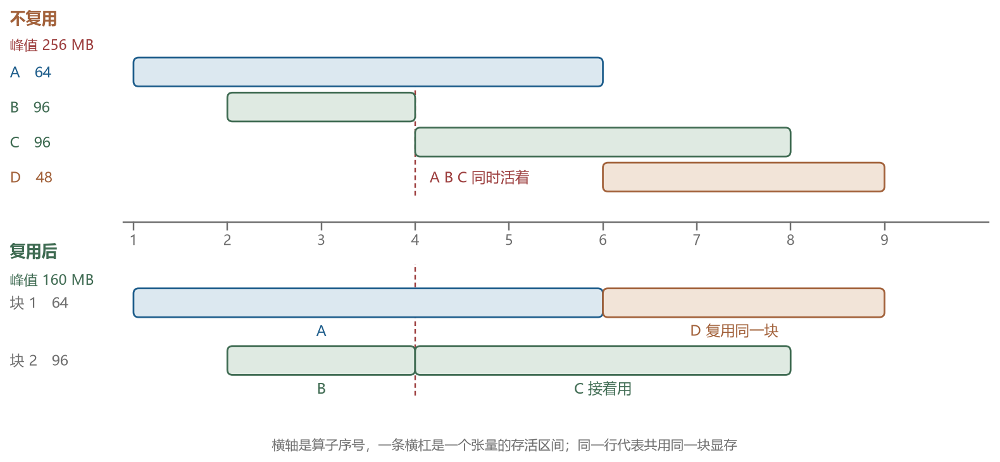

# 内存规划与复用

一个模型在 8 GB 的卡上跑不起来，日志显示峰值到了 8.2 GB。去掉 3.5 GB 权重、2 GB 的 KV cache，剩下的 2.7 GB 全是中间结果。把 batch 从 4 降到 3 就能跑，但业务需要 4。这时候问一句“这 2.7 GB 里有多少是同时活着的”，答案往往是一半左右。另一半是碎片、预留和没被回收的缓冲。

激活的峰值位置也很难靠直觉找。它不是出现在最大的那个张量上，而是出现在某几条链交叉的那一刻，两个分支的中间结果都要留着，等后面某个算子汇合。这一段在图上是看不见的，只有把每个张量的生命周期摊开，才知道谁和谁真的重叠。

## 五块内存

推理时的显存可以分成五块，它们的性质完全不同，优化手段也不一样。

权重是常驻的。加载一次，整个服务周期都在，大小等于参数量乘位宽。7B 的模型 fp16 就是 14 GB，int8 是 7 GB，这部分没法用复用省，只能靠量化和切分。

这里面有一块很容易被忽略，就是框架自己占的那部分。CUDA 上下文、cuBLAS 的句柄、通信库的缓冲区，初始化完可能就占了几百兆。规划容量时把这部分算进去，否则算出来的峰值和实测会差一整。

激活是临时的。每个算子的输出在它的下游用完之后就可以还回去。大小取决于形状，batch 和序列长度变化，它跟着变。这是内存规划的主要对象，也是最容易省的一块。

workspace 是引擎自己用的。某些算法需要一块中转区，比如卷积的隐式矩阵乘要展开一块，排序或者归约需要临时空间。它的大小在构建期就定了，通常按最大形状预留。

临时缓冲是库函数层面的。cuBLAS 的某些调用需要一块 scratch，cuDNN 的算法选择也依赖可用 workspace。这部分容易和引擎的 workspace 重复计算，配置的时候要留出余量。

KV cache 是生成式模型特有的。它按请求数乘序列长度增长，形状随流量变化，是长上下文服务里最不可控的一块。它有专门的管理方式，后面单独讲。

## 生命周期分析

规划的核心是回答两个问题，每个张量什么时候出生，什么时候最后一次被读。

第一个问题在图上是确定的，算子的输出在算子执行完之后就存在。第二个问题要做一次反向遍历，从每个张量出发找它的所有消费者，取最晚的那一个。这两个时间点构成一个区间，区间重叠的张量必须同时存在。

有了区间就能做复用。两个区间不重叠的张量可以共用同一块显存，即使大小不同，也可以让大的那块覆盖小的。这就是内存池的做法，一次向驱动申请一大块，内部按区间分配，避免频繁的申请释放。池化之后，分配变成一次指针运算，释放也不真的还给驱动，于是“释放”和“回收”成了两件事，回收时机由池决定，不由图决定。

in-place 是复用的极端形式。一个算子如果能把结果写回输入的那块显存，中间就完全不产生新张量。激活函数、逐元素加法、reshape 很多时候都可以就地做。判断能不能就地，看输入在这一次之后还有没有别的读者，以及这个算子的实现是否支持原地写。这一步省下的显存很可观，代价是调试变难，因为原地写会把中间结果覆盖掉。还有一个隐形的坑，如果某个张量被声明为输出，而下游又对它做了原地写，调用方拿到的就是被改过的值。这类错误在单测里很难发现，因为单测往往只看最终输出。

碎片是另一个问题。显存池按块分配，块大小不一，反复申请释放之后会出现大块被切碎的情况。一个需要 500 MB 连续空间的算子，可能明明有 800 MB 空闲却分配不出来。常见的对策是把块大小归到几档，或者干脆一次性按峰值预留，牺牲一点显存换确定性。

为什么要在池里分，而不是直接向驱动要。因为单次显存申请在驱动里要走一遍锁和页面映射，开销在微秒量级，而且会隐式同步，把已经排进队列的 kernel 卡住。一个几百层的前向如果每层都申请一次，光这块开销就够可观了。池把这件事变成“指针加偏移”，代价是池自己得管碎片。

## 一次手算

举一个具体例子。假设某段网络里只有四个激活张量，大小分别是 64、96、96、48 MB，生命周期按算子序号记，A 从 1 到 6，B 从 2 到 4，C 从 4 到 8，D 从 6 到 9。

不做任何复用，峰值出现在算子 4 附近，此刻 A、B、C 同时活着，总共 256 MB。

做复用之后，B 在算子 4 结束，C 在算子 4 开始，两者不重叠，可以共用同一块 96 MB。A 在算子 6 结束，D 在算子 6 开始，可以共用一块 64 MB（D 只要 48，浪费 16）。这时算子 4 的占用变成 A 加共用块，160 MB；算子 6 的占用是 C 加 D 所在的块，160 MB。峰值从 256 降到 160，降了将近四成。

$$ \mathrm{peak} = \max_{t} \sum_{i \in \mathrm{live}(t)} \mathrm{size}_i $$

这个式子看起来简单，实际算的时候有三个坑。一是张量数量多，一个 Transformer 有上千个中间张量，手工算不现实，要靠工具把时间线和峰值导出来。二是某些算子对输入有隐含的保持要求，比如反向传播要用的中间结果在推理时不存在，但某些融合 kernel 会要求输入在计算期间一直有效，这部分在图上看不出来。这类要求只能从 kernel 文档里读，或者靠实测反推。三是形状动态时区间也跟着变，最坏情况的区间组合未必出现在同一组输入上。所以内存规划一般按最大形状算，而实际占用比这个数字小，差额是留给未知的余量。把余量算进容量规划里，才能在流量峰值时不 OOM。

## 权重分块与常驻

权重那块显存看着没法动，其实有两个方向可以省。

一个方向是压缩。量化把 16 位降到 8 位甚至 4 位，权重直接减半或者减到四分之一。这属于数值层面的事，代价是精度和额外的反量化开销。

权重小到能放进 L2 缓存的时候，收益会跳一级。不是所有的卡都有那么大的 L2，但一个 200 MB 的权重和一个 20 MB 的权重，后者在很多层上能直接命中片上缓存，带宽需求降一个数量级。这也是小模型在某些场景下“低得不合理”的原因。

另一个方向是分块加载。模型大到一张卡放不下时，把权重切成若干块，用的时候再换入。这就是所谓的权重流式加载（weight streaming），或者更常见的说法是 CPU offload。它不改数值，改的是驻留策略。

两条路的代价不一样。量化省的是带宽和容量，代价是精度；分块省的是容量，代价是每次换入都要走一遍 PCIe，而 PCIe 的带宽比显存低一个数量级。一个 14 GB 的模型如果每层都要换入，一层 100 MB 走 16 GB/s 的链路要 6 毫秒，几十层叠起来，延迟直接从几十毫秒变成几百毫秒。

所以分块加载的适用场景很窄，通常是“模型必须跑，卡只有这么大，延迟可以放宽”的离线批处理。在线服务里更常见的做法是把模型切到多张卡上（张量并行或者流水并行），用卡间互联替代 PCIe，带宽高一个数量级。切分也不是白拿的，张量并行每层要同步一次激活，同步量大约等于 batch 乘 hidden 大小，序列长、batch 大时这部分会咬人。

分块还有一个容易混淆的地方，它和量化里的分组不是一回事。量化分组是把一个权重的通道切成几组，各自用不同的缩放因子；分块加载是把整个权重按层或者按块切开，按需换入。前者影响精度，后者影响延迟，两者可以叠加，但优化的目标不同。混用两个词会让讨论卡住，因为一个人想的是省显存，另一个人想的是提高计算效率。

## 峰值是设计出来的

回到开头那个 8.2 GB。真正的修法通常不是降 batch，而是三件事的组合：把一段能融合的算子合起来，消掉两个中间张量；把几个逐元素算子改成原地写，消掉一块；把 workspace 的预留从“最大形状”改成“实际形状”，省下几百兆。

这两件事都不改变模型的计算，改的是内存的组织方式。它们的效果可以直接算出来，不用上线压测。这也是内存规划值得单独做的原因，它比调 kernel 更确定，比换引擎更便宜。

复用也有代价。两个本来能并行执行的算子，如果它们的输出共用同一块显存，就只能串行，内存省下来的时间会从并行度里扣回去。所以复用策略和调度策略是一起设计的，先看哪里能并行，再在不能并行的那些段里做复用。

下一章讲执行调度，那里有一个和内存强相关的机制，CUDA Graph。它的前提之一就是地址固定，也就是这一章讲的这些区间在多次执行之间不再变化。这两个题目合起来，才是“每次前向只花几毫秒”的前提。
