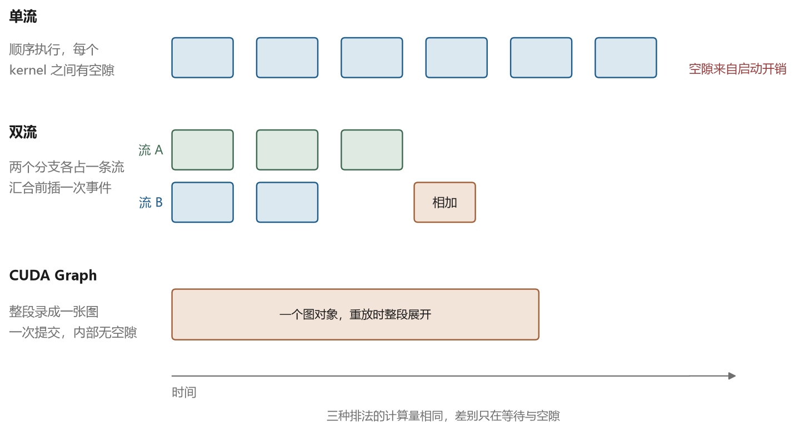

# 执行调度与 CUDA Graph

打开一份前向的时间线，会看到一段奇怪的空隙。每个 kernel 只跑三四微秒，两个 kernel 之间有差不多同样长的空白，整段下来 GPU 有一半时间在等指令。计算量没有变，卡也没有变，等的那部分全在启动上。

这类现象在小模型和生成式模型的解码阶段特别常见。一层里有几十个形状很小的算子，每个都短到不足以掩盖启动开销。想让这段变快，改 kernel 没用，得改调度。

## 启动开销的账

一次 kernel 启动在 CPU 侧要经过参数组装、驱动调用、入队，开销在几微秒的量级。GPU 侧从队列里取指令、配置参数、启动线程块，也要一点时间。单次看都很小，乘上算子数量就不小了。

一个 block 里有 200 个算子，每个算子 5 微秒启动开销，光启动就是 1 毫秒。如果整个前向本来只要 2 毫秒，等于三分之一的时间花在“告诉 GPU 要做什么”上。这就是小算子密集的模型在 GPU 上效率低的原因，也是为什么融合对这些模型特别有效。

还有一层不那么直观的损失。一个只算几百个元素的 kernel，能开出的线程块不足以填满整个芯片，大部分 SM 在它执行的那几微秒里是空的。同一时刻只能有一个 kernel 在跑，它的并行度上限就是那个小 kernel 的并行度。算子被切得越碎，芯片被填满的次数越少。

队列深度可以掩盖一部分。CPU 提前把后面几十个 kernel 排进队列，GPU 执行完一个立刻能取下一个，空隙就被填上了。但掩盖有上限，队列满了 CPU 就得等，而且有些算子之间有隐式同步，比如涉及内存分配的、涉及主机内存拷贝的，这些会清空队列，把空隙重新暴露出来。

还有一种更隐蔽的开销，同步。`cudaDeviceSynchronize`、张量转 numpy、打印张量值，每一个都会等 GPU 把队列跑完。在推理路径上出现一次，前面所有的重叠都白做。这类调用经常是无意中写进去的，比如统计耗时用 `torch.cuda.synchronize()` 包住了整段，或者日志里打印了 `loss.item()`。服务里排查延迟抖动时，先把这些调用清干净，往往就能解决一半问题。

## 多流能并行什么

一个前向里的算子大部分是串行的，但也有一部分本来可以并行。

典型的是分支结构。一段输入同时喂给两个卷积，两个结果再相加，这两个卷积之间没有依赖，可以放在两个流上同时跑。Inception 那种多尺度结构、双塔检索模型、多任务头的输出层，都属于这一类。

另一类是通信和计算的重叠。张量并行要传梯度或者激活，通信可以从计算流里拆出来，放到独立的流上，让下一层的计算和上一层的传输重叠起来。这类优化在大模型训练里是标配，在推理里也有用，尤其是跨卡的时候。重叠成立的条件是两边真的能同时跑，而不是一个在等另一个的结果，很多看起来能重叠的段实际上还是串行的。

流本身也有代价。每开一个流，就要有对应的事件来同步，每个事件都要 CPU 参与。流开多了，调度器在等待上的开销会超过并行带来的收益。经验上三到四个流是常见区间，再多就要看具体结构。

还有一点容易被忽略，显存带宽是共享的。两个流上的算子如果都是访存密集型，同时跑不会更快，只会互相抢带宽。并行只在计算密集和访存密集混跑时才有意义。

手写多流容易出错，错的地方几乎总在同步。一个流上的结果要被另一个流读，中间必须插一个事件，一个流 record，另一个流 wait，漏一步就是读到旧数据，而且错误是偶发的，跑一次两次看不出来。所以多流方案上线前要用工具验一下依赖，光看代码看不出漏没漏。

## CUDA Graph 的做法

CUDA Graph 把整段执行序列录下来，变成一个可以重复提交的对象。第一次捕获时，CPU 把每个 kernel 的参数、依赖、内存地址都记录下来，编成一张图；之后每次执行只需提交这张图，GPU 侧一次性展开，省掉了逐个启动的开销。

效果很直接。200 个算子的启动开销从 1 毫秒压到几十微秒，那些空隙也消失了。对延迟敏感的小模型，这是最有效的手段之一，比换引擎、调融合都干脆。

代价是前提很硬。

地址要固定。捕获时记录的是显存地址，重放时还用这些地址。输入数据必须拷到预先分配好的那块显存里，输出也从固定位置读。这意味着框架里那一层“每次调用申请新张量”的逻辑要换掉。

形状要固定。形状变了，kernel 的网格大小和循环边界都变，图就不适用了。要做动态形状，就得为每种形状捕一张图，或者用图更新接口把新的参数写进去。

不能在中间和 CPU 交互。捕获期间不能有同步、不能有条件分支依赖主机数据、不能动态分配。这一点在 Python 里尤其难保证，因为解释器随时可能插入一次同步。

PyTorch 里的 `mode="reduce-overhead"` 就是这条路，它会在条件满足时自动用 CUDA Graph，条件不满足时静默回退。用的时候要确认它真的用上了，否则会以为自己在用，实际没生效。

捕获失败的常见原因集中在分配。捕获期间如果代码调了一次显存分配，而分配器没开图内存池，捕获就会报错或者自动中止。多数框架会在捕获前切换分配器模式，但自定义算子或者第三方的库不一定遵守这个约定。另一个常见原因是多线程，别的线程发的 kernel 可能被录进图里，导致图的内容和预期不一致。

## 图更新与参数绑定

真实服务里，输入每次都不一样，地址固定的要求看起来是个死结。解法是把数据和地址分开，每次先把输入拷进那块固定显存，再重放。多一次拷贝，但拷贝的带宽远高于逐个 launch 的开销。

参数也是同理。如果某个 kernel 的标量参数每次都要变，比如温度、步长，可以在图里留一个从固定显存读参数的节点，每次只更新那 4 个字节。这类技巧在采样和动态缩放里很常见。

还有一条路是图更新。CUDA 提供了修改图中节点参数的接口，可以把新的地址或者参数写进已有的图，不用重新捕获。它的开销比重新捕获低得多，但比直接重放高，适合参数变化不频繁的场景。

需要注意的是，图更新改变的只是参数，不改变拓扑。算子数量变了、依赖关系变了，还是得重新捕获。所以设计服务时要让图的拓扑保持稳定，变化的只有数据。

## 多模型共存

一张卡上跑几个模型时，调度问题会变得更复杂。

最彻底的隔离是硬件分区，把一张卡切成几块，每块有自己的显存和计算单元。隔离好，代价是分区之后每块的资源都变小，灵活度差。分区的粒度是固定的，比如七块小卡加一块大卡，你要的切法未必存在。

第二种做法是时间片轮转。多个上下文共享一张卡，驱动在它们之间切换。切换有开销，而且一个模型的显存峰值会影响另一个模型的可用空间。

再往上是流优先级。给延迟敏感的模型高优先级，它的 kernel 可以抢占低优先级的。这能改善尾延迟，但会牺牲吞吐，因为被抢占的那部分工作要重做或者等待。

这些机制解决的是隔离和公平，不解决利用率。两个模型如果都是突发型负载，轮流空闲，那么在同一个卡上它们可以互相填补空隙；如果都是持续满载，放一起只会互相拖慢。选哪种机制前先想清楚要解决的是哪一个，混在一起谈会把问题说糊。判断该不该合卡，要看两个模型的负载曲线是不是互补，而不是看它们各自的显存占用加起来够不够。合卡之后还有一个容易被忽略的副作用，两个模型抢同一套页表与缓存，单独跑时都正常的尾延迟，合在一起会变差。

融合把算子变少，量化把数据变小，编译器把 kernel 变快，这些都在减少“要做多少事”。调度减少的是“做这些事之间浪费了多少”。前者有物理上限，后者在极端情况下能占掉一半。

所以一个已经优化到瓶颈的模型，再想快，往往要看时间线而不是看图。时间线上那些空隙、那些同步、那些不该出现的拷贝，是图上完全看不到的东西。这也是为什么性能分析工具在部署里的地位和编译器一样重要。一份能导出的时间线，往往比一份优化日志更能说明问题在哪里。

上面讲的是同一批任务内部的调度，目标是让 GPU 不要空转。下一章换成请求之间的调度，目标是让每个 kernel 都更值钱。两者方向一致，约束不同，能做的优化也不同。
