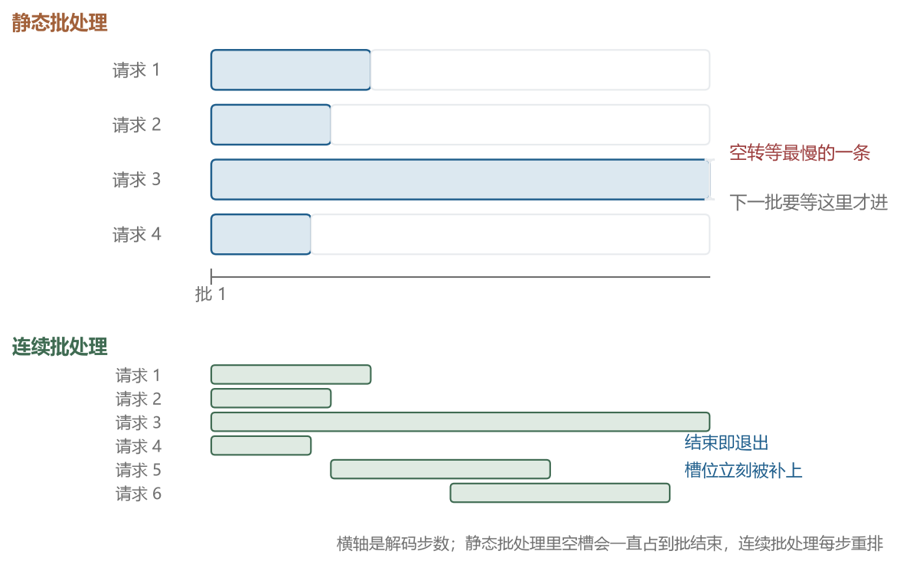
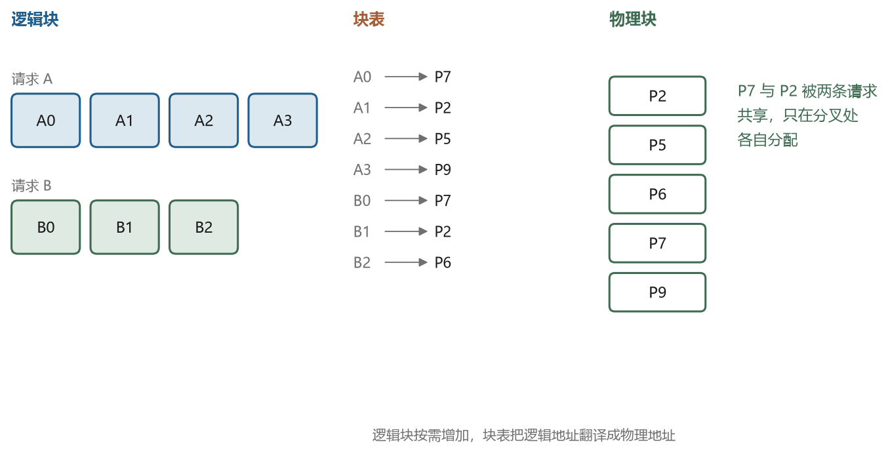

# 批处理与 KV cache 管理

一个对话服务压测时的曲线很有代表性。并发 8 路，每路平均输出 120 个 token，但长度从 20 到 800 不等。用静态批处理跑，GPU 利用率只有三成多，延迟却很差，因为一个 batch 要等里面最长的那条生成完才能收下一批，短的请求算完了也得占着位置干等。

把批处理换成按步调度之后，同样的硬件，吞吐涨了两倍多，平均延迟还降了（这是一组示例数字，具体幅度取决于长度分布有多散）。计算量没变，变的是排队的粒度。这一章讲的就是这件事，以及它带来的一个副产品，KV cache 得换一种管理方式。

先说清楚批处理为什么有用。GPU 的算力是按并行设计的，一个矩阵乘在 batch=1 时只用到它一小部分能力，因为数据搬进搬出的时间占了大头。把 8 条请求拼成一批，同样的权重读一次，算 8 份，算术强度上去了，吞吐也就上去了。批处理省的不是算力，是“读同样一份权重的那趟搬运”。

## 静态批处理的两种浪费

静态批处理把同时到达的请求凑成一批，一起跑完再收下一批。它的浪费来自两个地方。

第一个是 padding。一批里长度不一，短的补到最长，补出来的位置算出来的结果没人要，但算力和显存照花。一批 8 条请求长度分别是 20、30、400、800，其余都在 100 左右，padding 之后每条都按 800 算，有效利用率不到四分之一。padding 是“为了凑成矩形”而付出的对齐代价，矩阵运算要的是整齐的形状，真实流量偏偏不整齐。

第二个是等最慢的。一个 batch 的 8 条请求里有一条要生成 800 个 token，其余 7 条早就算完了，它们的槽位要一直占着，直到最长的那条结束。这段时间里新来的请求进不来，GPU 上跑的东西却越来越少。这个现象在解码阶段尤其明显，因为解码是一步一个 token，越往后在跑的请求越少。

两件事叠在一起，利用率就被压得很低。理论上的上限可以用一个简单的比值估出来，有效 token 数除以（batch 大小乘最长长度）。上面那组数据算下来是百分之十几。实际利用率比这个高一些，因为越到后面在跑的请求越少但仍在推进，不过量级不会差太多。

静态批处理并非一无是处。它的形状是固定的，所以内存可以一次分配完，kernel 可以按固定形状调到最优，整段可以捕成一张 CUDA Graph。在请求形状天然一致的场景里，这些好处能把上面两项浪费掩掉。图像分类、语音识别、定长问答，用静态批处理往往比动态的更划算。

还有一个常被忽略的浪费，凑批的等待。请求到了但批没凑满，调度器等了几毫秒，这几毫秒在低流量时是纯粹的延迟。有的系统在批不满时也照跑，用空闲算力换延迟；有的宁可等，用延迟换带宽利用率。两种选择都对，取决于业务对首 token 的容忍度。

判断该用哪种，有个简单的测试，看请求的“完成时间分布”。如果九成请求的时长都在一个窄区间里，静态批处理的等待浪费很小；如果分布是长尾，一条慢请求就能拖住整批，这时候静态批处理的代价会超过它的收益。

## 按步调度

连续批处理（continuous batching）换了一个粒度。它不在“一批”的层面调度，而在“一步”的层面调度，每生成一个 token 就是一步，每一步结束后重新决定哪些请求参与下一步。

这里的关键词是“重新决定”。上一节说静态批处理的毛病是“一批开始就锁死成员”，连续批处理把锁解开了，每一步都是一次小型的重新组队。新来的请求不用等当前批结束，下一个 step 就能进来。已经结束的请求立刻退出，把槽位让出来。批的大小因此是动态的，这一步 8 条，下一步可能 11 条，再下一步 6 条。GPU 的占用被填满，短请求的延迟也不再被长请求拖累。

代价在调度器上。每一步都要重新组织输入，把参与本步的请求的 token 拼成一个张量，同时维护每个请求的位置和注意力可见范围。这一步的 CPU 开销不能太大，否则省下来的 GPU 时间会被吃掉。工程上的做法是把这些状态放在显存里，每一步只更新变化的部分。即使这样，一台机器每秒能做几千步时，调度器本身就会成为下一个瓶颈。

另一个代价在注意力本身。一批请求长度不同、位置不同，注意力不能简单当成一个规则的矩阵乘来算，掩码要按每条请求的实际长度生成。这也是为什么分页和变长注意力在工程实现上绑在一起，它们解决的是同一个问题的两面。

调度器的实现方式也很影响结果。有的每一步都重新拼一遍输入张量，有的只在有新请求加入时改增量，后者的 CPU 开销小一个量级。看一个框架的调度效率，不用读源码，压测时看 CPU 占用和 GPU 占用的比例就够了，CPU 先满就是调度器在拖。

按步调度还改变了“延迟”的含义。静态批处理下，一条请求的延迟基本等于整批的时长；按步调度下，它等于排队时间加上自己算完的那些步。后者更接近用户感知，也更难预测，因为它取决于同时有多少别人在抢。做容量规划时，这个差别会体现在 P99 上，而不是平均值上。

## KV cache 的账

生成式模型每生成一个 token，都要用到前面所有 token 的 key 和 value。为了避免重复计算，这些中间结果被缓存下来，就是 KV cache。在解码阶段，每一步只算一个 token，计算量小到无法把计算单元填满，性能完全被显存带宽卡住（Pope 等，2022）。这也是为什么 KV cache 的大小直接决定了能跑多少并发。

它的显存占用可以精确算出来。每个 token、每一层、每一个 KV 头，需要存一份 key 和一份 value，各占 `d_head` 个元素：

$$ \mathrm{bytes} = 2 \times n_{\mathrm{layer}} \times n_{\mathrm{kv}} \times d_{\mathrm{head}} \times s \times b $$

其中 s 是序列长度，b 是批大小，前面的 2 是 key 和 value 各一份。

代入一组常见参数，40 层、8 个 KV 头、每个头 128 维、fp16，单个 token 是 160 KB 左右。怎么来的，`2 × 40 × 8 × 128 × 2` 字节等于 163840 字节，也就是 160 KB。一条 8K 上下文的请求要 1.3 GB，八条并发就是 10 GB，比 7B 模型的权重还大。这就是长上下文服务里显存吃紧的根源，也是为什么 GQA、MLA 这类结构优化这么受重视，它们把 `n_kv` 从几十降到几个，KV cache 的占用额直接除以一个倍数。层数也是线上的除数，每多一层就多一份开销，而模型规模变大时层数往往也在涨。

传统做法是按最大长度预分配。每个请求进来就占一块 `max_seq_len` 大小的显存，不管它实际会生成多长。这样做简单，块地址固定，不用管碎片。代价是浪费，一条 8K 的槽位里实际只用了 300 个 token，剩下的都空着。浪费的比例取决于流量，短请求为主的场景能浪费八成以上。按 8 条并发、8K 预分配算，预留出去的是 10 GB，实际用到可能只有 1.5 GB，差的那些就是不能给别人的空洞。

KV cache 还有一个精度上的开关值得知道，它可以用比权重更低的位宽存，比如权重 fp16、KV cache fp8。这样做省一半显存和带宽，代价是长上下文下误差累积，因为每个 token 都要读回前面所有的缓存，误差会一层层叠上去。试这条路的团队通常会发现，短上下文几乎无损，长上下文掉点，掉的多少要看模型的注意力分布。

这笔账还有一个反直觉的地方。KV cache 的浪费不是“多占点显存”那么简单，它会直接限制并发数，而并发数决定吞吐。假设一张卡留给 KV cache 的预算只有 10 GB，按 8K 预分配，最多 8 条并发；按实际平均 300 token 分配，能跑两百多条。同一张卡，两种管理方式，吞吐差几十倍。这就是分页这件事值得单独讲的原因。

## 分页

PagedAttention 的做法借鉴了操作系统的虚拟内存（Kwon 等，2023）。KV cache 不再按请求整块分配，而是切成固定大小的块，每个块存固定数量的 token，比如 16 个。一条请求的 KV cache 是若干个逻辑块，逻辑块按需映射到物理块，映射关系存在一张块表里。

可以想成一个仓库。以前是每来一个客户就划一块固定大小的库房，客户走了库房空着别人也进不去。现在是把库房隔成一个个小格子，客户按需租格子，格子可以散落在仓库各处，一张表格记录“客户的第几格在仓库的哪个位置”。

好处有两个。一是内部碎片被限制在最后一个块里，最多浪费 15 个 token 的空间，而不是整条序列。二是物理块可以不连续，一块用完了再分配下一块，显存不需要预留连续的整段。顺带还解决了一件事，请求的 KV cache 可以在不拷贝的情况下搬家，把块表指向另一批物理块就完成了，这让乱序完成、异步取消这类操作变得便宜。

块表是关键的数据结构。每一条请求有自己的逻辑块序列，注意力计算时按块表把逻辑地址翻译成物理地址。这一步在 kernel 里完成，翻译的开销相对注意力本身可以忽略。

分页还带来一个额外能力，块可以共享。两条请求如果前缀相同，它们的逻辑块可以指向同一批物理块，只在分叉的地方各自分配。系统提示词、few-shot 示例、多轮对话的历史，这些内容天然是共享的。共享之后，一份前缀只占一份显存，几十条并发请求的前缀部分能省下大量空间。

共享的块要写时复制。如果某条请求要修改一个被共享的块，先复制出一份再改。解码阶段 KV cache 是追加写的，共享的前缀块只读，所以大多数情况下不需要真的复制。但要注意一个细节，追加写落在块的边界上时，那条请求自己需要新块，这个新块不能共享，边界的位置于是变得重要，块越小，边界上的浪费越少，块表却越大，这是一个要调的参数。

## 三种调度策略

有了分页和按步调度，剩下的是策略问题，什么时候让新请求进来，什么时候让老请求让位。

前缀缓存（prefix caching）缓存的是“算过的前缀”。两条请求前面的 token 完全一样时，prefill 阶段的结果可以直接复用，不用重算。它对系统提示词很长的场景效果显著，能把首 token 延迟从几百毫秒降到几十毫秒。判断“完全一样”靠哈希，哈希冲突会算错，所以实际实现会用整段 token 做校验。

分块预填充（chunked prefill）解决的是 prefill 和 decode 抢资源的问题。一个长请求的 prefill 可能占满 GPU 几百毫秒，这期间所有正在解码的请求都被卡住，尾延迟飙升。分块的做法是把长 prefill 切成几段，和 decode 交替执行，让解码请求的延迟保持平稳。代价是长请求自己的首 token 延迟变长。

抢占是资源不够时的兜底。显存满了，新请求要进来，就得把某个正在跑的请求的 KV cache 换出去。换出的方式有两种，换到 CPU 内存再换回来，或者直接丢掉重算。前者省算力但费带宽，后者相反。选哪个取决于序列长度和 PCIe 带宽的比值，短序列重算便宜，长序列换出便宜。实际系统通常两个都实现，按当前序列长度和已生成的 token 数选一个成本更低的。

这三种策略都在同一个天平上取平衡，首 token 延迟（TTFT）和每 token 延迟（TPOT）之间的平衡，以及延迟和吞吐之间的平衡。批得越大吞吐越高，但每条请求的每 token 延迟也越长。这条曲线没有最优解，只有对当前业务合适的点。实时对话类业务宁可少批一点，延迟稳定比吞吐好看重要；离线摘要、批量翻译这类业务则相反，批越大越好。

近两年还多了一条路线，把预填充和解码拆到不同的机器上，业内叫 PD 分离（prefill-decode disaggregation）。它的道理很直接，prefill 是计算密集型，吃算力；decode 是访存密集型，吃带宽。两者混在一张卡上，各自都在等对方不用的那部分资源。拆开之后，prefill 机器配高算力，decode 机器配大显存和宽带宽，各自按瓶颈配比，资源利用率上去，尾延迟也好控，因为解码不再被长 prefill 打断。

代价也很实在。中间要把 KV cache 从 prefill 机器传到 decode 机器，一条 8K 上下文的请求是 1.3 GB，走几十 GB/s 的互联要几十毫秒，这段传输本身就成了新的延迟来源。两套机器的调度还要协同，故障面从一处变成两处，一边挂了另一边也出不了结果。所以它适合流量大、能压满两边的场景，小规模部署里拆开反而是净亏。

按步调度看起来只是调度层的一个改动，实际它把前面几章的东西都牵动了。

形状不再固定，静态引擎的优势被削弱。每次 step 的 batch 大小不同，序列位置不同，engine 要么开一个足够宽的范围，要么每步都做形状检查。这就是为什么大模型服务更依赖专门为动态形状设计的运行时，而不是通用的推理引擎。

内存管理从“一次分配”变成“持续分配”，分页和块表成了核心数据结构。图的优化在这里帮不上忙，因为瓶颈在显存管理和调度上，不在算子效率上。

指标的含义也变了。只看平均延迟会掩盖问题，因为批处理下延迟的分布很宽，P99 可能是 P50 的五倍。真正要盯的是首 token 延迟、每 token 延迟、排队长度和 GPU 的有效占用，这四个数才能描述一个服务的状态。只看平均值调参，很容易把一批快请求的改善当成整体改善，而尾部的慢请求并没变。

下一章把这些东西装进一个服务里，看一个请求从进来到返回 token，中间经过了哪些环节。
