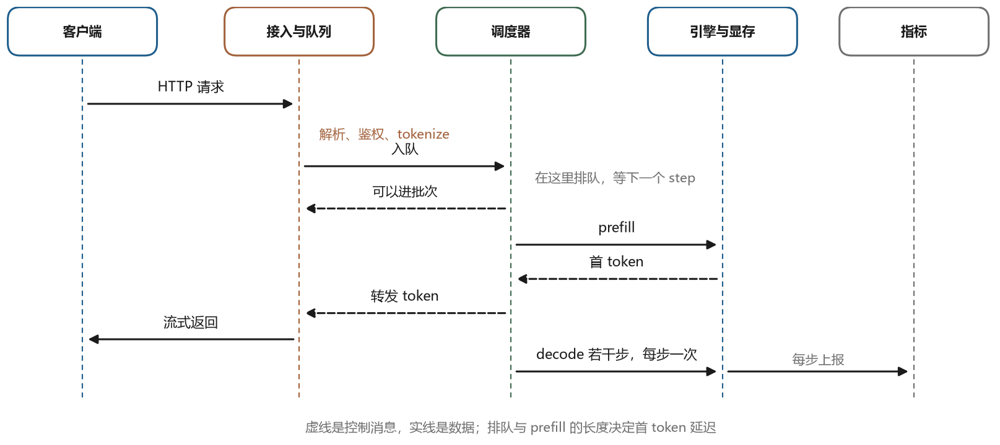

# 推理服务系统

一个服务上线第一周的监控面板上，两张图对不上。GPU 利用率一直在 40% 上下，进程的 CPU 占用却是满的。延迟 P50 是 80 毫秒，看起来还行，P99 到了 900 毫秒，用户侧的体感就是“偶尔卡一下”。

把时间线拆开看，GPU 上真正跑计算的那一段只占请求总时长的一小部分。剩下的时间花在三件事上，HTTP 解析和鉴权，tokenize，以及排队等一个可以进入的批次。这三件事都在 CPU 上，都在 GPU 开始算之前发生。

## 一个服务的五个部分

推理服务可以拆成五段，从外到内。

接入层做协议和鉴权，把请求变成一个内部结构。这一层看起来简单，实际经常是瓶颈，尤其是 Python 写的服务，一个 JSON 解析加一次 JWT 校验就能吃掉几毫秒。输入很大时序列化本身也很贵，一段两万字的 prompt 转成 JSON 再解回去，光字符串拷贝就是兆级的内存操作，换成二进制协议或者分段流式读取能省掉这一块。

队列与调度决定请求什么时候进 GPU。它要处理优先级、批大小上限、超时、取消。这一层是延迟和吞吐的主要杠杆。取消容易被忘掉，客户端断开之后，那个请求的 KV cache 还占着，后面的 token 还在算，算完发现无人接收。一个高并发服务里这类浪费能占到一成以上。

执行层就是前面几章讲的东西，引擎、显存、stream。它决定单个批次的处理速度。

状态层管 KV cache、会话、缓存。生成式服务里这一层和调度强耦合，因为 KV cache 决定了一个请求能不能继续留在批里。缓存写得好，同一个用户的多轮对话可以复用前缀；写得不好，每轮都要重算一遍那段历史。

指标层把每一步的结果写出来。它不影响性能，但没有它，上面四层都是黑盒。

这五段里，大多数团队把精力押在第三段，因为那是“模型相关”的部分。实际项目里延迟的方差往往来自第一段和第五段，因为那是代码最杂、最容易写出意外的地方。服务代码写得好不好，上线前很难看出来，上线后却天天在付。

## 模型仓库与配置

通用推理服务的第一种形态是“模型仓库”，代表是 Triton Inference Server。它的思路是把模型当成资源来管，一个目录放一个模型，一个配置文件描述这个模型的输入输出、批处理策略、后端类型。

目录结构固定，模型名是目录名，版本号是子目录名，加载哪个版本由配置决定。这套约定的好处是运维可以在不改代码的情况下换模型、加模型、回滚版本。坏处是灵活性受限，你的服务逻辑必须能塞进“一个模型一组输入输出”的框架里。

配置里最有用的两项是动态批处理和集成（ensemble）。动态批处理让服务自己攒批，等一小段时间把多个请求凑成一批，攒批的等待时间可配。集成让多个模型串成一个流水线，前一个的输出直接喂给后一个，中间的传输不经过网络。配置里还有一项经常被忽略，实例数。一个模型可以在一张卡上跑多个实例，也可以在多张卡上各跑一份。实例多的好处是能同时处理多个请求，代价是每个实例都占一份权重显存。一个 3 GB 的模型在 24 GB 的卡上跑四个实例就满了，而四个实例的总吞吐未必比一个实例加大批处理高。

集成的实际价值在于把预处理和后处理留在 GPU 上。一个图像模型前后的 resize、归一化、解码，如果每一步都是一次 HTTP 调用，网络和序列化的开销比计算还大。集成把这些步骤变成一个图里的节点。

代价在调试。集成里某一步出错，错误信息往往只告诉你“模型 X 返回失败”，具体哪个算子、什么输入，要靠日志一层层翻。所以集成适合稳定的流水线，不适合还在频繁改动的阶段。

## 两种生成式服务的路线

生成式模型的服务框架基本分成两条路线。

第一条是通用推理引擎路线，代表是 vLLM。它把 PagedAttention 和连续批处理做成核心，对外提供 OpenAI 兼容的接口（Kwon 等，2023）。它的优势是通用，换模型基本只换权重，硬件也相对宽松。它的劣势是性能上限受制于通用实现，某些融合做不了，某些精度格式支持得晚。生态也是它的一部分，评测工具、客户端库、路由器都围绕着这套接口长出来，接入成本低。

第二条是编译式路线，代表是 TensorRT-LLM。它把模型编译成针对特定硬件的引擎，把融合、量化、KV cache 布局都在构建期定下来，运行时只负责调度。它的优势是同样的硬件下延迟更低，尤其是在小 batch 和长序列的场景。它的劣势是构建流程重，换硬件要重建，模型结构一改就要重走一遍编译。国内还有一类基于自研框架的服务，把调度和引擎都自己写，代价是人力，收益是极致的可控。

两条路线的差别不在“谁更快”，而在“优化的时机”。编译式把选择提前，换来更好的结果和更差的灵活性；通用式把选择推后，换来灵活和略差的峰值性能。

选择的时候有一个简单的判据，模型结构多久变一次。半年不变、硬件固定，编译式划算。两周一个新版本、还要支持多种卡，通用式划算。混合的做法也常见，用通用框架做主力，把最热的那一两个模型单独编成引擎。

## 指标要看得懂

服务上线之后，能说明问题的指标只有几个，而且它们之间有关联。指标取得太细也麻烦，一个面板上摆三十个曲线，真出问题的时候没人看得完。

QPS 是吞吐，但它单独看没有意义，要和延迟一起看。同样的 QPS，P99 从 200 毫秒涨到 2 秒，说明队列在堆积，系统已经过载。

P50 和 P99 的差距说明稳定性。生成式服务里这个差距天然很大，因为输出长度不一样。用平均值做 SLO 会掩盖尾部，用 P99 又会被少数超长请求带偏，常见的做法是按长度分桶统计。分桶之后你会发现，长请求的 P99 可能并不差，差的是那些排在长请求后面的短请求。

首 token 延迟（TTFT）衡量的是 prefill 加排队的时间。它决定用户按下发送之后要等多久才看到第一个字。每 token 延迟（TPOT）衡量解码速度，决定文字流出来的快慢。这两个指标要分开看，因为它们对应不同的优化手段，前者靠减少排队和加速 prefill，后者靠批处理和 KV cache 效率。用一个总的端到端延迟去训模型，这两个东西是混在一起的，调优时就不知道该动哪一边。

GPU 利用率要看的是“有效利用率”，不是驱动报的那个数。驱动报的利用率包含等待内存的时间，一个被带宽卡住的 kernel 也会显示 100%。更有意义的指标是每秒处理的 token 数除以理论上限，或者直接看 SM 的活跃周期占比。

排队长度是最灵敏的过载信号。它一旦开始持续增长，延迟会在几十秒内崩掉。所以告警应该盯排队长度，而不是盯延迟，延迟是结果，排队是原因。这条经验在压测里尤其明显，压测工具看的是延迟，但真正先崩的是队列。

还有一个指标在容量规划时很有用，goodput，也就是“满足 SLO 的请求占比”。它把延迟和吞吐合成一个数，用来回答“这台机器现在能服务多少用户还不出问题”。它比 QPS 诚实，因为超载时 QPS 可能还在涨，goodput 已经开始跌了。

## 那些不在图上的开销

回到开头那个 40% 利用率的服务。修法不是换引擎，而是把 tokenize 从请求路径上挪走。

具体做法有几条。把 tokenizer 换成编译过的实现，Python 版的分词在长文本上能差一个数量级。把批处理的攒批窗口从 10 毫秒降到 2 毫秒，因为线上的请求本来就不缺，攒那么久只是白等。把日志从同步改成异步，每步写一次日志会把 GPU 的流水打断。把 HTTP 框架从同步换成异步，避免一个慢请求堵住整个 worker。

这几条加起来，GPU 利用率到了 75%，P99 从 900 毫秒降到 300 毫秒。计算一点没变。

还有一条容易被忽略的浪费，模型常驻。服务里同时挂五个模型，每个只偶尔用到，但五个都占着显存，结果每个只能开一个实例，每个批次只能排一条请求。改成按需加载、闲时卸载，把显存腾给主力模型多开几个实例，整体吞吐反而上去了。

这也是为什么服务层的优化常常比模型层的收益大。模型层的优化有物理上限，服务层的浪费往往没有下限，只要代码写得随意，浪费可以比计算还多。一个已经被压到 20 毫秒的模型，如果服务层每请求多花 10 毫秒做日志，那所有优化加起来都只值这个日志的一半。

下一章把这一路的东西串成一条流水线，从训练产物到线上服务，看每一步该怎么验证。
