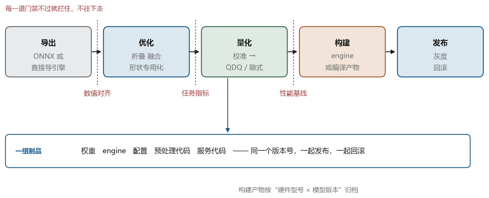

# 部署流水线

一次线上事故的记录很朴素。某个服务为了支持新的输入格式，改了一行图像归一化的代码，把均值和标准差换了顺序。模型没变，engine 没重建，服务照常返回结果，只是准确率掉了两个点。三天后 A/B 的指标才显示出来，回滚时又发现另一件事，制品库里那份 engine 是两周前的模型构建的，和当前的权重不是同一个版本。

这两件事都不是技术难题，都是流程问题。部署流水线要解决的正是这类问题，让“改了什么都可追溯、换了一个变量就能验证、出问题能退回去”变成默认行为，而不是靠人的记忆。

## 从训练产物到可执行文件

流水线的第一步是导出。PyTorch 的权重加一段前向代码，要变成某种引擎能读的东西，中间通常经过 ONNX，也可能直接喂给引擎的解析器。

这一小步能出的问题比想象中多。算子覆盖是第一道，模型里用了新算子，导出器不认识，要么报错要么变成自定义节点。算子集的版本是第二道，同一个模型用不同的算子集版本导出，图的结构可能不一样，某些融合在旧版本上做不了。还有一条路径是直接从训练框架导到引擎，不经过中间格式，它省掉了转换的损失，代价是调试时看不到中间图。对结构标准的模型它更快也更干净，需要逐层比对的场景还是留一份中间表示方便。动态轴是第三道，哪一维是 batch、哪一维是序列，标错了图还是能跑，但形状推导会错，后面所有基于形状的优化都跟着错。

导出完成后第一件事不是看速度，是对数值。同一组输入喂给原始模型和导出的图，比最终输出，也比几个关键中间层。中间层对齐而输出不对，问题在后处理；中间层就对不上，问题在导出。

这一步的判断标准要定得具体。余弦相似度高于某个阈值，最大绝对误差小于某个值，这两条都要有。只有余弦相似度会发生这种情况，两个向量整体方向一致但整体偏移，余弦是 0.9999，实际输出却全错了。fp16 下最大绝对误差的容忍度通常在千分位上，量化到 int8 之后要到百分之几，具体数值得拿你自己的模型跑一遍，看业务能不能接受。

## 把优化步骤变成可执行的东西

导出之后是一串优化，图优化、量化、融合、形状专用化。这些步骤在手工操作时是“跑一个脚本，看一眼结果”，在流水线里要变成“每一步都有输入、输出、参数和校验”。

工程上的做法是把每一步写成一个阶段，参数写在配置文件里，产物落在固定的目录，命名带上输入产物的哈希。这样任何一份产物都能回答三个问题，它从哪来，用了什么参数，和上一版差在哪。

这一步的价值在复现。半年后有人问“线上这个 engine 是怎么来的”，能顺着哈希一路找回去，而不是翻聊天记录。这一点在没有出过事故的团队里显得多余，出过一次之后就成了刚需。

流水线还要处理“哪些步骤可以跳过”。如果权重没变、参数没变，量化那一步不该重跑。判断的依据是输入哈希，而不是时间戳。这一步省下的时间在模型大、构建慢的场景里很可观，但更重要的是它让“重建”变成一件便宜的事，而便宜的重建是自动化验证的前提。

## 三层验证

验证不是一次，是三层，各管一件事。

第一层是数值对齐，管“这个产物还是不是原来那个模型”。做法是固定一组输入，逐层比较输出。这一层要自动化，而且要覆盖边界，比如空输入、最大长度、极值。数值对齐通过不代表模型好，只代表它没被改错。

第二层是任务指标，管“这个产物在业务上还能不能用”。跑一个固定的评测集，看准确率、F1、BLEU 这类指标，和基线比。这一层的关键是评测集要固定，不能每次用新数据，否则指标波动分不清是模型变了还是数据变了。

第三层是性能基线，管“它够不够快”。固定硬件、固定输入分布、固定并发，测延迟和吞吐。这一层要设回归门槛，超过就拦住。门槛不能定得太松，一个百分之五的退化在单次测试里看不出来，三个版本叠起来就是百分之十五。

三层验证的顺序有讲究。数值对齐最便宜也最快，先跑它，不过就不用往下走。任务指标要跑模型，几分钟到几小时。性能基线要占机器，最贵。按这个顺序能省下大量等待。

有一类退化三层都测不出来，输入分布漂移。线上的输入和评测集不一样，模型在评测集上没退化，线上却退化了。这类问题只能靠线上监控，看输入的长度分布、类别分布、置信度分布有没有偏。发现偏了，要么补数据，要么调整预处理。

三层验证还有一个副作用，它把评测变成了一个随时可跑的东西。既然一个命令就能拿到数值、指标和延迟，调优时就能随时回头验一下，而不用等下周的评测。很多“优化完了发现不能用”的情况，是因为验证流程太长，大家不愿意跑。

## 上线与回滚

上线这一步的工程手段已经很成熟，灰度、A/B、金丝雀，本质都是“先让一小部分流量走新版本，看指标，再决定放量”。做法上要定两件事，分多少流量，看多久。分得太多风险大，分得太少测得不准；看的时间短了区分不出波动，长了又拖迭代。经验上先给百分之一跑几个小时，看错误率和延迟分布，再放到一成。

部署这件事有个特殊之处，版本不是两个文件，而是一组文件。模型权重、engine 文件、配置文件、预处理代码、服务代码，这五样必须严格对应。任何一样错了，结果都是错的，而且错误可能很隐蔽。权重换了但 engine 没换，服务不报错，只是输出变差；配置改了但预处理没改，服务不报错，只是结果不对。这类错配只能靠版本绑定防，靠人看是防不住的。

所以制品管理要以“一组”为单位，而不是以“一个文件”为单位。给这一组打一个版本号，服务的启动参数只写这个版本号，不写具体路径。回滚就是换一个版本号，把整组换回去。

engine 和硬件的绑定让这件事更复杂。同一个模型在不同型号的卡上要有不同的 engine，版本矩阵从一维变成二维。常见的做法是把硬件型号也编进版本标签，服务启动时按当前硬件选对应的一组。这样一份发布单对应的是“模型版本乘硬件型号”的一个格子。

## 什么时候重建 engine

最后一个流程问题，重建的触发条件。

权重变了必须重建，这不用说。模型结构变了必须重建。这两条容易记住，难的是下面几条。

驱动或者库升级了，可能必须重建。engine 的兼容性边界受驱动影响，升级前要确认旧的 engine 还能不能加载。有些团队会在升级前先跑一遍加载测试，加载不了就批量重建。

输入形状变了，可能要重建。这里说的不是单次请求，而是分布变了。原来 90% 的请求在 128 token 以内，现在平均 500，profile 里的最优形状就不对了。这种情况不会有报错，只会有性能下降，所以要看监控而不是看日志。

量化参数变了，必须重建。重新校准之后缩放因子变了，engine 里存的还是旧的，两者对不上，结果是精度异常而不是报错。

把这些条件写进流水线的触发器，让重建变成自动的，比让每个人记住要可靠。触发器的实现可以很简单，几个输入文件的哈希组合成一个键，键变了就跑一遍。要注意的是构建缓存本身也会骗人，缓存键算得不对，或者缓存目录被共享到不同硬件上，拿到的就是一份错的 engine。

这一章讲的东西没有一样是新的，都是工程常识。但它在部署里的地位被低估，因为大家更愿意研究融合和量化，不愿意写配置和门禁。

真实的情况是，一个团队能走多远，往往不取决于它能把延迟优化到多少毫秒，而取决于它敢不敢频繁地改。敢改的前提是每次改都有验证兜底，有版本可回溯，有回滚的退路。这些东西不产生性能收益，但它们决定了前面十三章的技术能不能持续地用下去。反过来说，一个没有流水线的团队也能把延迟调得很低，只是每改一次都要重新证明一次自己没错，很快就没人敢改了。

最后一章换一个角度，不谈某一层的技术，谈怎么在这些技术之间做选择。
