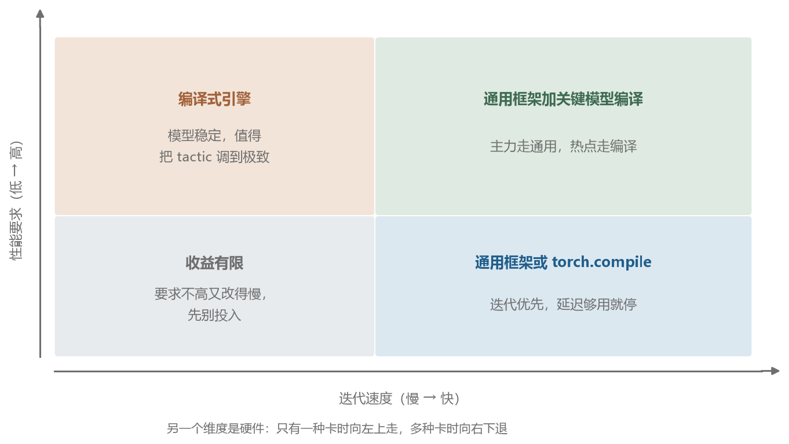

# 选型与取舍

三家公司做同一件事，给了三个不同的答案。一家把模型编成 TensorRT engine，构建一小时，线上延迟 8 毫秒。一家上了 vLLM，一行命令起服务，延迟 15 毫秒，但两周就能换一个新模型。还有一家自己写了 kernel，延迟 6 毫秒，投入了两个人半年。

单看延迟，第三家最好。看成本，两份账要分开算。构建成本是一次性的，一百次发布摊销一次；运行成本是持续的，每多一毫秒都在付机器钱。选型时的争论经常卡在这一点上，两个人用不同的时间段算不同的账。看总成本，第三家最贵，而且那两个人一离职，这套东西就没人能改。选型从来不是选最快的那条路，而是选一条你的团队能持续走下去的路。

这里说的“选型”不是一次会议上的决定，而是一组约束下的求解。约束包括团队会什么、模型多久变一次、硬件能不能固定、业务对延迟的容忍度。约束变了，答案就该变，所以这一章讲的不是结论，是判断的方法。方法的好处是，遇到表里没有的组合，你也能自己推出来。

## 四个维度

判断一条路线合不合适，看四件事。

团队能力决定上限。有没有人能读 CUDA 代码，有没有人能读编译器生成的 IR，有没有人能定位一次精度异常。这三件事的门槛依次降低，但都需要时间积累。团队里一个人都没有，写 kernel 这条路直接排除，因为写出来也维护不了。反过来，一个已经有算子库的团队，自研的边际成本很低，很多选择反而不用纠结。

迭代速度决定成本。模型一周一改，每次都要重新构建、重新验证、重新灰度，构建时间就成了迭代周期的一部分。一个四十分钟的构建流程，每周跑五次，加上验证和灰度，一周就没了。这种情况下通用框架的价值远大于它损失的几个毫秒。

硬件锁定决定风险。只跑一种卡，编译式方案的绑定不是问题。要跑三种卡、还要支持国产卡，绑定就变成了运维灾难，每种组合一份产物，验证矩阵翻倍。国产硬件还有一层现实，工具链的成熟度和算子覆盖都不如主流，同一个模型在两边跑出来的性能差距可能很大，选型时得拿真实的模型试，不能只看标称算力。

模型变化频率决定寿命。结构稳定的模型，为它做深度优化是划算的。结构还在演进的模型，为它做深度优化是浪费，因为下一次改结构就要重做。判断频率时不要只看发布记录，还要看模型团队的人在干什么，如果他们在频繁试新结构，那么哪怕上个月没发版，下个月也很可能发一个大改。

这四个维度没有权重，它们是筛选条件。任何一条不满足，对应的路线就直接划掉，不用再比性能。用筛选而不是打分，是因为这四件事的量级不对等。一个团队没人会写 CUDA，这一条就把自研排除了，性能再好也没用；而“构建慢半小时”这种缺点，在别的条件都满足时可以忍。打分会让这两类完全不同性质的问题混在一起比较，反而容易得出错的结论。

还有一个维度没写进去，供应链。硬件能不能稳定拿到，工具链能不能拿到技术支持，驱动更新是否及时。这些事不上技术指标，但一个项目上线三个月后卡停产，比任何性能问题都致命。

## 一张决策表

把常见的组合列出来，能看出一些规律。

表 14-1　按模型类型与部署形态给出的路线建议

| 场景 | 主要目标 | 建议路线 | 主要风险 |
|---|---|---|---|
| 卷积视觉，单机单卡 | 低延迟 | TensorRT 或 ONNX Runtime | 构建与环境绑定 |
| 卷积视觉，边缘设备 | 功耗与体积 | 量化加专用运行时 | 精度回退与算子缺失 |
| 小语言模型，单卡多并发 | 吞吐 | vLLM 一类分页框架 | 长尾延迟 |
| 大语言模型，多卡集群 | 吞吐与首 token | 编译式引擎加分页 | 构建成本与硬件锁定 |
| 多模态，在线服务 | 端到端延迟 | 预处理上卡加流水线编排 | 各段版本对齐 |
| 研究原型，单机开发 | 迭代速度 | torch.compile 或 eager | 上线前需重新选型 |

表里的“建议”不是最优，是“默认合理”。真实项目里经常有偏离，比如一个视觉模型的请求形状高度一致，用 TensorRT 加上静态形状能把延迟压一半，这时候值得为它承担构建成本。反过来，一个语言模型如果只有一路并发，上 vLLM 的分页调度也没有意义，直接跑一个引擎更简单。

判断偏离是否值得，用一条简单的标准，收益能不能覆盖成本。延迟从 15 毫秒降到 8 毫秒，如果业务对 15 毫秒完全无感，这 7 毫秒买不到任何东西。如果这 7 毫秒能把单机并发从 20 提到 40，省下一半的机器钱，那就是值得的。

算这笔账时要把口径统一。延迟降低带来的并发提升不是线性的，因为瓶颈会转移，原来卡在计算上，并发上去之后可能卡在显存或带宽上。比较靠谱的做法是改完重测一次压测，看真实的并发上限，而不是拿延迟比例去推。

表里没写的一条是人力配比。编译式路线通常需要一个懂构建的人长期在，通用路线一个后端工程师就能兼。团队只有一个人，选通用；有三五个人，才有条件分出一个人专做构建和调优。

表还有一层用法，它是给不熟悉这个领域的人看的。一个刚接手项目的人，看这张表能在十分钟内排除掉一半的错误方向，省下的时间比表本身的价值大。别指望它给出正确答案，它的作用是让你别从最离谱的地方开始。

## 什么时候自己写 kernel

自研是所有路线里最贵的，所以门槛应该最高。够得上门槛的情况有三种。

第一种是现成的实现确实没有。某些新型注意力、某些特殊的位置编码、某些融合得很深的算子组合，通用引擎和编译器都覆盖不了，写一个 kernel 是唯一的路。这种情况下要评估的不是“能不能写”，而是“写完谁来维护”。一个人写完离职，代码就成了没人敢动的黑盒，这类事在实际项目里不少见。

第二种是收益可以量化。写之前先算出上界，比如这一段占了 40% 的时间，理论上能快一倍，端到端就是 20%。如果算出来只有 3%，不值得。算的时候要诚实地把搬运和同步算进去，很多手写 kernel 输在周边而不是计算本身。

第三种是它能持续复用。一个通用性强的小算子库，写一次能用三年，值得。为一个模型的某一层写的特化 kernel，模型一改就废，不值得。

三种情况都不满足时，退一步的选择通常是“用 plugin 或自定义算子接口挂一段实现”，成本比全面自研低，可维护性也好一些。还有一条更保守的路，把那个算子拆成几个标准算子的组合，性能差一点但没有维护负担。在项目早期，后者往往是对的选择，因为那时你最缺的不是几毫秒，而是把东西跑起来的时间。

还有一条容易被忽略的门槛，迭代工具。自己写 kernel 意味着自己要有 profiler、有数值对比脚本、有能快速重跑的基准。这些东西通用框架都自带，自研时得自己搭。搭不起来，写出来的 kernel 就只能靠“感觉快了”来判断，这在长期会积累成很大的技术债。

自研还有一个隐形成本，测试。一个自己写的 kernel 要对所有可能的形状、精度、边界负责，别人写好的库这些测试已经做过了。自己写，测试也要自己写，而测试的工作量经常超过实现本身。算成本时把这块加上，很多“写一个也就两天”的判断会变成“两周”。

## 选型不是一次性决定

还需要提醒一点，选型会随着项目阶段变化。

原型阶段重要的是快，能用最少的代码跑通，这时候 torch.compile 或者 eager 加批处理就够。上线阶段重要的是稳，需要版本管理、监控、回滚，这一层和技术路线无关，任何方案都要补。规模化阶段重要的是成本，这时候才有必要为几毫秒去折腾引擎，因为乘上几千张卡就是真金白银。

很多团队的错误是在原型阶段就按规模化阶段的标准选型，结果花了三个月搭一套精密的流水线，模型改了五次，流水线也跟着改五次。另一种错误是到了规模化阶段还在用原型的方案，延迟压不下来，只能靠堆机器。

折中的路线在工程上最常见，主力用通用框架，把最热的一两个模型单独编成引擎，两者拼在一个服务里。代价是要维护两套构建流程和两套监控，好处是能按模型的实际价值分配精力。落地时要注意一个细节，两套引擎的输出必须能对齐，否则同一个服务里两条路径给出不一样的结果，排查起来非常费力。

还有一个反过来的信号也要注意，如果团队已经进入规模化阶段，但所有优化还是围绕着“换一个更快的框架”，那说明真正的瓶颈可能没被找到。规模化阶段的钱通常花在调度、容量、稳定性上，这些不在框架的选型里。

选型还有一条隐性约束，时间。同样的路线，一个人做要半年，三个人做要三个月，这个差别在排期上比性能差异重要得多。排期紧的时候，选一条“下个月能上线”的路，比选一条“半年后最快”的路更负责。

阶段变化还带来一个组织上的信号。当优化开始需要专人维护构建、评测、制品的时候，说明已经进入规模化阶段，这时候该考虑的不是“再试试哪个引擎”，而是“把这条流水线交给谁”。技术选型走到最后往往会变成人员分工的问题，提前想到这一点，比事后补人要省事。反过来说，如果一个团队连“谁来维护构建”都还没定，那现在就不该选自研，因为那条路第一天就需要一个责任人。

## 回到最初的问题

把算力、精度、引擎放在一起看，是三个层面。算力决定上限，同一份计算在什么硬件上跑，天花板在哪里，这是物理决定的。精度决定成本，用多少位表示数值，直接换算成显存、带宽和算力，这是经济账。引擎决定能不能稳定交付，图怎么改、kernel 怎么选、请求怎么排、版本怎么管，这是工程能力。

三者不是并列关系。算力给了一个区间，精度在这个区间里选一个成本点，引擎负责把选定的这个点稳定地跑到线上。任何一环出问题，另外两环的优化都会被抵消。一个把 kernel 调到极致的模型，如果形状没固定，构建时挑的 tactic 全部失效；一个量化到四位的模型，如果校准集不对，上线三天就会掉点。

这也解释了为什么单点优化经常回报很低。把注意力放在一个算子上，能看到它变快了两倍，放到端到端里可能只值百分之三。系统里能吃掉收益的地方太多了，不把链条拉直，局部的最优加起来不等于全局的最优。

回到最开始那个问题，一次前向为什么在线上比在实验室慢那么多。答案分布在几个层面里，数据在显存里搬了几趟，算子的算术强度够不够，数值格式选得对不对，图和调度有没有把空隙填满。这些问题没有一个是玄学，每一个都能测量、能定位、能改。测量靠工具，定位靠对图、对时间线、对数字的理解，改靠做出取舍的眼光。这三样都不在 API 文档里。

做部署的人最后会形成一种直觉，看到一个慢字，先问哪一层慢，再问为什么慢，最后才问怎么改。这个顺序反了，就会陷入“试了十个方法，快了一点点”的循环。改对一处瓶颈带来的收益，往往超过改错十处的总和。顺序对了，大部分问题在测量阶段就已经有答案了。所谓经验，大概就是这个顺序被反复验证过很多次之后，变成了本能。而这个顺序本身是可以学的，它不需要你先成为专家，只需要你在每次动手之前多问一句“慢在哪一层”。
