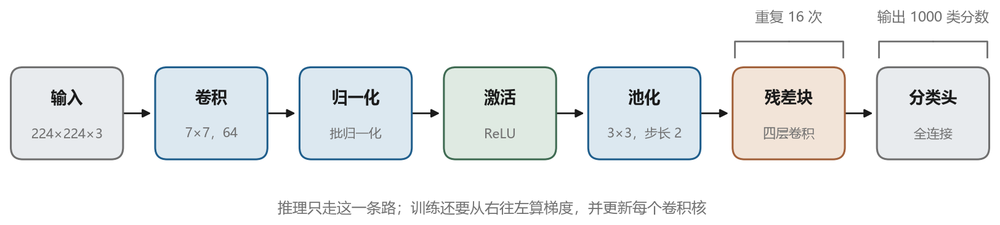
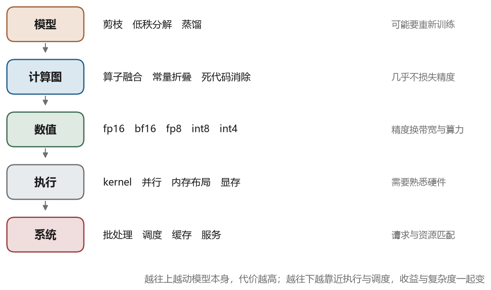

# 训练结束之后

一个图像分类模型在实验室里跑到了 76% 的 top-1 准确率。训练脚本最后一次打印验证集指标，权重存成 `model.pth`，事情看上去结束了。接下来业务方把模型接进一个拍照识别的页面，问题才一个个冒出来。单张图片在服务器上要等 180 毫秒，用户点一下按钮，转圈的时间比预想的长；模型加载完占了 1.2 GB 显存，一张卡本来想跑三个服务，现在只能跑一个；并发升到 30 路，延迟忽然从 180 毫秒跳到 900 毫秒，像换了一台机器。

模型没有变，准确率也没有变。变的是它所在的环境：训练时喂给它的是 256 张一批的图片，推理时来的是一张；训练时可以占满整张卡几个小时，推理时要在几十毫秒内把结果交出去；训练时框架替你管内存、管调度、管精度，推理时这些东西都要重新算一遍账。

这一章从一次前向开始，把训练与推理的差别摊开，再看部署这件事大致分成几层。后面二十七章会一层一层往下走。

## 一次前向里发生了什么

把一张 224×224 的图片送进 ResNet-50，框架做的事情可以粗略写成一条链：卷积、归一化、激活、残差相加，重复若干次，最后接一个全连接层，输出 1000 个分数。每一个方框是一个**算子**（operator），算子连起来的有向无环图叫**计算图**（computational graph）。

训练时，这张图只是故事的前半段。前向算完，损失函数拿预测和标签比一下，反向传播沿着图倒着走一遍，算出每个权重的梯度，优化器再更新权重。推理时只有前半段，没有损失，没有梯度，没有更新。听起来少了很多工作，为什么反而更麻烦？

因为训练和推理的目标不一样。训练要的是**吞吐**：一小时能看完多少张图，梯度能不能稳定收敛。推理要的是**延迟**：这一张图多久能出结果，以及一张卡能同时接多少路。目标一变，所有取舍都跟着变。

训练可以容忍批处理带来的延迟。256 张图一起算，第一张图要等最后一张图算完才能拿到结果，但平均到每张图上很便宜。推理不能这样等，用户只发了一张图，你没法凑齐 256 张再算。批处理在推理里仍然有用，只是它的单位从“训练样本”变成了“同时到达的请求”，而且要在延迟和吞吐之间找一个位置。

训练可以容忍精度上的浪费。梯度更新对数值误差不敏感，fp16 甚至 bf16 往往够用，出了偶尔的溢出，调一调损失缩放就能压住。推理对误差的容忍度取决于任务：给照片打标签，1% 的准确率波动可能没人发现；给病历做辅助判断，同样的波动就不能接受。精度不是一个开关，而是一条可以调节的旋钮，往哪边拧，要由业务来定。

训练可以容忍显存的浪费。框架会为反向传播保留中间结果，优化器还要存一份动量和方差，显存不够就换更大的卡。推理没有反向传播，中间结果用完就能扔，显存主要花在权重和同时处理的请求上。于是同样的模型，推理可以比训练省下不少显存，前提是你知道哪些东西可以扔。

## 部署要回答的五个问题

把部署拆开，大致是四个问题，从上到下越来越靠近硬件。

最上面是**模型本身**。权重能不能小一点，层能不能少一点，能不能用一个小模型学大模型的行为。这一层改的是模型结构和参数，代价是可能要重新训练。剪枝、低秩分解、蒸馏都属于这一层。

往下是**计算图**。同样的计算，能不能换一种组织方式。两个算子能不能合成一个，常量能不能提前算掉，只用于训练的层能不能删掉，形状能不能固定下来。这一层不改变模型的数学含义，或者只改变很少一点，代价通常最小。算子融合、常量折叠、死代码消除属于这一层。

再往下是**数值**。权重和激活用多少位来表示，fp32、fp16、bf16、fp8、int8、int4，每一种格式都有自己的范围和精度。位宽降下来，显存和带宽跟着降，算力也可能翻倍，代价是数值误差。量化属于这一层。

最下面是**执行**。同样的算子，用什么样的 kernel 跑，几个流并行，内存怎么排布。这一层离硬件最近，优化空间也常常最大，但需要对 GPU 和运行时足够熟悉。CUDA 优化、算子库、推理引擎属于这一层。

在执行这一层之外，还有一层**系统**。请求怎么排队、怎么组 batch、怎么在多个模型或多个租户之间调度、怎么扩缩容、怎么缓存。这一层不改模型，也不改数值，只改请求和资源的匹配方式。大模型服务里，这一层的收益往往最大。

这五个层面不是互斥的。一个真实的部署项目，往往五层都会动一点：先删掉训练专用的层，再把能合的算子合掉，然后试着把 fp32 换成 fp16，最后换一个更合适的推理引擎，再调批处理和缓存。每一层都有自己的账，合起来才是端到端的收益。

## 为什么“换个引擎”有时快有时不快

很多人第一次做部署，听到的建议是“上 TensorRT”或者“用 ONNX Runtime”。换完之后有时快一倍，有时几乎没变，有时还慢了。原因在于引擎能做的事情有边界。

引擎擅长的是图上的重写：把卷积、批归一化和激活合成一个算子，把常量提前算掉，为每一层挑一个更合适的 kernel，把内存复用起来。这些优化不依赖具体的模型，换什么模型都能做。但如果模型的瓶颈不在这些地方，引擎也帮不上忙。比如一个模型的注意力层占了 80% 的时间，而引擎没有为这种形状的注意力准备好 kernel，换引擎不会让注意力变快。

还有一种情况更常见：瓶颈根本不在计算，而在数据搬运。GPU 的算力早就等在那里，数据从显存搬到计算单元的速度跟不上，算子再快也没用。这时候该做的是改数据布局、减少搬运、把相邻的算子合起来，而不是换一个更“高级”的引擎。

所以部署的第一件事不是选工具，而是**量基线**。同一个模型，同样的输入形状，同样的硬件，先测出延迟、吞吐和显存，再决定往哪里优化。没有基线的优化，很容易忙了半个月，端到端只快了 3%。

## 这本书怎么读

这一册的目标是让你在听到一个部署术语时，知道它在五个层面里的位置，知道它解决什么问题，也知道它的代价。它不展开 CUDA 的细节，不推导量化误差，也不教你怎么写 TensorRT 插件。那些内容不在本书展开。

第一章到第四章讲背景：一次前向里有什么，延迟和吞吐怎么算，模型文件里装了什么，硬件为什么有这样的脾气。第五章到第十章讲计算：算子、融合、图优化、算法替换、编译器和性能分析。第十一章到第十五章讲数值：浮点与定点、量化、剪枝、低秩与蒸馏。第十六章到第十九章讲服务基础：批处理、KV cache、服务系统、部署形态和一次完整的优化。第二十章到第二十七章讲大模型时代的专门问题：注意力变体、投机解码、并行与 PD 分离、多 LoRA、长上下文与多模态、推理模型与 Agent、扩散模型、新一代硬件与数值格式。第二十八章把整张地图收拢，给出继续深入的方向。

如果你现在就想动手，可以先跳到第十九章看一遍优化流程，再回头补概念。如果你更习惯先建立框架，按顺序读下去就好。每一章都不长，读完能接上下一章，就是合适的节奏。
