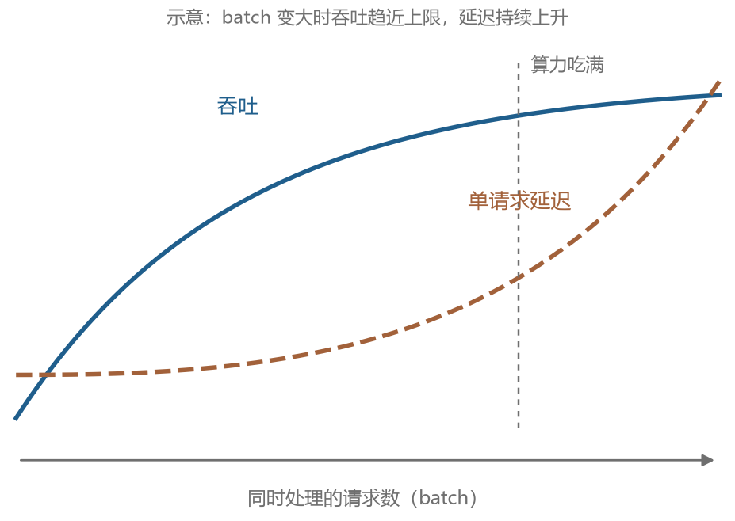
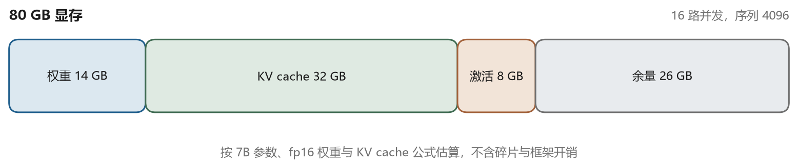

# 延迟、吞吐与显存的账

线上服务出问题，最先被看到的往往不是准确率，而是延迟。监控面板上一条曲线平时贴着 120 毫秒，某天下午突然翘到 800 毫秒，报警响了，值班的人第一反应是“机器不够了”。加一张卡，曲线回去一点，过两天又翘起来。加卡能解决一部分问题，但如果不清楚延迟由什么组成，加卡只是在给一个漏水的桶换更大的桶。

这一章把部署最常用的三个指标拆开：延迟、吞吐、显存。它们互相牵制，任何一项单独看都会骗人。

## 延迟不是一个数

用户感知到的延迟，是从请求发出到结果返回的时间。工程上通常不只看平均值，而看分位数。P50 是中位数，一半请求比它快；P95 和 P99 看尾部，最慢的那部分请求有多慢。平均值很容易被少数极慢的请求拉高，也很容易掩盖它们。一个服务平均 100 毫秒、P99 两秒，大多数用户觉得挺快，但那 1% 的人会觉得这个产品不能用。

用一个生活场景理解分位数：一家医院平均挂号等待 20 分钟，听起来还行；但如果最慢的 1% 要等 6 小时，那 1% 的人下次不会再来。分位数回答的是“有多糟糕的人有多糟糕”，平均值回答不了这个问题。**尾延迟**（tail latency）指的就是 P95、P99 这些尾部数字，它比平均值更难优化，也更能决定用户的去留。

对大语言模型，延迟还要再拆成两段。第一段是**首 token 延迟**（time to first token，TTFT），从请求到模型吐出第一个字；第二段是**每 token 延迟**（time per output token，TPOT），之后每多吐一个字要多久。一个人读字的速度大约是每秒几个字，TPOT 低于几十毫秒时，人眼几乎感觉不到等待；TTFT 则直接决定“按下发送键之后要愣多久”。两个指标对应不同的优化手段，混在一起谈“延迟”没有意义：TTFT 主要由输入有多长、排队多久决定，TPOT 主要由显存带宽和同时服务的请求数决定。

延迟的组成也不只是 GPU 计算。请求要经过网关、排队、分词、组 batch、拷贝到显存、执行、后处理、网络返回。GPU 只占其中一段。一个常见的误判是盯着 kernel 时间优化，而端到端的时间有一半花在排队和拷贝上。**kernel** 是 GPU 上执行的一段程序，也就是真正跑计算的那一小块代码；监控工具里看到的一个个名字，都是 kernel。

所以工程上有一个基本习惯：先量**端到端**（end to end），也就是从请求进来到响应回去的总时间，再把它拆成段落，看每段各占多少。不拆开就动手，等于闭着眼睛调收音机的旋钮。

拆段落时还要留出一个容易漏掉的项：不值得优化的固定开销。比如一次网络往返，在同一个机房里可能只有 0.5 毫秒，跨地域就是几十毫秒。这部分不归 GPU 管，但如果它占了端到端的一半，你把模型优化到零也没有意义。先把“确定改不动的部分”扣掉，剩下的才是你的战场。

## 吞吐和延迟互相拉扯

**吞吐**（throughput）是单位时间处理多少个请求，或者生成多少个 token。它和延迟不是一回事，也不能同时无限提升。

假设一张卡一次只能算一个请求，每个请求 100 毫秒，吞吐就是每秒 10 个。把 8 个请求攒成一批一起算，一批可能只要 160 毫秒，平均每个请求 20 毫秒的算力成本，吞吐升到每秒 50 个。但排在最前面的那个请求等了 160 毫秒才拿到结果，延迟变差了。批越大，吞吐越高，单请求延迟也越长，直到 GPU 算力被吃满，再加大 batch 只会让每个请求都变慢。

这正是前面说过的公交车效应：攒人上车省钱，但先到的人得等。区别在于 GPU 这辆车攒客几乎不要成本——多塞几个请求进同一批，计算量的增长远比请求数的增长慢，因为 GPU 的算力单元本来就有很多闲着。这也是为什么推理服务几乎一定会做批处理：不做，等于让一整车座位空着跑。

排队论里有一个简单的关系，叫 Little 定律：

$$L = \lambda W$$

`L` 是系统里同时存在的请求数，`λ` 是到达速率，`W` 是每个请求在系统里停留的时间。一张卡同时处理 32 个请求，每个请求平均停留 200 毫秒，那么系统的吞吐上限大约是 `32 / 0.2 = 160` 个请求每秒。想让吞吐翻倍，要么提高并发数，要么缩短停留时间。并发数受显存限制，停留时间受计算和排队限制，两个方向都有天花板。

把这条定律反过来用，还能得到一个诊断技巧。如果已知并发数 `L` 和实测吞吐 `λ`，就能反推出每个请求平均在系统里待了多久 `W = L / λ`。把这个数和纯计算时间比一下，差出来的那部分就是排队、拷贝和调度的开销。很多服务优化前的 `W` 是纯计算时间的三四倍，优化的空间就在这个差额里。

这条定律还解释了一个现象：压力测试时，QPS 加到某个点就不再涨，延迟却开始飙升。**QPS** 是每秒查询数，衡量请求到达的速度。那个拐点的含义是：系统已经满负荷，新来的请求只能在队列里等着，等待的时间越积越长。那不是“再优化一下 kernel”能解决的，而是系统进入了排队状态，请求在队列里等的时间超过了计算时间。遇到这种情况，正确的动作是限流或者扩容，而不是继续加压。

## 三本账：算力、带宽、显存

部署的每一次优化，最后都会落到三本账上。

第一本是**算力**。GPU 每秒能做多少次浮点运算，模型一次前向需要多少次。卷积、矩阵乘这类算子吃算力，算力不够时，延迟随计算量线性上涨。算力通常用 FLOPS 表示，也就是每秒浮点运算次数；fp16 和 fp8 的有效算力又不一样，因为它们走的是 GPU 上不同的计算通路。

第二本是**带宽**。数据从显存搬到计算单元的速度，单位是字节每秒。很多算子并不缺算力，缺的是把数据喂进去的速度。逐元素相加、归一化、激活函数都属于这一类，它们的计算量很小，时间几乎全花在读写显存上。A100 80GB 的显存带宽大约是 2 TB/s，消费级的 RTX 4090 大约是 1 TB/s（只为说明量级，具体型号以厂商文档为准）。把这两个数字和算力放在一起看，就能理解为什么很多算子只能跑到峰值算力的一小部分。

第三本是**显存**。权重、激活、临时缓冲、KV cache 都要放进去。显存不够，服务要么起不来，要么只能减小 batch，吞吐跟着掉。这里的**权重**（weight）是模型训练出来的那堆参数，**激活**（activation）是每一层算出来的中间结果。

三本账里，显存最容易算。一个 7B 参数的模型，fp16 每个参数 2 字节，权重就是 14 GB；换成 int8 是 7 GB，int4 是 3.5 GB。这里的 7B 指 70 亿个参数，是模型规模的常用写法。一张 80 GB 的卡，扣掉权重和运行时开销，剩下的大部分要留给 KV cache 和中间结果。模型越大，权重占的比例越高，量化省下来的显存就越值钱。

KV cache 的账稍微复杂一点。Transformer 每生成一个 token，都要把之前所有 token 的 Key 和 Value 保留下来，避免重复计算，这块缓存就是 **KV cache**，可以把它想成一份只写不删的备忘录：每说一个字就在备忘录上添一行，下一句话要引用前面的内容时直接翻备忘录，不必把整段对话重新读一遍。它的显存占用可以写成：

$$\mathrm{bytes} = 2 \times n_{\mathrm{layer}} \times n_{\mathrm{head}} \times d_{\mathrm{head}} \times n_{\mathrm{token}} \times b$$

前面的 2 是 Key 和 Value 各一份，`b` 是每个数的字节数。一个 32 层、32 头、头维 128 的 7B 模型，序列长度 4096，fp16 下每个请求的 KV cache 大约是 2 GB。并发 16 个请求就是 32 GB。这还没算激活和临时缓冲，显存很快就见底。长上下文服务里，KV cache 往往是比权重更大的一块支出，这也是后面要讲分页和量化的原因。

## 成本是这三本账的汇率

云上的 GPU 按小时计费，一张 A100 每小时几美元，不管你有没有跑满。成本可以粗略写成：

$$\mathrm{cost\ per\ request} = \frac{\mathrm{GPU\ price\ per\ hour}}{\mathrm{requests\ per\ hour}}$$

分母是吞吐，分子是固定的。提高吞吐，单请求成本就下降。但吞吐受延迟目标约束，不能为了堆 batch 让 P99 无限变长。真正划算的做法，是在满足延迟目标的前提下，把 GPU 的利用率和显存都吃满。

这也解释了一个常见的决策：同样的模型，放在一张大卡上跑高并发，还是放在几张中小卡上跑低延迟。大卡的显存和带宽更充裕，适合大 batch 和高吞吐；中小卡便宜，适合把请求分散到离用户更近的地方。没有绝对的好坏，只有和业务指标是否匹配。

这里还有一个容易被忽略的事实：成本的分母是“有效吞吐”，而不是“理论吞吐”。一张卡标称能跑多快，和你实际能接多少请求，中间隔着排队、预热、扩容、故障和流量波动。夜里没人用的时候，卡还在计费；白天高峰的时候，扩容又来不及。所以成本优化往往不在 kernel 上，而在调度和容量规划上：把不同优先级的请求混在一张卡上跑满，或者用更小的模型接住大部分简单请求。

一个具体的判断方法是把三本账换算成同一单位。延迟目标告诉你能开多大 batch，batch 决定显存里能放多少请求，显存决定要几张卡，卡数乘以单价就是成本。这条链子上任何一环算错，成本估算就会偏。

举个只为说明量级的例子。假设单请求需要 2000 个 token 的输出，每卡每秒能生成 2000 个 token，那么一张卡最多支撑每秒一个请求。如果业务峰值是每秒 50 个请求，只看这个数字就要 50 张卡；再乘上一个为流量波动预留的余量系数，实际可能要到 70 张。这里每一数字都是假设，真实数字必须自己测。但它说明了一件事：成本估算的起点是“每卡每秒多少 token”这个实测值，其他都是从它推出来的。

延迟、吞吐、显存三本账算清楚，才有资格谈优化。而这三本账的入口，是模型文件里的那些张量。

下一章打开模型文件，看看这些数字具体落在哪些张量上。
