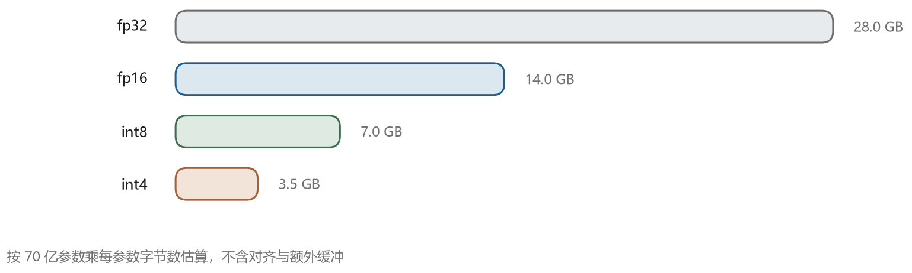

# 一个模型文件里有什么

把一个训练好的模型交给部署工程师，通常是一个压缩包，或者一个几 GB 的文件。文件名可能是 `model.pth`、`model.safetensors`、`model.onnx`，也可能是一个目录。很多人第一次打开它，会以为里面只有权重。实际上，一个训练检查点里装着的东西比想象的多，而推理真正需要的只是其中一部分。

这一章把模型文件拆开，看看每一部分在部署时扮演什么角色，以及为什么文件大小和运行时的显存占用对不上。

## 权重只是检查点的一部分

PyTorch 保存的 `state_dict` 是一张表，键是层的名字，值是对应的张量。可以把它想成一本账，左边写着“第 3 个残差块的第一个卷积的权重”，右边是一大块数字。一个 ResNet-50 大约有 2500 万个参数，fp32 下权重约 100 MB；一个 7B 的语言模型，fp16 下权重约 14 GB。这些数字只算了一遍权重。

**检查点**（checkpoint）是训练过程中保存的一份快照，它的目的是“以后能接着练”。训练检查点里往往还有优化器状态。Adam 优化器为每个参数保存一阶矩和二阶矩，也就是两个滑动平均，加起来是参数量的两倍。混合精度训练还会保存一份 fp32 的主权重副本，用来在更新时保住精度。一个 7B 模型用 Adam 训练，检查点里可能有 14 GB 权重、28 GB 优化器状态、14 GB 主权重，再算上梯度，接近 60 GB。推理不需要这些，加载时只取 `state_dict` 里的权重，或者用 `strict=False` 跳过不认识的键。

这里有个坑值得提前说：`strict=False` 只是“不报错”，不等于“加载正确”。如果键名因为模型代码改过而变了，权重会被静默丢掉，模型照样能跑，输出的却是随机初始化的结果。部署前要核对加载日志里缺失和多余的键，别让错误在准确率上才暴露。

有些检查点还带 EMA 权重、学习率调度器的状态、训练步数、随机数种子。**EMA**（指数滑动平均）是训练时维护的一份平滑权重，评估时往往比当前权重更稳。这些东西对复现训练有用，对推理是负担。部署前把检查点转成推理格式，第一件事就是把这些东西剔掉。所以“模型文件 60 GB”和“模型要占 60 GB 显存”是两回事，前者是搬家的纸箱，里面塞满了旧衣服。

还有件事在交付时经常出问题：权重的存储格式。老的 `pickle` 格式在加载时会执行文件里的代码，理论上不安全，而且只能整个读进来；`safetensors` 只存张量和元数据，可以按张量读，加载快、也安全。现在大多数开源模型都提供 safetensors 版本，部署时优先选它。如果只拿到 `.bin` 或 `.pth`，转换一次通常只要几分钟，但别忘了转换后重新校对一遍输出。

## 配置、分词器和预处理

权重之外，模型目录里通常还有几个小文件，它们不占多少空间，却决定了输入怎么变成张量。

`config.json` 记录层数、隐藏维度、注意力头数、激活函数、位置编码方式。推理引擎要按它推导形状、分配显存、选择算子。改了一个参数却忘了同步配置，模型要么加载失败，要么算出一堆看似正常但完全错误的结果。原因很直接：权重的形状由配置描述，形状对不上，数字就会被按错误的顺序解释，跨界读取但仍在合法范围内，程序不会报错。

分词器目录里有词表、合并规则、特殊 token 的编号、截断和填充策略。**分词器**（tokenizer）负责把一段文本切成模型认得的最小单位，每个单位叫一个 **token**，再换成编号。它的作用像门卫手上的对照表：来的人不在表上，就只能按最接近的方式登记。文本模型的分词器还决定了最大序列长度和 padding 的方向。图像模型则有归一化的均值方差、输入尺寸、色彩空间，这些参数的作用是把像素值缩放到模型训练时习惯的范围。

这些东西看起来是“预处理”，实际上和模型是一个整体。预处理错了，后面再优化也没用。举个常见的例子：训练时图片按 0 到 1 归一化，推理时忘了除 255，输入全是 0 到 255 的大数，模型照样输出一个类别，置信度还挺高，只是基本全错。这种错误不会崩，只会悄悄让线上指标掉一半。

对话模型还有一个专属于它的坑：**对话模板**（chat template）。同一个基础模型，训练时用的是某一种固定的角色标记格式，比如用特殊 token 把系统提示、用户发言、助手回复分开。推理时如果拼接方式和训练时不一致，模型会输出奇怪的内容，或者反复重复。这个模板通常就写在分词器目录的配置里，拷贝模型时一并拷走，并且在服务启动时打印一次渲染后的真实 prompt，人工看一眼。

有些导出流程会把预处理也画进图里，比如把归一化写成减均值除方差的两个算子。这样做的好处是端到端一致，调用方不用记这些参数；坏处是图里多了几个逐元素算子，后面要靠融合把它们消掉，否则每个算子都要读写一遍显存。

## 计算图在哪里

PyTorch 默认是 eager 模式，代码执行一行算一行，没有一个持久的图。`model.pth` 里只有权重，没有计算图；图是在你写 `forward` 函数时，由 Python 代码现场组织的。这也是为什么部署时不能只拿一个 `.pth` 就跑，还需要模型定义代码。

导出格式会把图固化下来。ONNX 用一组标准算子描述计算，TorchScript 把 Python 代码编译成可序列化的中间表示，TensorRT 有自己的网络定义，`torch.compile` 在运行时捕获图再编译。导出的过程本质上是在问一个问题：你的模型能不能用一套与框架无关的算子表达出来。

答案常常是不能完全表达。自定义算子、动态控制流、Python 侧的列表操作、依赖数据的循环，都会在导出时变成难题。有的被折叠成常量，有的被替换成近似实现，有的直接报错。一个在 PyTorch 里跑得好好的模型，导出后精度掉了一点，往往就是某个算子在转换时换了实现。比如某个求幂或归一化，在框架里用双精度算，到了图里变成单精度，误差在小数点后几位，单层看不出来，几十层叠加就有了。

导出还有一件容易忘记的事：动态维度怎么标。文本模型的序列长度、图像模型的 batch，通常在导出时被标成符号维度，引擎里叫动态 shape 或 dynamic axes。标多了，优化空间小；标少了，线上遇到别的长度就报错。这一步的选择会一直影响到后面所有的优化，值得单独花时间确认。

图一旦固定下来，还能做一件在 eager 模式下做不到的事：把整段执行序列录成一条指令，下次直接重放。这就是后面会提到的 CUDA Graph，它能把几百次 kernel 启动的开销压成一次。但它要求每次的形状和显存地址都一样，所以“固定图”和“固定形状”是绑在一起的。

反过来，如果你只拿到导出的图、没有模型代码，排查问题会比想象的难。图里只剩下算子名字和连接关系，丢了变量名和注释。遇到一个奇怪的中间张量，你不知道它是哪一行 Python 代码写出来的。所以导出前把源代码和配置一起归档，不是形式主义。

## 文件大小不等于运行显存

一个 14 GB 的权重文件，加载到显存后不会正好占 14 GB。

第一层是数据类型。文件里存的是 fp16，加载后如果引擎要求 fp32，会先转成 28 GB，再转换成内部格式。反过来，如果加载后立刻量化成 int8，显存可能降到 7 GB，但转换过程需要一块临时空间，峰值可能比 14 GB 还高。峰值超出显存，服务就直接起不来，哪怕稳态占用是够的。这类问题在容器里表现为一个语焉不详的 OOM 报错，排查时容易走弯路。

第二层是运行时缓冲。推理时要为每一层的输出分配激活，为卷积和矩阵乘分配 workspace，为 KV cache 留出连续空间。**workspace** 是算子执行时临时借用的显存，算完就还，但借的时候必须够大。激活的大小和 batch、序列长度有关，workspace 的大小和引擎选的算法有关，有的算法更快但更费显存。一个 14 GB 的模型，跑起来占 20 GB 显存是常事。

还有内存映射和分页。`safetensors` 支持按需加载，权重可以从磁盘映射到内存，不必一次性读进显存；传统 `pickle` 格式要先反序列化整个对象，启动慢，峰值内存也高。**内存映射**（memory mapping）是把文件当成一块内存来读，用到哪页读哪页，操作系统负责缓存。服务常驻的场景下，加载方式会影响冷启动时间，冷启动又会影响扩容速度：流量高峰时新机器要几分钟才能接客，这几分钟里用户就在排队。

最后一个容易被低估的因素是**显存碎片**。反复申请和释放不同大小的块，会让显存里出现很多小块空洞，总数看上去够，却拼不出一块连续的大区域。这和硬盘用久了会碎是一个道理。解决办法有两类：预先按最大需求切好块反复用（内存池），或者把分配单位统一成固定大小（分页）。这两种做法在后面讲 KV cache 时还会出现。

## 版本是文件的一部分

部署时最容易被忽略的是版本。PyTorch 的版本、CUDA 的版本、cuDNN 的版本、ONNX 的 opset、TensorRT 的版本，任何一个对不上，模型都可能加载失败，或者加载成功但结果不对。

**opset** 是 ONNX 的算子集版本。它决定了哪些算子可用、每个算子的语义是什么。用新 opset 导出的模型，旧版运行时可能不认识。TensorRT 的 engine 更是和 GPU 架构、驱动版本、TensorRT 版本绑定，换一张卡就要重新构建。把 engine 文件当成普通模型文件拷来拷去，是部署现场常见的错误：在本机跑得好好的，到了另一台机器上加载失败，报的错还和模型无关。

所以一个可靠的模型交付物，除了权重和图，还应该带上版本清单：训练框架、导出工具、目标运行时的版本，以及一份能把输入输出对齐的测试用例。测试用例不用多，几条就够，但必须覆盖边界：最短的输入、最长的输入、空输入、异常输入。它能在每次升级后五分钟内告诉你“还能不能用”，比任何文档都靠得住。

把这些东西写成一个清单，看起来繁琐，但它是部署可重复的前提。一个只有权重和图、没有版本说明的交付包，换一个人接手就要从零开始试错；而一个带清单的包，新人半小时就能把服务跑起来。

清单上的版本组合最好固定成一个“已知可用”的组合，其余组合即使能跑也算未验证。原因很简单：推理链路上的依赖是乘法关系，CUDA、驱动、引擎、算子库任意两个版本之间都可能有细微的行为差异，而这些差异只会在特定的输入上暴露。固定组合、整体升级、全量回归，比逐个升级、随机碰到问题要省事得多。这一章讲的是文件，下一章讲这些文件最终落在什么硬件上，以及硬件为什么会对某些形状特别友好。这一章讲的是文件，下一章讲这些文件最终落在什么硬件上，以及硬件为什么会对某些形状特别友好。

下一章从文件走到硬件，看看这些张量最终在什么样的机器上执行。
