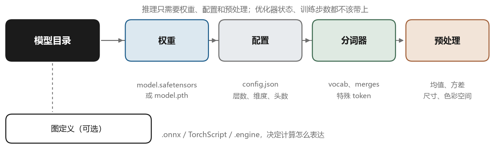

# 一个模型文件里有什么

把一个训练好的模型交给部署工程师，通常是一个压缩包，或者一个几 GB 的文件。文件名可能是 `model.pth`、`model.safetensors`、`model.onnx`，也可能是一个目录。很多人第一次打开它，会以为里面只有权重。实际上，一个训练检查点里装着的东西比想象的多，而推理真正需要的只是其中一部分。

这一章把模型文件拆开，看看每一部分在部署时扮演什么角色，以及为什么文件大小和运行时的显存占用对不上。

## 权重只是检查点的一部分

PyTorch 保存的 `state_dict` 是一张表，键是层的名字，值是对应的张量。一个 ResNet-50 大约有 2500 万个参数，fp32 下权重约 100 MB；一个 7B 的语言模型，fp16 下权重约 14 GB。这些数字只算了一遍权重。

训练检查点里往往还有优化器状态。Adam 为每个参数保存一阶矩和二阶矩，加起来是参数量的两倍。混合精度训练还会保存 fp32 的主权重副本。一个 7B 模型用 Adam 训练，检查点里可能有 14 GB 权重、28 GB 优化器状态、14 GB 主权重，再算上梯度，接近 60 GB。推理不需要这些，加载时只取 `state_dict` 里的权重，或者用 `strict=False` 跳过不认识的键。

有些检查点还带 EMA 权重、学习率调度器的状态、训练步数、随机数种子。这些东西对复现训练有用，对推理是负担。部署前把检查点转成推理格式，第一件事就是把这些东西剔掉。

## 配置、分词器和预处理

权重之外，模型目录里通常还有几个小文件，它们不占多少空间，却决定了输入怎么变成张量。

`config.json` 记录层数、隐藏维度、注意力头数、激活函数、位置编码方式。推理引擎要按它推导形状、分配显存、选择算子。改了一个参数却忘了同步配置，模型要么加载失败，要么算出一堆看似正常但完全错误的结果。

分词器目录里有词表、合并规则、特殊 token 的编号、截断和填充策略。文本模型的分词器还决定了最大序列长度和 padding 的方向。图像模型则有归一化的均值方差、输入尺寸、色彩空间。这些东西看起来是“预处理”，实际上和模型是一个整体。预处理错了，后面再优化也没用。

有些导出流程会把预处理也画进图里，比如把归一化写成减均值除方差的两个算子。这样做的好处是端到端一致，坏处是图里多了几个逐元素算子，后面要靠融合把它们消掉。

## 计算图在哪里

PyTorch 默认是 eager 模式，代码执行一行算一行，没有一个持久的图。`model.pth` 里只有权重，没有计算图；图是在你写 `forward` 函数时，由 Python 代码现场组织的。这也是为什么部署时不能只拿一个 `.pth` 就跑，还需要模型定义代码。

导出格式会把图固化下来。ONNX 用一组标准算子描述计算，TorchScript 把 Python 代码编译成可序列化的中间表示，TensorRT 有自己的网络定义，`torch.compile` 在运行时捕获图再编译。导出的过程本质上是在问一个问题：你的模型能不能用一套与框架无关的算子表达出来。

答案常常是不能完全表达。自定义算子、动态控制流、Python 侧的列表操作、依赖数据的循环，都会在导出时变成难题。有的被折叠成常量，有的被替换成近似实现，有的直接报错。一个在 PyTorch 里跑得好好的模型，导出后精度掉了一点，往往就是某个算子在转换时换了实现。

## 文件大小不等于运行显存

一个 14 GB 的权重文件，加载到显存后不会正好占 14 GB。

第一层是数据类型。文件里存的是 fp16，加载后如果引擎要求 fp32，会先转成 28 GB，再转换成内部格式。反过来，如果加载后立刻量化成 int8，显存可能降到 7 GB，但转换过程需要一块临时空间，峰值可能比 14 GB 还高。

第二层是运行时缓冲。推理时要为每一层的输出分配激活，为卷积和矩阵乘分配 workspace，为 KV cache 留出连续空间。激活的大小和 batch、序列长度有关，workspace 的大小和引擎选的算法有关。一个 14 GB 的模型，跑起来占 20 GB 显存是常事。

还有内存映射和分页。`safetensors` 支持按需加载，权重可以从磁盘映射到内存，不必一次性读进显存；传统 `pickle` 格式要先反序列化整个对象，启动慢，峰值内存也高。服务常驻的场景下，加载方式会影响冷启动时间，冷启动又会影响扩容速度。

## 版本是文件的一部分

部署时最容易被忽略的是版本。PyTorch 的版本、CUDA 的版本、cuDNN 的版本、ONNX 的 opset、TensorRT 的版本，任何一个对不上，模型都可能加载失败，或者加载成功但结果不对。

ONNX 的 opset 决定了哪些算子可用。用新 opset 导出的模型，旧版运行时可能不认识。TensorRT 的 engine 更是和 GPU 架构、驱动版本、TensorRT 版本绑定，换一张卡就要重新构建。把 engine 文件当成普通模型文件拷来拷去，是部署现场常见的错误。

所以一个可靠的模型交付物，除了权重和图，还应该带上版本清单：训练框架、导出工具、目标运行时的版本，以及一份能把输入输出对齐的测试用例。下一章从文件走到硬件，看看这些张量最终在什么样的机器上执行。
