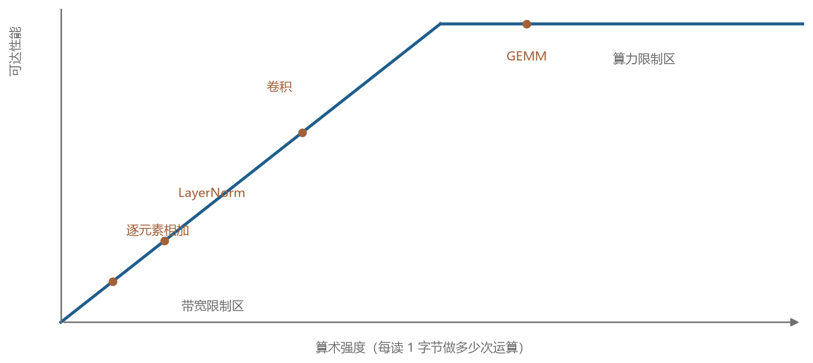

# 硬件的脾气

同一个模型，在一张卡上跑得飞快，换一张卡可能只快一点，换到另一台机器上甚至更慢。参数没变，框架没变，变的是硬件。硬件不是一块均匀的算力，它有自己的偏好：喜欢大矩阵，喜欢连续访问，喜欢把很多相同的工作一起做。顺着它的脾气，程序就快；逆着来，算力再多也发挥不出来。

这一章讲四件事：CPU 和 GPU 各自擅长什么，内存带宽为什么常常比算力更关键，Tensor Core 和专用芯片在什么条件下才帮得上忙，以及拿到一张卡的参数表该怎么看。

## CPU 和 GPU 的分工

CPU 为延迟而生。它有几十个核心，每个核心都很强，有分支预测、乱序执行、大容量缓存，擅长处理逻辑复杂、依赖多的任务。你写的一段 Python、一次数据库查询、一个操作系统调用，都跑在 CPU 上。**核心**（core）是处理器里能独立执行指令的单元，一个核心里还有算术单元、寄存器、一级缓存这些部件。

GPU 为吞吐而生。它有几千个较小的核心，按 32 个线程一组调度，这一组叫一个 **warp**，同一组线程执行同一条指令。这种模式叫 **SIMT**，单指令多线程，意思是一条指令同时在几十个线程上生效。遇到条件分支时，两组线程走不同路径，硬件只能让它们分时执行，效率下降，这叫**分支分歧**（branch divergence）。作为交换，GPU 可以用极低的成本同时处理大量相同的运算，矩阵乘和卷积正好是这种运算。

可以用一个类比记住这个分工：CPU 像一位能修水管、能看电路图、能临时改方案的老师傅，什么活都能接，但一次只能干一件；GPU 像流水线上几百个工人，每个人只会一个动作，但同一个动作同时开工，产量极高。你要做一百件完全一样的零件，找流水线；你要临时判断机器哪里坏了，找老师傅。

两者之间隔着 PCIe。数据要从主机内存拷到显存，算完再拷回来。PCIe 的带宽和显存带宽差一个数量级，频繁来回拷贝会把 GPU 的算力浪费在等待上。推理服务通常让数据尽量留在显存里，把预处理也搬到 GPU 上，或者用固定内存（pinned memory）和异步拷贝来重叠传输。**固定内存**是锁在物理内存里、不会被操作系统换出的一块区域，GPU 可以直接读它，传输更快；**异步拷贝**则是让数据搬运和计算同时进行，搬第 2 张图的时候算第 1 张。

这一分工在实践里的含义是：一段看起来很快的代码，可能大部分时间卡在 CPU 上。一个常见情况是图像的预处理——解码 JPEG、缩放尺寸——全部在 CPU 上用 Python 库完成。GPU 算一次卷积只要几毫秒，CPU 解一张图要十几毫秒，端到端的时间就被 CPU 卡住了。遇到这种情况，把解码交给 GPU（或 NVDEC 这类硬件解码器），比换一张更快的 GPU 管用。

## 内存墙

过去二十年，算力的增长速度远快于内存带宽。处理器每秒能做的浮点运算翻了很多倍，内存每秒能送来的字节数却没有跟上。结果是很多程序不是算不动，而是喂不饱。这个现象有个名字，叫**内存墙**（memory wall）。

衡量一个算子更吃算力还是更吃带宽，用**算术强度**（arithmetic intensity）：每读一个字节，能做多少次浮点运算。矩阵乘的强度高，因为一个权重会被复用很多次；逐元素相加的强度低，读两个数、写一个数，只做一次加法。把算子的位置画在一张图上，横轴是算术强度，纵轴是可达性能，就得到 **roofline 模型**。斜线是带宽上限，平台是算力上限，拐点是两者的交点。这个名字里的 roof 就是屋顶，图像一个房顶。

这个模型解释了很多现象。为什么 batch 变大能提高吞吐，因为同一份权重被更多样本复用，算术强度上去了；为什么小 batch 的 LLM 推理卡在带宽上，因为每生成一个 token 都要把全部权重读一遍，算力几乎闲着；为什么融合算子有效，因为它把中间结果留在寄存器或共享内存里，少写回一次显存。

带宽也分层次。寄存器最快，容量最小；共享内存次之，每个线程块独享；再往下是 L2，所有 SM 共享；最远是 HBM，容量大但延迟高。**SM** 是流式多处理器，一块 GPU 由几十个 SM 组成，每个 SM 里有几十个执行单元。**HBM** 是显卡上那几颗显存芯片用的高带宽内存。一个算子如果能让数据在离计算单元近的地方多待一会儿，就能少读几次 HBM。GEMM 的分块、FlashAttention 的分块，本质上都是在做这件事，像厨师把要用的食材先搬到手边的案板上，而不是每切一刀回一趟仓库。

反复出现的“小 batch 解码只能跑到带宽的一小部分”也可以用算术强度算出来。假设一层有一个 4096×4096 的权重矩阵，fp16 下每个参数 2 字节，读一遍是 32 MB。生成一个 token 时，这一层大约需要 2×4096×4096 次乘加，也就是三千多万次。用 32 MB 换三千万次运算，算术强度约等于 1，而现代 GPU 的算力带宽比往往是几百。这两个数字差两个数量级，意味着算力单元大部分时间是空的。

## Tensor Core 与数据格式

从 Volta 架构开始，NVIDIA 的 GPU 里多了一类专门做矩阵乘加的单元，叫 **Tensor Core**。一条指令可以完成一个小矩阵块的乘加，吞吐比普通的 FMA 指令高一个数量级。**FMA** 是“乘加”，算一次 `a × b + c`，传统 CUDA Core 一次做一个这样的运算。代价是 Tensor Core 对数据格式和形状有要求：早期只支持 fp16 输入、fp32 累加，后来逐步支持 bf16、tf32、fp8 和 int8。

Tensor Core 的算力数字很漂亮，但不是所有算子都能用上。卷积和矩阵乘可以改写成矩阵乘，能用；LayerNorm、softmax、逐元素激活主要走普通 CUDA Core，算力提升对它们帮助有限。一个模型里如果逐元素算子占的时间多，换一张 Tensor Core 更强的卡，端到端可能只快一点。这一点在选卡时最容易被忽略：参数表上的算力对应的是矩阵乘，你的模型里可能只有一半时间在矩阵乘。

数据格式也影响算力。fp16 的 Tensor Core 算力通常是 fp32 的两倍到四倍，fp8 再翻倍，int8 也有专门的整数通路。这就是量化最直接的收益来源。但格式一变，数值范围和精度也跟着变，能不能用要看模型对误差的容忍度，第十一章会专门讲这些格式各自能表示什么。

形状还有对齐要求。Tensor Core 一次处理的是一个固定大小的小块，比如 16×8×16，输入的行列数不是这些数的倍数时，硬件要么补齐，要么退回慢路径。所以工程师常会看到“把通道数从 1000 改成 1024，速度突然快了一截”这种事，它和省下的那 2.4% 计算量无关，和能不能走快路径有关。

天底下没有只赚不赔的买卖。如果你的模型以逐元素算子为主，或者形状碎得无法对齐，那么 Tensor Core 再多也用不上，此时高带宽、大 L2 的卡反而更合适。反过来，如果你的模型是大矩阵乘为主、形状整齐，Tensor Core 和新格式（fp8、fp4）就是最大的红利。选卡之前先把自己的模型拆成算子类型统计一遍，比看任何跑分都准。

实际部署里还有一种折中：不要让整张图都用同一种格式。卷积和矩阵乘用 Tensor Core 能吃的格式，归一化和 softmax 留在 fp32 或 fp16。代价是两种格式之间要插入转换，每次转换都要读写一遍张量。转换多了，收益就没了。所以混合精度的关键不在“能不能混”，而在“把转换点放在哪里，让转换次数最少”。

## 专用芯片

除了 CPU 和 GPU，还有一类专用加速器，通常叫 NPU、TPU 或推理卡。它们把矩阵乘、卷积、激活这些操作做成固定的硬件通路，能效比很高，适合大规模部署或边缘设备。**能效比**是每瓦电能换来多少算力，在数据中心里它决定电费和散热，在手机和车上它决定能不能长时间跑。

专用芯片的代价是依赖软件栈。算子覆盖不全，模型里有一个它不支持的算子，整张图就可能被切碎，或者退回 CPU 执行。很多 NPU 要求模型先量化成 int8，甚至要求特定的算子顺序和布局。部署到这类硬件上，工作重心从“调 kernel”变成“让模型能被编译器接受”。这句话听起来轻描淡写，实际可能占掉整项目一半的时间：改一个不支持的激活函数，常常要连带动模型结构和训练。

边缘设备又是另一种约束。手机、摄像头、车载盒子功耗有限，内存只有几 GB，散热也差。它们需要的不是峰值算力，而是持续算力，以及在不稳定的电源和温度下保持稳定。同一个模型在云端用 fp16，到了边缘可能要 int8 甚至 int4，还要接受精度上的一点损失。

专用芯片还有一个时间维度的问题。编译器、驱动、算子库都在不停更新，今天能跑的模型，升级到新版本后可能因为某个算子被删而不支持了。选这类硬件时，除了看现在支不支持，还要看它的软件迭代有没有把兼容性当回事。一个很实际的做法是：先用目标硬件厂商的官方示例模型跑一遍，再换成自己的模型，看哪一步开始报错。没人会替你维护兼容性，只能自己在选型阶段测清楚。

另一个常被提到的选项是“推理专用卡”。它们通常指去了显示输出、缩小了显存、降低了功耗的 GPU，单位算力的价格更便宜，但没有视频输出，也不适合需要图形接口的机器。选定这类卡之前，确认软件栈和你惯用的框架一致，否则会多出一堆环境问题。

## 选硬件看什么

选卡的时候，参数表上最显眼的是算力，实际最该先看的是显存容量和带宽。

显存容量决定模型能不能放下，以及能放多少并发。一个 7B 模型 fp16 权重 14 GB，加上 KV cache 和运行时开销，24 GB 的卡只能跑很有限的并发；80 GB 的卡才能谈吞吐。显存不够，算力再高也用不上，这是硬门槛，没有技巧可以绕开。

带宽决定很多算子的上限。逐元素算子、归一化、注意力里的 KV 读取，都受带宽约束。两张卡算力相差一倍，带宽只差 20%，跑带宽瓶颈的模型时差距可能远小于参数表。

算力要看有效算力，也就是你的模型实际能用上的那部分。Tensor Core 的峰值算力只对特定格式和形状成立，稀疏算力又要求模型按 2:4 稀疏剪枝过。把峰值当实际值，预算很容易做错。

接下来是互联和软件。多卡推理要看卡间带宽，NVLink 和 PCIe 差很多；软件要看框架和引擎对这张卡的支持程度，驱动、CUDA、算子库的版本是否匹配。一张纸面参数很好的新卡，如果算子库还没跟上，实际表现可能不如一张老卡。这不是保守，是过去几年反复发生的现实。

最后一件事是功耗和成本。数据中心的机架有供电上限，一张卡功耗高，能塞进机架的卡就少。算总账时要把卡的价格、电费、机架占用、散热能力一起算，只看单卡价格容易得出错的结论。

把上面几条排个顺序，大致是：显存能不能放下，带宽够不够喂，算力格式匹不匹配，互联够不够大，软件成不成熟，最后才是价格。这个顺序不能被颠倒，因为前面一条不满足，后面的优势全部作废。一个常见的错误是先比单价，买回来发现显存差 8 GB，只能降低并发，最后单请求成本反而更高。

还有一个不在参数表上、但经常决定成败的东西：批次或机型的一致性。同一个服务混用两张不同型号的卡，看上去灵活，实际会带来两个版本的 kernel、两套调优参数、两种性能表现，调度器还得按型号分池。省下的采购成本，很容易被运维成本吃掉。

下一章进入计算本身，看看这些算子到底在做什么。
