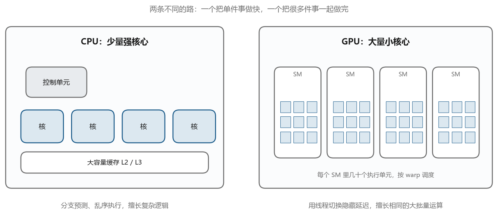

# 硬件的脾气

同一个模型，在一张卡上跑得飞快，换一张卡可能只快一点，换到另一台机器上甚至更慢。参数没变，框架没变，变的是硬件。硬件不是一块均匀的算力，它有自己的偏好：喜欢大矩阵，喜欢连续访问，喜欢把很多相同的工作一起做。顺着它的脾气，程序就快；逆着来，算力再多也发挥不出来。

这一章讲三件事：CPU 和 GPU 各自擅长什么，内存带宽为什么常常比算力更关键，以及 Tensor Core 和专用芯片在什么条件下才帮得上忙。

## CPU 和 GPU 的分工

CPU 为延迟而生。它有几十个核心，每个核心都很强，有分支预测、乱序执行、大容量缓存，擅长处理逻辑复杂、依赖多的任务。你写的一段 Python、一次数据库查询、一个操作系统调用，都跑在 CPU 上。

GPU 为吞吐而生。它有几千个较小的核心，按 32 个线程一组（warp）调度，同一组线程执行同一条指令。遇到分支时，两组线程走不同路径，硬件只能让它们分时执行，效率下降。作为交换，GPU 可以用极低的成本同时处理大量相同的运算，矩阵乘和卷积正好是这种运算。

两者之间隔着 PCIe。数据要从主机内存拷到显存，算完再拷回来。PCIe 的带宽和显存带宽差一个数量级，频繁来回拷贝会把 GPU 的算力浪费在等待上。推理服务通常让数据尽量留在显存里，把预处理也搬到 GPU 上，或者用固定内存（pinned memory）和异步拷贝来重叠传输。

## 内存墙

过去二十年，算力的增长速度远快于内存带宽。处理器每秒能做的浮点运算翻了很多倍，内存每秒能送来的字节数却没有跟上。结果是很多程序不是算不动，而是喂不饱。

衡量一个算子更吃算力还是更吃带宽，用**算术强度**：每读一个字节，能做多少次浮点运算。矩阵乘的强度高，因为一个权重会被复用很多次；逐元素相加的强度低，读两个数、写一个数、只做一次加法。把算子的位置画在一张图上，横轴是算术强度，纵轴是可达性能，就得到 roofline 模型。斜线是带宽上限，平台是算力上限，拐点是两者的交点。

这个模型解释了很多现象。为什么 batch 变大能提高吞吐，因为同一份权重被更多样本复用，算术强度上去了；为什么小 batch 的 LLM 推理卡在带宽上，因为每生成一个 token 都要把全部权重读一遍，算力几乎闲着；为什么融合算子有效，因为它把中间结果留在寄存器或共享内存里，少写回一次显存。

带宽也分层次。寄存器最快，容量最小；共享内存次之，每个线程块独享；再往下是 L2，所有 SM 共享；最远是 HBM，容量大但延迟高。一个算子如果能让数据在离计算单元近的地方多待一会儿，就能少读几次 HBM。GEMM 的分块、FlashAttention 的分块，本质上都是在做这件事。

## Tensor Core 与数据格式

从 Volta 开始，NVIDIA 的 GPU 里多了一类专门做矩阵乘加的单元，叫 Tensor Core。一条指令可以完成一个小矩阵块的乘加，吞吐比普通的 FMA 指令高一个数量级。代价是它对数据格式和形状有要求：早期只支持 fp16 输入、fp32 累加，后来逐步支持 bf16、tf32、fp8 和 int8。

Tensor Core 的算力数字很漂亮，但不是所有算子都能用上。卷积和矩阵乘可以改写成矩阵乘，能用；LayerNorm、softmax、逐元素激活主要走普通 CUDA Core，算力提升对它们帮助有限。一个模型里如果逐元素算子占的时间多，换一张 Tensor Core 更强的卡，端到端可能只快一点。

数据格式也影响算力。fp16 的 Tensor Core 算力通常是 fp32 的两倍到四倍，fp8 再翻倍，int8 也有专门的整数通路。这就是量化最直接的收益来源。但格式一变，数值范围和精度也跟着变，能不能用要看模型对误差的容忍度，这部分在第三篇展开。

## 专用芯片

除了 CPU 和 GPU，还有一类专用加速器，通常叫 NPU、TPU 或推理卡。它们把矩阵乘、卷积、激活这些操作做成固定的硬件通路，能效比很高，适合大规模部署或边缘设备。

专用芯片的代价是依赖软件栈。算子覆盖不全，模型里有一个它不支持的算子，整张图就可能被切碎，或者退回 CPU 执行。很多 NPU 要求模型先量化成 int8，甚至要求特定的算子顺序和布局。部署到这类硬件上，工作重心从“调 kernel”变成“让模型能被编译器接受”。

边缘设备又是另一种约束。手机、摄像头、车载盒子功耗有限，内存只有几 GB，散热也差。它们需要的不是峰值算力，而是每瓦性能，以及在不稳定的电源和温度下保持稳定。同一个模型在云端用 fp16，到了边缘可能要 int8 甚至 int4，还要接受精度上的一点损失。

## 选硬件看什么

选卡的时候，参数表上最显眼的是算力，实际最该先看的是显存容量和带宽。

显存容量决定模型能不能放下，以及能放多少并发。一个 7B 模型 fp16 权重 14 GB，加上 KV cache 和运行时开销，24 GB 的卡只能跑很有限的并发；80 GB 的卡才能谈吞吐。显存不够，算力再高也用不上。

带宽决定很多算子的上限。逐元素算子、归一化、注意力里的 KV 读取，都受带宽约束。两张卡算力相差一倍，带宽只差 20%，跑带宽瓶颈的模型时差距可能远小于参数表。

算力要看有效算力，也就是你的模型实际能用上的那部分。Tensor Core 的峰值算力只对特定格式和形状成立，稀疏算力又要求模型按 2:4 稀疏。把峰值当实际值，预算很容易做错。

最后是互联和软件。多卡推理要看卡间带宽，NVLink 和 PCIe 差很多；软件要看框架和引擎对这张卡的支持程度，驱动、CUDA、算子库的版本是否匹配。一张纸面参数很好的新卡，如果算子库还没跟上，实际表现可能不如一张老卡。

下一章进入计算本身，看看这些算子到底在做什么。
