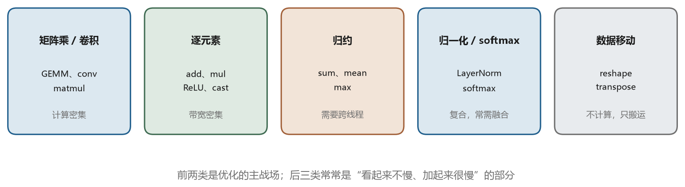
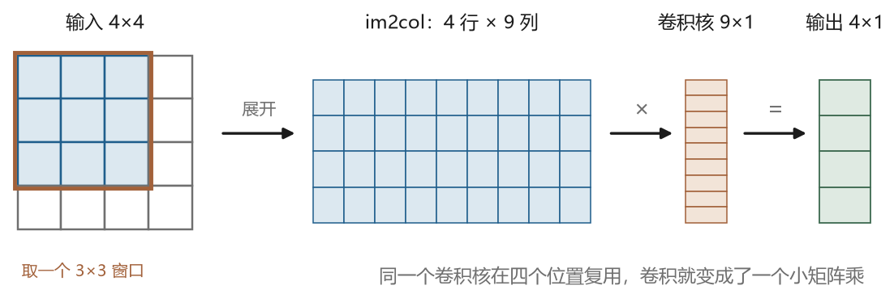

# 算子的真面目

打开一份推理 profile，最上面往往是一长串名字：`conv2d`、`batch_norm`、`relu`、`add`、`mean`、`softmax`、`matmul`。看起来模型就是由这些积木搭起来的，每块积木各干一件事。真到优化的时候，同一个名字背后可能是完全不同的实现，耗时也差得很远。

一个 `conv2d` 可以是直接卷积、im2col 加矩阵乘、隐式矩阵乘、Winograd，也可以是张量核心上的一个融合算子。选哪一种，取决于输入形状、通道数、卷积核大小、数据类型、布局，以及框架和硬件的版本。说“这个卷积很慢”没有意义，得说清是哪一种卷积、什么形状、在什么硬件上。

这一章把算子拆成几个维度，看看“一个算子”到底由什么决定，以及为什么同一层在不同条件下会跑出不同的时间。

## 一个算子由四样东西决定

是哪种运算，只是第一样。另外三样同样重要。

**形状**决定并行度。一个 3×3 卷积，输入 224×224×64，输出通道 64，和输入 7×7×512，输出 512，计算量差不多，但前者空间大、通道少，后者空间小、通道多，适合的 kernel 完全不同。batch 为 1 和 batch 为 32 又是两种世界。

**数据类型**决定走哪条通路。fp32 走普通 CUDA Core，fp16 和 bf16 可以走 Tensor Core，int8 走整数通路，fp8 需要更新的硬件。数据类型不匹配时，框架会插入转换，多出来的 cast 算子会吃掉一部分收益。

**布局**决定访存是否连续。NCHW 里通道维在第二维，NHWC 里通道维在最后。Tensor Core 通常偏好 NHWC，因为一个像素的所有通道连续存放，便于向量化加载；但很多训练框架默认 NCHW，导出后要插一层 transpose。布局转换本身不改变计算，却要读写一遍整个张量。

同样是 `conv2d`，这四样东西一变，kernel 的实现、寄存器用量、共享内存大小、occupancy 全都跟着变。profile 上看到的耗时，是这四样东西共同作用的结果，不是算子名字自带的属性。

## 算子的几个家族

按计算和访存的模式，算子大致分五类。

**矩阵乘与卷积**是计算密集型。它们的共同点是有大量可复用的权重，算术强度高，能喂饱 Tensor Core。GEMM 是这类算子的原型，卷积可以通过 im2col 或隐式展开变成 GEMM。

**逐元素算子**包括加、乘、激活、比较、类型转换。每个元素独立计算，读多少写多少，算术强度接近常数，几乎总是带宽瓶颈。ReLU 只做一次比较，却要把整个张量读一遍写一遍。

**归约算子**包括求和、均值、最大值、方差。它们要把一个维度上的数据聚合成一个数，需要跨线程通信。LayerNorm 和 softmax 都包含归约，归约的并行方式决定了它们的效率。

**归一化与 softmax**是复合算子，内部有归约、有逐元素运算，有时还有跨通道的统计。单独实现要读两三遍显存，融合成一个 kernel 可以只读一遍。

**数据移动算子**包括 reshape、transpose、concat、slice、padding。它们不做算术，只搬数据，但在实际模型里占的时间常常超出预期。一个不必要的 transpose 可能让后面的卷积从 NHWC 退回 NCHW，连锁反应比它本身大得多。

## FLOPs 和字节数

判断一个算子吃算力还是吃带宽，最直接的办法是数一数它做了多少次运算、读写了多少字节。

矩阵乘 `C = AB`，`A` 是 `M × K`，`B` 是 `K × N`，运算量是 `2MNK` 次浮点操作，访存量是 `MK + KN + MN` 个元素。当 `M`、`N`、`K` 都很大时，运算量按三次方增长，访存量按二次方增长，算术强度随矩阵尺寸线性上升。这就是大矩阵乘能跑满算力的原因。

逐元素相加 `C = A + B`，每个元素一次加法，读两个数写一个数。fp32 下每个元素 12 字节的访存换 1 次运算，算术强度不到 0.1。哪怕 GPU 有几百 TFLOPS，这种算子也只能跑到带宽上限。

卷积介于两者之间。卷积核越大、通道越多，权重复用越多，算术强度越高；1×1 卷积本质上是矩阵乘，强度也不低；depthwise 卷积每个通道独立，权重复用少，容易变成带宽瓶颈。

把算子的算术强度和硬件的 roofline 放在一起，就能大致判断它应该跑多快。实际耗时明显低于这个上限，说明实现还有问题；已经贴着上限，再优化算子本身收益有限，得改算法或者融合。

## 同一个算子，不同的 kernel

框架不会为每个形状手写一个 kernel，而是准备一批实现，再按规则挑一个。cuDNN 为卷积准备了几十种算法，cuBLAS 为矩阵乘准备了不同 tile 和 stage 的组合，TensorRT 在构建 engine 时会为每一层试跑多个 tactic。

挑选的依据是启发式规则或实测。启发式快，但可能选错；实测准，但构建时间长。形状不在预设范围内时，可能退回到一个通用但较慢的实现，或者插入额外的转换。这就是为什么同一个模型换个 batch、换个序列长度，性能会突然变差。

还有一个常被忽略的因素是**对齐**。很多 kernel 要求通道数是 8 或 16 的倍数，指针对齐到 128 字节。形状不满足时，要么 padding，要么走标量路径。一个 3 通道的输入、一个 1000 类的输出，都可能落在不友好的形状上。

## 算子不是孤立的

单独看一个算子，优化空间有限。真正大的收益往往来自算子之间：把相邻的算子融合，少写一次中间结果；把布局转换消掉，少搬一次数据；把多个小算子合成一个，少启动几次 kernel。

这也意味着，profile 上最慢的那个算子不一定是优化的第一站。它可能只是一个受害者，上游给它喂了一个不合适的布局，或者下游要求它输出一个它不擅长的形状。把整条链放在一起看，才能找到真正的瓶颈。

下一章讲融合。它是最常见、也最容易被过度期待的一类图优化。
