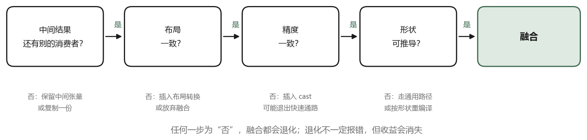

# 融合：一次算完，少搬几趟

一个常见的推理图里，卷积后面跟着批归一化，再后面跟着 ReLU。三个算子，三次 kernel 启动，中间结果写回显存再读出来。假设特征图是 64×224×224 的 fp16，大约 6 MB。卷积写 6 MB，归一化读 6 MB 写 6 MB，ReLU 再读 6 MB 写 6 MB，一趟下来二十多 MB 的显存流量，只为了做一次减法、一次除法和一次比较。

融合就是把这三步塞进一个 kernel：卷积算完一个输出块，直接在寄存器里做归一化和 ReLU，然后写回。中间结果从来没有离开过计算单元，显存流量从二十多 MB 降到十几 MB，kernel 启动从三次变成一次。这里的**寄存器**是 GPU 芯片上离计算单元最近的一小块存储，容量以 KB 计，读写几乎不花时间，是数据最理想的落脚点。

这是部署里性价比最高的一类优化，也是最容易被说成“编译器会自动做”的一类。编译器确实会做，但有条件。条件不满足时，它要么放弃，要么只融合一部分，收益和预期差很远。

## 融合省下的是什么

融合的收益可以拆成三笔账。

第一笔账是**显存流量**。一个逐元素算子至少读一遍、写一遍，融合进前一个算子后，这两遍都省了。融合的算子越多，省下的中间张量越多。这笔账在带宽瓶颈的模型上最值钱：如果模型本来就跑在带宽上限，减少一半读写就等于快了一倍。

第二笔账是**启动开销**。每次 kernel 启动都有固定成本，几微秒到几十微秒。单个不算多，几百个小算子累起来就是几毫秒，在延迟只有几十毫秒的服务里不是小数。启动还有一个隐性成本：每次启动都要从 CPU 发一条指令，算子太多时 CPU 发指令的速度可能跟不上 GPU，时间线上出现一段一段的空白。

第三笔账是**缓存局部性**。融合后数据在寄存器或共享内存里连续处理，不用先写回显存再读回来，L2 命中率也更好。**L2** 是 GPU 上所有 SM 共享的一级缓存，容量比共享内存大，比显存小得多，命中它比读显存快一个数量级。

三笔账合起来，就是融合能直接降耗时的原因。融合不改变数学，理想情况下结果完全一致。实际会有一点点差异：浮点运算的顺序变了，舍入误差可能略有不同。对大多数模型无所谓，对数值敏感的场景要验证。有的编译器要求融合前后逐位一致，差一点就放弃，宁可慢也不冒险。

融合还有一种不太明显的收益：它减少了中间张量的数量，显存占用跟着降。中间张量少了，显存里能放的请求就多了，批处理能开得更大。这类收益不会体现在单个 kernel 的时间上，而是体现在整体吞吐上。

可以粗算一下启动开销的量级。一个中等规模的视觉模型，图里可能有三百多个算子；假设每次启动平均 5 微秒，光启动就要 1.5 毫秒。但如果模型中间夹着大量尺寸很小的算子（比如在低分辨率的特征图上做逐元素运算），每个只需 2 微秒就能算完，却要 5 微秒启动，那么 GPU 有超过一半的时间在“准备开始”，而不是在算。融合把这类小算子吃进大算子之后，这部分浪费就消失了。

## 垂直融合：卷积、归一化、激活

最常见的是把 Conv、BN、ReLU 合成一个。**BN**（batch normalization，批归一化）是训练时用来稳定数值的一种操作，推理时它已经退化成一个固定的缩放加平移。

BN 在推理时是一个固定的仿射变换：

$$y = \frac{\gamma (x - \mu)}{\sqrt{\sigma^2 + \epsilon}} + \beta = a x + b$$

其中 `a = γ / √(σ^2 + ε)`，`b = β - aμ`。这个变换可以整个折进前面的卷积：把卷积权重乘上 `a`，把偏置变成 `a b_conv + b`。折完之后，BN 消失了，卷积的输出直接就是归一化后的值。这个操作叫 **BN 折叠**（BN folding），是推理图优化里最经典的一步。

为什么可以这样折？因为卷积是线性的：先乘权重再加偏置，再乘一个标量加一个数，两步的次序可以交换。只要中间没有非线性，这种交换永远成立。这也是图优化里一个通用的思路：找出可以换序的运算，把便宜的那个吸收进贵的那个。

ReLU 更简单，它是一个逐元素的最大值，可以在卷积的 epilogue 里做。所谓 **epilogue**，就是卷积算完累加、写回之前的那一小段收尾代码。现代卷积 kernel 通常允许在 epilogue 里接一个简单的逐元素函数，ReLU 正好合适。这个设计的意义在于，写回显存的这一次机会被利用起来了：既然反正要写，就在写的路上顺便做完。

三步合一之后，图里只剩下一个卷积。精度上，BN 折叠是代数等价，唯一的误差来自浮点舍入；ReLU 也是精确的。这类融合通常标成“零损失”，原因就在这里。不过要注意一点：折叠要求 BN 的参数在推理时固定。如果你的服务会在运行时切换模型版本或者做在线学习，折叠后的卷积就过期了，需要重新折叠。

验证折叠有没有做对，有个简单方法：拿一批输入，分别跑“折叠前”和“折叠后”的图，比较输出的最大绝对误差。如果误差在浮点的量级内（比如 1e-5 量级），就是正常的舍入差异；如果到了 1e-2，说明折叠公式用错了，比如 `ε` 放错了位置或者 `γ` 漏乘了。这个测试只要几十行代码，值得写进发流水线。尤其是量化之后的重新折叠，参数变了但公式没变，人很容易想当然，而这一道测试就能拦住问题。

## 逐元素组合的几种常见形态

除了 Conv+BN+ReLU，还有几类在模型里反复出现。

**Gemm+Mul** 和 **Gemm+Add**（有的资料写作 GemmMul、GemmAdd）。**Gemm** 是通用矩阵乘，深度学习框架里对矩阵乘的统称。矩阵乘的输出乘一个标量或加一个偏置，是很常见的结构，比如缩放注意力分数、给 logits 加温度。**logits** 是模型最后一层输出的原始分数，还没经过 softmax 变成概率。这些操作可以在 GEMM 的 epilogue 里完成，不必单独起一个 kernel。

**Scale+Linear**（ScaleLinear）。先乘一个缩放系数，再过一个线性层。如果缩放作用在输入上，它可以折进线性层的权重；如果作用在输出上，可以折进偏置。折的条件是缩放系数在推理时固定。这和 BN 折叠是同一个道理，只是形式更简单。

**ConvAdd**。残差连接里，卷积的输出和另一条分支相加。**残差连接**是把一层的输入直接加到输出上的那条短路，让梯度更容易传回去。如果另一条分支已经在显存里，卷积可以在写回时直接读它、加上去，省掉一次单独的 add kernel。代价是卷积 kernel 要同时读两个输入，寄存器压力会大一点。

**Attention 里的融合**。多头注意力天然包含很多小算子：拆分头、转置、缩放、mask、softmax、再合并。**mask** 是给某些位置打上“不许看”的标记，比如不让模型看到未来的 token。把这些合成一个注意力 kernel，是 FlashAttention 这类实现的核心工作之一。它不只是省流量，还改变了计算的顺序，把中间矩阵留在片上。这是一个比前面几种都更深的融合：前面几种是在收尾时顺便做，它是把整个计算过程重新分块。

还有一类融合经常被忽略：把归约和逐元素运算合在一起。LayerNorm 的典型实现是算均值、算方差、归一化、再乘缩放加偏移，四个步骤。分开写要读四遍数据；合成一个 kernel，读一遍就够，各项统计在同一个循环里算完。这类算子在 Transformer 里每层都有两个，数量不少，融合之后省下的带宽相当可观。还避免了中间张量写回显存，显存峰值也跟着降。

## 水平融合

垂直融合是生产者与消费者的合并。水平融合处理的是另一种关系：多个算子读同一份输入，或者写同一份输出。

比如两个分支各自做一次 1×1 卷积，再把结果拼起来。如果两个卷积的输入相同、输出通道数相近，可以合成一个更大的卷积，一次算完再切开。这样输入只读一遍，kernel 启动也少一次。这个技巧在做多分支的特征提取时很常见，比如 inception 结构里几条不同尺寸的卷积分支。

水平融合的适用面比垂直融合窄。它要求分支的形状、布局、精度一致，还要求没有别的消费者。分支多了以后，寄存器放不下，收益会被抵消。一个四条分支的结构合成一条大卷积，权重矩阵会大到无法放进寄存器，此时反而比四条小卷积慢。这也是一个提醒：融合不是越多越好，它有一个最优数量，过了拐点就开始倒退。

水平融合还有一个判断标准：合并后的 kernel 是不是还能保持高的算术强度。如果把几个很小的卷积合成一个大的，算术强度上升，通常划算；如果合并后每个分支的输入都不一样，只是形式上合在一起，那就只是多了一个更复杂的 kernel，收益有限。

举个具体情形。一个模块里有三个 1×1 卷积，输入都是 256 通道，输出分别是 64、64、128，最后拼成 256 通道。这三个卷积可以合成一个输出 256 通道的卷积，权重矩阵直接拼起来，输入只读一遍。如果三个分支的输入不同（比如一个来自主干、两个来自不同层的特征），就不能合，因为输入不是同一块数据。

水平融合和垂直融合经常同时发生。一个模块里，几条分支先水平合并，合并后的结果再和后面的激活垂直融合。编译器会反复尝试，直到再没有可合并的为止。这也是为什么图优化的顺序很重要：先把能删的删掉，再融合，比边删边融合成功率高。多余的分支和重复计算先消失之后，剩下的节点消费者关系简单，融合中间结果被多处引用的障碍也就少了。

## 什么时候融合不了

编译器不是万能的。下面这些情况，融合会失败或者只融合一部分。知道这些条件，就能在设计模型和导出模型时主动让路。

**中间结果还有别的消费者**。卷积的输出既要喂给 ReLU，又要作为残差的输入。如果把它融进 ReLU，另一条分支就拿不到这个张量了。编译器只能保留中间结果，或者复制一份。这是最常见的融合失败原因，也是为什么残差结构多的模型，融合率往往比串行结构低。

**布局不一致**。前一个算子输出 NCHW，后一个算子要求 NHWC，中间必须转置。转置不能随便融进卷积的 epilogue，因为它的访存模式和卷积不同。有的编译器会先插一个 transpose，再把后面的算子融合到 transpose 上，但这样又多了一次搬运。

**精度不一致**。卷积输出 fp16，后面的算子要求 fp32，中间要 cast。cast 可以融，但会增加寄存器用量，也可能让 kernel 从 Tensor Core 路径退出来。退出快路径这件事，往往比多一次读写更贵。

**动态形状**。融合后的 kernel 往往要按固定块大小处理，形状变化时要重新编译或走通用路径。动态序列长度的模型里，融合的收益会被重编译和回退吃掉一部分。

**语义上有副作用**。dropout、随机数、原地修改，这些操作不能随便和其他算子合并。推理时 dropout 本来就应该删掉，但如果图里还留着，融合会把它一起带进去或者直接拒绝。

还有一种情况不太算融合失败，但结果一样：编译器用代价模型估算融合是否划算，估不准时就保守处理。如果某个融合“应该做但没做”，先查形状和布局是否对齐，再看是不是被一个不起眼的 cast 卡住了。

融合的效果，最终要在端到端上验证。一个融合把某个 kernel 的耗时降了一半，但如果它让前面的布局转换多了一次，整体可能没变。更常见的坑是：融合后单个片段变快了，但因为 kernel 变复杂、寄存器占用变高，占用率下降，在一批混合负载下反而不如原来。下一章讲图上的清理，那些看起来不起眼的删除和折叠，往往决定了融合能不能顺利发生。
