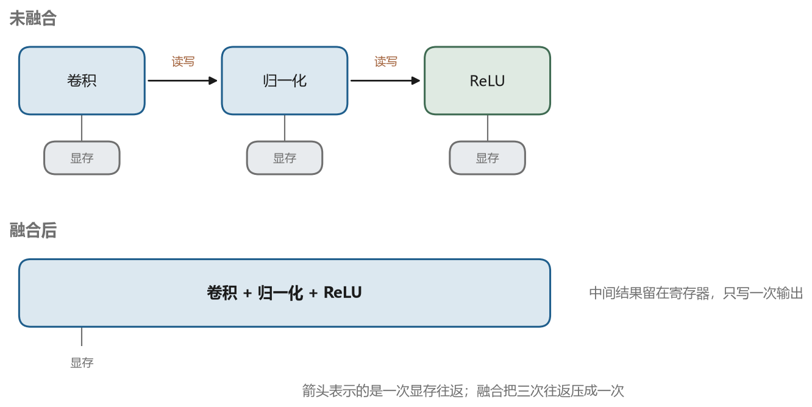

# 融合：一次算完，少搬几趟

一个常见的推理图里，卷积后面跟着批归一化，再后面跟着 ReLU。三个算子，三次 kernel 启动，中间结果写回显存再读出来。假设特征图是 64×224×224 的 fp16，大约 6 MB。卷积写 6 MB，归一化读 6 MB 写 6 MB，ReLU 再读 6 MB 写 6 MB，一趟下来二十多 MB 的显存流量，只为了做一次减法、一次除法和一次比较。

融合就是把这三步塞进一个 kernel：卷积算完一个输出块，直接在寄存器里做归一化和 ReLU，然后写回。中间结果从来没有离开过计算单元，显存流量从二十多 MB 降到十几 MB，kernel 启动从三次变成一次。

这是部署里性价比最高的一类优化，也是最容易被说成“编译器会自动做”的一类。编译器确实会做，但有条件。条件不满足时，它要么放弃，要么只融合一部分，收益和预期差很远。

## 融合省下的是什么

第一笔账是**显存流量**。一个逐元素算子至少读一遍、写一遍，融合进前一个算子后，这两遍都省了。融合的算子越多，省下的中间张量越多。

第二笔账是**启动开销**。每次 kernel 启动都有固定成本，几微秒到几十微秒。单个不算多，几百个小算子累起来就是几毫秒。在延迟只有几十毫秒的服务里，这不是小数。

第三笔账是**缓存局部性**。融合后数据在寄存器或共享内存里连续处理，不用先写回显存再读回来，L2 命中率也更好。

融合不改变数学，理想情况下结果完全一致。但浮点运算的顺序变了，舍入误差可能略有不同。对大多数模型无所谓，对数值敏感的场景要验证。

## 垂直融合：卷积、归一化、激活

最常见的是把 Conv、BN、ReLU 合成一个。

BN 在推理时是一个固定的仿射变换：

$$y = \frac{\gamma (x - \mu)}{\sqrt{\sigma^2 + \epsilon}} + \beta = a x + b$$

其中 `a = γ / √(σ^2 + ε)`，`b = β - aμ`。这个变换可以整个折进前面的卷积：把卷积权重乘上 `a`，把偏置变成 `a b_conv + b`。折完之后，BN 消失了，卷积的输出直接就是归一化后的值。

ReLU 更简单，它是一个逐元素的最大值，可以在卷积的 epilogue 里做。所谓 epilogue，就是卷积算完累加、写回之前的那一小段。现代卷积 kernel 通常允许在 epilogue 里接一个简单的逐元素函数，ReLU 正好合适。

三步合一之后，图里只剩下一个卷积。精度上，BN 折叠是代数等价，唯一的误差来自浮点舍入；ReLU 也是精确的。这类融合通常标成“零损失”，原因就在这里。

## 逐元素组合的几种常见形态

除了 Conv+BN+ReLU，还有几类在模型里反复出现。

**Gemm+Mul** 和 **Gemm+Add**。矩阵乘的输出乘一个标量或加一个偏置，是很常见的结构，比如缩放注意力分数、给 logits 加温度。这些操作可以在 GEMM 的 epilogue 里完成，不必单独起一个 kernel。

**Scale+Linear**。先乘一个缩放系数，再过一个线性层。如果缩放作用在输入上，它可以折进线性层的权重；如果作用在输出上，可以折进偏置。折的条件是缩放系数在推理时固定。

**ConvAdd**。残差连接里，卷积的输出和另一条分支相加。如果另一条分支已经在显存里，卷积可以在写回时直接读它、加上去，省掉一次单独的 add kernel。代价是卷积 kernel 要同时读两个输入，寄存器压力会大一点。

**Attention 里的融合**。多头注意力天然包含很多小算子：拆分头、转置、缩放、mask、softmax、再合并。把这些合成一个注意力 kernel，是 FlashAttention 这类实现的核心工作之一。它不只是省流量，还改变了计算的顺序，把中间矩阵留在片上。

## 水平融合

垂直融合是生产者与消费者的合并。水平融合处理的是另一种关系：多个算子读同一份输入，或者写同一份输出。

比如两个分支各自做一次 1×1 卷积，再把结果拼起来。如果两个卷积的输入相同、输出通道数相近，可以合成一个更大的卷积，一次算完再切开。这样输入只读一遍，kernel 启动也少一次。

水平融合的适用面比垂直融合窄。它要求分支的形状、布局、精度一致，还要求没有别的消费者。分支多了以后，寄存器放不下，收益会被抵消。

## 什么时候融合不了

编译器不是万能的。下面这些情况，融合会失败或者只融合一部分。

**中间结果还有别的消费者**。卷积的输出既要喂给 ReLU，又要作为残差的输入。如果把它融进 ReLU，另一条分支就拿不到这个张量了。编译器只能保留中间结果，或者复制一份。

**布局不一致**。前一个算子输出 NCHW，后一个算子要求 NHWC，中间必须转置。转置不能随便融进卷积的 epilogue，因为它的访存模式和卷积不同。有的编译器会先插一个 transpose，再把后面的算子融合到 transpose 上，但这样又多了一次搬运。

**精度不一致**。卷积输出 fp16，后面的算子要求 fp32，中间要 cast。cast 可以融，但会增加寄存器用量，也可能让 kernel 从 Tensor Core 路径退出来。

**动态形状**。融合后的 kernel 往往要按固定块大小处理，形状变化时要重新编译或走通用路径。动态序列长度的模型里，融合的收益会被重编译和回退吃掉一部分。

**语义上有副作用**。dropout、随机数、原地修改，这些操作不能随便和其他算子合并。推理时 dropout 本来就应该删掉，但如果图里还留着，融合会把它一起带进去或者直接拒绝。

融合的效果，最终要在端到端上验证。一个融合把某个 kernel 的耗时降了一半，但如果它让前面的布局转换多了一次，整体可能没变。下一章讲图上的清理，那些看起来不起眼的删除和折叠，往往决定了融合能不能顺利发生。
