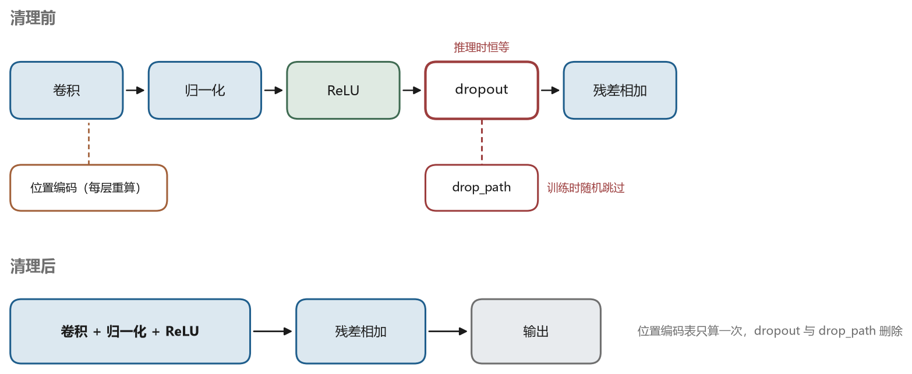

# 图上的清理：常量、死代码与静态形状

导出的推理图，往往比模型本身臃肿。训练时为了防止过拟合加的 dropout，在推理时什么都不做，却还留在图里；随机深度的分支在推理时永远走同一条路，另一条却还在；位置编码每一步都重新算一遍三角函数，明明它的值只和位置有关；还有一些常量表达式，每次前向都要重新算一次。

这些东西不改变模型的输出，删掉它们不会掉精度，但会让图更小、更快。清理是融合之前的准备工作，图越干净，后面的融合越容易成功。用装修打个比方：先拆掉不要的隔断、清走建筑垃圾，再谈铺地板和装柜子，否则每一步都在跟杂物打架。

## 常量折叠

常量折叠做的事情很朴素：如果一个子图的所有输入都是常量，就在编译时把它算出来，用一个常量节点代替整个子图。编译时算一次，运行时就不再算，哪怕它每秒钟要被执行一千次。

最常见的是权重预处理。BN 的均值、方差、缩放、偏置在推理时都是固定的，可以折进卷积权重；LayerNorm 的缩放和偏置如果也是固定的，可以提前算好；量化的 scale 和 zero point 在标定之后也是常量，可以折进量化算子。这类折叠的收益不在算力，而在“少启动几次 kernel、少读写几遍参数”。

另一类是形状计算。很多图里有 `reshape`、`transpose`、`concat` 之类的操作，它们的参数来自常量，输出形状可以在构建时推导出来。推导出来之后，后面的算子就能按固定形状分配内存、选择 kernel。这一步看起来只是“算个数”，实际影响很大：形状一确定，内存可以提前排好，算子可以选到专用实现。

还有一类是真正的常量表达式，比如 masked fill 的 mask、固定的位置索引、预计算的三角函数表。这些表只和最大序列长度有关，可以在加载时算一次，之后每步复用。长上下文模型里，位置编码的计算量不小，缓存下来能省一截。**位置编码**是告诉模型“每个 token 排在第几位”的一串数字，因为注意力本身对顺序不敏感，必须额外把顺序信息加进去。

常量折叠也有边界。只要子图里有一个输入依赖运行时数据，整块就不能折。有些图看似全是常量，但里面混了一个从输入形状推出来的值，编译器只能折一部分。遇到“为什么这里明明可以提前算，却没算”的疑问，先看那个子图的输入里有没有藏着一个动态值。

折叠还能把不同精度的计算拉到同一边。如果两个常量一个是 fp32、一个是 fp16，编译器可以先把它们统一成 fp32 再算，得到一个确定的结果；如果不折，运行时每步都要做一次转换，转换本身就占了时间。这类细节单独看很小，但在一个每层都要重复的路径上，累起来相当可观。

## 死代码消除

死代码消除沿着图的输出往回找，凡是不能到达输出的节点，都可以删掉。**死代码**（dead code）就是算出来了、但没人用的东西，和程序里写了却永远不执行的分支是同一类问题。

推理图里最常见的死代码是训练专用的层。dropout 在推理时是恒等变换，输入直接等于输出，可以整个删掉；随机深度（drop_path）在推理时也是恒等，保留哪条分支是训练时随机的，推理时全部保留，所以那条“跳过”的分支可以删掉；辅助分类头、对比学习的分支、正则项，只要不影响主输出，都可以删。

**恒等变换**的意思是“输出等于输入”，什么也没做。理解这一点，就知道为什么删它绝对安全：既然它什么也没做，删掉当然不会改变结果。这类删除是零风险的，应该毫不犹豫地做。

有些死代码不那么明显。比如一个张量被计算出来，但只用于打印日志；一个分支只在特定条件下执行，而那个条件在推理时恒为假；一个 `detach` 之后的副本，没有任何消费者。这些节点在图上看得到，运行时却完全不参与输出。它们往往来自训练脚本里残留的调试代码，或者某个实验开关忘了关。

删死代码之前，要确认没有副作用。原地修改、随机数、自定义算子里的隐式状态，这些不能只因为“输出没人用”就删掉。推理图通常已经没有这些，但从训练图直接导出时，最好检查一遍。一个自定义算子在内部写了一个全局计数器，输出没人用，删掉它不影响精度，但可能影响别的逻辑，这类坑不多见，一旦碰上就很难查。

死代码消除还有一个副产品：它让图的拓扑变简单，后面的融合更容易成功。一个中间张量如果只被一个消费者使用，融合的可能性最高；被两个消费者使用，就很难融合。删掉一个多余的分支，可能就把一个“不能融合”变成了“能融合”。这也解释了为什么很多引擎的优化流程里，消除类 pass 总排在融合 pass 前面。

## 静态化

静态化的意思是：把形状、数据类型、布局在构建时定下来，运行时不再变。这三个东西一旦固定，编译器能做事的空间立刻变大。

动态形状的代价很大。引擎无法提前分配内存，只能在运行时按最大可能形状预留，或者每次都重新分配；无法为每一层选一个固定的 kernel，只能走通用路径；无法把整串 kernel 录成 CUDA Graph，因为每次的指针和形状都可能不同。**CUDA Graph** 是把一段固定的 GPU 操作序列录下来，之后一次提交、整段重放，省掉逐条下发的开销。固定形状之后，这些都能做，端到端能省下不少。

静态化的第一步是确定推理时的真实形状。图像服务通常固定输入分辨率，文本服务固定最大序列长度，batch 可以固定，也可以留几个档位。确定之后，把形状写进引擎的优化配置，让它按这个形状选 kernel、排内存。

静态化还有一个常被忽略的细节：填充浪费。如果服务把每个请求都补齐到最大长度再算，短请求就会被一堆无效 token 拖慢。所以更好的做法是按几个档位分桶，比如 128、512、2048、8192，请求被塞进最接近的那一档。分桶越多，浪费越少，但要维护的引擎变体越多，构建和缓存成本越高。

静态化的代价是灵活性。用户传了一张更大的图，或者序列比预期长，引擎要么拒绝，要么回退到慢路径，要么重新构建。实际系统里常见的做法是准备几个档位，按请求形状选最接近的一个，超出范围再走通用路径。这条“兜底路径”必须存在，否则一个意外的输入就能让服务报错。

**缓存位置编码**是静态化的一个具体例子。Transformer 的位置编码由位置索引算出，同一个位置在不同请求、不同层里反复使用。如果序列长度固定，可以预先算好一张表，运行时按索引取，不必每步重新算 sin 和 cos。表的显存占用是“长度 × 维度 × 字节数”，长上下文下不小，但比每层重复计算便宜。

**静态张量**是另一个说法，指的是形状和布局在构建时就确定的张量。很多引擎要求权重是静态的，激活可以是动态的；有的引擎连激活的形状也要静态，才能做更激进的内存复用。静态的范围越大，优化空间越大，能支持的输入形态也越少。

## 公共子表达式与布局

同一张图里经常有重复计算。两个分支都要用同一个转置后的张量，图里就画了两遍；连续的 `reshape` 和 `transpose` 互相抵消，图里还留着；`concat` 之后再 `slice`，切出来的就是原来的几块。这类重复叫**公共子表达式**（common subexpression），消除的思路很直接：算一次，存起来，大家共用。

公共子表达式消除把这些重复节点合并成一个。合并本身不难，难在判断“算一次再共用”是否真的更划算。共用意味着多一份显存占用，如果这个张量很大、只被用两次，省下的计算可能不如多占的显存值钱。编译器通常会用代价模型估算，估不准时就保守处理。

布局优化则更进一步，把 `transpose` 往后推或者往前挪，让它和相邻的算子合并，或者干脆消掉。一个 NCHW 的卷积后面接一个 NHWC 的卷积，中间本来要转两次，优化之后可能只需要转一次，甚至不转。**布局传播**（layout propagation）是这类优化的通用做法：给每个算子标注它能接受的布局，然后从两端往中间推，看能不能找到一条全程一致的路径。

布局优化的难点在于，它要同时考虑前后算子的偏好。往前推可能让前一个算子变慢，往后推可能让后一个算子变慢。编译器通常用代价模型估算，估不准时就保守处理，留下一次转换。

还有一个更彻底的做法：如果整条链都是自己可控的，干脆从输入开始就用同一种布局，让转换从头到尾都不出现。这就是为什么很多推理引擎会要求“输入就用 NHWC”——它不是偏好，而是为了省掉一路上的转换。

布局优化最容易失败的地方是注意力。注意力的输入一般是“批 × 头 × 序列 × 头维”，而投影层的权重按“隐藏维 × 隐藏维”排。两者之间必然有一次重排，而且这个重排在每个注意力层都要发生一次。很多引擎会把这次重排融进相邻的矩阵乘，或者直接按注意力需要的形状存中间结果，这就是细节层面的优化。

## 清理的边界

清理看起来没有风险，实际也有边界。把这些边界记住，能省下不少“明明删了却变慢了”的困惑。

数值等价要验证。常量折叠改变了计算顺序，浮点结果可能差最后几位；BN 折叠在数值上等价，但如果 `epsilon` 很小、方差很大，折叠后的结果可能和原来略有不同。大多数模型不在乎，但对数值敏感的场景要跑一遍对齐测试。测试方法很简单：同样的输入，比较清理前后的输出，看最大绝对误差是否在浮点的量级内。

副作用不能忽略。删除一个“没人用”的节点之前，要确认它没有原地写、没有随机数、没有外部状态。自定义算子尤其要小心，它的输出可能没人用，但内部可能做了别的事。

动态控制流要保留。有些模型的图里有 `if` 或循环，取决于输入。清理不能把这些当成死代码，除非能证明条件恒真或恒假。这类图在导出时本来就容易出问题，清理阶段更要保守。

清理之后，图的节点数可能少了一半，但端到端不一定快一倍。很多被删掉的节点本来就不耗时，真正的大头还是卷积和矩阵乘。清理的价值在于为后面的融合和静态化铺路，而不是它自己省了多少时间。把这句话反过来理解：如果你只做清理，不做后面的融合和静态化，收益很可能低于预期，但工作量已经花了，容易让人得出“优化没用”的错误结论。

还有一条实践建议：把清理前后的图都导出保存，对比一下。很多时候你会看到意料之外的东西，比如一个你以为只有一层的结构实际上展开了三层，或者一个注意力被拆成了十几个小算子。看到这些，才知道下一步该动哪里。

下一章换一个角度，看不改变图的结构，只改变算子本身的算法，能换来什么。
