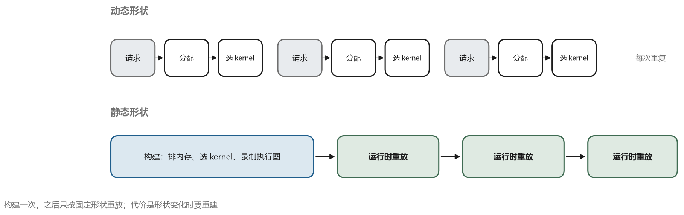

# 图上的清理：常量、死代码与静态形状

导出的推理图，往往比模型本身臃肿。训练时为了防止过拟合加的 dropout，在推理时什么都不做，却还留在图里；随机深度的分支在推理时永远走同一条路，另一条却还在；位置编码每一步都重新算一遍三角函数，明明它的值只和位置有关；还有一些常量表达式，每次前向都要重新算一次。

这些东西不改变模型的输出，删掉它们不会掉精度，但会让图更小、更快。清理是融合之前的准备工作，图越干净，后面的融合越容易成功。

## 常量折叠

常量折叠做的事情很朴素：如果一个子图的所有输入都是常量，就在编译时把它算出来，用一个常量节点代替整个子图。

最常见的是权重预处理。BN 的均值、方差、缩放、偏置在推理时都是固定的，可以折进卷积权重；LayerNorm 的缩放和偏置如果也是固定的，可以提前算好；量化的 scale 和 zero point 在标定之后也是常量，可以折进量化算子。

另一类是形状计算。很多图里有 `reshape`、`transpose`、`concat` 之类的操作，它们的参数来自常量，输出形状可以在构建时推导出来。推导出来之后，后面的算子就能按固定形状分配内存、选择 kernel。

还有一类是真正的常量表达式，比如 masked fill 的 mask、固定的位置索引、预计算的三角函数表。这些表只和最大序列长度有关，可以在加载时算一次，之后每步复用。长上下文模型里，位置编码的计算量不小，缓存下来能省一截。

## 死代码消除

死代码消除沿着图的输出往回找，凡是不能到达输出的节点，都可以删掉。

推理图里最常见的死代码是训练专用的层。dropout 在推理时是恒等变换，输入直接等于输出，可以整个删掉；随机深度（drop_path）在推理时也是恒等，保留哪条分支是训练时随机的，推理时全部保留，所以那条“跳过”的分支可以删掉；辅助分类头、对比学习的分支、正则项，只要不影响主输出，都可以删。

有些死代码不那么明显。比如一个张量被计算出来，但只用于打印日志；一个分支只在特定条件下执行，而那个条件在推理时恒为假；一个 `detach` 之后的副本，没有任何消费者。这些节点在图上看得到，运行时却完全不参与输出。

删死代码之前，要确认没有副作用。原地修改、随机数、自定义算子里的隐式状态，这些不能只因为“输出没人用”就删掉。推理图通常已经没有这些，但从训练图直接导出时，最好检查一遍。

## 静态化

静态化的意思是：把形状、数据类型、布局在构建时定下来，运行时不再变。

动态形状的代价很大。引擎无法提前分配内存，只能在运行时按最大可能形状预留，或者每次都重新分配；无法为每一层选一个固定的 kernel，只能走通用路径；无法把整串 kernel 录成 CUDA Graph，因为每次的指针和形状都可能不同。固定形状之后，这些都能做，端到端能省下不少。

静态化的第一步是确定推理时的真实形状。图像服务通常固定输入分辨率，文本服务固定最大序列长度，batch 可以固定，也可以留几个档位。确定之后，把形状写进引擎的优化配置，让它按这个形状选 kernel、排内存。

静态化的代价是灵活性。用户传了一张更大的图，或者序列比预期长，引擎要么拒绝，要么回退到慢路径，要么重新构建。实际系统里常见的做法是准备几个档位，按请求形状选最接近的一个，超出范围再走通用路径。

**缓存位置编码**是静态化的一个具体例子。Transformer 的位置编码由位置索引算出，同一个位置在不同请求、不同层里反复使用。如果序列长度固定，可以预先算好一张表，运行时按索引取，不必每步重新算 sin 和 cos。表的显存占用是 `长度 × 维度 × 字节数`，长上下文下不小，但比每层重复计算便宜。

**静态张量**是另一个说法，指的是形状和布局在构建时就确定的张量。很多引擎要求权重是静态的，激活可以是动态的；有的引擎连激活的形状也要静态，才能做更激进的内存复用。静态的范围越大，优化空间越大，能支持的输入形态也越少。

## 公共子表达式与布局

同一张图里经常有重复计算。两个分支都要用同一个转置后的张量，图里就画了两遍；连续的 `reshape` 和 `transpose` 互相抵消，图里还留着；`concat` 之后再 `slice`，切出来的就是原来的几块。

公共子表达式消除把这些重复节点合并成一个。布局优化则更进一步，把 `transpose` 往后推或者往前挪，让它和相邻的算子合并，或者干脆消掉。一个 NCHW 的卷积后面接一个 NHWC 的卷积，中间本来要转两次，优化之后可能只需要转一次，甚至不转。

布局优化的难点在于，它要同时考虑前后算子的偏好。往前推可能让前一个算子变慢，往后推可能让后一个算子变慢。编译器通常用代价模型估算，估不准时就保守处理，留下一次转换。

## 清理的边界

清理看起来没有风险，实际也有边界。

数值等价要验证。常量折叠改变了计算顺序，浮点结果可能差最后几位；BN 折叠在数值上等价，但如果 `epsilon` 很小、方差很大，折叠后的结果可能和原来略有不同。大多数模型不在乎，但对数值敏感的场景要跑一遍对齐测试。

副作用不能忽略。删除一个“没人用”的节点之前，要确认它没有原地写、没有随机数、没有外部状态。自定义算子尤其要小心，它的输出可能没人用，但内部可能做了别的事。

动态控制流要保留。有些模型的图里有 `if` 或循环，取决于输入。清理不能把这些当成死代码，除非能证明条件恒真或恒假。

清理之后，图的节点数可能少了一半，但端到端不一定快一倍。很多被删掉的节点本来就不耗时，真正的大头还是卷积和矩阵乘。清理的价值在于为后面的融合和静态化铺路，而不是它自己省了多少时间。

下一章换一个角度，看不改变图的结构，只改变算子本身的算法，能换来什么。
