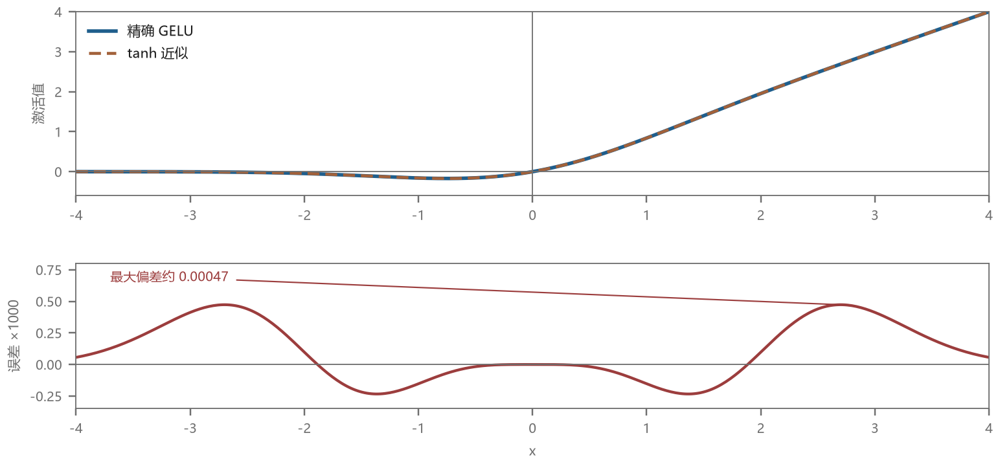
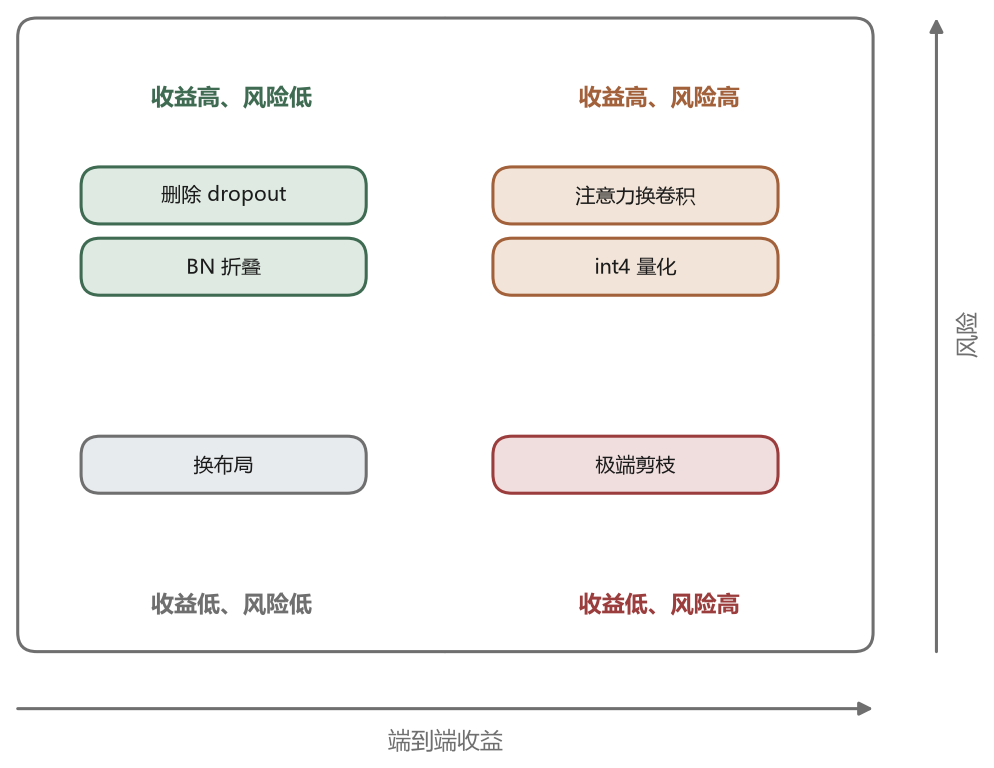

# 换一种算法：注意力、GELU 与那些被删掉的层

有些优化不改图的结构，也不改数值格式，而是把算子本身换掉。用卷积代替一小段注意力，用多项式近似代替精确的 GELU，用一个更简单的归一化代替 LayerNorm。换完之后计算量可能降了一半，精度掉一点点，或者一点都不掉。

这类优化最容易被误解。有人说“注意力可以全部换成卷积”，也有人说“近似激活会毁掉模型”。两种说法都太绝对。能不能换，取决于被换掉的那部分在做什么，以及换上去的算子能不能表达同样的关系。

## 注意力什么时候能换成卷积

标准的多头注意力做的是这件事：每个位置根据与其他位置的相关性，加权求和。权重由 softmax 归一化，谁和谁相关，由输入决定。**softmax** 是一个把一组分数变成“加起来等于 1 的权重”的函数，分数高的位置权重大。这个“由输入决定”是关键，卷积的权重是固定的，不能随输入变化。所以严格意义上，标准注意力不能无损地换成卷积。有些资料把下面这类替换叫作“多头注意力的拆分与置换”，拆开的是投影和局部聚合，置换掉的是 softmax 那一步。

能换的是几种特殊情况。

第一种是**局部且固定的注意力模式**。有些视觉模型在浅层只关注相邻的几个 patch，注意力分布接近一个固定的局部核。**patch** 是把图片切成的小方块，视觉 Transformer 的基本输入单位。把这一层换成一个同样大小的深度卷积，输出会很接近。损失通常很小，速度提升明显，因为卷积有成熟的 kernel，而小注意力在 GPU 上效率不高——一个只覆盖 3×3 邻域的注意力，先算分数、再 softmax、再加权，绕了一大圈，做的却是卷积本来就能做的事。

第二种是**线性注意力**。它把 softmax 去掉，用核函数把注意力写成两个矩阵乘的组合。这种形式在数学上可以整理成对位置的卷积或累积和，序列固定时能换成卷积。代价是表达能力下降，长程依赖变弱。所谓**长程依赖**，指的是序列开头的信息对结尾的影响，这类关系在 softmax 注意力里可以被精确保留，在线性形式里会被压缩。

第三种是**把注意力的投影层看成 1×1 卷积**。Q、K、V 的线性投影本来就是逐位置的矩阵乘，和 1×1 卷积等价。这部分换成卷积不损失精度，只是换一个实现。真正有损失的是注意力权重那一部分。

所以“多头注意力拆分成卷积”这句话，通常指的是把投影层和局部聚合拆开，投影层用 1×1 卷积，局部聚合用深度卷积或分组卷积，softmax 那一步被近似掉。损失大小取决于模型和层，不能一概而论。

一个实际的判断方法是看注意力分布的熵。**熵**衡量分布的分散程度：如果某层的注意力几乎总是集中在少数几个相邻位置，熵很低，换成局部卷积损失就小；如果注意力分布很分散，很多位置都有贡献，换成卷积就会丢掉信息。

## 快速 GELU 与近似激活

**激活函数**是神经网络里给每个神经元输出加的一道非线性变换，没有它，多层网络会退化成一层。GELU 是 Transformer 里最常见的激活函数，名字来自高斯误差线性单元，定义里带一个误差函数：

$$\mathrm{GELU}(x) = \frac{x}{2}\left(1 + \mathrm{erf}\left(\frac{x}{\sqrt{2}}\right)\right)$$

误差函数没有简单的闭式，精确计算要用查表或特殊函数，代价不低。工程上常用双曲正切近似：

$$\mathrm{GELU}(x) \approx \frac{x}{2}\left(1 + \tanh\left(\sqrt{\frac{2}{\pi}}\left(x + 0.044715x^3\right)\right)\right)$$

这个近似在常用区间里误差很小，计算也便宜。很多框架默认就用它。更激进的近似用 sigmoid，误差大一些，但在一些模型上仍然可用。

近似激活的收益取决于它在图里的位置。如果 GELU 是逐元素算子，时间主要花在读写显存上，换一个更便宜的计算，端到端可能没什么变化；如果它被融合进了卷积或矩阵乘的 epilogue，计算开销才会显现。这句话可以反过来当判断标准：先看这个激活是不是已经被融合，没融合的话，优化它的数学表达式基本没用。

损失也不是零。近似函数在尾部偏离精确值，激活值很大或很小时误差更明显。对分类任务，这点误差常常被后续层吸收；对生成任务，误差会一步步累积，长序列上可能放大。换之前要在业务数据上评估，不能只看一个公开基准。评估的方法要具体：同一个 prompt 反复采样，看输出的分布有没有变化，而不是只比一次贪心解码的结果。

另外要注意，近似激活的误差不一定是坏事。网络有一定的鲁棒性，轻微的偏差往往被后续层吸收；而在某些情况下，近似反而起到了正则的作用。所以“近似一定掉点”也是错的，必须实测。很多团队的经验是：先换上去跑一周真实流量，对标业务指标，而不是只在离线基准上争论。

拿 GELU 换成 SiLU 举例。SiLU 是另一种常见的激活，形式是 x 乘 sigmoid(x)，计算更便宜，在很多模型上效果相当。但它不是近似关系，而是另一个函数，换它需要微调，不能像 tanh 近似那样直接替换。很多人把两类改动混为一谈，以为“都是换激活”，实际风险完全不同。

## 结构替换与重参数化

还有一类替换发生在训练和推理之间。训练时用多分支结构帮助收敛，推理时把多个分支合并成一个卷积，这就是**重参数化**（re-parameterization）。RepVGG 是典型例子：训练时有 3×3 卷积分支、1×1 卷积分支和恒等分支，推理时全部合并成一个 3×3 卷积，精度不变，速度变快。

合并的数学很直接。1×1 卷积可以看成中心为 1、其余为 0 的 3×3 卷积；恒等映射可以看成单位卷积核。把三个卷积核按对应位置相加，偏置也相加，就得到一个等效的 3×3 卷积。前提是三个分支的输入输出通道一致，且中间没有非线性。**单位卷积核**是只在中心位置取 1、其余取 0 的核，用它卷积等于原样输出。

这个技巧的价值在于，它把“训练时想要的多分支”和“推理时想要的单路”分开了。多分支的好处是梯度有多条路径可走，训练更稳；单路的好处是只有一次卷积，访存少、kernel 简单。过去只能二选一，重参数化让两边都拿到。

深度可分离卷积是另一种替换。标准卷积同时做空间聚合和通道混合，深度可分离把它拆成两步：逐通道的空间卷积，再逐点的 1×1 卷积。参数量和计算量都大幅下降，精度通常掉一点，在移动端很常见。这里的直觉是：空间上的模式和通道间的组合是两件事，拆开来分别做，参数就不用“两两相乘”那么多。

这些替换的共同点是改变了模型的表达方式，而不只是实现方式。它们通常需要重新训练或微调，不能直接套在一个训练好的模型上。把 RepVGG 的结构硬套到一个已经训练好的 VGG 上，权重对不上，精度会崩，这是初学者常犯的错误。

重参数化有一个隐形的收益：它让推理引擎的工作变简单。多分支结构需要多块显存、多次启动、一次相加；合并之后就是一次卷积，编译器不用再操心分支的事情。所以即便训练时没有用这类结构，遇到那些“结构上可以合并”的模块，也可以手动合并，把它们当作一次图上的简化。

## 被删掉的层

推理图里还有一些层，删掉不影响输出，或者影响很小。

dropout 和随机深度在推理时是恒等变换，删掉是精确的。辅助分类头、对比学习的投影头、只在训练时用的正则项，只要不参与主输出，也可以删。这些属于死代码消除，上一章讲过。

还有一些层删掉会有微小损失。比如某些模型里的 LayerNorm 在推理时可以折进相邻的线性层，前提是没有别的消费者；某些注意力里的 bias 可以去掉，如果训练时它一直很小；某些模型在部署时会去掉最后一层的 softmax，因为服务端只需要 logits，softmax 可以放到后处理里做。这些改动要逐个验证，不能批量处理。

去掉最后一层 softmax 值得单独说一句。它看起来是“少算一步”，实际收益取决于后处理怎么用。如果下游要算温度缩放、要取 top-k、要做采样，softmax 迟早要算，挪到 CPU 上反而更慢；如果下游只要一个类别编号，那确实可以省掉。同一个改动在不同业务里收益相反，这就是为什么不能照抄别人的优化清单。

删层还有一个原则：能从结构上证明它是恒等的，就删；只能靠经验判断“影响很小”的，要单独评估。前者零风险，后者有风险，两类改动不要混在同一次发布里。

还有一个常见的误区：把“删掉最后一层 softmax”和“量化”混着做。前者改了输出语义，后者改了数值精度，两者叠加之后如果指标掉了，你分不清是谁的错。发布前的每一次改动都要能单独回滚，这是工程上最省心的习惯。

最后提醒一句：删层是不可逆的改动方向。删错了要恢复，就得回到原始模型重新导出。所以动手之前把原始模型和一份“未删减”的引擎文件都留着，出问题的时候能快速对比。存储成本很低，换来的排查速度很值。

还需要知道，删层省下的时间往往比想象中少。一层 LayerNorm 在一个 32 层的模型里只占几十分之一，即使完全去掉，端到端也只降一点点。真正值得花心思的是那些每个位置都要跑很多遍的算子，比如注意力和 FFN，而不是那些边边角角的归一化。

## 换算法的边界

换算法之前，先问三个问题。

这个算子在端到端里占多少时间。占 5% 的算子，换成再快的实现，端到端最多快 5%。占 40% 的算子才值得动。这个判断不能靠感觉，要拿 profile 说话。

第二个问题往往比第一个难。一个替换让平均指标持平，但让长度超过 4000 的输入掉了 3 个点，这种损失在平均值里看不出来，在真实流量里却能明显感受到。所以评估集要按长度分桶，每一桶单独看。如果某个桶的样本太少，还要人工造一些补上，否则统计上没有意义。

换完之后精度掉多少，掉在哪些样本上。平均值掉 0.1% 可能无所谓，但某一类样本掉 10% 就不能接受。评估要分层，不能只看总体。分层的意思是按业务上真正关心的维度切：不同的输入长度、不同的语言、不同的设备、不同的用户群。

换完之后的可维护性如何。一个高度定制的卷积替换，可能只对当前模型、当前形状有效，换一个模型就要重写。引擎升级、硬件换代时，这类定制的代价会显现出来。

三个问题里，前两个是技术判断，第三个是工程判断，而工程判断往往决定了一个优化能不能长期活下来。一个只快了 5%、但需要专人维护的定制，可能不如一个只快 3%、但用标准做法的方案。这不是保守，是把维护成本算进去了。

还有一个顺序问题：换算法应该在量化之前做。先把结构改成你要的形状，再做量化校准，刻度才是对的；反过来先量化再改结构，校准参数全部作废，得重来一遍。这个顺序在后面的优化流程里还会提到，它是一条通用的原则：先改结构，再改数值，最后改调度。

换算法还有一个容易忽视的副作用：可解释性。一个用深度卷积替代了局部注意力的模型，在需要看注意力图做分析的业务里就没法用了。医疗、金融这些需要“看得见依据”的场景，优化方案要和业务对得上，不只是看延迟和精度。

下一章把算子放回引擎里，看看编译器怎么把这些选择自动化。
