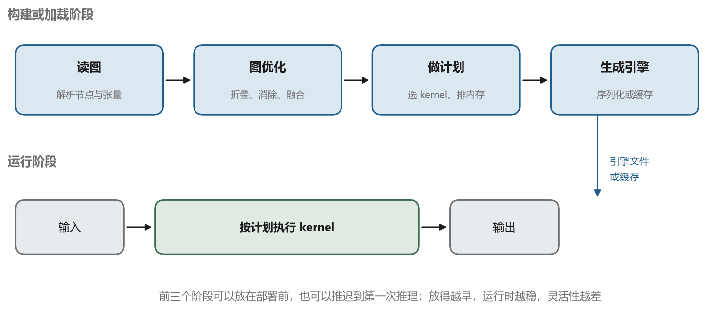

# 编译器与推理引擎

同一个 ONNX 模型，放在三个运行时里跑，延迟可能差出一倍。模型没变，输入没变，硬件也没变。差别来自运行时怎么理解这张图、怎么为每一层挑实现、怎么安排内存和执行顺序。

推理引擎就是干这些事的软件。它把框架导出的图读进来，做一轮优化，给每一层选一个 kernel，把内存排好，最后按顺序执行。有的引擎在部署前就把这些做完，产出一个针对当前硬件定制的文件；有的引擎在加载时做，或者每次遇到新形状时重新做。

这一章不比较具体产品的跑分，而是看引擎的通用结构和取舍。知道了结构，再看任何一个引擎的文档，都能对上位置。

## 引擎做的四件事

第一件是**读图**。引擎要认识模型格式，把节点、张量、属性解析成自己的内部表示。ONNX、TorchScript、TensorFlow SavedModel，各有各的解析器。遇到不认识的算子，引擎要么报错，要么回退到框架执行，要么要求你写一个插件。

第二件是**优化图**。常量折叠、死代码消除、算子融合、布局转换，这些在上一章和上上章讲过。引擎通常有一套固定的 pass，按顺序跑，有的还允许用户加自定义 pass。

第三件是**做计划**。为每一层选一个 kernel 实现，给中间张量分配内存，决定哪些可以复用，哪些要常驻。计划的质量直接决定显存峰值和端到端延迟。

第四件是**执行**。按拓扑顺序启动 kernel，管理流和事件，处理输入输出拷贝。执行本身的开销不大，但调度不好会出现大量空隙。

## 提前构建与运行时编译

引擎的工作可以放在两个时间点做，差别很大。

**提前构建**是在部署前把模型编译成一个引擎文件。TensorRT 的 engine、OpenVINO 的 IR、一些厂商的离线模型包都属于这一类。构建时可以慢慢试，为每一层试多种 kernel，选最快的；可以把内存排到最紧；可以把整个执行序列录下来。运行时的启动只是加载文件，速度快，行为稳定。

代价是绑定。引擎文件通常和硬件架构、驱动版本、引擎版本绑定，换一张卡就要重建。动态形状支持有限，构建时要给定形状范围，超出范围就回退或重建。模型更新也要重新构建，构建时间可能几分钟到几十分钟。

**运行时编译**是在加载模型或第一次推理时做优化。ONNX Runtime 在加载时做图优化和算子分配，torch.compile 在第一次遇到某个形状时捕获并编译，TVM 可以在部署机上编译和调优。灵活性好，模型和形状变了可以重新编译，不依赖离线流程。

代价是启动开销和不确定性。第一次推理可能很慢，形状变化会触发重编译，编译缓存没命中时延迟会突然升高。线上服务通常要在发布前预热，把常见形状都跑一遍，避免第一个用户承担编译时间。

两种方式没有绝对优劣。模型稳定、硬件固定、追求极致延迟的服务，适合提前构建；模型迭代快、形状多变、部署环境复杂的场景，适合运行时编译，或者两者结合，常见形状提前构建，长尾形状走运行时。

## 图优化与 kernel 选择

引擎的图优化和前面讲的是同一套东西，只是更系统。它会反复跑一组 pass，直到图不再变化。融合、折叠、消除、布局转换，每一步都有代价模型，决定要不要做。

kernel 选择更像一个搜索问题。同一层可能有几十种实现，每种在不同形状下的表现不同。引擎可以查表，可以按启发式规则挑，也可以在构建时实测几种，选最快的。TensorRT 把这一步叫 tactic 选择，构建时间长，很大程度上花在这里。

搜索的代价是构建时间，收益是运行时性能。一个模型有几百层，每层试五种实现，构建就要跑上千次。有的引擎允许限制搜索范围，用构建时间换一点性能。

自动调优还有一层风险。构建时测出来的最快实现，在真实负载下不一定最快，因为真实负载的 batch、序列长度、并发可能和构建时不同。构建时的形状配置要尽量贴近线上，否则选出来的 tactic 会偏。

## 量化在引擎里怎么接

量化不是一个独立的步骤，它要落到图和张量上。引擎通常提供两种接口。

**显式量化**是在图里插入量化（Quantize）和反量化（Dequantize）节点，把浮点张量转成整数再转回来。图的结构清楚，哪一层量化、用什么 scale 都看得见，调试方便。代价是 QDQ 节点本身有开销，引擎要把它们融合进相邻算子，否则会多出很多小 kernel。

**隐式量化**是给张量标注 scale 和 zero point，引擎在内部决定什么时候量化、什么时候保持浮点。图更干净，融合更容易，但可调试性差，出了问题不容易定位到具体张量。

校准通常在引擎之外做。用一批代表性数据跑浮点模型，统计每一层激活的范围，算出 scale。引擎拿到 scale 之后，把权重和激活转成整数，或者生成 QDQ 图。校准集选得不好，scale 就会偏，量化误差会集中出现在某些层。

## 选引擎看什么

选引擎时，跑分只是其中一个维度，而且要看业务形状下的跑分。

**算子覆盖**决定模型能不能完整跑起来。一个引擎对 Transformer 支持很好，对自定义卷积或稀疏算子可能支持很差。覆盖不全时，图会被切碎，切碎的地方要回退到框架，性能断崖式下降。

**硬件绑定**决定部署灵活性。离线引擎通常绑定架构和版本，换卡要重建；运行时引擎的适配层多，但性能可能不如深度定制的引擎。

**动态形状**决定能不能应对真实流量。固定形状的服务好办，变长序列、变尺寸图像的服务要重点看引擎的 profile 机制和回退策略。

**量化支持**决定能不能用低精度。有的引擎对 int8 支持成熟，对 fp8 只支持特定层；有的引擎要求 QDQ 格式，有的接受隐式 scale。选之前要确认目标模型的每一层都在支持范围内。

**可调试性**在出问题时才显现。能不能导出优化后的图，能不能逐层对比数值，能不能看到每个 kernel 的耗时，决定了排查问题的速度。

最后一件事是版本锁定。引擎、驱动、CUDA、模型格式的版本组合要固定下来，写进部署清单。升级其中任何一个，都要重新跑一遍精度和性能回归。这不是保守，是避免线上出现无法复现的问题。

下一章讲怎么读一次性能分析，把引擎、kernel 和端到端时间对上。
