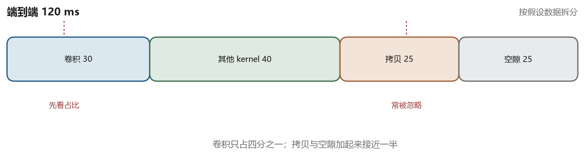

# 看懂一次性能分析

有一个很常见的场景。模型上线后延迟 180 毫秒，团队决定优化卷积。花了两周，把卷积 kernel 从 40 毫秒压到 25 毫秒，端到端只降了 8 毫秒。回头抓了一次完整的 profile，才发现时间线上有大段空白，GPU 在等 CPU 发指令，另外还有一块 memcpy 在搬输入数据，这两项加起来比卷积还大。

性能分析的第一步不是优化，是看清楚时间花在哪里。这一章讲三件事：怎么看时间线，怎么判断一个 kernel 是算力瓶颈还是带宽瓶颈，以及怎么把一次优化做成可复现的实验。

## 先看时间线，不要先看 kernel

Nsight Systems 给出的是一张时间线：横轴是时间，纵轴是 CPU 线程、CUDA 流、GPU 上的 kernel 和拷贝。看这张图，先找三类东西。

第一类是**空隙**。GPU 上没有 kernel 在跑，或者两个 kernel 之间有明显间隔。空隙可能来自 CPU 准备数据、Python 解释器开销、同步点、锁等待。小算子很多的模型，空隙占比可能超过 30%。

第二类是**拷贝**。主机到设备、设备到主机、设备到设备，三种拷贝的代价不同。PCIe 上的拷贝比显存内拷贝慢一个数量级。如果输入图片在主存里，每张都要拷到显存，拷贝时间会直接进入端到端延迟。用固定内存和异步拷贝可以把拷贝和计算重叠，但前提是流水线设计对了。

第三类是**同步**。每次 `cudaDeviceSynchronize` 或 `.cpu()` 都会让 CPU 等 GPU，时间线上表现为一个长条后面跟着空白。推理代码里不必要的同步，会把本来可以重叠的工作串行化。

把 kernel 时间加起来，往往小于端到端时间。差额就是空隙、拷贝、框架开销和排队。优化之前先把这个差额算清楚，否则很容易优化错对象。

## 三个利用率

Nsight Compute 看单个 kernel，最常看的三个指标是 SM 利用率、DRAM 吞吐和 Tensor Core 利用率。

**SM 利用率**高，说明计算单元大部分时间在忙。但它不说明忙得有没有意义。一个 kernel 可能在反复读显存，SM 一直有指令在执行，实际是在等数据。

**DRAM 吞吐**接近硬件的带宽上限，说明这个 kernel 是带宽瓶颈。继续优化计算没有用，要么减少访存，要么换算法，要么融合。

**Tensor Core 利用率**低，说明矩阵乘没有走到矩阵单元上。可能是数据类型不对，可能是形状不满足对齐要求，也可能这一层根本不是矩阵乘。

还有一个指标是**占用率**（occupancy），也就是每个 SM 上同时驻留的 warp 数量。占用率高有助于隐藏延迟，但不是越高越好。寄存器用量大的 kernel，占用率低，但每个线程做的活多，可能反而更快。占用率低到无法隐藏访存延迟时，才是问题。

三个指标要一起看。SM 利用率高、DRAM 吞吐低、Tensor Core 利用率低，说明指令在空转，可能有分支分歧或依赖停顿。SM 利用率低、DRAM 吞吐高，说明在等数据，带宽是瓶颈。SM 和 DRAM 都不高，说明并行度不够，或者 kernel 太小、启动开销占比太大。

## 用 roofline 定位

roofline 把算子的算术强度和硬件上限放在一起。你可以从 kernel 的运算量和访存量算出它的位置，再看它离斜线或平台有多远。

如果 kernel 贴着斜线，说明它已经达到带宽上限，优化空间在减少访存。如果贴着平台，说明达到算力上限，优化空间在减少计算，或者换更快的数值格式。如果离两条线都很远，说明实现效率不够，可能是分块不好、占用率太低、指令组合差。

实际测量时，FLOPs 和字节数不一定好数。卷积的 FLOPs 可以按输出元素数乘卷积核大小乘通道数估算，访存量要算输入、输出和权重的读写，还要考虑缓存命中。估算不精确没关系，量级对就有判断价值。

roofline 给的是上限，不是目标。一个 kernel 达到上限的 60% 到 70%，已经很不错；达到 90% 的，通常是高度定制的实现。看到 20% 就断定实现有问题，也可能是因为形状太小、并行度不够，硬件本来跑不满。

## 一个假设的诊断过程

假设一个图像模型端到端 120 毫秒，profile 显示 kernel 总共 70 毫秒，拷贝 25 毫秒，空隙 25 毫秒。这些数字是为了说明顺序编的，不是实测。

第一步，看空隙。25 毫秒的空隙里，CPU 在做什么？如果是 Python 预处理，把它移到 GPU 上或者用多线程；如果是算子启动太频繁，考虑融合或 CUDA Graph；如果是同步，去掉不必要的同步。

第二步，看拷贝。25 毫秒的拷贝是不是每张图都要发生？能不能用固定内存异步拷贝，和上一张图的计算重叠？输入能不能直接解码到显存？如果拷贝能藏进计算，端到端能省下一大块。

第三步，看 kernel。70 毫秒里，最大的卷积占 30 毫秒，DRAM 吞吐已经接近上限，说明它是带宽瓶颈。这时候优化计算没用，应该改布局、减少中间张量、把相邻算子融合。另一个 kernel 占 10 毫秒，Tensor Core 利用率很低，可能是形状不对齐，调整 padding 或换一个实现就能改善。

第四步，算收益上限。如果卷积占 30 毫秒，把它优化到 15 毫秒，端到端最多从 120 降到 105，因为 Amdahl 定律限制了总收益。如果拷贝和空隙能省 30 毫秒，收益比优化卷积大得多。

## 复测

优化做完，必须复测，而且要用同样的方法测。

先预热。第一次推理包含加载权重、编译 kernel、分配内存，不能算进延迟。至少跑几十次，让缓存和频率稳定。

看分布，不只看平均。P50 说明典型体验，P99 说明尾部。优化可能降低了平均延迟，却让 P99 变差，比如批处理让大多数请求变快，少数请求排队更久。

一次只改一个变量。同时改布局、融合和 batch，延迟变了也不知道是谁的功劳。改完记录配置、输入形状、硬件状态，下一次才能复现。

锁定频率和电源模式。GPU 在温度和功耗限制下会降频，同一份代码在不同时间跑出不同结果。数据中心的卡通常比较稳定，桌面卡波动更大，测试时要注意。

最后，把 profile 留下来。优化前后的时间线放在一起，比任何口头描述都有说服力。下一章进入数值，看看把 fp32 换成 fp16、int8，到底改变了什么。
