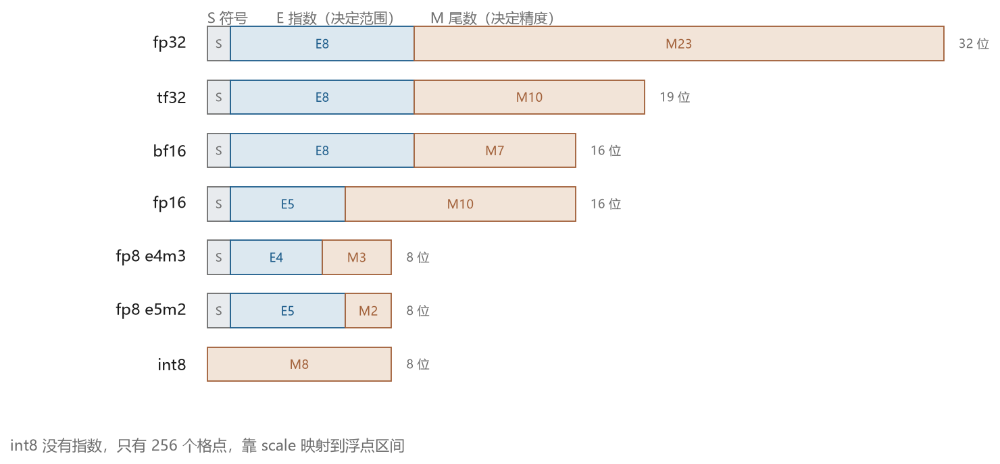

# 数字的几种写法

同一个数，可以用不同的方式存储。`0.1` 在 fp32 里是 `0.100000001490116`，在 fp16 里是 `0.0999755859375`，在 int8 量化之后可能变成 `0.098` 左右。误差看起来不大，但模型有几十层、上百次累加，误差会一层层放大。

部署里的精度选择，本质上是在三个东西之间做交换：数值范围、数值精度、存储和计算的成本。位宽越少，存储越省、算得越快，能表示的范围和精度也越窄。选哪种格式，取决于模型对误差的容忍度，以及硬件对格式的支持。

这一章把常见格式拆开，看看每种格式能表示什么、不能表示什么。

## 浮点数的三段

一个浮点数由三段组成：符号位、指数位、尾数位。

$$x = (-1)^s \times 1.m \times 2^{e - \mathrm{bias}}$$

`s` 是符号，`m` 是尾数的小数部分，`e` 是指数，bias 是偏移量。指数决定能表示多大的范围，尾数决定在这个范围里能分多细。这套写法就是科学计数法，只不过底数从 10 换成了 2：`1.011 × 2^5` 和 `1.011 × 10^5` 的结构完全一样。

**符号位**决定正负，1 位就够。**指数位**决定这个数能有多大、能有多小，位数越多，范围越宽。**尾数位**决定有效数字有几位，位数越多，同一个量级里能区分的数越细。三个部分各有各的职责，增删任何一位都要在范围和精度之间做取舍。

fp32 有 1 位符号、8 位指数、23 位尾数，指数偏移 127。它能表示大约 `10^-38` 到 `10^38` 的范围，有效十进制位约 7 位。训练时默认用它，因为梯度很小、激活很大，范围要够宽。7 位有效数字意味着，一个 100 万量级的数，能精确到个位左右。

fp16 有 1 位符号、5 位指数、10 位尾数。指数只有 5 位，范围缩到大约 `6 × 10^-5` 到 65504。尾数 10 位，有效十进制位约 3 位。它的范围窄，训练时容易溢出，推理时通常够用，因为推理的激活值不会像梯度那样跨很多个数量级。**溢出**（overflow）指的是数大到超出格式能表示的上限，结果变成无穷大；反方向的**下溢**（underflow）是数小到变成零。

bf16 有 1 位符号、8 位指数、7 位尾数。指数和 fp32 一样宽，范围不缩，尾数只剩 7 位，精度大约 2 位十进制。它牺牲精度换范围，训练时很受欢迎，因为不需要担心溢出；推理时也能用，但对数值敏感的任务要验证。bf16 和 fp16 的区别可以记成一句话：fp16 更准但更窄，bf16 更宽但更粗。

这里有一个容易被忽略的点：浮点的精度是相对的，不是绝对的。fp16 表示 1.0 附近的数，间隔约千分之一；表示 1000 附近的数，间隔就变成 1 左右。所以同一个格式，在不同量级上的绝对误差完全不同。评估量化误差时，如果只看绝对误差，会被大量级的值主导；看相对误差，才看得出小值有没有被压坏。

## fp8 的两种分工

fp8 只有 8 位，怎么分指数和尾数，有两种常见方案。

e4m3 是 4 位指数、3 位尾数，范围大约到 448，精度比 fp16 差不少，但比 int8 的定点表示灵活，因为它能表示很小的数。e5m2 是 5 位指数、2 位尾数，范围到 57344，精度更差，适合梯度这类范围大、精度要求低的场景。**e4m3** 的名字就是“4 位指数、3 位尾数”，读法很直白。

为什么要有这两种？因为范围和精度不可兼得。梯度这类数据可能跨好几个数量级，但每个值的精度要求不高，e5m2 合适；权重和激活的取值范围相对集中，但需要保留一些细节，e4m3 合适。选错方向的后果很明显：用 e4m3 存梯度，大梯度会溢出；用 e5m2 存权重，精度不够，误差累积。

fp8 的麻烦在于范围仍然不够宽。激活值里偶尔出现一个很大的 outlier，就会把整个张量的 scale 撑大，其余值被压到很小的格点上。**outlier** 是“离群值”，指那些比其他值大得多的少数元素。所以 fp8 通常要配合 per-tensor 或 per-channel 的缩放，甚至延迟缩放，才能稳定。缩放的做法在第十三章会细讲。

硬件支持也不统一。较新的数据中心 GPU 原生支持 fp8 的矩阵乘，消费级卡可能只支持 fp16 和 int8。选了 fp8，先确认目标硬件有没有对应的 Tensor Core 通路，否则转换来转换去，反而更慢。一个实际的经验是：fp8 的收益几乎全部来自“矩阵乘走 fp8 通路”，如果只是把权重存成 fp8、算的时候转回 fp16，那只是省了显存，算力一点没变。

还有一个容易忽视的细节：fp8 的精度虽然比 int8 灵活，但它的尾数只有 3 位，意味着一个数只有 8 个刻度可用。对于接近零的小值，fp8 能表示得更细；对于中等范围的值，int8 的均匀刻度反而更准。所以“fp8 比 int8 好”这个说法不成立，取决于数据分布。

还有一个使用层面的现实：很多引擎把 fp8 当成“可选项”而不是默认路径。开了 fp8，不一定所有层都走 fp8，引擎会按敏感度自己决定；要看真实生效了多少层，得把优化后的图导出来看。这一点和 int8 一样，配置里开着不等于图里真用了。

硬件层面还有一个区分：有的卡把 fp8 的两种格式都支持，有的只支持 e4m3。部署前查一下目标卡的支持矩阵，不是所有“支持 fp8”的卡都能跑 e5m2。这类细节在选型时很少被提到，却是实际踩坑最多的地方。

## 整数与定点

int8 不是浮点，它是一个 8 位整数，范围 -128 到 127，一共 256 个格点。它没有指数，不能表示很小的数，也不能表示很大的数。要让它表示浮点数，必须约定一个缩放关系。这种“整数加固定缩放”的表示叫**定点**（fixed point），因为小数点的位置是固定的。

最常见的是仿射映射：

$$q = \mathrm{round}\left(\frac{x}{s}\right) + z$$

`s` 是 scale，`z` 是 zero point。反过来的近似是 `x ≈ s(q - z)`。`s` 决定一个格点代表多大的数，`z` 决定浮点零对应哪个整数。对称量化让 `z = 0`，正负数对称；非对称量化让 `z` 偏移，能更好地利用 256 个格点。

可以用一把尺子来理解。浮点像一把刻度疏密可变的尺子，量小东西时刻度很密，量大时刻度很疏；定点像一把刻度均匀的尺子，量什么都是同一套刻度，所以量程越大，每一格就越粗。这个比喻能解释很多现象，比如为什么 outlier 会毁掉整把尺子的精度：因为它逼着你把量程放大。

拿一个具体数字看。假定一个张量的范围是 -3 到 3，量化到对称的 int8，scale 就是 3/127，约等于 0.0236。一个真值 0.5 会被量化成 round(0.5/0.0236) = 21，反量化回 0.496，误差 0.004。如果这个张量里突然多了一个 30，scale 变成 30/127，约 0.236，同样的 0.5 只能落在 2 号格点，反量化回 0.472，误差 0.028，大了七倍。这就是 outlier 的破坏力。

对称与非对称的选择也有具体影响。ReLU 之后的激活全是非负数，用对称量化会浪费一半格点，非对称量化能多用一倍刻度。权重通常正负对称，对称量化更划算，而且矩阵乘里不用处理零点偏移，硬件实现也简单。这就是为什么很多方案“权重对称、激活非对称”，它不是随意搭配，而是跟着数据分布走的。

还有一个与精度相关的现象值得知道：零点附近的值最容易错。量化时，绝对值很小的权重可能全部被当成零，很多模型对这种“零化”有容忍度（它们本来就不重要），但某些归一化层的系数不一样，被零化会直接改变输出。所以校准之后要查一下哪些层被零化的比例特别高，这些层往往就是该保留高精度的地方。

int8 的优点是硬件支持好、算力高、存储省。一个 fp32 权重占 4 字节，int8 只占 1 字节，显存和带宽都降到四分之一。矩阵乘用 int8 输入、int32 累加，Tensor Core 的吞吐通常是 fp16 的两倍。

代价是表示范围固定。一个张量里如果有 outlier，scale 会被撑大，其余值只剩很少几个格点，量化误差急剧上升。这也是后面要讲 per-channel、per-group 和 outlier 处理的原因。

## 格式选择的实际考虑

选格式时，先看硬件支持，再看数值范围，最后看精度。

硬件不支持的低位格式，只能靠软件模拟，转换开销可能超过收益。数值范围不够，模型会在某些输入上溢出或者大面积截断。精度不够，指标会掉，掉多少要在业务数据上测。

混合精度是常见的折中。敏感层用 fp16 或 fp32，其余层用 int8；权重用 int4，激活保持 fp16；注意力的 softmax 用 fp16，矩阵乘用 fp8。每一层的格式可以不同，关键是有一条路径能把它们连起来，转换次数不要太多。

还有一个容易忽略的点是累加精度。int8 乘 int8 的结果要用 int32 累加，fp16 乘 fp16 的结果通常用 fp32 累加。**累加器**是矩阵乘里把一堆乘积加起来的那个寄存器或缓冲。累加器精度不够，长序列或大矩阵会溢出。格式选对了，累加器选错了，结果一样不对。

一个具体的例子能说明累加器有多重要。假设用 fp16 累加，每次乘加的结果都在 1 附近，累加一万次，理论上限是 65504，看起来还够。但如果中间有几次结果是 10 或者 100，累加和很快就能冲到上限，超出部分直接变成无穷。换 fp32 累加，同样的计算就毫无问题。这也是为什么很多“权重 fp16、累加 fp32”的组合是默认选项。

还有一类格式不在表里但经常碰到：tf32。它把 fp32 的尾数截成 10 位，指数保持 8 位，是 NVIDIA 在 Tensor Core 上给训练用的折中。很多人在配置里看到 tf32 选项，以为它只影响训练，实际推理也可能默认开启，数值和 fp32 不一样。对精度敏感的任务，要明确关掉它。

| 格式 | 符号/指数/尾数 | 大致范围 | 有效精度 | 常见用途 |
|---|---|---|---|---|
| fp32 | 1/8/23 | 约 `10^-38` 到 `10^38` | 约 7 位十进制 | 训练、敏感层 |
| tf32 | 1/8/10 | 与 fp32 同 | 约 3 位十进制 | Tensor Core 训练 |
| fp16 | 1/5/10 | 约 `6×10^-5` 到 65504 | 约 3 位十进制 | 推理、混合精度 |
| bf16 | 1/8/7 | 与 fp32 同 | 约 2 位十进制 | 训练、推理 |
| fp8 e4m3 | 1/4/3 | 约 0.002 到 448 | 低 | 推理、矩阵乘 |
| fp8 e5m2 | 1/5/2 | 约 `6×10^-5` 到 57344 | 很低 | 梯度、范围优先 |
| int8 | 定点 | -128 到 127 | 256 个格点 | 推理、量化 |

表 11-1　常见数值格式的对照。范围与精度是近似值，具体实现可能略有差异。

格式只是工具，真正决定精度的是怎么用。同样的 int8，per-tensor 和 per-channel 的误差可能差好几倍；同样的 fp8，加不加缩放，能不能用完全是两个结论。下一章讲量化的具体做法，从 scale 怎么定，到校准怎么做。
