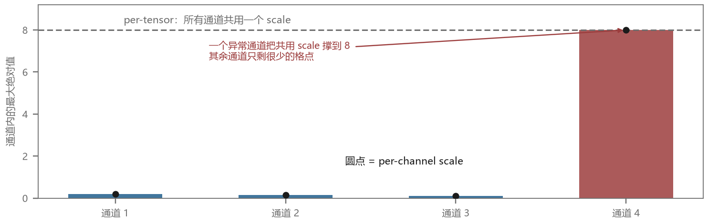

# 量化的基本做法

一个训练好的卷积层，权重是 fp32，范围大概在 -0.8 到 0.7 之间。绝大多数值落在 -0.1 到 0.1 里，少数接近边界。如果把每个权重乘 1000 再取整，能塞进 int16，但没必要；如果只保留 256 个格点，也就是 int8，精度够不够？

答案取决于怎么放置这 256 个格点。放得好，误差在千分之一量级，模型指标几乎不变；放得不好，大部分权重被挤到同一个格点上，模型等于被随机初始化。量化的核心工作，就是找到这个映射，并让误差落在可接受的地方。

int8 量化是这条路上最成熟的一档。硬件支持广，工具链完整，校准和部署的流程都有现成的实现，多数模型能直接跑通。它也是理解更低位宽量化的基础，后面讲的 int4、fp8，很多问题在 int8 上就已经出现，只是没那么尖锐。

## 仿射映射与两个参数

最常用的量化方式是仿射映射。给定一个浮点区间 `[x_min, x_max]`，把它线性映射到整数区间 `[q_min, q_max]`。

$$s = \frac{x_{\max} - x_{\min}}{q_{\max} - q_{\min}}$$

$$z = \mathrm{round}\left(q_{\min} - \frac{x_{\min}}{s}\right)$$

`s` 是 scale，表示一个整数格点代表多大的浮点值；`z` 是 zero point，表示浮点零对应哪个整数。量化时：

$$q = \mathrm{clamp}\left(\mathrm{round}\left(\frac{x}{s}\right) + z,\ q_{\min},\ q_{\max}\right)$$

反量化时：

$$\hat{x} = s(q - z)$$

如果让 `z = 0`，就是对称量化。对称量化的整数区间通常取 `[-127, 127]`，正负对称，零精确表示。它实现简单，矩阵乘里不需要额外的零点修正，很多硬件更偏好这种形式。代价是负数侧的范围被浪费了一点，如果数据分布明显不对称，误差会大一些。

非对称量化用满 `[-128, 127]`，零点的位置可以偏移。它对非负激活（比如 ReLU 之后）更友好，能把整个区间用上。代价是反量化时要减 zero point，累加时要做修正，硬件实现复杂一点。

## 粒度：从一个张量到一个通道

scale 可以按不同的粒度定。

**per-tensor** 是整个张量共用一个 scale。实现最简单，硬件最友好，但如果张量里不同通道的数值范围差异很大，小范围的通道会被大范围的通道拖累，精度损失严重。

**per-channel** 是每个输出通道一个 scale。卷积权重的形状是 `[out, in, kh, kw]`，按 `out` 切分，每个输出通道单独定 scale。这样每个通道的动态范围都能被充分利用，精度明显好于 per-tensor。大多数推理引擎对权重的默认量化粒度就是 per-channel。

**per-group** 是把通道再分组，每组一个 scale。常见于大模型的权重量化，比如每 128 个权重一组。组越小，精度越高，但 scale 的存储开销和反量化开销也越大。int4 量化几乎一定要用分组，否则精度掉得厉害。

激活的量化通常用 per-tensor，因为激活的形状随 batch 和序列长度变化，per-channel 的统计不稳定，硬件也不一定支持。有些方案会对激活做 per-token 量化，每个 token 一个 scale，适合大模型的动态范围。

## 校准

权重的范围可以直接从权重文件里统计，激活的范围不行，它取决于输入。要知道激活在真实数据上有多大，得跑一批数据，统计每一层的输出，这个过程叫校准。

校准集不需要很大，几百到几千个样本通常够用，但分布要贴近线上。用训练集的随机子集校准，和用真实流量校准，得到的 scale 可能差很多。校准集里如果全是白天的高清图，晚上低光照的图就可能溢出。

确定范围的方法有几种。

**min-max** 直接用校准集里的最小值和最大值。简单，但对 outlier 敏感。一个极端样本就能把范围撑大，其余值被压扁。

**百分位** 取 99.9% 或 99.99% 分位，截掉尾部。范围小一点，大多数值的精度更高，代价是尾部值会被截断。截断多少要看任务，分类任务通常能容忍，回归任务要小心。

**KL 散度** 把浮点分布和量化后的分布做比较，选一个让 KL 散度最小的截断点。TensorRT 的熵校准用的是这个思路。它比 min-max 稳，计算也更复杂。

**MSE 最小化** 直接找让量化误差平方和最小的 scale。实现简单，效果通常不错，适合作为默认方案。

校准之后得到的 scale 是固定的，推理时不再变。如果线上数据分布漂移，scale 会失配，量化误差变大。这时候要重新校准，或者改用动态量化，在运行时按当前输入算 scale。动态量化更灵活，但每次推理多一次统计，延迟会高一点。

## PTQ 和 QAT 的分工

**PTQ**（post-training quantization）是在训练好的浮点模型上直接做量化。流程是：插入观察器，跑校准集统计范围，把浮点算子换成量化算子，验证精度。不需要重新训练，工程成本低，大多数模型能直接跑通。

PTQ 的极限在于，量化误差没有被训练过程补偿。模型越敏感、位宽越低，PTQ 掉点越明显。int8 通常还好，int4 往往需要更精细的方法。

**QAT**（quantization-aware training）是在训练时模拟量化。前向用伪量化，把权重和激活量化再反量化，让模型在训练中就感受到误差；反向传播时，量化函数不可导，用直通估计（STE）把梯度直接传过去。训练完之后，模型对量化误差更鲁棒，低位宽下精度更好。

QAT 的代价是要训练，要有标注数据，要调超参数。它适合量化收益很大、PTQ 又达不到指标的场景。实际项目里常见的路线是先用 PTQ 试，掉点可接受就上线，不可接受再考虑 QAT 或混合精度。

## 一个手算的例子

假设某层权重范围是 `[-0.8, 0.7]`，量化到 int8。

非对称量化：

$$s = \frac{0.7 - (-0.8)}{255} = 0.005882$$

$$z = \mathrm{round}\left(-128 + \frac{0.8}{0.005882}\right) = \mathrm{round}(-128 + 136) = 8$$

一个权重 `x = 0.1`，量化后 `q = round(0.1 / 0.005882) + 8 = 17 + 8 = 25`。反量化 `x_q = 0.005882 × (25 - 8) = 0.1000`，误差几乎为零。

对称量化：

$$s = \frac{0.8}{127} = 0.006299$$

同一个权重，`q = round(0.1 / 0.006299) = 16`，反量化 `x_q = 0.006299 × 16 = 0.1008`，误差约 0.0008。

这个例子里两种方式差别不大。真正的差别出现在 outlier 上。换一个范围更大的层，假设某个通道的权重到了 10.0，per-tensor 的 scale 会被撑到 0.0787，0.1 的权重只能落在 1 号格点上，反量化回来是 0.0787，误差 20%。per-channel 只让那一个通道变粗，其他通道不受影响。

量化的细节到这里。下一章把位宽继续往下压，看 int4、fp8 和大模型量化的几条路线。
