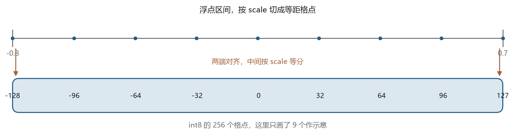

# 量化的基本做法

一个训练好的卷积层，权重是 fp32，范围大概在 -0.8 到 0.7 之间。绝大多数值落在 -0.1 到 0.1 里，少数接近边界。如果把每个权重乘 1000 再取整，能塞进 int16，但没必要；如果只保留 256 个格点，也就是 int8，精度够不够？

答案取决于怎么放置这 256 个格点。放得好，误差在千分之一量级，模型指标几乎不变；放得不好，大部分权重被挤到同一个格点上，模型等于被随机初始化。量化的核心工作，就是找到这个映射，并让误差落在可接受的地方。

**量化**（quantization）这个词的意思是：把一个连续的取值范围切成一格一格，用格子编号代替原来的数。最直观的类比是图片的颜色深度：真彩色每个通道 256 级，看着很细腻；降到 16 级，颜色还是一眼能认出来，只是渐变处出现色带。量化做的事情和这个几乎一样，只不过被切的不是颜色，是权重和激活。

int8 量化是这条路上最成熟的一档。硬件支持广，工具链完整，校准和部署的流程都有现成的实现，多数模型能直接跑通。它也是理解更低位宽量化的基础，后面讲的 int4、fp8，很多问题在 int8 上就已经出现，只是没那么尖锐。

## 仿射映射与两个参数

最常用的量化方式是仿射映射。**仿射映射**就是“先缩放、再平移”，把一条数轴上的点等距地搬到另一条数轴上。给定一个浮点区间 `[x_min, x_max]`，把它线性映射到整数区间 `[q_min, q_max]`。

$$s = \frac{x_{\max} - x_{\min}}{q_{\max} - q_{\min}}$$

$$z = \mathrm{round}\left(q_{\min} - \frac{x_{\min}}{s}\right)$$

`s` 是 scale，表示一个整数格点代表多大的浮点值；`z` 是 zero point，表示浮点零对应哪个整数。量化时：

$$q = \mathrm{clamp}\left(\mathrm{round}\left(\frac{x}{s}\right) + z,\ q_{\min},\ q_{\max}\right)$$

反量化时：

$$\hat{x} = s(q - z)$$

`clamp` 是“截断到区间内”的意思。这一步是必要的，因为真实的激活值可能超出校准时看到的范围。`round` 是四舍五入。两个小函数，决定了量化误差的基本性质：舍入误差最大是半个格点，超出范围的值则会被整块截断。

如果让 `z = 0`，就是对称量化。对称量化的整数区间通常取 `[-127, 127]`，正负对称，零精确表示。它实现简单，矩阵乘里不需要额外的零点修正，很多硬件更偏好这种形式。代价是负数侧的范围被浪费了一点，如果数据分布明显不对称，误差会大一些。

非对称量化用满 `[-128, 127]`，零点的位置可以偏移。它对非负激活（比如 ReLU 之后）更友好，能把整个区间用上。代价是反量化时要减 zero point，累加时要做修正，硬件实现复杂一点。所谓“累加时要做修正”，指的是两个非对称量化矩阵相乘时，结果里会混进零点带来的额外项，必须在累加后减掉。

为什么只有两个参数就能描述整套映射？因为仿射映射是线性的，只要知道“一格代表多大”和“零在哪里”，其他点全都能推出来。这也是量化能用得这么广的原因：它不需要存储整张查找表，只需要两个数。

两个参数里，scale 决定误差大小，zero point 决定范围对齐。如果数据分布正好对称，把 zero point 留着不用，精度损失很小；如果数据分布偏到一边（比如全靠正数的激活），zero point 就能找回一半刻度。很多工具默认把两者都算出来，然后在能不用的地方优化掉，这就是“对称/非对称自动选择”背后的逻辑。

## 粒度：从一个张量到一个通道

scale 可以按不同的粒度定。粒度越粗，参数越少，实现越简单，但越容易让范围小的部分被范围大的部分拖累。

**per-tensor** 是整个张量共用一个 scale。实现最简单，硬件最友好，但如果张量里不同通道的数值范围差异很大，小范围的通道会被大范围的通道拖累，精度损失严重。

**per-channel** 是每个输出通道一个 scale。卷积权重的形状是 `[out, in, kh, kw]`，按 `out` 切分，每个输出通道单独定 scale。这样每个通道的动态范围都能被充分利用，精度明显好于 per-tensor。大多数推理引擎对权重的默认量化粒度就是 per-channel。

**per-group** 是把通道再分组，每组一个 scale。常见于大模型的权重量化，比如每 128 个权重一组。组越小，精度越高，但 scale 的存储开销和反量化开销也越大。int4 量化几乎一定要用分组，否则精度掉得厉害。

激活的量化通常用 per-tensor，因为激活的形状随 batch 和序列长度变化，per-channel 的统计不稳定，硬件也不一定支持。有些方案会对激活做 per-token 量化，每个 token 一个 scale，适合大模型的动态范围。**per-token** 就是“每个位置一个 scale”，对长序列特别有用，因为不同位置的激活幅度可能差很多。

粒度和存储开销之间有一个具体的换算。一个 7B 模型，权重共 70 亿个数，每 128 个一组就需要 5500 万个 scale。每个 scale 用 fp16 存，多占 110 MB，相对 14 GB 的权重只是零头。但如果每组只有 16 个，scale 就变成 4.4 亿个，多占 880 MB，这时候就得掂量了。所以“组越小越好”只在精度上有道理，在存储和速度上是有代价的。

还有一个实际的选择依据：硬件支不支持。很多推理卡对 per-channel 权重量化有专门的指令，可以边算边取 scale；如果换成 per-group，硬件只能退回通用路径，反而变慢。所以在 int8 上，per-channel 通常是甜点；在 int4 上，分组是不得已的选择。

还有一个容易答错的点：粒度是按哪个维度切。卷积权重按输出通道切，因为每个输出通道是一条完整的特征，范围相近；如果按输入通道切，每个输出通道的权重会散在多组里，反而不够均匀。

## 校准

权重的范围可以直接从权重文件里统计，激活的范围不行，它取决于输入。要知道激活在真实数据上有多大，得跑一批数据，统计每一层的输出，这个过程叫**校准**（calibration）。校准的本质是“用一小批真实数据，替所有未来的输入估一个范围”。

校准集不需要很大，几百到几千个样本通常够用，但分布要贴近线上。用训练集的随机子集校准，和用真实流量校准，得到的 scale 可能差很多。校准集里如果全是白天的高清图，晚上低光照的图就可能溢出。溢出的后果不是报错，而是那些超范围的值被截断成最大值，输出悄悄变形。

确定范围的方法有几种。

**min-max** 直接用校准集里的最小值和最大值。简单，但对 outlier 敏感。一个极端样本就能把范围撑大，其余值被压扁。

**百分位** 取 99.9% 或 99.99% 分位，截掉尾部。范围小一点，大多数值的精度更高，代价是尾部值会被截断。截断多少要看任务，分类任务通常能容忍，回归任务要小心。

**KL 散度** 把浮点分布和量化后的分布做比较，选一个让 KL 散度最小的截断点。TensorRT 的熵校准用的是这个思路。它比 min-max 稳，计算也更复杂。**KL 散度**衡量两个分布的差异，值越小说明量化后的分布越像原来的。

**MSE 最小化** 直接找让量化误差平方和最小的 scale。实现简单，效果通常不错，适合作为默认方案。**MSE** 是均方误差，把每个点的误差平方后平均。

校准之后得到的 scale 是固定的，推理时不再变。如果线上数据分布漂移，scale 会失配，量化误差变大。这时候要重新校准，或者改用动态量化，在运行时按当前输入算 scale。动态量化更灵活，但每次推理多一次统计，延迟会高一点。

还有一种做法叫**敏感度分析**，值得在正式量化前做一遍。做法是每次只量化一层，其余保持浮点，看指标掉多少，把每层的“敏感度”排个序。掉得多的层保留高精度，掉得少的层可以放心量化。这个流程不复杂，但能省下大量试错时间，尤其是混合精度量化的时候。

## PTQ 和 QAT 的分工

**PTQ**（post-training quantization）是在训练好的浮点模型上直接做量化。流程是：插入观察器，跑校准集统计范围，把浮点算子换成量化算子，验证精度。不需要重新训练，工程成本低，大多数模型能直接跑通。

PTQ 的极限在于，量化误差没有被训练过程补偿。模型越敏感、位宽越低，PTQ 掉点越明显。int8 通常还好，int4 往往需要更精细的方法。这个“没被补偿”可以这样理解：模型在训练时不知道自己以后会被量化，所以它把信息分布在很多小数位上；量化把这些小数位砍掉，信息就丢了。QAT 让模型在训练时就知道这件事，它会主动把信息挪到更结实的位置上。

**QAT**（quantization-aware training）是在训练时模拟量化。前向用伪量化，把权重和激活量化再反量化，让模型在训练中就感受到误差；反向传播时，量化函数不可导，用直通估计（STE）把梯度直接传过去。**伪量化**指的是“算的时候用浮点，但把数值先压到量化格点上再放回来”，效果上等于给模型加了一层噪声。**直通估计**是一种近似：量化函数本身没有梯度，就假装它的梯度是 1，让梯度能穿过去。

QAT 的代价是要训练，要有标注数据，要调超参数。它适合量化收益很大、PTQ 又达不到指标的场景。实际项目里常见的路线是先用 PTQ 试，掉点可接受就上线，不可接受再考虑 QAT 或混合精度。混合精度往往是最划算的折中：只把最敏感的那几层留高精度，其余照常量化，精度能回来大半，成本几乎为零。

还有一条经验值得提前说：量化掉点往往不是均匀的。它可能集中出现在长序列、小语种、低频类别上，平均值看不出来。所以验收时不能只看一个总结标，要把评估集拆成几个有业务意义的子集，分别对比。这也是很多团队“离线达标、上线被投诉”的原因。

另外，PTQ 和 QAT 不是二选一的关系。实际项目里常见的是先用 PTQ 找到敏感层，再用 QAT 只针对这些层做微调，其余层保持 PTQ 的结果。这样训练成本低，效果又能拉回来。

## 一个手算的例子

假设某层权重范围是 `[-0.8, 0.7]`，量化到 int8。

非对称量化：

$$s = \frac{0.7 - (-0.8)}{255} = 0.005882$$

$$z = \mathrm{round}\left(-128 + \frac{0.8}{0.005882}\right) = \mathrm{round}(-128 + 136) = 8$$

一个权重 `x = 0.1`，量化后 `q = round(0.1 / 0.005882) + 8 = 17 + 8 = 25`。反量化 `x_q = 0.005882 × (25 - 8) = 0.1000`，误差几乎为零。

对称量化：

$$s = \frac{0.8}{127} = 0.006299$$

同一个权重，`q = round(0.1 / 0.006299) = 16`，反量化 `x_q = 0.006299 × 16 = 0.1008`，误差约 0.0008。

这个例子里两种方式差别不大。真正的差别出现在 outlier 上。换一个范围更大的层，假设某个通道的权重到了 10.0，per-tensor 的 scale 会被撑到 0.0787，0.1 的权重只能落在 1 号格点上，反量化回来是 0.0787，误差 20%。per-channel 只让那一个通道变粗，其他通道不受影响。

把这两个数字放在一起，就能看出为什么工程上更关心“最坏的那一层”而不是“平均误差”。20% 的误差出现在一个通道上，可能只是让某个特征变模糊；如果出现在一整层上，输出就废了。所以量化的验收标准通常不是平均误差，而是“有没有哪一层单独崩掉”。

这个例子只需要两步：算 scale、算 zero point。但把它推到全模型时，真正的难点不在公式，而在“到底该把哪些值算进量程”。如果把一个偶尔出现的极大值算进去，大部分数据的精度就被牺牲了；如果故意把它排除，那些极大值就会被截断。这个取舍没有标准答案，只能靠校准方法、敏感度分析和业务指标一起定。

手算的价值在于心里有数，也给后面的低比特量化留了一个参照：同样的格点，只是格子变粗了，误差放大的方式完全一样。当别人告诉你“这个模型量化后几乎无损”，你可以反问：那 outlier 通道的误差是多少，敏感层留了高精度吗。能答上来，这个说法才可信。这两个数不一定需要公开，但做的人心里必须有。

最后提醒一个流程上的顺序问题：量化不是孤立的一步，它要和图优化、引擎构建、校准数据一起管理。改了一次校准集，所有 scale 都变了，之前测的性能和精度全部作废。所以量化版本要和其他东西一起打版本号，不能只改一个文件就上线。

int8 的细节到这里。下一章把位宽继续往下压，看 int4、fp8 和大模型量化的几条路线，它们的难点已经不是“怎么映射”，而是“信息损失很大时，保住什么”。
