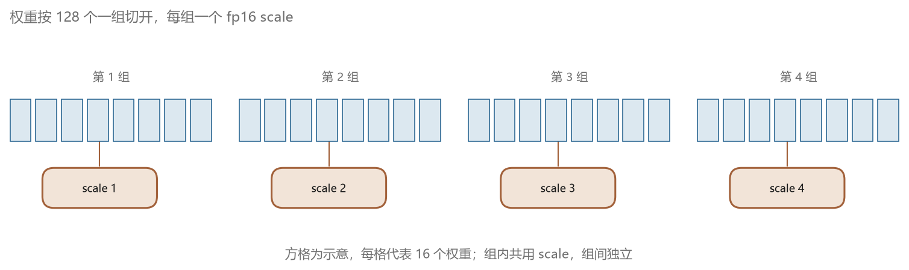
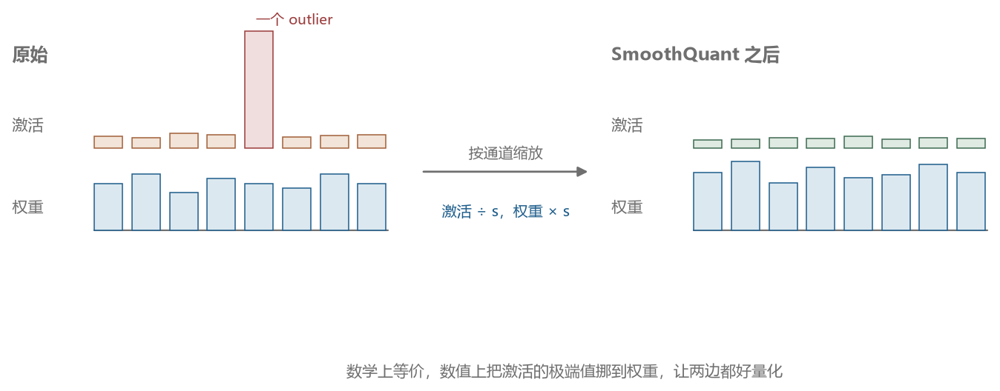

# 量化做到更低比特

int8 能把权重压到 fp32 的四分之一。一个 7B 模型从 28 GB 降到 7 GB，一张 24 GB 的卡就能放下，还能留出空间给 KV cache。但对更大的模型，或者更小的设备，7 GB 还是太多。于是有了 int4、fp8 和一堆带名字的方法。

位宽越低，问题越不是“怎么映射”，而是“怎么在信息损失很大的情况下，保住模型最关键的部分”。这一章讲低比特量化的几种做法，以及它们各自在赌什么。

## int4 与分组

int4 只有 16 个格点。一个通道的所有权重共用一个 scale，绝大多数权重会落到同一个格点上，量化误差大到无法接受。

解决办法是分组。把权重按每 128 个或每 64 个一组切开，每组一个 scale。组内的数值范围接近，scale 就能定得比较细。组越小，精度越高，scale 的存储开销也越大。一个 7B 模型，每组 128 个权重，scale 用 fp16 存，额外开销大约是 1/64，可以接受。

分组量化在计算时要把整数还原成浮点，再做矩阵乘。还原发生在什么时候，决定了它快不快。如果先反量化整个权重矩阵再算，显存带宽省了，但计算还是 fp16，速度提升主要来自带宽。如果边算边反量化，把权重留在低位格式，kernel 更复杂，但能省更多。这就是 weight-only 量化和 weight-activation 量化的区别。

weight-only 量化，比如 W4A16，权重存 int4，激活保持 fp16。矩阵乘时把 int4 反量化成 fp16，再走 Tensor Core。它的收益主要来自权重读取带宽，适合 decode 阶段这种每生成一个 token 都要读一遍全部权重的场景。weight-activation 量化，比如 W4A4，连激活也压到 4 位，收益更大，但精度更难保，硬件支持也更少。

## fp8 与微缩放

fp8 不是定点，它保留了指数，能表示很小的数。e4m3 的尾数有 3 位，精度比 int4 好，范围比 int8 宽，适合权重和激活。

fp8 的难点还是 outlier。一个张量里如果有一个特别大的值，per-tensor 的 scale 会被撑大，其余值的有效位数变少。解决办法有两个方向。

一个是**延迟缩放**。不直接用当前 batch 的最大值，而是用历史若干步的最大值，乘一个安全系数。这样 scale 不会因为某一步的偶然极值跳变，代价是要维护历史状态，冷启动时不稳定。

另一个是**微缩放**。把一个张量切成固定大小的块，每块一个 scale。MX 格式用 32 个元素一块，块内是 4 位的尾数，块外是一个 8 位的共享指数。NVIDIA 的 NVFP4 用 16 个元素一块，块内 4 位，块外一个 fp8 scale。块越小，越能跟上局部数值的变化，scale 的存储开销也越大。

微缩放把“一个张量一个 scale”变成“一个块一个 scale”，本质上是量化的粒度又细了一层。它需要硬件支持，否则反量化和缩放的开销会吃掉收益。

## 大模型量化的三条路

大模型量化有几个专门的方法，名字经常一起出现，解决的问题其实不同。

**SmoothQuant** 处理的是激活的 outlier。LLM 的激活里，少数通道的值比其余通道大几十倍，直接量化会让这些通道占满范围，其他通道精度尽失。SmoothQuant 做一个数学等价的变换，把激活的尺度迁移到权重上：

$$\hat{X} = X \,\mathrm{diag}(s)^{-1}, \quad \hat{W} = \mathrm{diag}(s)\, W$$

`s` 按通道计算，取值和激活、权重的最大值有关。变换之后，激活的 outlier 被压平，权重的范围变大但仍可量化。它主要面向 W8A8，让激活也能用 int8。

**GPTQ** 处理的是权重的量化误差。它逐层做，把一层权重量化完之后，用二阶信息（Hessian 的逆）估计剩余权重需要怎么调整，来补偿已经量化部分的误差。量化按列进行，每一列量化完就更新后面的列。它不需要反向传播，只需要一批校准数据，能在几个 GPU 小时内处理完一个几十 B 的模型。GPTQ 主要面向 W4A16，权重 4 位，激活保持 fp16。

**AWQ** 走的是另一条路。它观察到权重里有一小部分“显著”通道对输出影响很大，这些通道对应的激活也往往很大。与其均匀量化，不如按激活的幅度给通道乘一个缩放系数，保护显著权重。缩放系数通过网格搜索确定，不需要反向传播，也不需要 Hessian。AWQ 同样是 W4A16 路线。

三者不是互斥的。实际系统里可能先用 SmoothQuant 把激活压平，再用 GPTQ 或 AWQ 压权重；也可能只用其中一种，看模型和硬件。把它们当成“同一个量化问题的三种解法”，比当成三个可以随便替换的开关更准确。

## 激活与 KV cache 的量化

权重是静态的，可以慢慢校准；激活是动态的，每个请求都不一样。激活量化的难点在于范围不稳定。

对大模型，激活的 outlier 集中在少数通道，而且这些通道在不同 token 上相对稳定。per-channel 量化能缓解，但硬件对激活的 per-channel 支持不如权重普遍。per-token 量化是另一种思路，每个 token 一个 scale，适合处理不同 token 之间范围差异大的情况。

KV cache 的量化更值钱，因为它在长上下文下占的显存比权重还大。Key 和 Value 的分布不一样，Key 的 outlier 更明显，通常按通道量化；Value 相对平滑，可以按 token 量化。量化的误差会随着序列长度累积，因为每一步的注意力都要用到之前所有的 Key 和 Value。评估时不能只看短序列，要在目标长度上测。

KV cache 量化还有一个工程问题：分页之后，cache 被切成很多块，每块的 scale 怎么存、怎么取。per-tensor 最简单，一个请求一个 scale；per-token 要为每个 token 存一个 scale，元数据的开销要算进去。

## 低比特的边界

低比特不是免费的，边界主要在三个地方。

**硬件支持**。不是所有 GPU 都原生支持 int4 或 fp8 的矩阵乘。没有硬件支持，只能反量化回 fp16 再算，收益只剩带宽，算力没有变化。买卡之前要确认目标格式的通路。

**kernel 效率**。低位宽的 kernel 要处理打包、解包、scale 读取，指令数比 fp16 多。位宽降一半，kernel 不一定快一倍，可能只快 20%。分组越小，开销越大。很多低比特方案在理论上省了带宽，实际被反量化开销吃掉一半。

**精度与评估**。低比特的误差不是均匀的，可能集中在某些层、某些样本、某些长度上。评估要分层、分长度、分任务，不能只看一个平均指标。校准集也要覆盖真实分布，否则 scale 会偏。

低比特量化的趋势是把粒度做细、把格式做活，让模型在损失很小的情况下压到 4 位甚至更低。但每细一层，工程复杂度就多一层。选方案时，先问硬件支持什么，再问模型能忍多少误差，最后才看论文里的数字。

下一章换一个方向，不减少每个数的位宽，而是直接去掉一部分权重。
