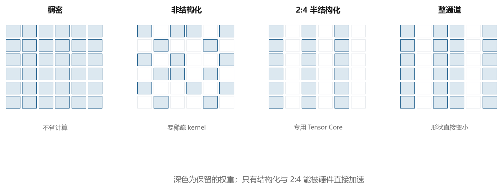

# 剪枝：从权重到通道

把一个训练好的模型里 60% 的权重置零，文件小了一半多，推理速度却几乎没变。这是剪枝最常见的第一课。稀疏矩阵在数学上省了计算，在 GPU 上却不一定省时间，因为 GPU 喜欢整齐的矩阵，不喜欢中间突然空出来的洞。

剪枝要真正变成速度，得让“去掉”这件事被硬件看见。去掉单个权重，硬件看不见；去掉一整个通道，硬件看得见；按固定模式去掉一半权重，专门为这种模式设计的 Tensor Core 也看得见。

这一章讲三种剪枝形态，以及它们各自怎么把稀疏变成速度。

## 非结构化剪枝

非结构化剪枝是最直接的做法：按绝对值大小排序，把小的权重置零。一层里 70% 的权重接近零，去掉它们对输出影响很小。

问题在于存储和计算。置零后的矩阵仍然按稠密矩阵存，零也占位置，显存没有省；矩阵乘仍然按稠密算，零也要参与乘加，计算没有省。除非用稀疏存储格式（比如 CSR）和稀疏 kernel，否则速度不会变。

稀疏 kernel 的效率取决于稀疏的分布。如果零是随机散的，每个非零元素的位置都要额外记录，访存不规则，GPU 的并行优势发挥不出来。有研究在特定稀疏度和矩阵形状下能做到几倍加速，但通用性差，换一个模型或形状就可能失效。

所以非结构化剪枝的主要价值，往往在压缩存储和后续的量化、蒸馏上，而不是直接加速。它也可以作为结构化剪枝的前置步骤，先看哪些权重不重要，再决定剪哪些通道。

## 结构化剪枝

结构化剪枝去掉的是整块结构：整个输出通道、整个注意力头、整个层。去掉之后，矩阵的形状真的变小了，计算量真的变少，不需要稀疏 kernel 也能加速。

通道剪枝是最常见的一种。一个卷积层的输出通道被删掉，后面的层对应的输入通道也要跟着删，否则形状对不上。这种连锁关系让剪枝变成一个全局问题，不能一层一层独立决定。

结构化剪枝的收益直接，但代价是精度。去掉一个通道，等于去掉一组特征，模型的可表达性下降。剪得少，精度掉一点；剪得多，精度断崖。实际项目里通常逐步剪，每次剪一小部分，再微调恢复，重复几轮。

结构化剪枝还有一个工程约束：剪完之后通道数可能不再是 8 或 16 的倍数，Tensor Core 的对齐要求不满足，速度反而变慢。所以剪枝时通常按 8、16、32 的倍数剪，牺牲一点压缩率，换 kernel 的效率。

## 2:4 半结构化

2:4 稀疏是一个折中。它要求每 4 个连续权重里最多保留 2 个非零，稀疏度固定为 50%，模式固定，硬件可以专门加速。

NVIDIA 的 Ampere 及之后的 Tensor Core 支持这种模式，理论算力是稠密的两倍。编译器把权重按 2:4 模式压缩，kernel 在矩阵乘时跳过零，实际速度提升取决于稀疏模式和形状是否匹配。

2:4 的约束很强。不是所有层都能自然满足这个模式，需要通过训练或剪枝让权重适应。剪枝时通常按每 4 个一组，保留绝对值最大的两个，再微调。精度损失比非结构化剪枝大，比结构化剪枝小。

它的收益也不是无条件的。只有矩阵乘走 Tensor Core 的稀疏通路，才有两倍算力；逐元素算子、归一化、注意力里的 softmax 不受益。端到端能快多少，要看矩阵乘占多大比例。

## 重要性怎么定

剪哪些权重、哪些通道，需要一个重要性度量。

最简单的是**绝对值**。权重越小，越不重要。它对非结构化剪枝很有效，对通道剪枝就不够，因为一个通道里可能有很多小权重，但整体很重要。

**BN 缩放因子**是通道剪枝常用的度量。BN 层里每个通道有一个缩放系数 `γ`，训练时如果某个通道不重要，`γ` 会趋近于零。按 `|γ|` 排序，剪掉最小的通道，简单有效。前提是模型里有 BN，且训练时没有对 `γ` 加太强的正则。

**梯度**和**Hessian** 能更准确地估计去掉一个权重对损失的影响，但计算代价高。**运动剪枝**（movement pruning）在微调过程中根据权重远离零的速度判断重要性，适合大模型。

**敏感度分析**是另一种思路。一次只剪一层，看指标掉多少，掉得少的层多剪，掉得多的层少剪。它不直接给每个权重打分，而是给每一层一个可剪比例，工程上很好用。

## 剪枝与重训练

剪枝很少一次完成。一次剪太多，模型没有足够的冗余恢复，精度会崩。常见做法是迭代剪枝：剪一小部分，微调几个 epoch，再剪，再微调，直到达到目标稀疏度。

微调的数据不需要很多，但分布要和任务一致。剪枝改变了模型的表示，微调是让它重新适应。学习率通常比原始训练小，训练轮数也少，避免过拟合。

彩票假说提出，稀疏网络里存在一个“中奖彩票”子网络，从头训练也能达到和原网络相近的精度。这个发现激发了大量研究，但在实际部署里，找到一个稳定可复现的中奖彩票仍然不容易。它更多是一个理解稀疏性的视角，不是一个现成的压缩流程。

## 剪枝的边界

剪枝能不能用，取决于三件事。

精度能不能接受。结构化剪枝的精度损失通常比量化大，尤其是剪得深的时候。剪枝和量化可以叠加，但叠加之后的误差不是简单相加，要一起评估。

硬件能不能受益。非结构化剪枝在通用 GPU 上很难加速，2:4 需要特定 Tensor Core，结构化剪枝最通用。选剪枝方式之前，先看目标硬件支持什么。

维护成本高不高。剪枝后的模型结构变了，权重形状变了，导出、量化、部署的每一步都要重新适配。剪枝比例、通道选择、微调策略都是超参数，换一个模型就要重新调。它不像量化那样有一套相对标准化的流程。

剪枝和量化经常一起用。先剪枝去掉冗余结构，再量化压缩剩余的权重，两个方向的收益可以叠加。但顺序有讲究，先剪后量通常更容易，因为剪枝后的模型更小，校准和微调的成本更低。

下一章讲另外两种压缩方式，低秩分解和蒸馏，它们不删权重，而是换一种表示。
