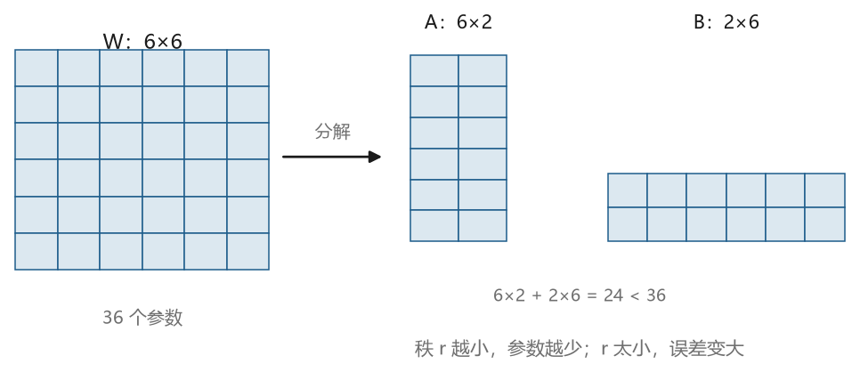

# 低秩、蒸馏与稀疏

一个 4096×4096 的线性层有 1600 多万个参数，fp16 下 32 MB。把它做奇异值分解，只保留前 256 个奇异值，可以用两个 4096×256 的矩阵近似，参数量降到 200 万，少了八分之七。如果这个层的权重本来就接近低秩，精度几乎不掉；如果它承载了复杂的关系，近似会丢掉关键信息。

低秩分解、蒸馏、稀疏，这三种方法和剪枝、量化一样，都是在“用更少的资源表达同样的东西”。区别在于它们动的不是单个数的位宽，也不是单个权重，而是模型的结构和训练方式。

## 低秩分解

矩阵 `W` 的奇异值分解写成：

$$W = U \Sigma V^T$$

`U` 和 `V` 是正交矩阵，`Σ` 是对角矩阵，对角线上的奇异值从大到小排列。只保留前 `r` 个奇异值，得到 `W_r = U_r Σ_r V_r^T`，用两个矩阵 `A = U_r Σ_r^1/2` 和 `B = Σ_r^1/2 V_r^T` 表示，`W ≈ AB`。

原来一个 `M × N` 的矩阵有 `MN` 个参数，分解后是 `M r + r N` 个。当 `r` 远小于 `M` 和 `N` 时，参数量和计算量都大幅下降。一个 4096×4096 的层，秩 256 分解后是 `4096 × 256 × 2`，约 200 万参数，计算量也从 `M N` 次乘加变成 `r(M+N)` 次。

低秩能不能用，取决于权重的奇异值分布。如果奇异值衰减很快，前几个就占了大部分能量，低秩近似误差小；如果衰减很慢，说明权重在各个方向上都有信息，强行降秩会丢很多。实际模型里，注意力层的投影矩阵往往比 FFN 层更容易低秩，因为前者更接近一个受约束的变换。

## 卷积的低秩

卷积也可以低秩分解，方式更多。

**空间可分离**是把一个 `k × k` 的卷积核拆成 `k × 1` 和 `1 × k` 两个核，先横着卷再竖着卷。参数量从 `k^2` 降到 `2k`，计算量也降。但不是所有卷积核都能这样拆，只有那些近似可分离的才可以。

**通道低秩**是把输入通道到输出通道的映射矩阵做低秩分解，中间插入一个瓶颈层。一个 `C_in → C_out` 的卷积，变成 `C_in → r` 和 `r → C_out` 两个卷积，`r` 小于两者。这和 1×1 卷积的瓶颈结构很像，MobileNet 的倒残差块就是这种思路。

**张量分解**把卷积核看成四维张量，用 CP 分解或 Tucker 分解降低秩。表达能力强，但实现复杂，部署工具支持有限。

低秩分解的工程难点在于，分解后的结构要能被推理引擎识别和优化。两个连续的卷积如果中间没有非线性，引擎可能会把它们合并回去；如果有非线性，引擎要分别处理，额外的 kernel 启动和中间张量会吃掉一部分收益。

## 低秩与 LoRA 的关系

LoRA 也是低秩，但它不是为了压缩，而是为了微调。它冻结原权重，额外训练两个低秩矩阵 `A` 和 `B`，把增量 `BA` 加到原权重上。推理时可以把 `BA` 合并进 `W`，不增加延迟。

低秩分解是“用一个低秩矩阵近似原矩阵”，LoRA 是“在原矩阵上加一个低秩增量”。前者会损失信息，后者不会，因为原权重还在。两者的数学形式相似，目的完全不同。把 LoRA 当成压缩方法，是一个常见的误解。

## 蒸馏

蒸馏用一个大的教师模型教一个小的学生模型。教师输出的不是硬标签，而是每个类别的概率分布，分布里包含类别之间的相似性，比如一张猫的图，教师可能给“猫”0.8，“狗”0.15，“狐狸”0.03。这些相对关系比硬标签信息更多。

损失函数通常写成两部分：

$$L = \alpha L_{\mathrm{CE}}(y, p_s) + (1-\alpha) T^2 L_{\mathrm{KL}}(p_t^{(T)}, p_s^{(T)})$$

`p_s` 是学生输出，`p_t` 是教师输出，`T` 是温度，用来软化分布。温度越高，分布越平滑，类别之间的相对关系越明显。`T^2` 是为了让梯度量级和第一项匹配。

蒸馏的收益来自学生模型的结构更小，推理更快。它不改变数值格式，也不删权重，而是换一个模型。学生模型可以比教师小很多，但精度通常达不到教师，能接近多少取决于任务和蒸馏方法。

除了输出蒸馏，还有特征蒸馏，让学生中间层的特征逼近教师的中间层，TinyBERT 是这一类。特征蒸馏对小模型更有效，因为小模型的容量有限，光靠输出分布不够。

## 稀疏与稀疏训练

稀疏和剪枝有重叠，但角度不同。剪枝是训练完之后去掉权重，稀疏训练是在训练过程中就让权重变稀疏。

常见做法是加 L1 正则，让权重趋向零；或者用稀疏掩码，每训练几步把最小的权重置零，再继续训练。稀疏训练能让模型在稀疏状态下重新收敛，精度通常比事后剪枝好，但训练成本高。

2:4 稀疏需要专门的训练流程，让权重在每 4 个一组里保持 2 个非零。NVIDIA 的 ASP（Automatic SParsity）提供了工具，但模型是否适合 2:4，要看权重的分布。有些层剪到 50% 稀疏度精度就崩，有些层几乎无损。

## 组合与边界

这几种方法可以组合。先蒸馏得到一个小模型，再量化；先低秩分解，再微调，再量化；先剪枝，再蒸馏恢复。组合的收益不一定相加，因为每种方法都在去掉冗余，冗余去掉之后，下一种方法的操作空间就小了。

边界也很清楚。低秩分解需要权重本身冗余，蒸馏需要有一个好教师和足够的数据，稀疏训练需要时间和算力。它们都不像量化那样可以套一个标准流程，每一步都要针对模型调。

下一章进入服务层，看批处理和 KV cache 怎么把单次推理的成本摊薄。
