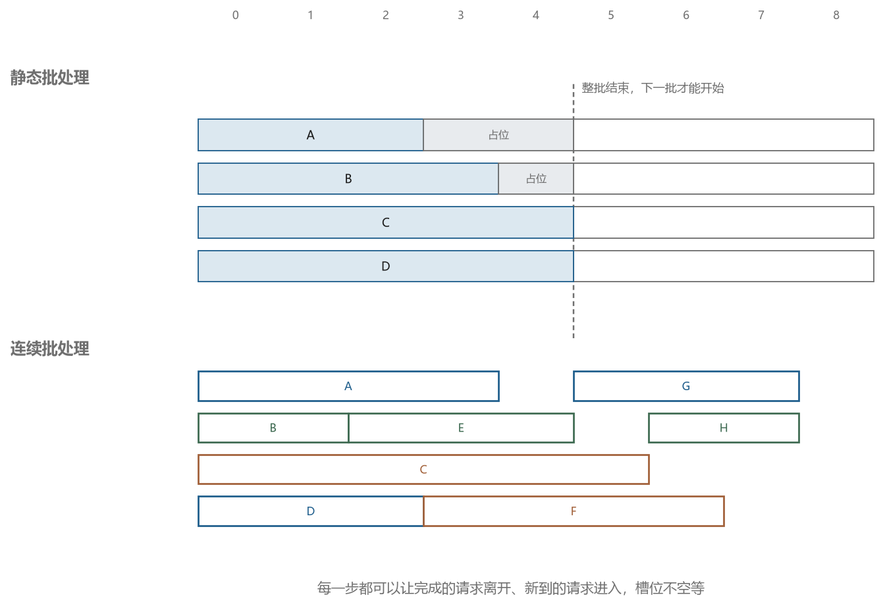

# 批处理与 KV cache

十个用户几乎同时发来请求，每个请求要生成一段不同长度的文字。服务器的第一反应是把它们凑成一批，一起送进模型。第一批跑完，八个请求结束了，两个还在生成。这两个请求是继续占着一整批的算力，还是等下一批？等，它们的延迟变长；不等，GPU 的利用率掉下来。

大模型服务里，批处理不是一个“攒够八个再算”的简单策略。请求的长度不同、到达时间不同、结束时间不同，KV cache 的大小也不同。调度器要在延迟、吞吐和显存之间不断做选择。这一章讲这些选择背后的机制。

**批处理**（batching）的意思是把多个请求凑在一起算，让一次 GPU 计算服务多个用户。这个类比可以想成公交车：一趟车拉的是一群人，而不是一个人；人越多，平均到每个人身上的成本越低，但每个人都要等车凑够人。

## 静态批处理

静态批处理是最早的做法。凑够固定数量的请求，或者等一个固定时间窗口，把它们组成一批，补齐到相同长度，一起送进模型。整批跑完，再处理下一批。

它的好处是实现简单，GPU 的矩阵乘效率高，因为 batch 维度是满的。坏处是**填充浪费**和**尾效应**。短请求被 padding 到最长请求的长度，多出来的计算全是零；一批里只要有一个长请求，其他请求都要等它跑完才能返回。**padding** 就是往短序列后面补占位符号，让所有序列一样长。

填充浪费有多严重，取决于长度分布的离散程度。如果一批里有 10 条请求，长度分别是 50、55、60 一直到 500，那么所有短请求都被拉长到 500，实际有效计算可能只有三成。这些无效计算不产生任何有用的结果，只是为了让矩阵形状整齐。

尾效应是另一个问题。一批里最长的那个请求决定整批的完成时间，其他请求即使早就生成完了，也要陪它等到最后一刻。这在生成任务里尤其明显：短请求生成 20 个 token 就结束，长请求要生成 500 个，二十倍的时间差，全部由最短的请求承担。

在图像模型里，这个问题不大，因为输入尺寸通常固定，一批跑完就结束。在生成模型里，问题被放大，因为每个请求要生成多少 token 事先不知道，短请求早就结束了，却还要陪着长请求占着位置。

静态批处理还有一个隐性问题：批大小和延迟目标绑定得太紧。批大，吞吐高，但单请求等待久；批小，延迟好，但吞吐低。要改这个平衡，得改配置重启服务。线上流量随时在变，一个固定配置很难两头都顾。一个实际的做法是按业务分池：交互式请求用小 batch 保延迟，批处理任务用大 batch 保吞吐，两池各自调优，互不干扰。这个思路在后面讲 PD 分离时还会出现，只是那时候分的是阶段而不是业务类型。静态批处理的另一个限制是它无法应对突发：一批已经开始了，新来的请求只能等下一批，即使 GPU 还有余力。高并发场景下，这个“等下一批”的时间可能比计算本身还长。

## 连续批处理

连续批处理换了一个调度单位：不是一批请求，而是一次前向。每一步，调度器看哪些请求还在生成，把它们的当前 token 组成一批，跑一次前向，然后让完成的请求离开，让新到的请求加入。**连续批处理**（continuous batching）这个名字强调的是“连续地进出”，而不是“凑成一批再跑”。

这样 GPU 每一步都是满的，短请求结束就释放位置，长请求继续跑，新请求不用等整批结束。吞吐上去了，短请求的延迟也下来了。这个机制现在几乎是所有大模型推理系统的默认配置，因为它同时改善了吞吐和延迟，没有明显的取舍。

代价是调度复杂。每步都要重新组 batch，KV cache 要能动态分配和回收，不同请求的序列长度不同，注意力计算要处理变长。连续批处理通常和分页 KV cache 一起用，才能把显存碎片控制住。

生成模型的一次请求分两个阶段。**prefill** 是把整段输入 prompt 一次算完，建立 KV cache，计算量大，适合并行；**decode** 是逐 token 生成，每次只算一个 token，计算量小，主要受显存带宽限制。两个阶段的资源需求不同，混在一起调度会让 GPU 一会儿闲一会儿忙。prefill 阶段是算力瓶颈，decode 阶段是带宽瓶颈，同一个 kernel 面对这两种负载，效率完全不同。

**chunked prefill** 把长 prompt 切成几块，和 decode 交错执行，避免一个长 prefill 把其他请求堵住。**chunked** 就是“分块”的意思。一个 32K token 的 prompt，如果一口气 prefill，可能要占住 GPU 几百毫秒，期间所有 decode 请求都停下来，用户感觉像卡住了；切成 8 块，每块之间插几次 decode，其他请求就能持续推进，整体体验好得多。

chunked prefill 还有一个副作用：它把一个长 prompt 拆成多段，每段都要读写一次 KV cache 的部分内容，额外开销不可避免。块的粒度要权衡：块太大，插不进去；块太小，开销大。一个经验值是每块几百个 token，和硬件带宽、模型大小都有关系。这个参数往往需要实测，因为它影响的是流水线的平稳度，而不是单个指标。

## KV cache 的账

Transformer 生成第 `t` 个 token 时，要回头看一眼之前所有 token 的 Key 和 Value。这些 Key 和 Value 算过一次就不再变，缓存起来，避免重复计算。这就是 KV cache。**Key** 和 **Value** 是注意力里每个位置算出的两组向量，可以理解成“这个位置能被怎么找到”和“找到之后能提供什么信息”。

它的显存占用是：

$$\mathrm{bytes} = 2 \times n_{\mathrm{layer}} \times n_{\mathrm{kv}} \times d_{\mathrm{head}} \times n_{\mathrm{token}} \times b$$

`n_kv` 是 Key/Value 的头数。标准多头注意力里它等于头数；分组查询注意力（GQA）里它小于头数，因为多个查询头共享一组 Key/Value。GQA 能显著降低 KV cache，代价是表达能力略降，很多新模型默认用它。

公式里每一项都有明确的含义。前面的 2 是 Key 和 Value 各一份；`n_layer` 是层数，每一层都要存自己的 cache；`n_kv × d_head` 是这一层每个 token 的向量长度；`n_token` 是序列长度；`b` 是字节数。乘法关系意味着，任何一项翻倍，显存就翻倍。

一个 32 层、32 个 KV 头、头维 128 的 7B 模型，序列 4096，fp16 下每个请求约 2 GB。并发 16 个就是 32 GB。如果上下文拉到 32K，单个请求就 16 GB，一张 80 GB 的卡也放不下几个。这些数字说明一件事：在长上下文场景里，KV cache 不是“顺便占一点”，而是显存的主要支出，比权重还多。

KV cache 还有碎片问题。每个请求的长度不同，如果按最大长度预分配，短请求会浪费大量空间；如果按需分配，频繁的申请和释放会产生碎片，最后明明有空间却分配不出连续块。分页解决的就是这个问题。

碎片有多浪费？假设最大长度 8K，平均长度 500，按最大长度预分配，浪费超过九成。这个浪费还会随最大长度上升而加剧，因为平均长度往往跟不上最大长度。这意味着你花大价钱买的显存，九成在闲置。这也是为什么分页几乎成了必选项，而不是可选的优化。

还有一个容易被忽略的开销：KV cache 的读写。decode 阶段每个 token 都要把整个 cache 读一遍，这个读的量随长度线性增长。所以长上下文不仅吃显存，还吃带宽，两者的压力叠在一起，才是长上下文服务真正的难点。所以长上下文不能只靠“把长度参数调大”来支持，还需要专门的分块注意力实现。

## 分页与共享

PagedAttention 把 KV cache 切成固定大小的块，比如每块存 16 个 token。每个请求维护一张块表，逻辑上连续的 token 可以放在物理上不连续的块里。写满一块再申请下一块，不需要预分配最大长度。**块表**记录“逻辑第几块 → 物理第几块”，和操作系统的页表是同一个思路。

块表让显存分配变得像操作系统的虚拟内存：按需、离散、可共享。两个请求如果有相同的 prompt 前缀，可以共享前缀对应的块，只复制引用计数，不复制数据。多轮对话、few-shot 提示、系统提示词很长的场景，前缀共享能省下大量显存。**引用计数**是“有多少人在用这块”的计数，减到零才真正释放，避免一个请求结束时把别人还在用的块删掉。

前缀共享的收益有多真实？设想一个客服系统，每条请求前面都有 2000 token 的系统提示词。没有共享时，100 个并发请求要存 20 万个 token 的 cache；有共享时，系统提示词只存一份，省下的显存可以接更多请求，或者让每个请求的上下文更长。这类场景在前缀复用的业务里非常常见。

块也有开销。块越小，碎片越少，但块表越长，寻址开销越大；块越大，寻址简单，但最后一个块可能浪费。块大小是一个需要按模型和工作负载调的参数。经验值是 16 到 64 个 token，太小则表项爆炸，太大则尾部浪费明显。

当显存不够时，调度器要决定换出哪些块。可以换到主机内存，需要时再换回来；也可以直接丢弃，之后重新计算。**换出**（swap）的代价是 PCIe 传输，**重算**（recompute）的代价是算力。哪个便宜，取决于序列长度和带宽。一般来说，短请求重算便宜，长请求换出更划算。还有第三种选择：直接拒绝。当显存实在不够时，把新请求挡在外面比让它把已有请求拖下水更划算，至少已经进来的请求能跑完。拒绝的代价是短痛，雪崩的代价是全站不可用，两者不在一个量级上。

## 调度指标

批处理和 KV cache 的调度，最终要落到几个指标上。

**TTFT** 是首 token 延迟，主要受 prefill 和排队影响。**TPOT** 是每 token 延迟，主要受 decode 的批大小和显存带宽影响。**吞吐**是每秒生成的 token 数，和批大小正相关。**显存占用**决定能并发多少请求。

这四个指标互相牵制。加大 batch 提高吞吐，但 TTFT 和 TPOT 都会变长；分页减少碎片，但增加寻址开销；前缀共享省显存，但需要维护引用计数和哈希表。

线上服务通常设一个 SLO，比如 TTFT 小于 500 毫秒、TPOT 小于 50 毫秒，然后在满足 SLO 的前提下最大化吞吐。**SLO**（service level objective）是服务等级目标，是对用户承诺的性能底线。调度器的参数，比如最大 batch、最大并发、块大小、prefill 和 decode 的比例，都是围绕这个目标调的。

没有一个通用的最优配置。模型大小、序列长度分布、请求到达模式、硬件规格，任何一个变了，配置都要重调。一个实用的做法是把这些参数做成可热更新的，并且在压测环境里维护一套“当前流量下最优配置”的对照表，流量形态变化时按表切换。

调参的时候有一个常见的误区：盯着平均延迟。平均延迟好看，可能只是因为短请求多；用户的抱怨往往集中在长请求和高峰期，那部分正好是尾延迟。所以看调度效果，P99 的 TTFT 和 TPOT 比平均值重要得多。前者衡量“第一个人什么时候开口”，后者衡量“中间会不会卡”，两个都关系到用户会不会中途关掉页面。

最后一个实践提醒：调度参数的两个方向不能同时优化。想提高吞吐就得接受更长的排队，想降低延迟就得接受更低的利用率。先把目标定清楚，再去调参数，否则很容易在两者之间来回折腾，最后两头都不满意。一个有用的习惯是把目标写成一个具体句子，比如“高峰期 P99 的 TTFT 不超过 1 秒，其他指标尽力而动”，有了这句，很多争论自然就消了。

下一章把这些机制放进一个完整的服务里，看请求从进来到返回经历了什么。
