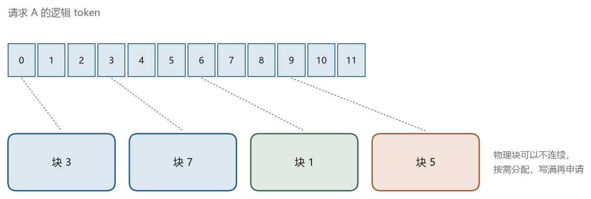

# 批处理与 KV cache

十个用户几乎同时发来请求，每个请求要生成一段不同长度的文字。服务器的第一反应是把它们凑成一批，一起送进模型。第一批跑完，八个请求结束了，两个还在生成。这两个请求是继续占着一整批的算力，还是等下一批？等，它们的延迟变长；不等，GPU 的利用率掉下来。

大模型服务里，批处理不是一个“攒够八个再算”的简单策略。请求的长度不同、到达时间不同、结束时间不同，KV cache 的大小也不同。调度器要在延迟、吞吐和显存之间不断做选择。这一章讲这些选择背后的机制。

## 静态批处理

静态批处理是最早的做法。凑够固定数量的请求，或者等一个固定时间窗口，把它们组成一批，补齐到相同长度，一起送进模型。整批跑完，再处理下一批。

它的好处是实现简单，GPU 的矩阵乘效率高，因为 batch 维度是满的。坏处是**填充浪费**和**尾效应**。短请求被 padding 到最长请求的长度，多出来的计算全是零；一批里只要有一个长请求，其他请求都要等它跑完才能返回。

在图像模型里，这个问题不大，因为输入尺寸通常固定，一批跑完就结束。在生成模型里，问题被放大，因为每个请求要生成多少 token 事先不知道，短请求早就结束了，却还要陪着长请求占着位置。

## 连续批处理

连续批处理换了一个调度单位：不是一批请求，而是一次前向。每一步，调度器看哪些请求还在生成，把它们的当前 token 组成一批，跑一次前向，然后让完成的请求离开，让新到的请求加入。

这样 GPU 每一步都是满的，短请求结束就释放位置，长请求继续跑，新请求不用等整批结束。吞吐上去了，短请求的延迟也下来了。

代价是调度复杂。每步都要重新组 batch，KV cache 要能动态分配和回收，不同请求的序列长度不同，注意力计算要处理变长。连续批处理通常和分页 KV cache 一起用，才能把显存碎片控制住。

生成模型的一次请求分两个阶段。**prefill** 是把整段输入 prompt 一次算完，建立 KV cache，计算量大，适合并行；**decode** 是逐 token 生成，每次只算一个 token，计算量小，主要受显存带宽限制。两个阶段的资源需求不同，混在一起调度会让 GPU 一会儿闲一会儿忙。**chunked prefill** 把长 prompt 切成几块，和 decode 交错执行，避免一个长 prefill 把其他请求堵住。

## KV cache 的账

Transformer 生成第 `t` 个 token 时，要回头看一眼之前所有 token 的 Key 和 Value。这些 Key 和 Value 算过一次就不再变，缓存起来，避免重复计算。这就是 KV cache。

它的显存占用是：

$$\mathrm{bytes} = 2 \times n_{\mathrm{layer}} \times n_{\mathrm{kv}} \times d_{\mathrm{head}} \times n_{\mathrm{token}} \times b$$

`n_kv` 是 Key/Value 的头数。标准多头注意力里它等于头数；分组查询注意力（GQA）里它小于头数，因为多个查询头共享一组 Key/Value。GQA 能显著降低 KV cache，代价是表达能力略降，很多新模型默认用它。

一个 32 层、32 个 KV 头、头维 128 的 7B 模型，序列 4096，fp16 下每个请求约 2 GB。并发 16 个就是 32 GB。如果上下文拉到 32K，单个请求就 16 GB，一张 80 GB 的卡也放不下几个。

KV cache 还有碎片问题。每个请求的长度不同，如果按最大长度预分配，短请求会浪费大量空间；如果按需分配，频繁的申请和释放会产生碎片，最后明明有空间却分配不出连续块。分页解决的就是这个问题。

## 分页与共享

PagedAttention 把 KV cache 切成固定大小的块，比如每块存 16 个 token。每个请求维护一张块表，逻辑上连续的 token 可以放在物理上不连续的块里。写满一块再申请下一块，不需要预分配最大长度。

块表让显存分配变得像操作系统的虚拟内存：按需、离散、可共享。两个请求如果有相同的 prompt 前缀，可以共享前缀对应的块，只复制引用计数，不复制数据。多轮对话、few-shot 提示、系统提示词很长的场景，前缀共享能省下大量显存。

块也有开销。块越小，碎片越少，但块表越长，寻址开销越大；块越大，寻址简单，但最后一个块可能浪费。块大小是一个需要按模型和工作负载调的参数。

当显存不够时，调度器要决定换出哪些块。可以换到主机内存，需要时再换回来；也可以直接丢弃，之后重新计算。换出的代价是 PCIe 传输，重算的代价是算力。哪个便宜，取决于序列长度和带宽。

## 调度指标

批处理和 KV cache 的调度，最终要落到几个指标上。

**TTFT** 是首 token 延迟，主要受 prefill 和排队影响。**TPOT** 是每 token 延迟，主要受 decode 的批大小和显存带宽影响。**吞吐**是每秒生成的 token 数，和批大小正相关。**显存占用**决定能并发多少请求。

这四个指标互相牵制。加大 batch 提高吞吐，但 TTFT 和 TPOT 都会变长；分页减少碎片，但增加寻址开销；前缀共享省显存，但需要维护引用计数和哈希表。

线上服务通常设一个 SLO，比如 TTFT 小于 500 毫秒、TPOT 小于 50 毫秒，然后在满足 SLO 的前提下最大化吞吐。调度器的参数，比如最大 batch、最大并发、块大小、prefill 和 decode 的比例，都是围绕这个目标调的。

没有一个通用的最优配置。模型大小、序列长度分布、请求到达模式、硬件规格，任何一个变了，配置都要重调。下一章把这些机制放进一个完整的服务里，看请求从进来到返回经历了什么。
